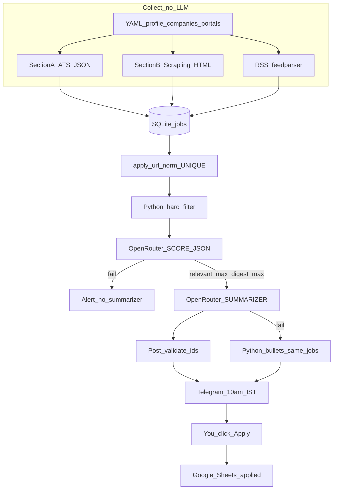

# SUPERSEDED — do not implement from this file

**New source of truth:** [job_digest_sota_post_i6.plan.md](job_digest_sota_post_i6.plan.md)

This file assumed a **greenfield** repo and **Hermes cron on a VPS** with SQLite as the only store. I1–I6 are already in `c:\Projects\Job_Hunt`. I7 is GitHub Actions + Neon Postgres + Telegram Bot API. Hermes, OpenWA, and a required Dockerfile are void.

Archive text below is historical only.

# Job digest pipeline (agent source of truth)

This plan is **archive**. Workspace [`c:\Projects\Job_Hunt`](c:\Projects\Job_Hunt) is **not** empty.

Fix-pass (summarizer restored, architecture + easy build steps): [summarizer spec](2a00e0a5-b5cc-4351-94a7-4a7a9ac4f552), [easy steps](08b95a00-e3f8-4d81-bbbd-c4ecaa023659), [architecture nuances](f282ea7d-ed48-455a-9647-be621bfa358a).

Earlier research/reviews still apply for ATS/Scrapling/Hermes/SQLite details: [ATS](52524610-591f-4c6a-ac83-15c97c80189a), [Scrapling](be6c49c0-2aa1-4667-b1b5-36e4f2823da9), [Hermes](428bef8d-9d58-4e15-8edf-ca990f4df651), [SQLite](c62c3e65-0b07-433b-8258-71865726104e), [I1](33774d7c-774c-4c69-97ed-20c36b8f7b5f), [I2](1963fbc8-406c-4af4-aeb9-348e5cb2a98b), [I3](8c6ba507-5f0d-46db-acbf-d25901ffe03b), [I5](83c9ace9-b982-4b8a-aa64-922da57bcb4d), [I6–I7](f4950379-292a-4dce-8ac5-fe8cc6250f49). **I4 Python-only digest is VOID.** Two OpenRouter calls are required.

---

## How the pieces fit (plain English)

YAML lists **who you are**, **which companies**, **which websites**. Secrets live in `.env`, not GitHub. Every few hours **collect** (no AI) pulls company job JSON, one scrape loop, and RSS into **one** SQLite table. The same apply link, after cleaning (`apply_url_norm`), is one job forever. Cheap Python rules drop senior / US-only / junk **before** any model. A **SCORE** model answers yes/no in JSON (the bouncer). A **SUMMARIZER** model writes the morning Telegram from those yes-rows only (the news anchor who may only read the guest list). Hermes sends it at **10:00 Asia/Kolkata**. Google Sheets is what you **already applied to**, not a dump of every listing. You click Apply yourself.

---

## Architecture (locked)

**Scorer = bouncer. Summarizer = news anchor who can only read the guest list.** Collect does not call a model. The summarizer does not fetch URLs and does not invent jobs. If the summarizer dies, Python sends the **same** guest list as bullets with links. That fallback is not the happy path.



**What runs when**

- Every **6 hours:** collect A + B + RSS. `flock` so two collects cannot overlap. Hermes `--no-agent`. Telegram **only if collect failed**.
- **10:00 Asia/Kolkata:** score (new pass-rows) then summarizer then Telegram. Silent (no message) **only** if collect succeeded and there is nothing new.
- **When you apply:** `sheet-append`. Collect/score/digest never write the sheet.

**Hermes vs Python vs Docker**

- Python is the cook (fetch, filter, both LLM HTTP calls).
- Hermes is the alarm clock and mailman (`--no-agent`). Do not let Hermes browse or scrape.
- Optional Compose image is Chromium-free Python for fetch/score. **Hermes stays on the VPS as systemd, not a container.**

---

## Locked decisions

- **Product:** daily intern/new-grad India digest. Not auto-apply. Not a 100-MNC Workday crawler.
- **Package:** `jobdigest`. Folder may stay `Job_Hunt`. Python `>=3.11`, CI 3.12. `pyproject.toml` only.
- **Hunt in YAML.** No personal name in Python.
- **SQLite** = jobs source of truth. **Sheets** = applied CRM only.
- **Section A:** Greenhouse, Lever, Ashby, Workable public JSON. Workday skip. Getro skip until unauthenticated XHR exists.
- **Section B:** one Scrapling `FetcherSession` loop. No `StealthyFetcher`. No Chromium in default image. RSS via `feedparser`.
- **Dedupe** `apply_url_norm` before any LLM.
- **Hard filters in Python** before OpenRouter.
- **Two LLMs in v1 (required):** SCORE then SUMMARIZER. Pin both in [`config/models.yaml`](config/models.yaml). Paid ids only; refuse `*:free`. Python template = **fallback only**.
- **Telegram 10:00 Asia/Kolkata.** Cron `0 10 * * *` with `TZ=Asia/Kolkata`. UTC host: **`30 4 * * *`**, never `0 4 * * *` (09:30 IST).
- Empty market vs outage: silent only after successful collect with nothing new.

---

## Life of one job

1. Collect (6h, no LLM) hits Greenhouse `.../jobs?content=true` with `User-Agent: JobHunt/0.1 (+repo URL)`, 20–30s timeout, 200–400ms jitter, honor `Retry-After`.
2. Map to `NormalizedJob`. **404/410 = dead token** (rot). **200 + empty list = empty board** (alive, nothing posted). 403/5xx/timeout = error. Never call an unimplemented adapter `empty_board`.
3. Upsert `jobs`. Same cleaned URL from Hasjob later → one row. Synthetic `ats://source/external_id` **only if `external_id` is set**; never clickable. Two URL-less empty-id rows must not collide.
4. Hard filter: India in title or location or first 2k of JD. **Empty location + Bangalore in JD = pass.** Empty location + no India = reject. Intern titles **or** new-grad-broad (SDE 1, Software Engineer, GET, Fresher, 0–1 years) if India and not staff and not 3+. Do not treat “0–3 years” as 3+.
5. 10am SCORE: only `hard_status=pass`, unscored for current model+prompt_version, not already applied. Strip HTML, cap ~3000 chars, fence `<<<JOB id=N>>>`, untrusted. Strict JSON. Drop unknown ids.
6. SUMMARIZER gets **only** `{id, company, title, location, url, score, why}`, max 12. Must not fetch, invent, or drop links. Post-validate ids; restore URLs from payload; discard invented cards. Score fail → **no summarizer**, alert. Summarizer fail → Python bullets of the **same** list.
7. You apply. Then Sheets one row. **No auto-apply.**

---

## Nuance checklist (do not skip)

- Profile blurb in **both** system prompts. No resume file, no name/CGPA in the user blob. Load `.env` in Python; Hermes cron **does not inherit** `OPENROUTER_API_KEY`.
- JD HTML can jailbreak: strip, cap, fence, ignore instructions inside the fence. Never send `raw_json` to either model. Telegram: plain text, not HTML parse mode.
- Summarizer post-validate: every card id must be on the guest list; drop extras; if prose has zero payload jobs but guest list was non-empty → fallback.
- `digest_max` 12. Hermes `--deliver telegram` is one payload (~3500 chars). Over 3800: Python Bot API split, then empty stdout so Hermes does not double-send.
- Lever: paginate `limit=100` + `skip` or you drop the tail; sleep between pages; `createdAt` is epoch **milliseconds**. Greenhouse content often needs **two** `html.unescape` passes. Ashby names are case-sensitive.
- Scrapling: 1 GET / 3–5s / hostname; adaptive selectors **off**; do not `scrapling[fetchers]` or `scrapling install`. Per-portal errors continue. Challenge page → disable that portal, do not StealthyFetcher.
- Kill / never scrape as primary: Otta; huggingface.co/jobs (GPU compute); HF/LangChain Inc ATS (US/EMEA); Underdog; CronJobs USA; Discord/Slack/WA; LinkedIn login; LLMHire/Perik/EngRadar as primary; unfiltered Accel Getro; jobs.punestartups.org; Workday; auto-apply.
- Hugging Face Workable stays `enabled: false`. Stripe/Atlassian/Databricks may stay enabled after token probe; **I3 filter** keeps India intern/new-grad.
- Never git: `.env`, `jobs.db`+WAL/SHM, Google JSON, cookies, chat ids.

---

## Repo tree (end state)

```
.gitignore  LICENSE  README.md  pyproject.toml  .env.example
Dockerfile  docker-compose.yml
.github/workflows/ci.yml
config/profile.yaml  companies.yaml  portals.yaml  models.yaml  feeds.yaml
data/.gitkeep
src/jobdigest/__init__.py  __main__.py  cli.py  config.py
  db.py  normalize.py  hard_filter.py
  ats/{base,greenhouse,lever,ashby,workable}.py
  collect.py  score.py  summarize.py  digest.py  sheet.py
  portals/{generic,foss_united,null_community,hasjob}.py
  feeds.py
tests/  fixtures/ats/...
```

I1 creates **only** the scaffold subset. No Scrapling/OpenRouter/httpx in I1.

CLI (all phases eventually): `python -m jobdigest collect|score|digest|sheet-append`. `digest` runs score-if-needed then summarizer then prints/sends Telegram.

---

## Config contracts

### [`config/profile.yaml`](config/profile.yaml)

Omkar defaults, types in [`src/jobdigest/config.py`](src/jobdigest/config.py): `name`, `college` PICT Pune, `degree` B.E. ECE, `batch` 2027, `cgpa` 8.88, `location` Pune, `relocate` [Bengaluru], `work_auth` India, `role_types` [intern, new-grad], `skills` [Python, FastAPI, LangChain, LangGraph, RAG, Docker, AWS, GCP, security], `internships` [Persistent GenAI, Froncort AI], `india_keywords` (India, Pune, Bengaluru, Bangalore, Hyderabad, Mumbai, Chennai, Noida, Gurugram, Gurgaon, Delhi, NCR, PAN India, Remote India), intern title regex, new-grad-broad titles, `title_reject_regex` staff|principal|distinguished, `reject_remote_us` true, `min_yoe_reject` 3, `timezone` Asia/Kolkata, `digest_hour` 10, `digest_max` 12.

### [`config/companies.yaml`](config/companies.yaml)

`id`, `name`, `ats` (greenhouse|lever|ashby|workable), `token`, `enabled`, `notes`. Pin ats+token. Probe with UA `JobHunt/0.1`, `follow_redirects=False` before `enabled: true`.

Probe list: Razorpay (`razorpay` vs `razorpaysoftwareprivatelimited`), Postman, BrowserStack, Freshworks, Chargebee, Hasura, Innovaccer, Darwinbox, MoEngage, Gupshup, Stripe, Atlassian, Databricks, CRED, Groww (`growwapp`), Zepto, Meesho, Urban Company (`urbanclap`), Sarvam, Krutrim, Yellow.ai, Observe.AI, Slice (`sliceit`), Fi (`epifi`), Smallcase, ShareChat.

`enabled: false`: Hugging Face Workable, Workday GCCs, Getro Peak XV/Surge until XHR proven.

### [`config/portals.yaml`](config/portals.yaml)

Enabled: FOSS United, null.community jobs, Hasjob + intern.hasjob.co. Disabled: HuntYourTribe, PrepNPlaced, kill-list URLs kept for documentation.

### [`config/feeds.yaml`](config/feeds.yaml)

Python.org jobs RSS. `feedparser` only.

### [`config/models.yaml`](config/models.yaml)

Both keys required:

- `score.model` — paid OpenRouter id
- `summarize.model` — paid OpenRouter id (may differ)
- `score.prompt_version`, `summarize.prompt_version`
- `batch_size` 10–15

Refuse any id ending `:free`. No `openrouter/auto`. No env override that unpins YAML. `provider.data_collection: deny`.

### `.env` (never commit)

`OPENROUTER_API_KEY`, `DATABASE_PATH=data/jobs.db`, `TELEGRAM_BOT_TOKEN`, `TELEGRAM_CHAT_ID`, `GOOGLE_SHEET_ID`, `GOOGLE_SERVICE_ACCOUNT_JSON`.

---

## Data layer

- YAML = company **list**. SQLite `companies` = health cache. Collect upserts YAML → DB.
- `apply_url` nullable. UNIQUE `apply_url_norm`. Insert only with `http(s)` URL **or** `(source AND external_id)`.
- `normalize_url`: lowercase host, drop www, fragment, trailing slash, utm/gclid/fbclid/ref.
- Secondary unique `(source, external_id)` where id set.
- `hard_status` in collect. No OpenRouter import in collect.
- `applications` local sheet mirror.
- `PRAGMA foreign_keys=ON`. Gitignore all `data/*.db*`.

---

## ATS adapters

`BoardAdapter.fetch` → `FetchStatus`: ok | empty_board | dead_token | error.

- Greenhouse: `GET https://boards-api.greenhouse.io/v1/boards/{token}/jobs?content=true`
- Lever: `GET https://api.lever.co/v0/postings/{site}?mode=json` (bare array)
- Ashby: `GET https://api.ashbyhq.com/posting-api/job-board/{name}`
- Workable: `GET https://apply.workable.com/api/v1/widget/accounts/{slug}?details=true` — fixtures first, not HF

Default pytest **offline**. Optional `@pytest.mark.network` never in default CI.

---

## LLM nodes (I4)

**SCORE:** JSON `{job_id, score 0-100, relevant, level_ok, location_ok, stack_ok, why max 160, kill}`. Persist. `relevant=false` never goes to summarizer.

**SUMMARIZER:** guest list JSON only. Telegram prose. Must keep each row’s `url`. Empty guest list → short “nothing new” (not a failure).

**Fallback:** Python bullets of the same rows if summarizer HTTP/parse/post-validate wipes a non-empty list.

**Score fail:** do not summarize; print `SCORE FAILED`; exit non-zero.

---

## Scrapling

Pins: `scrapling==0.4.15`, `curl_cffi`, `browserforge`, `protego`, `feedparser`. Import `FetcherSession` only. Parsers: `foss_united`, `null_community`, `hasjob`, `generic_cards`.

---

## Sheets

Date, Company, Role, Link, Source, Status, Notes. Status: applied|oa|interview|offer|rejected|ghosted. `python -m jobdigest sheet-append` only. Idempotent on `apply_url_norm`. Missing Google creds must not fail collect.

---

## Hermes

- `job-collect` every 6h `--no-agent --deliver local --failure-deliver telegram`
- `job-digest` `0 10 * * *` `--no-agent` script runs `python -m jobdigest digest` (score+summarize inside Python)
- Copy wrappers into `~/.hermes/scripts/`
- `hermes cron doctor`
- `flock` SQLite

---

## Phases — easy build steps (one PR each)

### I1 Scaffold

**Today in one sentence:** Make an installable package named `jobdigest` whose CLI prints help and whose YAML files exist, with no internet calls.

**Build steps**

1. Python 3.11+. Create src layout and [`pyproject.toml`](pyproject.toml) (`jobdigest`, hatchling, `[project.scripts]`, optional-dev pytest). Runtime dep: PyYAML only.
2. Files: `.gitignore` (`.env`, `.venv`, `data/*.db*`, credentials), MIT LICENSE 2026 Omkar, README stub, `.env.example`, [`.github/workflows/ci.yml`](.github/workflows/ci.yml), `data/.gitkeep`.
3. Config schema locks: profile with Omkar defaults; companies/portals one `enabled: false` example; models.yaml with `score.model` and `summarize.model` placeholder paid ids.
4. [`src/jobdigest/cli.py`](src/jobdigest/cli.py) argparse: collect|score|digest|sheet-append stubs exit 0 with “not built”.
5. [`src/jobdigest/config.py`](src/jobdigest/config.py) loads YAML from `JOBDIGEST_CONFIG_DIR` or repo `config/`.
6. Tests: `--help` lists four cmds; yaml loads; **scaffold constraint** — pyproject text has no scrapling/playwright/openai.

**Gotchas:** Import name is `jobdigest`, not `job_hunt`. Do not add httpx or a real collect. Dual `requirements.txt` is forbidden.

**Done:** `pip install -e ".[dev]"`; `python -m jobdigest --help`; pytest green, no sockets.

---

### I2 ATS collect

**Today in one sentence:** For each enabled company, GET public job JSON and turn it into a normal job object. Still no database required for the adapter unit tests (fixtures).

**Build steps**

1. Add httpx. Shared HTTP helper: timeout, UA, jitter, Retry-After.
2. Implement greenhouse, lever, ashby, workable. Freeze `NormalizedJob` + `FetchStatus` first.
3. Commit fixtures under `tests/fixtures/ats/`: two jobs, empty 200, 404, 429, Lever two-page, Greenhouse encoded HTML.
4. Maintainer command (not CI): probe tokens; set `enabled: true` only on 200.
5. Wire `collect --ats-only` later in I3; I2 can stop at adapter tests + a dry-run script if needed.

**Gotchas:** Token ≠ company name. 404 is dead token, not zero jobs. Hugging Face stays disabled. No Workday/Getro. Unimplemented adapters must not return `empty_board`.

**Done:** Fixture JSON maps correctly; Lever pagination does not truncate; 404 vs empty distinguished.

---

### I3 SQLite + hard filter

**Today in one sentence:** Save jobs in SQLite, drop obvious mismatches in Python, same apply URL = one row.

**Build steps**

1. DDL: jobs, companies cache, scores, runs, portal_errors, applications.
2. `normalize_url` + UNIQUE upsert. Re-run collect twice: count must not double.
3. `hard_filter` on upsert. India / intern / new-grad / YOE / Remote US rules as above.
4. Collect writes `runs`. No OpenRouter import in collect module.

**Gotchas:** Empty location is not auto-reject if Bangalore is in the JD. `ats://` only with external_id. Ignore WAL files.

**Done:** Offline tests in the I3 review list all pass; collect does not import OpenRouter.

---

### I4 Score + summarizer + Telegram

**Today in one sentence:** Two model calls — bouncer then news anchor — then a Telegram-shaped message. Python bullets only if the anchor dies.

**Build steps**

1. `score.py`: batch hard-pass unscored jobs; strict JSON schema; persist scores.
2. `summarize.py`: send guest list only; post-validate ids/urls.
3. `digest.py`: if collect last run failed → `COLLECT FAILED` exit 1. If score fails → `SCORE FAILED`, no summarizer. If guest list empty and collect ok → empty stdout exit 0. Else summarizer; on fail, Python bullets of the same jobs.
4. Local: `python -m jobdigest digest` prints what Telegram would get. Hermes wiring is I7.

**Gotchas:** Do not replace summarizer with a template as the happy path. No `:free`. Strip HTML. Summarizer must not add companies that were not in JSON.

**Done:** Fixture 3 relevant + 10 junk → message names only those 3 (or fallback bullets of those 3); empty relevant → honest empty/silent; failed score is not silent.

---

### I5 Scrapling + RSS

**Today in one sentence:** Same SQLite, extra sources: one HTTP scrape loop plus RSS. Still no LLM in collect.

**Build steps**

1. Add scrapling+curl_cffi+browserforge+protego+feedparser. One `FetcherSession` over enabled portals.
2. Named parsers + generic_cards. Rate 1/3–5s per host. robots.txt.
3. `feeds.yaml` via feedparser into the same upsert.
4. Dockerfile still must not run `scrapling install`.

**Gotchas:** One loop, not 66 spiders. Challenge page → skip portal. Overlap with Greenhouse collapses on `apply_url_norm`.

**Done:** One HTML + one RSS insert; duplicate URL = one row; Chromium not on PATH in image.

---

### I6 Google Sheets

**Today in one sentence:** A phone sheet of jobs **you applied to**, not a copy of SQLite.

**Build steps**

1. gspread + service account path in `.env`. Share sheet with SA email.
2. `sheet-append` pushes `applications` where `sheet_row IS NULL`.
3. CLI to mark applied by URL (writes local `applications` then append).

**Gotchas:** Collect must not touch the sheet. Missing creds fail sheet-append only. Unique on normalized URL.

**Done:** Append twice → one row; `git status` has no SA JSON; digest works with Sheets disconnected.

---

### I7 Hermes + docs + Docker

**Today in one sentence:** VPS alarm clock: collect every 6h, digest at 10:00 India time. Hermes runs your scripts; it is not the crawler.

**Build steps**

1. Chromium-free Dockerfile + compose `profiles: [manual]`. No Hermes service.
2. Copy thin wrappers to `~/.hermes/scripts/` that `cd` to the app and load repo `.env`.
3. Create cron jobs; set TZ Asia/Kolkata; `flock` collect.
4. README: TZ table, doctor, what not to commit, YAML vs secrets.

**Gotchas:** `0 4 * * *` on UTC is wrong. Cron does not inherit OpenRouter key. Empty digest stdout = quiet success; collect failure must not look quiet.

**Done:** Forced digest hits Telegram; `next_run_at` is 10:00 IST; overlapping collects block; compose has no Hermes container.

---

## Never in git / never in v1

`.env`, jobs.db and WAL, Google JSON, resume, Telegram chat ids, cookies. No LinkedIn/Discord/Slack scrape, no auto-apply, no StealthyFetcher, no dumping the board to Sheets, no Hermes-in-Docker. **Do not ship Python-only digest as the happy path** — summarizer LLM is required; Python bullets are fallback only.
