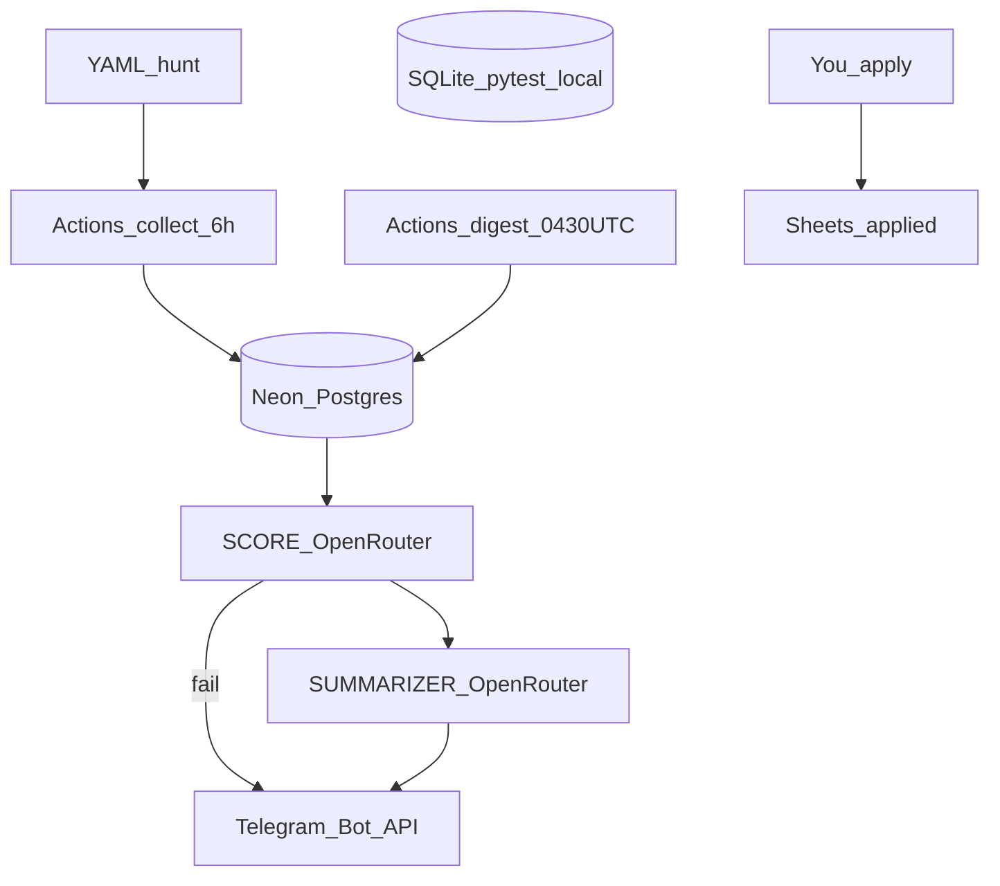

# Job digest pipeline (source of truth, post-I6)

This is the **only** parent contract for later implementers.

It **supersedes** [job_digest_pipeline_3d6a0d34.plan.md](job_digest_pipeline_3d6a0d34.plan.md) (greenfield + Hermes/VPS) and [i7_sota_gha_44025ef0.plan.md](file:///C:/Users/omkar/.cursor/plans/i7_sota_gha_44025ef0.plan.md) (amend-the-parent draft). Those files are archive. Do not implement Hermes, OpenWA, Render-as-WhatsApp, or a required Docker image.

**Repo:** [c:\Projects\Job_Hunt](c:\Projects\Job_Hunt) — package `jobdigest`, Python `>=3.11`, CI 3.12. **I1–I6 are already in the tree.** Do not reopen ATS adapters, hard filters, SCORE/SUMMARIZER prompts, Scrapling parsers, or Sheets CRM unless an I7 acceptance test fails.

**VOID:** I7 as Hermes systemd + `~/.hermes/scripts/` + `flock` on a VPS disk. **VOID:** unofficial WhatsApp (OpenWA). **VOID:** Python-only digest as the happy path (two OpenRouter calls still required). **VOID:** SQLite as the hosted store (GitHub Actions runners wipe the disk).

Do **not** implement I7 until this plan is confirmed and the user asks to build it.

---

## What is already built (do not redo)

CLI: `python -m jobdigest collect|score|digest|sheet-append`. Hunt YAML in `config/`. Committed companies, portals, and feeds are **`enabled: false`**. Pytest is offline; [`.github/workflows/ci.yml`](.github/workflows/ci.yml) is pytest on push/PR only (no cron, no Telegram, no Neon).

There is **no** `Dockerfile`, **no** `requirements.txt`, **no** `openai` / `playwright` / `scrapling[fetchers]` in [pyproject.toml](pyproject.toml). Runtime deps today: PyYAML, httpx, scrapling 0.4.15 + curl_cffi + browserforge + protego, feedparser, gspread.

Digest **prints** Telegram-shaped plain text to stdout. It does **not** POST Telegram. `.env.example` already has unused `TELEGRAM_BOT_TOKEN` / `TELEGRAM_CHAT_ID`.

| Phase | In the repo |
|---|---|
| I1 | setuptools [pyproject.toml](pyproject.toml), [src/jobdigest/](src/jobdigest/), [config/](config/), MIT, [`.gitignore`](.gitignore), [`.env.example`](.env.example) |
| I2 | Greenhouse/Lever/Ashby/Workable + [probe.py](src/jobdigest/probe.py) + fixtures under `tests/fixtures/ats/` |
| I3 | SQLite [db.py](src/jobdigest/db.py), `apply_url_norm` UNIQUE, [hard_filter.py](src/jobdigest/hard_filter.py), [collect.py](src/jobdigest/collect.py) |
| I4 | [openrouter.py](src/jobdigest/openrouter.py) (httpx, no `openai` package), [score.py](src/jobdigest/score.py), [summarize.py](src/jobdigest/summarize.py), [digest.py](src/jobdigest/digest.py) |
| I5 | HTTP-only Scrapling pins, [portals/](src/jobdigest/portals/), [feeds.py](src/jobdigest/feeds.py), `--ats-only` skips B |
| I6 | [sheet.py](src/jobdigest/sheet.py) gspread applied-only |

**I3 collect constraint (keep):** [collect.py](src/jobdigest/collect.py) must not contain the strings `openrouter`, `openai`, `scrapling`, or `gspread`. Portal/feed work is imported from `jobdigest.portals` / `jobdigest.feeds`.

**I4 digest behavior (keep):** recent successful collect within **26 hours** or print `COLLECT FAILED` and exit 1. Score HTTP/parse failure prints `SCORE FAILED`, skips summarizer, exit 1. Empty guest list after a good collect = **silent stdout, exit 0**. Summarizer death → Python bullets of the **same** guest list (fallback only). `_split_message` already splits ~3800 chars for print; I7 reuses that for `sendMessage`.

**I5 hosted reality (keep, do not “fix” in I7):** `FetcherSession` import currently pulls Playwright even for HTTP ([session.py](src/jobdigest/portals/session.py)). Do **not** add Playwright. Live portals fail `error_class=http` if the session cannot open. Parsers/tests stay offline via fixtures. **Hosted I7 collect therefore runs `--ats-only`.** Portals/RSS stay local after a 200.

**I6 (keep):** collect/score/digest never import gspread. Missing Google creds fail `sheet-append` only. Duplicate and utm-tagged URLs stay one DB row and one sheet row.

---

## Architecture (locked going forward)

**Scorer = bouncer. Summarizer = news anchor on the guest list only.** Collect has no LLM. Sheets are applied CRM only. You click Apply.



**Cook vs clock vs mailman**

- Python is the cook (fetch, filter, both LLM calls, optional Sheet append, Telegram POST).
- GitHub Actions is the alarm clock (hosted runners; disk is ephemeral).
- Telegram Bot API is the mailman (`sendMessage` from Python). Not Hermes `--deliver telegram`. Not OpenWA/WhatsApp.

**What runs when**

- Every **6 hours:** Actions runs `python -m jobdigest collect --ats-only`. Concurrency group so two collects do not overlap. Telegram **only if collect exits 1** (`COLLECT FAILED`).
- **10:00 Asia/Kolkata** = cron **`30 4 * * *` UTC** (never `0 4 * * *`, which is 09:30 IST). Actions runs `python -m jobdigest digest`. Non-empty body → Bot API `sendMessage`. Empty stdout after a good collect → **no send**. `COLLECT FAILED` / `SCORE FAILED` → send that text, exit 1.
- **When you apply:** `sheet-append` (local). Collect/score/digest never write the sheet. Sheets on Actions is out of I7 unless you later add a dedicated workflow.

**Stores**

- **Local and default pytest:** SQLite `DATABASE_PATH` / `--db` (current [db.py](src/jobdigest/db.py)). Offline. **0 skipped.** No `@pytest.mark.network` in default CI.
- **Hosted Actions:** Neon Postgres via `DATABASE_URL`. Same logical schema and identity (`apply_url_norm` UNIQUE, partial unique `(source, external_id)` where id set, applications unique on `apply_url_norm`).

**Secrets**

- Local: `.env` (gitignored). Load via existing [envfile.py](src/jobdigest/envfile.py).
- Hosted: **GitHub Actions secrets** — `OPENROUTER_API_KEY`, `DATABASE_URL`, `TELEGRAM_BOT_TOKEN`, `TELEGRAM_CHAT_ID`. Optional later: `GOOGLE_SHEET_ID`, `GOOGLE_SERVICE_ACCOUNT_JSON` (not required for I7 digest).
- Never put keys in workflow YAML. Chat ids never in git.

**Hunt enablement (git stays false)**

Committed YAML stays `enabled: false`. A hosted collect that only reads git YAML would upsert zero boards.

I7 must add a runtime override, e.g. env `JOBDIGEST_ENABLE` = comma-separated `companies.yaml` `id` values (and later `portal:` / `feed:` prefixes if needed). Collect treats those ids as enabled even when YAML says false. Put the list in a GitHub **Variable** or secret (ids are not tokens). Do **not** commit `enabled: true`. Local: same env, or flip YAML on disk without committing.

---

## Locked product decisions (unchanged from I1–I6)

- Daily intern/new-grad **India** digest. No auto-apply. No Workday/Getro. No `StealthyFetcher`. No `scrapling[fetchers]` / `scrapling install`. No `openai` package. No `requirements.txt`.
- Two paid OpenRouter models in [config/models.yaml](config/models.yaml) (`openai/gpt-4o-mini` score, `anthropic/claude-sonnet-4` summarize as of I6). Refuse ids ending `:free` and `openrouter/auto`. No env override that unpins YAML. `provider.data_collection: deny`.
- Hard filters in Python before any model. Dedupe on `normalize_url` before LLM.
- Telegram **plain text**, not HTML parse mode. `digest_max` 12. Split over ~3800 chars into multiple `sendMessage` (Telegram ~4096).
- Git hunt YAML stays `enabled: false`.
- Never git: `.env`, `jobs.db`+WAL/SHM, Google JSON, cookies, chat ids, Neon URL.

ATS / filter / Scrapling gotchas still apply (do not reopen in I7):

- UA `JobHunt/0.1`, 20–30s timeout, 200–400ms jitter, honor `Retry-After`. `follow_redirects=False` on ATS client.
- **404/410 = dead token.** **200 + empty list = empty_board.** 403/5xx/timeout = error. Unimplemented adapters must not return `empty_board`.
- Lever: paginate `limit=100` + `skip`; `createdAt` is epoch **milliseconds**. Greenhouse content often needs **two** `html.unescape` passes. Ashby names are case-sensitive.
- Synthetic `ats://source/external_id` **only if `external_id` is set**; never clickable.
- India: empty location + Bangalore in JD = pass. Empty location + no India keyword = reject. Intern titles **or** new-grad-broad if India and not staff and not 3+. Do not treat “0–3 years” as 3+ (`yoe_too_high` skips ranges with `lo == 0`).
- Profile blurb in **both** system prompts. No resume file, no name/CGPA in the user blob. Strip HTML, cap ~3000 chars, fence `<<<JOB id=N>>>`. Never send `raw_json` to either model.
- Summarizer post-validate: every card id must be on the guest list; restore URLs from payload; if prose has zero payload jobs but guest list was non-empty → fallback.
- Scrapling: 1 GET / ~3.5s / hostname; adaptive selectors off; challenge page → skip that portal; kill-list rows stay false (Otta, huggingface.co/jobs, LLMHire, Discord, LinkedIn).
- Hugging Face Workable stays `enabled: false`.

---

## Life of one job (unchanged)

1. Collect (6h, no LLM) hits ATS JSON for enabled (YAML or `JOBDIGEST_ENABLE`) companies.
2. Map to `NormalizedJob`. Upsert `jobs`. Same cleaned URL from Hasjob later → one row.
3. Hard filter on upsert. `hard_status` in collect. No OpenRouter in collect.
4. Digest: SCORE only `hard_status=pass`, unscored for current model+prompt_version, not already applied. Then SUMMARIZER on guest list max 12.
5. You apply. Then `sheet-append`. **No auto-apply.**

---

## Config contracts (as-built + I7 delta)

### Already in git

- [config/profile.yaml](config/profile.yaml) — Omkar defaults (PICT Pune, 2027, CGPA 8.88, Pune, relocate Bengaluru, India work auth, intern + new-grad). Types in [config.py](src/jobdigest/config.py).
- [config/companies.yaml](config/companies.yaml) — Greenhouse/Lever/Ashby/Workable rows, all `enabled: false`. Probe before any local enable.
- [config/portals.yaml](config/portals.yaml) / [config/feeds.yaml](config/feeds.yaml) — all `enabled: false`.
- [config/models.yaml](config/models.yaml) — both model keys required; `batch_size` 12.

### `.env` (never commit)

Keep: `OPENROUTER_API_KEY`, `DATABASE_PATH=data/jobs.db`, `TELEGRAM_BOT_TOKEN`, `TELEGRAM_CHAT_ID`, `GOOGLE_SHEET_ID`, `GOOGLE_SERVICE_ACCOUNT_JSON`.

**I7 add:** `DATABASE_URL=` (Neon; empty locally). Optional: `JOBDIGEST_ENABLE=`.

---

## Data layer (as-built SQLite; I7 adds Postgres twin)

Tables already in [db.py](src/jobdigest/db.py): `companies`, `jobs`, `scores`, `runs`, `portal_errors`, `applications`.

- YAML = company **list**. `companies` table = health cache. Collect upserts YAML → DB.
- `apply_url` nullable. UNIQUE `apply_url_norm`. Insert only with `http(s)` URL **or** `(source AND external_id)`.
- `normalize_url`: lowercase host, drop www, fragment, trailing slash, utm/gclid/fbclid/ref.
- `PRAGMA foreign_keys=ON` on SQLite. Gitignore all `data/*.db*`.
- I7 Postgres: same names, same uniqueness, same CHECK statuses. `connect()` uses `psycopg` when `DATABASE_URL` is set; else existing SQLite `--db` / `DATABASE_PATH`. Do not break tmp-file pytest. Callers that type `sqlite3.Connection` must be generalized enough that tests still pass.

---

## CLI (as-built)

```
python -m jobdigest collect [--ats-only] [--db PATH]
python -m jobdigest score [--db PATH]
python -m jobdigest digest [--db PATH]
python -m jobdigest sheet-append --url … [--db PATH]
python -m jobdigest.probe
```

`--db` stays SQLite. Hosted jobs use `DATABASE_URL` (no `--db` on Actions). I7 does not add a fifth subcommand unless send-test is useful; prefer `digest` + workflows.

---

## I7 — only remaining phase

**Today in one sentence:** Actions runs collect and digest against Neon; Python sends Telegram; pytest still uses SQLite files.

### Build

1. **[src/jobdigest/telegram.py](src/jobdigest/telegram.py)** — httpx POST `https://api.telegram.org/bot{token}/sendMessage` (`chat_id`, `text`, **no** `parse_mode`). Inject `http_post` in tests. No live Telegram in default pytest. Reuse digest `_split_message` (or move it to `telegram.py`) so each part is under ~3800 chars.

2. **Send rules** (keep stdout printing for Actions logs; do not double-send via any other mailman):
   - collect exit 1 → send `COLLECT FAILED` (or the printed error text).
   - digest non-empty stdout → send each part.
   - digest empty + exit 0 → **no send**.
   - digest `COLLECT FAILED` / `SCORE FAILED` → send that alert.
   - Local missing token: still print (dev). Hosted cron: if a send is **required** (failure alert or non-empty digest) and token/chat_id missing → fail loud (exit 1), do not look quiet.

3. **[db.py](src/jobdigest/db.py):** if `DATABASE_URL` set, Postgres (`psycopg`); else existing SQLite. Add `psycopg` to pyproject. Keep `gspread`. Still no `playwright` / `openai` / `scrapling[fetchers]`. Default pytest never sets `DATABASE_URL`. Optional maintainer live test is not CI.

4. **`JOBDIGEST_ENABLE`:** collect honors comma-separated company ids. Hosted collect without it is a successful no-op — document that, do not treat it as collect failure.

5. **Workflows** (separate from [ci.yml](.github/workflows/ci.yml), which stays pytest-only):
   - `collect.yml`: schedule every 6 hours UTC + `workflow_dispatch`. `python -m jobdigest collect --ats-only`. Secrets as above. Concurrency group `jobdigest-collect`, `cancel-in-progress: false`.
   - `digest.yml`: `30 4 * * *` + `workflow_dispatch`. `python -m jobdigest digest`. Group `jobdigest-digest`, `cancel-in-progress: false`.
   - `pip install -e ".[dev]"` (or without `[dev]` if pytest is unused on cron). Python 3.12 to match CI.
   - Do not checkout-and-commit databases. Neon is the store.

6. **Docs:** `.env.example` gets `DATABASE_URL=` and `JOBDIGEST_ENABLE=`. README: BotFather, Neon `DATABASE_URL`, GitHub secrets/variables, TZ table (`30 4 * * *` UTC = 10:00 IST), `--ats-only` on hosted collect, remove Hermes/VPS. Keep I5/I6 local instructions.

### Forbidden in I7

Hermes, OpenWA, Render-as-WhatsApp, dumping jobs to Sheets, enabling YAML in git, live Telegram/Neon in default pytest, changing SCORE/SUMMARIZER behavior except the send hook, adding Playwright to make portals work on Actions, adding `openai` package.

### Done

`workflow_dispatch` digest can send a real Telegram when secrets exist (manual). Default `pytest` green, 0 skipped, SQLite only. Collect source still has no `openrouter`/`openai`/`scrapling`/`gspread` strings. Telegram live calls live in `telegram.py`. No Hermes scripts, no required Dockerfile.

---

## Repo tree (end of I7)

```
.gitignore  LICENSE  README.md  pyproject.toml  .env.example
.github/workflows/ci.yml
.github/workflows/collect.yml   # I7
.github/workflows/digest.yml    # I7
config/profile.yaml  companies.yaml  portals.yaml  models.yaml  feeds.yaml
data/.gitkeep
src/jobdigest/… (as today)
  telegram.py                   # I7
tests/  fixtures/ats/…
```

No required `Dockerfile` / `docker-compose.yml`.

---

## Never in git / never in v1

`.env`, jobs.db and WAL, Google JSON, resume, Telegram chat ids, Neon URL, cookies. No LinkedIn/Discord/Slack scrape, no auto-apply, no StealthyFetcher, no dumping the board to Sheets, no Hermes, no unofficial WhatsApp gateway. **Do not ship Python-only digest as the happy path** — summarizer LLM is required; Python bullets are fallback only.

Out of I7 / out of v1: Hermes, OpenWA, required Docker, two-way Sheets sync, Workday/Getro, hosted Scrapling/RSS (needs a Playwright-free FetcherSession first), auto-apply.
