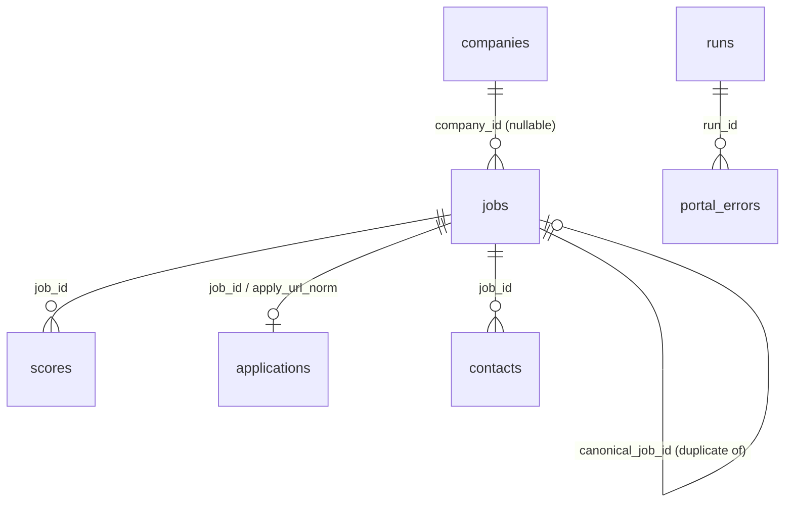
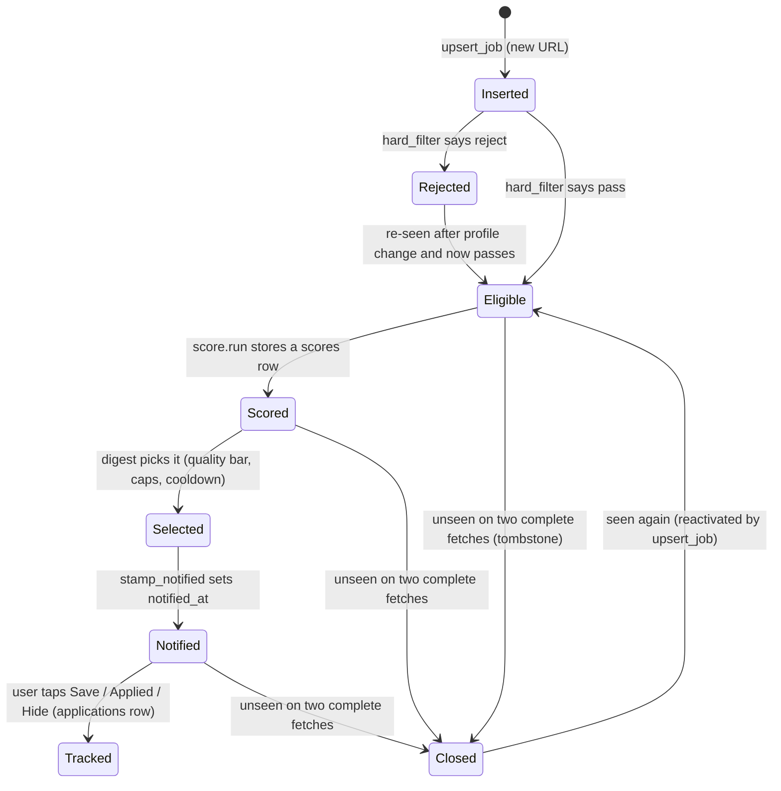

# Data model and job lifecycle

The database is the only shared state between pipeline stages. This page explains the *concepts* (what a row means,
how a job moves through states). Column-by-column reference, indexes, SQL and migrations are in
[storage/schema-and-migrations](../modules/storage/schema-and-migrations.md); the Python API is in
[storage/overview](../modules/storage/overview.md).

## Tables at a glance

| Table | One row is... | Written by | Read by |
|---|---|---|---|
| `companies` | one configured ATS board (a company's job board) | `collect` (`upsert_company`, `update_company_fetch`) | `collect`, `health` |
| `jobs` | one *posting*, keyed by normalized apply URL | `collect` -> `db.jobs.upsert_job`; `score`/`digest` stamp fields | everything |
| `scores` | the LLM's verdict on one job for one `(model, prompt_version)` | `score` (`upsert_score`) | `digest`, `sheet`, `bot` |
| `runs` | one execution of a stage (`collect`, `score`, `digest`, `contacts`...) | every stage (`insert_run`/`finish_run`) | `digest` (`collect_is_ok`), `health`, `contacts` |
| `portal_errors` | one failed fetch attempt in a run (ATS, portal, feed or marketplace) | `collect` | `health` |
| `applications` | one job the user acted on (saved/applied/hidden...) | `bot`, `sheet` | digest selection, `followups`, priors |
| `contacts` | one guessed person/email for a job | `contacts` | `bot` (Mail button) |

The diagram shows only relationships that exist as foreign keys or join keys in `db/schema.py`. Note that
`applications` joins to a job through **`apply_url_norm`** (so an application survives even if the job row is
re-inserted), with `job_id` filled when known. The authoritative ER diagram with all columns is in the
[schema page](../modules/storage/schema-and-migrations.md).

## What identifies a job

A job's identity is its **normalized apply URL** (`jobs.apply_url_norm`, UNIQUE). `normalize.job_identity` picks the
apply URL (or hosted URL), lower-cases the host, strips `www.`, tracking parameters (`utm_*`, `gclid`...) and
trailing slashes. If a job has no usable http(s) URL but has `(source, external_id)`, a synthetic key
`ats://<source>/<external_id>` is used. A second, partial unique index on `(source, external_id)` (only when
`external_id` is non-empty) prevents the same board entry from being inserted twice under different URLs. See
[foundation/normalize](../modules/foundation/normalize.md) and [storage/jobs](../modules/storage/jobs.md#upsert_job).

A *different* notion, the **posting key** (`jobs.posting_key`), is a hash of normalized title + company + location.
It exists to recognise the same role posted on two sources (for example an ATS board and an aggregator).
Rows sharing a `posting_key` are linked: one becomes canonical (`canonical_job_id IS NULL`), the others point to it
and are excluded from scoring and digests.

## Job lifecycle

Explanation of each state, with the field that records it:

* **Inserted / Rejected / Eligible** - `jobs.hard_status` is `pending` (column default), `pass` or `reject`, with a
  short `hard_reason` (`ok`, `title_reject`, `yoe`, `location`, `function`, ...). The filter runs inside
  `upsert_job` on **every** upsert, so a changed rule flips status for any job that is seen again. See
  [filtering/hard-filter](../modules/filtering/hard-filter.md).
* **Scored** - a `scores` row exists for the configured `(model, prompt_version)` and is not `stale`. A change in a
  job's description hash marks old scores `stale = 1` so the job is re-scored. See
  [ranking/score-llm](../modules/ranking/score-llm.md).
* **Selected / Notified** - selection is computed on the fly (not stored). Once sent, `jobs.notified_at` and
  `jobs.notify_kind` (`digest` or `urgent`) are set and the job is excluded from later digests.
* **Tracked** - an `applications` row with `status` in `applied, oa, interview, offer, rejected, ghosted, saved,
  hidden`. The statuses `oa`, `interview` and `offer` are *protected*: a later button tap cannot overwrite them.
* **Closed (tombstone)** - when a board is fetched **completely** and a previously seen job is absent,
  `miss_count` increments; on the second miss `is_active = 0`, `closed_at` is set and `close_reason = 'unseen_board'`.
  A partial or failed fetch never increments the counter (that is the purpose of `FetchResult.complete`). A closed job
  that reappears is reactivated. See [collect-orchestrator](../modules/collection/collect-orchestrator.md) and
  [storage/jobs](../modules/storage/jobs.md#bump_unseen_for_source).

## Why the digest can say "COLLECT FAILED"

`digest` calls `db.runs.collect_is_ok`, which is true only if the most recent `collect` run has `status = 'ok'` **and**
finished within the last 26 hours. If the last collect crashed, or nothing has run for more than a day, the digest sends
a loud failure message instead of silently re-sending stale data. See
[delivery/digest](../modules/delivery/digest.md).

## What lives outside the database

* Configuration (profile, companies, models, portals, feeds) is YAML on disk or in GitHub secrets - see
  [configuration and secrets](configuration-and-secrets.md).
* `data/boards_india.tsv` (the discovered board list) and `data/ats_board_tokens_*.tsv` (the raw candidate tokens) are
  flat files, not tables. See [sources/expand](../modules/sources/expand.md).
* The Google Sheet is a one-way mirror of selected jobs, keyed by link. See [delivery/sheet](../modules/delivery/sheet.md).
