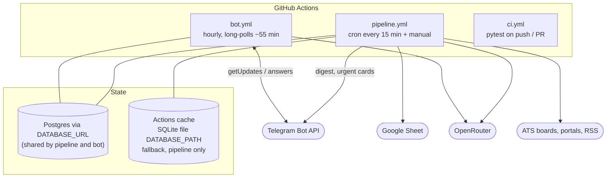

# Deployment and scheduling

jobdigest has no server of its own. Everything runs either **on GitHub Actions** (scheduled) or **on your machine**
(`start.sh`, or manual CLI calls). This page explains the moving parts and why they are arranged this way. The
step-by-step workflow reference is in [infra/github-workflows](../infra/github-workflows.md); the cron code is in
[foundation/cron-gate](../modules/foundation/cron-gate.md).

## Runtime topology

**Why two workflows.** The digest is a short batch job. Answering button taps needs a process that is *listening*,
and a GitHub Actions job can listen for at most a few hours. `bot.yml` therefore starts every hour and long-polls Telegram
for about 55 minutes (`--max-seconds 3300`); the next run waits in the same concurrency group until the previous one
exits, so there is nearly always exactly one poller. Taps made in a gap are held by Telegram and handled at the next
start. See [delivery/bot](../modules/delivery/bot.md).

## The scheduling gate

GitHub's `schedule` trigger only supports fixed cron strings in the workflow file, but the digest time should be
configurable without editing code. The workaround is a two-job design in `pipeline.yml`:

1. The workflow ticks **every 15 minutes** (`cron: "*/15 * * * *"`).
2. The cheap `gate` job runs `python3 -m jobdigest.cron` (standard library only, so it needs no `pip install`). It reads
   `JOBDIGEST_CRON` (default `30 3 * * *` = 09:00 IST) and `JOBDIGEST_CRON_URGENT` (default `30 8 * * 1-5`, `off`
   disables), and writes `due=true|false` and `slot=digest|urgent|` to `$GITHUB_OUTPUT`.
3. The heavy `pipeline` job has `if: needs.gate.outputs.due == 'true'`, so 95% of ticks cost seconds.

`cron.due_slot` returns `"digest"` for any non-`schedule` event (so a manual *Run workflow* always runs the full digest
path), otherwise checks the digest expression, then the urgent one. `is_due` looks at the 15-minute window that starts at the
tick's slot (`scheduled_slot` floors the current time to a 15-minute boundary and tests each of the 15 minutes), which
tolerates GitHub starting a tick a few minutes late. A run delayed by more than one window misses its day - a known
limitation of GitHub's best-effort scheduler.

## What the `pipeline` job does, in order

| # | Step | Purpose |
|---|---|---|
| 1 | checkout, setup-python 3.12, `pip install -e .` and `.[marketplaces]` | Install the package and JobSpy |
| 2 | Playwright cache, `install-deps`, `install chromium` | Browser for `dynamic`/`stealth` portals; cached by key |
| 3 | *Write private config* | Secrets -> `config/*.yaml`; exits 1 if a required one is empty |
| 4 | *Restore job state* (`actions/cache/restore`) | Bring back the SQLite state file (see below) |
| 5 | `collect` | Fetch and store |
| 6 | `digest` (digest slot) or `digest --urgent-only` (urgent slot) | Score, select, send |
| 7 | `contacts` | Guess contacts for the jobs just sent |
| 8 | *Write Google service account*, `sheet-sync` (digest slot only) | Mirror to the sheet |
| 9 | *Checkpoint job state* and *Save job state* (`if: always()`) | Persist the SQLite file even if a step failed |

Steps 5-8 run sequentially with no `continue-on-error`: if `collect` exits non-zero the later stages are skipped for that run.

## Where state lives

* **Postgres (`DATABASE_URL`)** - the intended production store. Both the pipeline and the bot see the same rows, which
  is mandatory for button taps to find the job that was sent.
* **SQLite on the Actions runner** - when `DATABASE_URL` is empty the code uses SQLite. A runner's disk disappears after
  the job, so `pipeline.yml` sets `DATABASE_PATH: data/pipeline_state.db` and restores/saves that file with
  `actions/cache`. Each save uses a unique key (`jobdigest-state-<run_id>-<attempt>`) and each restore falls back to the
  newest `jobdigest-state-` entry (`restore-keys`). This keeps "already sent" memory between runs, but is **not visible to
  `bot.yml`**, which is why `bot.yml` refuses to run without `DATABASE_URL`.
* **Local** - `start.sh` always passes `--db data/jobs.db`.

## Local operation

`start.sh` runs `collect --portal-fetch http`, `digest`, `contacts`, `sheet-sync` against `data/jobs.db`, loading a
`.env` file for secrets. It deliberately does not start the bot and does not run browser-based portals. See
[onboarding/03-setup](../onboarding/03-setup.md).

## Cost and limits worth knowing

* The repository is public, so Actions minutes are free; a digest run takes roughly 5 minutes (mostly fetching boards).
* `pipeline` has `timeout-minutes: 60`; `bot` has 62 with a 55-minute poll.
* Concurrency groups (`jobdigest-pipeline`, `jobdigest-bot`) use `cancel-in-progress: false`, so overlapping runs queue
  instead of killing each other.
* GitHub keeps one pending run per concurrency group; extra ticks are dropped, which is acceptable because they are
  idempotent.
