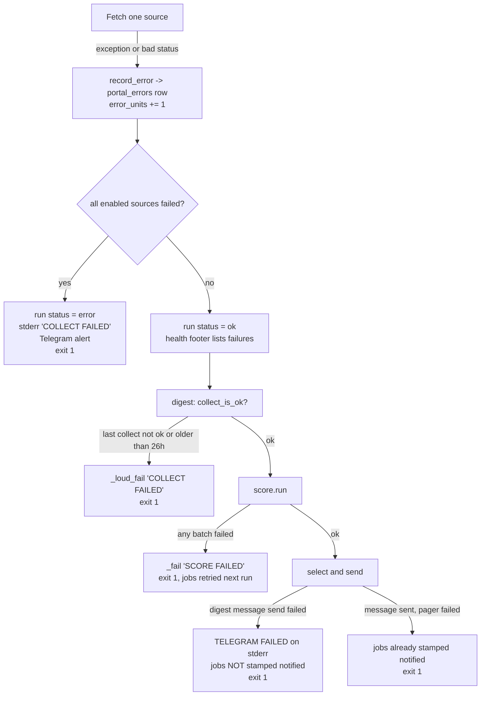

# Error handling, logging and observability

How failures are detected, reported and recovered in jobdigest, and how to find out what happened after the fact.
The guiding rule is **loud failure for the things that matter, quiet degradation for the things that are optional**.

## The three failure postures

| Posture | Used for | Mechanism |
|---|---|---|
| **Fail the run loudly** | collect with every enabled source failing, scoring failure, digest after a bad collect, missing required config secrets in CI | non-zero exit code **and** a Telegram message (`telegram.deliver(..., required=True)`), plus a red GitHub Actions job |
| **Skip and log** | no Telegram/Sheet credentials locally, no GitHub token for contacts, no `blurb` model, optional marketplace lane | the stage prints/logs `skip ...` and returns 0 |
| **Isolate and continue** | one bad portal/feed/board, one bad scoring batch, one bad contact lookup, one bad Telegram update | catch at the smallest unit, record an error row or log, carry on with the rest |

## Where each failure is handled

Every box is backed by code: `collect._Collector.record_error` and `failed`, `collect.run` (status/alert),
`db.runs.collect_is_ok`, `digest._loud_fail`, `score._fail`, and `telegram.deliver`. See
[collect-orchestrator](../modules/collection/collect-orchestrator.md), [digest](../modules/delivery/digest.md),
[score-llm](../modules/ranking/score-llm.md) and [telegram](../modules/delivery/telegram.md).

### Collect: partial failure is normal

`collect` runs each board, portal, feed and marketplace row as an independent *unit*. A unit that fails is written to
the `portal_errors` table (despite the name it also stores ATS, feed and marketplace errors) with an `error_class`
(`http`, `timeout`, `cloudflare`, `parse`, `robots`, `config`), and counted. The run is marked `error` only if **every**
enabled unit failed (`enabled_units > 0 and error_units == enabled_units`). Otherwise the run is `ok` and the problems
appear in the health footer (see below). Two statuses are deliberately **not** counted as errors: `DEAD_TOKEN`
(board returned 404/redirect) and `EMPTY_BOARD`; a run where every board is dead therefore still exits 0.

### Scoring: failed batch, not failed run

`score.run` sends jobs to the LLM in batches. A batch whose request or JSON fails is skipped (its jobs stay unscored and
are retried next run); the loop continues so one transient error does not starve the other jobs. If any batch failed the
run still returns 1 so the digest reports `SCORE FAILED`. An invalid/forbidden model name aborts immediately
(`_InvalidModel`). Jobs the model silently omitted from a successful reply are re-asked once.

### Telegram: send, skip or fail

`telegram._gate_send` is the single switch. With credentials present it sends. With credentials missing it either skips
(returns `None`, `deliver` returns `True`) or - when the caller passed `required=True` **and** the environment sets
`JOBDIGEST_REQUIRE_TELEGRAM` - raises `TelegramError`, which `deliver` turns into `False` after printing
`TELEGRAM FAILED`. The hosted workflows set `JOBDIGEST_REQUIRE_TELEGRAM=1`; local runs leave it unset so you can run the
pipeline without a bot. The bot token is embedded in the request URL, so `bot_post` never puts the exception text into
messages or logs (it records only the exception *type*).

### The bot: every tap ends visibly

`bot.handle_update` wraps callback handling so that a crash, a missing job or an unreachable database still answers the tap
and sends a plain message. The contract is enforced by `tests/test_bot_buttons.py`. See [delivery/bot](../modules/delivery/bot.md).

## Exit codes

| Command | 0 | 1 |
|---|---|---|
| `collect` | at least one enabled unit succeeded, or none were enabled | all enabled units failed |
| `digest` | digest sent, nothing to send, or sending skipped (no credentials) | collect not OK / scoring failed / required Telegram send failed |
| `score` | all batches scored (or nothing to score) | any batch failed, missing API key with work pending, invalid model |
| `contacts` | finished (per-job failures are only counted) | the run itself failed |
| `sheet-sync` | synced, or skipped for missing credentials | credentials required (`JOBDIGEST_REQUIRE_SHEET`) but missing, or sheet error |
| `cron` (gate) | wrote `due=`/`slot=` | invalid cron expression (`cron error ...`) |

## Logging

* `logutil.configure()` is called once per entry point. It attaches a stderr handler (and a file handler when
  `JOBDIGEST_LOG_FILE` is set) to the logger named `jobdigest`, sets the level from `JOBDIGEST_LOG_LEVEL` (default `INFO`),
  and turns propagation off so logs are not duplicated by the root logger.
* Each module uses `get_logger("<name>")`, producing `jobdigest.<name>`; the format is
  `%(asctime)s %(levelname)s %(name)s %(message)s`.
* Intentional program output (the digest text, `collect ok ...`, `score ok ...`) goes to **stdout** with `print`; logs go
  to **stderr**. Tests assert on both.
* The GitHub Actions log is the primary record. Tokens never appear because secrets are masked by Actions and the code
  avoids printing them.

## Observability after the fact

* **`runs` table** - one row per stage execution with `status` (`running`/`ok`/`error`), timestamps and `stats_json`
  (for collect: fetched, inserted, updated, pass, reject, errors, missed, tombstoned). `collect_is_ok` reads it.
* **`portal_errors` table** - what failed in the last collect, with HTTP status and detail.
* **Health footer** - `health.collect_health` builds sections (`ERRORS`, `EMPTY`, `0 CARDS`, `DEAD TOKENS`, each capped) from
  the last collect run; `collect` prints it and the bot's `/health` command returns it. See
  [followups-and-health](../modules/delivery/followups-and-health.md).
* **Telegram alerts** - `COLLECT FAILED`, `SCORE FAILED` messages.
* **`notified_at` / `notify_kind` on `jobs`** - proves what was sent and when.

## Known weak spots

Collected from the per-module documentation; see [known-issues-and-limitations](known-issues-and-limitations.md) for
the full list with source references. The most important for operators: a *crashed* collect (an exception outside the
per-unit isolation) is recorded as `ok` in `runs` before the exception propagates; and an empty "ok" result from a feed or
marketplace can tombstone a source's jobs after two runs.
