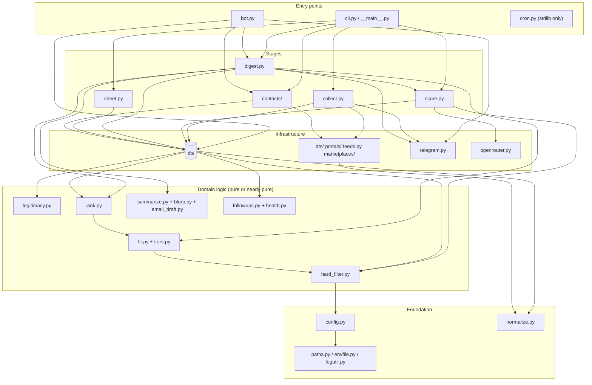

# Layers and module dependencies

This page describes the import structure of `src/jobdigest/`: which modules are foundations, which are stages,
and which cross-package imports are surprising. Every edge below was extracted from the source with Python's `ast`
module (all `import jobdigest...` / `from jobdigest... import` statements, including ones inside functions).

## Layer map

**How to read it.** Arrows point from the importer to the imported module. The picture is simplified to one arrow
per relationship family. The exact module-to-module edges are listed in the next section.

The one rule that holds throughout: **imports flow downward** (entry points -> stages -> domain logic ->
infrastructure -> foundation). There is no import cycle between top-level modules. Two places use *function-level*
imports instead of module-level ones, and both exist to keep import cost or cycles out of the way:

* `cli.py` imports each stage inside its `_cmd_*` function (`from jobdigest.collect import run`) so that
  `python -m jobdigest --help` does not import Scrapling, gspread, psycopg and friends.
* `collect._collect_side_lanes` imports `feeds`, `marketplaces` and `portals` inside the function, so an `--ats-only`
  run never loads the heavy scraping stack.

## Exact edges between top-level modules

Counts are the number of import statements. Foundation modules (`paths`, `logutil`, `envfile`, `normalize`,
`config`) are omitted from the "uses" column when they are the only dependency.

| Module | Imports (jobdigest-internal) |
|---|---|
| `cli` | `collect`, `contacts`, `digest`, `score`, `sheet` (lazily), `envfile`, `logutil` |
| `collect` | `ats` (adapters, `base`, `http_client`), `config`, `db`, `feeds`, `marketplaces`, `portals`, `health`, `telegram`, `normalize`, `envfile`, `logutil` |
| `score` | `db`, `hard_filter`, `openrouter`, `ats.base` (`decode_html_content`), `config`, `envfile`, `logutil` |
| `digest` | `score`, `db`, `rank`, `fit`, `legitimacy`, `summarize`, `telegram`, `openrouter`, `followups`, `config`, `envfile`, `logutil` |
| `bot` | `blurb`, `contacts`, `db`, `digest` (`_guest_dicts`), `email_draft`, `followups`, `health`, `openrouter`, `summarize`, `telegram`, `config`, `envfile`, `logutil` |
| `sheet` | `db`, `config`, `normalize`, `envfile` |
| `contacts/*` | `ats.http_client` (HTTP client + user agent), `db`, `normalize`, `envfile`, `logutil` |
| `db/*` | `ats.base` (`KNOWN_ATS`), `hard_filter`, `legitimacy`, `rank` (`sort_rows`, `select_diverse`), `followups` (lazy), `config`, `normalize`, `paths` |
| `rank` | `fit`, `config`, `normalize` |
| `fit` | `hard_filter` (`low_priority_function`), `tiers`, `config` |
| `hard_filter` | `tiers`, `config` |
| `legitimacy` | `hard_filter` (`_remote_us`), `normalize` |
| `feeds` | `ats.base`, `portals` (`PortalResult`), `portals.session` (`UA`) |
| `marketplaces` | `ats.base`, `portals` (`PortalResult`) |
| `portals/*` | `ats.base` (`NormalizedJob`) |
| `probe` | `ats`, `config` |
| `discover` | `probe`, `config` |
| `expand` | `hard_filter`, `config`, `paths` |
| `telegram`, `openrouter`, `cron`, `followups`, `logutil`, `normalize`, `paths`, `tiers` | no internal imports besides foundation (or none) |

## The most depended-upon modules

| Module | Imported by (count) | Why |
|---|---|---|
| `ats/base.py` | 19 | Owns `NormalizedJob`, the single record type every source produces and every later stage consumes |
| `config.py` | 15 | `Profile` and `Models` are read by almost every stage |
| `normalize.py` | 14 | URL/company/title normalization is the basis of dedupe |
| `ats/http_client.py` | 10 | One HTTP client factory and user agent shared by ATS, contacts and the portal code |
| `logutil.py` | 10 | One logger configuration |

## Surprising or noteworthy dependencies

* **`db` imports `rank`, `hard_filter` and `legitimacy`.** The storage layer is not purely storage: `db/jobs.py`
  runs the hard filter and legitimacy check as part of `upsert_job`, and `db/digest_queries.py` ranks and selects
  rows. This is deliberate (decisions are stamped at write time and ranking needs SQL results) but means that
  changing a filter rule affects what is written, not only what is read. See
  [storage/jobs](../modules/storage/jobs.md) and [storage/contacts-and-digest-queries](../modules/storage/contacts-and-digest-queries.md).
* **`feeds` and `marketplaces` import from `portals`.** `PortalResult` (the status/jobs/error envelope) lives in
  `portals/__init__.py` and is reused by the other two non-ATS lanes. See [portals-overview](../modules/sources/portals-overview.md).
* **`bot` imports `digest._guest_dicts`.** A "private" helper is shared so the bot renders a card exactly as the
  digest does. See [delivery/bot](../modules/delivery/bot.md).
* **`contacts` and `blurb`/`score` import from `ats`** only for small shared utilities (`make_client`, `USER_AGENT`,
  `decode_html_content`), not for ATS behaviour.
* **`cron.py` has no internal imports at all.** The GitHub Actions gate job runs it with `PYTHONPATH=src` *before*
  installing dependencies, so it must only use the standard library. See [cron-gate](../modules/foundation/cron-gate.md).

## Third-party dependencies by layer

From `pyproject.toml` ([packaging](../infra/packaging-and-scripts.md)): `httpx` for all HTTP; `scrapling`, `playwright`,
`patchright`, `curl_cffi`, `browserforge`, `protego` for the portal lane; `feedparser` for RSS; `gspread` for the
sheet; `psycopg[binary]` for Postgres; `jinja2` for email templates; `pyyaml` for config. `python-jobspy` is an
optional extra for the marketplace lane.
