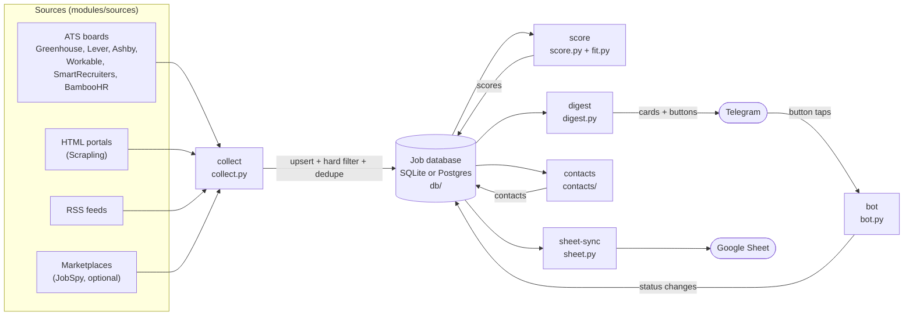

# Architecture overview

`jobdigest` is a batch pipeline plus a small chat bot. Once a day (and optionally on weekday mornings for
exceptional jobs) it gathers fresh job postings from the public web, throws away everything that is not a
genuine **entry-level engineering role in India**, ranks what is left, and sends the best few to one person on
Telegram. The same person can then tap buttons on each message to track the job. It never applies for anything.

If you are new to the repo, read this page first, then follow the [learning path](../onboarding/01-what-is-this.md).

## The pipeline in one picture

**Reading the diagram.** Every arrow that touches the database cylinder is a read or write through the `db`
package. The stages never call each other directly except `digest`, which calls `score` itself before it picks
jobs (see [`digest.run`](../modules/delivery/digest.md#run)). Stages communicate only through database rows,
which is why each one can be re-run, tested, or replaced on its own.

## Components and what each one owns

| Component | Source | One-line responsibility | Deep dive |
|---|---|---|---|
| Entry points | `src/jobdigest/cli.py`, `__main__.py`, `cron.py` | Parse commands; decide whether a scheduled tick is due | [foundation](../modules/foundation/cli-and-entrypoints.md), [cron gate](../modules/foundation/cron-gate.md) |
| Configuration | `src/jobdigest/config.py`, `paths.py`, `envfile.py` | Load YAML profile/companies/models and env vars | [config](../modules/foundation/config.md) |
| Sources | `ats/`, `portals/`, `feeds.py`, `marketplaces/` | Turn each external site into `NormalizedJob` records | [sources](../modules/sources/ats-overview.md) |
| Collection | `collect.py` | Run every source, store jobs, mark vanished ones | [collect](../modules/collection/collect-orchestrator.md) |
| Filtering | `hard_filter.py`, `legitimacy.py` | Reject non-fits in code; flag suspicious postings | [filtering](../modules/filtering/hard-filter.md) |
| Storage | `db/` | Schema, upserts, dedupe, queries for SQLite and Postgres | [storage](../modules/storage/overview.md) |
| Scoring & ranking | `score.py`, `fit.py`, `rank.py`, `tiers.py`, `openrouter.py` | LLM relevance + deterministic fit; choose the digest | [ranking](../modules/ranking/score-llm.md) |
| Delivery | `digest.py`, `telegram.py`, `bot.py`, `sheet.py`, `followups.py`, `health.py` | Send the digest, answer button taps, sync the sheet | [delivery](../modules/delivery/digest.md) |
| Contacts | `contacts/`, `email_draft.py` | Guess recruiter/hiring-manager contacts and draft outreach | [contacts](../modules/contacts/overview.md) |
| Discovery | `expand.py`, `discover.py`, `probe.py` | Find more boards worth fetching | [expand](../modules/sources/expand.md) |
| Scheduling | `.github/workflows/` | Run it all on GitHub Actions | [infra](../infra/github-workflows.md) |

## The five stages (what runs, in what order)

The scheduled workflow (`.github/workflows/pipeline.yml`) runs these as separate CLI invocations:

1. `python -m jobdigest collect` - fetch from every enabled source, store, hard-filter, dedupe.
2. `python -m jobdigest digest` - check collect succeeded, **score** unscored jobs, select the best, send to Telegram.
3. `python -m jobdigest contacts` - guess contacts for the jobs just sent.
4. `python -m jobdigest sheet-sync` - copy relevant jobs into the Google Sheet (digest slot only).
5. `python -m jobdigest.bot --max-seconds N` - a *separate* workflow (`bot.yml`) that answers button taps.

Locally, `start.sh` runs 1-4 against a SQLite file.

## Key design properties

* **Everything external is injectable.** `collect.run`, `digest.run`, `score.run`, `bot.handle_update`, `sheet.sync`
  and the contact pipeline accept the HTTP client, LLM function, Telegram poster or worksheet as arguments. That is
  why the 700+ tests never touch the network. See [testing strategy](../testing/strategy.md).
* **Code owns the decisions; the LLM only advises.** Regex gates in `hard_filter.py` decide what is eligible, the
  deterministic score in `fit.py` is 65% of the ranking, and `score.coerce_relevant` overrides the model whenever a rule
  disagrees. See [design decisions](design-decisions.md).
* **Idempotent and restartable.** Jobs are keyed by normalized URL; re-running `collect` updates rather than
  duplicates; a job already sent is stamped `notified_at` and never sent again. See [data model](data-model.md).
* **Loud failure, quiet degradation.** Missing optional credentials skip a stage with a log line; if a required
  stage fails (collect all-sources-down, scoring failure) a message is pushed to Telegram. See
  [error handling](error-handling-and-observability.md).

## Where to go next

* Import structure and layering: [layers-and-dependencies.md](layers-and-dependencies.md)
* Tables and job lifecycle: [data-model.md](data-model.md)
* Config files and secrets: [configuration-and-secrets.md](configuration-and-secrets.md)
* How it is deployed: [deployment-and-scheduling.md](deployment-and-scheduling.md)
* End-to-end traces: [workflows/](../workflows/collect-run.md)
