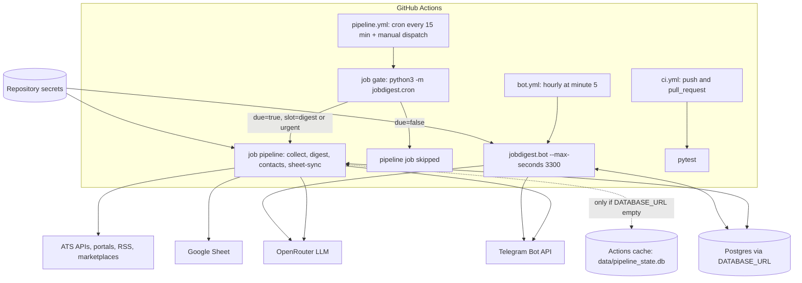

# GitHub Actions workflows

- Source: `.github/workflows/ci.yml` (15 lines), `pipeline.yml` (about 160 lines), `bot.yml` (about 55 lines)
- Role: deployment layer. The project has no server: GitHub Actions is the scheduler and runtime, Postgres (Neon) or an Actions cache holds state, Telegram and Google Sheets are the outputs.
- Tests that pin these files: `tests/test_workflows.py`, `tests/test_pipeline_e2e.py`, `tests/test_bot_buttons.py` (see [../testing/strategy.md](../testing/strategy.md#constraint-tests-what-each-forbids))
- Related: [config-files.md](config-files.md) (what the `*_YAML` secrets contain), [../modules/foundation/cron-gate.md](../modules/foundation/cron-gate.md) (the gate logic), [packaging-and-scripts.md](packaging-and-scripts.md)

## Deployment overview

Two things to understand:

- The pipeline and the bot are separate workflows because they have different lifetimes. The pipeline is a batch job that finishes in minutes; the bot is a long poll that must be alive to answer Telegram button taps.
- State must be shared. The digest records what it sent, and the bot must find those same jobs when a user taps a button. Hence the bot workflow demands a real `DATABASE_URL` (see below), while the pipeline can fall back to a cached SQLite file.

## `ci.yml`

Triggers: `push` and `pull_request` (all branches). One job `test` on `ubuntu-latest`: checkout, `actions/setup-python@v5` with Python 3.12, `pip install -e ".[dev]"`, `pytest`. No secrets, no Chromium, no JobSpy. `tests/test_workflows.py::test_ci_stays_pytest_only` forbids adding any of those. Because the `marketplaces` extra is not installed, the one pandas-dependent test is skipped in CI.

## `pipeline.yml`

Workflow name `pipeline`. Triggers: `schedule` with cron `*/15 * * * *`, and `workflow_dispatch` (manual "Run workflow"). Concurrency: group `jobdigest-pipeline`, `cancel-in-progress: false`. A second run waits for the first instead of killing it (GitHub keeps at most one running and one pending run per group), so two pipelines never write the database simultaneously.

### Why every 15 minutes

GitHub cron cannot express "09:00 IST on the day the user chose" through repository settings, and the user wants to change the schedule without editing YAML. So the workflow wakes every 15 minutes and a cheap gate decides whether this tick is the user's slot. The slot expressions live in two repository secrets, `JOBDIGEST_CRON` and `JOBDIGEST_CRON_URGENT` (UTC, five fields). Defaults in `src/jobdigest/cron.py`: `DEFAULT_CRON = "30 3 * * *"` (09:00 IST) and `DEFAULT_URGENT_CRON = "30 8 * * 1-5"` (14:00 IST on weekdays). `tests/test_workflows.py` forbids these literals in the YAML so the schedule stays secret-driven.

### Job `gate`

Runs on `ubuntu-latest` with no Python setup and no `pip install` (it uses the runner's `python3`). Steps:

1. `actions/checkout@v4`.
2. Step `id: gate`, "Schedule gate": `env` sets `PYTHONPATH: src`, `JOBDIGEST_CRON`, `JOBDIGEST_CRON_URGENT` from secrets; `run: python3 -m jobdigest.cron`. `jobdigest.cron.main()` (`src/jobdigest/cron.py:143`) calls `due_slot()` (line 107). For any event other than `schedule` (manual dispatch) it returns `"digest"`. For a scheduled tick it floors the time to the 15-minute slot (`scheduled_slot`, line 12) and checks whether the digest cron expression matches any minute inside that 15-minute window (`is_due`, line 86); if so `"digest"`; otherwise it checks the urgent expression (value `off` disables it); otherwise `None`. `_emit` (line 134) appends `due=true|false` and `slot=digest|urgent|` to the file named by `GITHUB_OUTPUT` and also prints them. An invalid cron string prints `cron error ...` and exits 1, which fails the gate loudly.
3. Job `outputs`: `due: ${{ steps.gate.outputs.due }}`, `slot: ${{ steps.gate.outputs.slot }}`.

The module is stdlib-only on purpose (`test_cron_module_is_stdlib_only`) because nothing is installed in this job.

### Job `pipeline`

`needs: gate`, `if: needs.gate.outputs.due == 'true'`, `timeout-minutes: 60`. Job-level `env: DATABASE_PATH: data/pipeline_state.db`. The comment in the file explains: used only when the `DATABASE_URL` secret is empty; keeps "already sent" state between runs via the cache so the digest never repeats itself.

Steps in order:

| # | Step | What it does |
|---|---|---|
| 1 | `actions/checkout@v4` | fetches the repo including `config/*.example.yaml` and tracked `data/*.tsv` |
| 2 | `actions/setup-python@v5`, Python 3.12 | |
| 3 | `pip install -e .` | installs core dependencies |
| 4 | `pip install -e ".[marketplaces]"` | adds `python-jobspy` (and thus pandas) for the JobSpy lane. The previous step is redundant since the second command also installs the core package |
| 5 | `actions/cache@v4`, id `playwright-cache` | caches `~/.cache/ms-playwright` under key `playwright-chromium-${{ runner.os }}-1.62.0` |
| 6 | "Install Chromium system deps": `python -m playwright install-deps chromium` | always runs (apt packages are not part of the cache) |
| 7 | "Install Chromium": `python -m playwright install chromium` | only `if: steps.playwright-cache.outputs.cache-hit != 'true'` |
| 8 | "Write private config" | inline Python; see below |
| 9 | "Restore job state" | `actions/cache/restore@v4`; see below |
| 10 | `python -m jobdigest collect` | all lanes (ATS, discovered boards, portals, feeds, marketplaces); no `--portal-fetch`/skip flags |
| 11 | "Digest" `python -m jobdigest digest` | `if: needs.gate.outputs.slot != 'urgent'` |
| 12 | "Urgent digest" `python -m jobdigest digest --urgent-only` | `if: needs.gate.outputs.slot == 'urgent'` |
| 13 | "Contacts enrich" `python -m jobdigest contacts` | runs on both slots |
| 14 | "Write Google service account" | `if: slot != 'urgent'`; inline Python writes the secret text to `google-sa.json`, exits 1 if empty |
| 15 | "Sheet sync" `python -m jobdigest sheet-sync` | `if: slot != 'urgent'`; `GOOGLE_SERVICE_ACCOUNT_JSON: google-sa.json` (a path, not the JSON text) and `JOBDIGEST_REQUIRE_SHEET: "1"` |
| 16 | "Checkpoint job state" | `if: always()`; SQLite WAL checkpoint |
| 17 | "Save job state" | `if: always()`; `actions/cache/save@v4` |

The Chromium cache key hard-codes `1.62.0`, the version pinned in `pyproject.toml` as `playwright==1.62.0`. When bumping Playwright, update the key too, or the cache will keep serving the old browser build.

So the digest slot runs collect, digest, contacts, sheet-sync; the urgent slot runs collect, digest `--urgent-only`, contacts (no sheet-sync).

#### Step 8: writing private config

Environment: `PROFILE_YAML`, `COMPANIES_YAML`, `MODELS_YAML`, `PORTALS_YAML`, `FEEDS_YAML`, `MARKETPLACES_YAML` from secrets. The embedded script maps the first five to `config/profile.yaml`, `config/companies.yaml`, `config/models.yaml`, `config/portals.yaml`, `config/feeds.yaml`. If any of those five is empty or whitespace the script prints `required config secrets missing: ...` and exits 1. It then writes each file's text. `MARKETPLACES_YAML` is optional: written to `config/marketplaces.yaml` only when non-empty. Otherwise `config.py`'s example fallback (`_yaml_path`) loads `config/marketplaces.example.yaml`, whose rows are all `enabled: false`, so the lane is a no-op. Note that this overwrites the tracked `config/models.yaml`, `portals.yaml`, `feeds.yaml` in the runner's checkout with the secret values.

#### Secrets used per step

| Step | Secrets and env |
|---|---|
| gate | `JOBDIGEST_CRON`, `JOBDIGEST_CRON_URGENT` |
| Write private config | `PROFILE_YAML`, `COMPANIES_YAML`, `MODELS_YAML`, `PORTALS_YAML`, `FEEDS_YAML`, `MARKETPLACES_YAML` |
| collect | `DATABASE_URL`, `TELEGRAM_BOT_TOKEN`, `TELEGRAM_CHAT_ID`, `JOBDIGEST_REQUIRE_TELEGRAM=1` (literal), `JOBDIGEST_MARKETPLACE_PROXIES` |
| Digest and Urgent digest | `OPENROUTER_API_KEY`, `DATABASE_URL`, `TELEGRAM_BOT_TOKEN`, `TELEGRAM_CHAT_ID`, `JOBDIGEST_REQUIRE_TELEGRAM=1` |
| Contacts enrich | `DATABASE_URL`, `JOBDIGEST_GITHUB_TOKEN` |
| Write Google service account | `GOOGLE_SERVICE_ACCOUNT_JSON` |
| Sheet sync | `DATABASE_URL`, `GOOGLE_SHEET_ID`, `GOOGLE_SERVICE_ACCOUNT_JSON=google-sa.json`, `JOBDIGEST_REQUIRE_SHEET=1` |

Observations drawn from this table: `collect` has no `OPENROUTER_API_KEY` (collection is LLM-free, enforced by `test_collect_no_llm.py`); `contacts` gets no Telegram or OpenRouter variables (enforced by `test_contacts_package_has_no_banned_integrations`); Telegram credentials are not passed to `contacts` or `sheet-sync`. `JOBDIGEST_REQUIRE_TELEGRAM=1` makes a missing token or chat id a hard failure instead of a silent skip (`src/jobdigest/telegram.py:65`).

#### State cache: restore and save

Background: GitHub's `actions/cache` stores a directory under a key and is the only thing that survives between runner VMs besides external services. Cache entries are immutable: you cannot overwrite a key, so the workflow saves under a new unique key each run and restores "the newest entry whose key starts with a prefix".

- Restore (step 9): `path: data/pipeline_state.db*`, `key: jobdigest-state-${{ github.run_id }}` (never an exact hit for a new run), `restore-keys: jobdigest-state-`. The prefix match restores the most recent saved state.
- Save (step 17): same `path`, `key: jobdigest-state-${{ github.run_id }}-${{ github.run_attempt }}`, `if: always()` so state is stored even if a later step failed after the digest already sent messages.
- Checkpoint (step 16): runs `PRAGMA wal_checkpoint(TRUNCATE)` on `os.environ["DATABASE_PATH"]` if the file exists. SQLite is opened in WAL mode (`src/jobdigest/db/connection.py:213` `connect`), meaning recent writes live in a `-wal` side file. Checkpointing with TRUNCATE folds them into the main `.db` file and empties the `-wal`, so the cached glob `data/pipeline_state.db*` holds a self-contained database.
- When is it used? `connect(None)` picks Postgres if the `DATABASE_URL` environment variable is non-empty (`uses_postgres`, `src/jobdigest/db/connection.py:165`); otherwise `default_db_path()` (line 169) resolves `DATABASE_PATH` against the repo root, giving `data/pipeline_state.db`. A secret that is unset renders as an empty string in the step `env`, which counts as empty. With Postgres configured, the SQLite file is never created, the checkpoint step is a no-op (it tests `os.path.exists`), and the cache steps have nothing to store (how the `cache/save` action reports an empty glob was not verified here).
- `.gitignore` ignores `data/*.db`, `-wal`, `-shm` and `-journal` so the state file is never committed; `test_workflows.py` forbids `git commit` and `jobs.db` in the workflow.

Caveat worth knowing: Actions caches are subject to GitHub's retention and size limits and are scoped to branches, so a cache-only state is weaker than Postgres. The README says the hosted state is Neon (`DATABASE_URL`); the cache fallback is an addition described only in the workflow comment and the e2e test. README does not mention it.

## `bot.yml`

Purpose (from the file header comment): answer Telegram button taps (Save, Applied, Hide, Why me, Mail). Without a running poller those buttons do nothing, so the workflow long-polls for about 55 minutes and is restarted every hour. Taps made between runs wait in Telegram and are handled at the next start.

- Triggers: `schedule: "5 * * * *"` (minute 5 of every hour, UTC) and `workflow_dispatch`.
- Concurrency: group `jobdigest-bot`, `cancel-in-progress: false` (an overlapping run queues; it never kills the active poller). `test_bot_workflow_runs_the_poller_on_a_schedule` asserts this.
- Job `bot`: `timeout-minutes: 62`; the poller runs `--max-seconds 3300` (55 minutes), a test asserts `3300 < 62*60`. The 5-minute offset and 7-minute margin leave room for setup and for the next hourly run to queue behind it.

Steps:

1. `actions/checkout@v4`, `actions/setup-python@v5` (3.12), `pip install -e .` (no Chromium, no marketplaces extra).
2. "Require shared database": a shell `if [ -z "$DATABASE_URL" ]` that prints why and `exit 1`. The message: the bot would not see the jobs the pipeline sends, so every button would fail. This guard exists because the pipeline can run on a private cached SQLite, which the bot could never read. `test_bot_workflow_refuses_to_run_without_the_shared_database` asserts the guard precedes the poller step.
3. "Write private config": inline Python identical in shape to the pipeline's but only for `PROFILE_YAML` and `MODELS_YAML`; both required, exit 1 if missing. The bot needs no companies, portals or feeds.
4. `python -m jobdigest.bot --max-seconds 3300` with env `DATABASE_URL`, `TELEGRAM_BOT_TOKEN`, `TELEGRAM_CHAT_ID`, `OPENROUTER_API_KEY` (for "Why me" blurbs), `JOBDIGEST_GITHUB_TOKEN` (for "Mail" contact lookups). `bot.main` (`src/jobdigest/bot.py:537`) dispatches `--max-seconds` to `run_for` (line 509). See [../modules/delivery/bot.md](../modules/delivery/bot.md).

README warns to run only one poller at a time; the concurrency group enforces that inside GitHub only, not against a local `python -m jobdigest.bot`.

## Secrets reference

| Secret | Required | Used by |
|---|---|---|
| `PROFILE_YAML`, `COMPANIES_YAML`, `MODELS_YAML`, `PORTALS_YAML`, `FEEDS_YAML` | pipeline: yes (all five); bot: profile and models | written to `config/*.yaml` |
| `MARKETPLACES_YAML` | no | `config/marketplaces.yaml`, else example stub |
| `DATABASE_URL` | bot: yes; pipeline: no (falls back to cached SQLite) | all stages |
| `OPENROUTER_API_KEY` | digest slots, bot | LLM calls |
| `TELEGRAM_BOT_TOKEN`, `TELEGRAM_CHAT_ID` | yes in practice (`JOBDIGEST_REQUIRE_TELEGRAM=1` fails without them) | collect alerts, digest, bot |
| `JOBDIGEST_CRON`, `JOBDIGEST_CRON_URGENT` | no (defaults) | gate |
| `GOOGLE_SHEET_ID`, `GOOGLE_SERVICE_ACCOUNT_JSON` | digest slot (sheet-sync, `JOBDIGEST_REQUIRE_SHEET=1`) | sheet sync |
| `JOBDIGEST_MARKETPLACE_PROXIES` | no | JobSpy proxies in collect |
| `JOBDIGEST_GITHUB_TOKEN` | no | contacts GitHub lookups (never use Actions' own token) |

## Failure modes

- Missing required config secret: "Write private config" exits 1; nothing else runs.
- Collect failure: `collect` exits 1 and sends `COLLECT FAILED`; later digest refuses to run on a missing/failed collect (e2e-tested), so a failed run is loud rather than silent.
- Urgent slot never runs sheet-sync, so the Google credentials are not needed (and not written) for it.
- The checkpoint and cache-save steps use `if: always()` so a mid-pipeline failure still persists "already notified" state.

## README drift to note

- README line about `config/companies.hosted.yaml` refers to a file that does not exist in the repo.
- README's workflow table lists only `pipeline.yml` and `ci.yml`; `bot.yml` is described later under "Telegram bot worker".
- README does not mention the Actions-cache state fallback (`DATABASE_PATH`).
