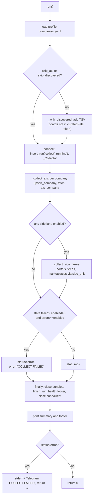
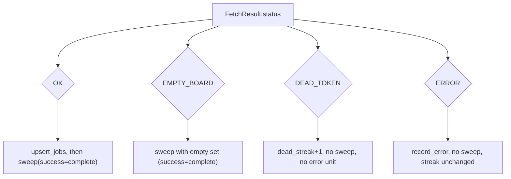

# Collect orchestrator (`jobdigest.collect`)

- **Source:** `src/jobdigest/collect.py` (615 lines)
- **Layer:** pipeline stage 1 (fetch + persist). Everything downstream (score, digest) reads what this stage writes.
- **Depends on:** `jobdigest.config` (YAML loaders), `jobdigest.ats` (adapters, `FetchResult`, `FetchStatus`), `jobdigest.db` (`upsert_company`, `upsert_job`, `update_company_fetch`, `bump_unseen_for_source`, `insert_run`, `finish_run`, `insert_portal_error`), `jobdigest.health`, `jobdigest.telegram`, and lazily `jobdigest.portals`, `jobdigest.feeds`, `jobdigest.marketplaces`.
- **Used by:** `jobdigest.cli._cmd_collect` (`src/jobdigest/cli.py`, `python -m jobdigest collect`), and the `collect` step of the pipeline workflow (see [github-workflows](../../infra/github-workflows.md)).
- **Tests:** `tests/test_collect.py`, `tests/test_collect_portals.py`, `tests/test_collect_marketplaces.py`, `tests/test_collect_no_llm.py` (asserts the collect source never imports OpenRouter), `tests/test_tombstone.py`, `tests/test_pipeline_e2e.py` (full pipeline, discovered boards, total-failure exit).

## Why this exists / responsibility

`collect.run` is the single entry point that turns configuration (which companies, portals, feeds, marketplaces are enabled) into rows in the `jobs` table. It does not decide *what is a good job*; it only
1. fetches every enabled source,
2. hands each normalized job to `upsert_job`, which applies the [hard filter](../filtering/hard-filter.md) and [legitimacy](../filtering/legitimacy.md) and legitimacy stamping (see [storage/jobs.md](../storage/jobs.md)),
3. records per-source health (company row fields, `portal_errors` rows, a `runs` row), and
4. sweeps jobs that vanished from a source so they can be closed ("tombstoned").

It also decides when the whole run counts as failed (exit code 1 and a Telegram alert).

## Public interface at a glance

| Symbol | Signature | Purpose |
|---|---|---|
| `run` | `run(*, db_path=None, client=None, sleep=None, fetch_fn=None, ats_only=False, skip_ats=False, skip_discovered=False, skip_portals=False, skip_feeds=False, skip_marketplaces=False, portal_fetch=None, portal_run_fn=None, feed_run_fn=None, marketplace_run_fn=None, telegram_http_post=None) -> int` | The whole stage; returns the process exit code (0 or 1). |
| `_Collector` | `_Collector(conn, run_id, profile)` | Per-run mutable state: stats counters, unit counters, persistence helpers. |
| `_collect_ats` | see below | ATS lane loop. |
| `_collect_side_lanes` | see below | Portal / feed / marketplace lanes. |
| `_with_discovered` | `(rows, discovered) -> list` | Merge curated and auto-discovered boards. |
| `_upsert_jobs`, `_sweep_source`, `_seen_keys`, `_dead_streak`, `_board_url`, ... | | Helpers, documented below. |

The injectable parameters (`client`, `sleep`, `fetch_fn`, `portal_run_fn`, `feed_run_fn`, `marketplace_run_fn`, `telegram_http_post`) exist for tests: they let the suite run the entire stage offline with fake fetchers and a fake Telegram transport.

## Key concepts

**Lane / unit.** A *lane* is a class of source: ATS boards, portals, feeds, marketplaces. A *unit* is one enabled source inside a lane (one company board, one portal row...). `_Collector.enabled_units` counts units that were actually attempted; `error_units` counts units that ended in an error. The run-level failure rule is based on those two counters only (see [`failed`](#failed)).

**Source string.** Every job row has a `source` column. For ATS jobs this is the company's yaml `id` (the adapters set `source=company.id`, e.g. `src/jobdigest/ats/greenhouse.py:146`); for the side lanes it is the row `name` (the code passes `name` to `_sweep_source`, and the tests use jobs whose `source` equals that name). Sweeping works per source string.

**Fetch status** (`jobdigest.ats.base.FetchStatus`, [ats-overview](../sources/ats-overview.md)):

| Status | Meaning | `last_error` written | Jobs upserted | Sweep | `record_error` | `dead_streak` |
|---|---|---|---|---|---|---|
| `OK` | board returned jobs | `NULL` | yes | yes, `success=result.complete` | no | reset to 0 |
| `EMPTY_BOARD` | board reachable, zero jobs | `NULL` | none | yes, with an empty set, `success=result.complete` | no | reset to 0 |
| `DEAD_TOKEN` | board does not exist (404-style) | `"dead_token"` | none | **no** | **no** | +1 |
| `ERROR` | any other failure | `result.error or "error"` | none | **no** | yes | unchanged |

`FetchResult.complete` (default `True`) lets an adapter say "this OK result is truncated/paginated incompletely"; an incomplete OK still upserts but does not sweep, so jobs that fell past the truncation point are not wrongly closed (`tests/test_tombstone.py::test_incomplete_ok_does_not_sweep`).

**Tombstoning.** A job that is absent from a *successful, complete* fetch gets `miss_count += 1`; on the second consecutive miss it is closed (`is_active = 0`, `close_reason = 'unseen_board'`). Seeing it again resets everything. The mechanism lives in `bump_unseen_for_source` (`src/jobdigest/db/jobs.py:509`; see [storage/jobs.md](../storage/jobs.md)). This module's responsibility is to decide *when* to call it and with *which* "seen" set.

## Detailed walkthrough

### `run`

**Location** `src/jobdigest/collect.py:512` · **Signature** `def run(*, db_path: Path | None = None, client: httpx.Client | None = None, sleep: Callable[[float], None] | None = None, fetch_fn: FetchFn | None = None, ats_only: bool = False, skip_ats: bool = False, skip_discovered: bool = False, skip_portals: bool = False, skip_feeds: bool = False, skip_marketplaces: bool = False, portal_fetch: tuple[str, ...] | None = None, portal_run_fn=None, feed_run_fn=None, marketplace_run_fn=None, telegram_http_post=None) -> int`

**Purpose / why it exists.** Orchestrates one collect run: load config, open the DB, run each lane, close the run record, print a summary and health footer, and alert on total failure. The order of the `try`/`finally` is deliberate: the run row is always finalized and resources are always closed, even when a lane raises.

**Called by** `cli.py:_cmd_collect` (flags `--ats-only`, `--skip-ats`, `--skip-discovered`, `--skip-portals`, `--skip-feeds`, `--skip-marketplaces`, `--portal-fetch`), tests. **Calls** `load_dotenv`, `configure`, `load_profile`, `load_companies`, `_with_discovered`, `load_discovered_boards`, `connect`, `insert_run`, `_collect_ats`, `_collect_side_lanes`, `finish_run`, `collect_health`, `format_health`, `telegram_deliver`.

**Parameters**

| name | type | default | meaning |
|---|---|---|---|
| `db_path` | `Path \| None` | `None` | Passed to `connect`; `None` means the default database (see [storage/connection-and-postgres-shim.md](../storage/connection-and-postgres-shim.md)). |
| `client` | `httpx.Client \| None` | `None` | Shared HTTP client for ATS fetches. If `None`, one is created lazily by `_collect_ats` and closed by `run`. A caller-supplied client is never closed here. |
| `sleep` | callable | `time.sleep` | Delay function handed to adapters and portals so tests do not really sleep. |
| `fetch_fn` | `FetchFn` | `_default_fetch` | `(company, client, sleep) -> FetchResult`; seam for tests. |
| `ats_only` | bool | False | Forces `skip_portals = skip_feeds = skip_marketplaces = True`. |
| `skip_ats` | bool | False | The ATS lane gets an empty list; discovered boards are not even loaded. |
| `skip_discovered` | bool | False | Do not merge `data/boards_india.tsv` boards. |
| `skip_portals/feeds/marketplaces` | bool | False | Disable that lane. |
| `portal_fetch` | `tuple[str,...] \| None` | None | If given, only portal rows whose fetch mode (`portals.portal_fetch_mode(row)`) is in the tuple run (e.g. `("http",)` skips browser-based rows; see [portals-overview](../sources/portals-overview.md)). |
| `portal_run_fn`, `feed_run_fn`, `marketplace_run_fn` | callables | None | Per-row runner overrides; `None` means the real `run_one`. |
| `telegram_http_post` | callable | None | Transport override for the failure alert. |

**Returns** `0` on success, `1` when `status == "error"`. Exceptions raised inside a lane are not caught (see [failure modes](#failure-modes-and-edge-cases)).

**Step-by-step**

1. **Bootstrap.** `load_dotenv()` (read `.env` into the process env, [paths-envfile-logutil](../foundation/paths-envfile-logutil.md)), `configure()` (logging), then `sleep = sleep or time.sleep` and `fetch_fn = fetch_fn or _default_fetch`. If `ats_only`, the three `skip_*` side-lane flags are forced on.
2. **Load config.**
   ```python
   profile = load_profile()
   payload = load_companies()
   rows = payload.get("companies") if isinstance(payload, dict) else None
   if not isinstance(rows, list):
       rows = []
   ```
   A malformed `companies.yaml` therefore degrades to "no companies" rather than crashing. `load_profile` supplies the `Profile` that the hard filter will use inside `upsert_job`.
3. **Merge discovered boards** only when `not skip_ats and not skip_discovered`: `rows = _with_discovered(rows, load_discovered_boards())` (see [`_with_discovered`](#_with_discovered)). Then one `collect start ...` log line including the number of yaml-enabled rows.
4. **Open state.** `conn = connect(db_path)`; `state = _Collector(conn, insert_run(conn, "collect", "running"), profile)`. `insert_run` writes a `runs` row with status `running`; its id is `state.run_id`. Local flags: `own_client = False`, `status = "ok"`, `error_msg = None`, `open_bundle = []` (portal session bundles to close), `health_footer = ""`.
5. **`try:` ATS lane.** `client, own_client = _collect_ats(state, [] if skip_ats else rows, client=client, sleep=sleep, fetch_fn=fetch_fn)`. The returned `client` may be a freshly created one; `own_client` says whether `run` must close it.
6. **Side lanes**, only if at least one of the three is enabled: `_collect_side_lanes(...)`. The `on_bundle` callback is a lambda that appends `(module, bundle)` to `open_bundle` *immediately* when the bundle is opened, so even if a later portal raises, `finally` can still close the browser/session objects.
7. **Failure rule:**
   ```python
   if state.failed:
       status = "error"
       error_msg = "COLLECT FAILED"
   ```
8. **`finally:` always runs**:
   1. `for mod, bundle in open_bundle: mod.close_bundle(bundle)`.
   2. `finish_run(conn, state.run_id, status, state.stats, error=error_msg)` stamps `finished_at`, `status`, `stats_json`, `error`.
   3. Health footer: `text = format_health(collect_health(conn))`; if `text != HEALTHY` (`"All sources healthy."`) it is kept in `health_footer`. The whole block is wrapped in `try/except Exception: log.exception("health footer failed")` so a reporting bug can never change the exit code.
   4. `conn.close()`, then `client.close()` only if `own_client and client is not None`.
9. **Report** (after the `finally`): log `collect done status=... k=v ...`, `print(_summary_line(status, stats))`, and if there is a footer `print(health_footer)`. The footer goes to stdout only; it is not sent to Telegram by this module.
10. **Exit path.** If `status == "error"`: print `COLLECT FAILED` to stderr, call `telegram_deliver("COLLECT FAILED", required=True, http_post=telegram_http_post)` and return `1`; otherwise return `0`. `required=True` means that when `JOBDIGEST_REQUIRE_TELEGRAM` is set (hosted cron) and credentials are missing, `deliver` reports failure loudly; locally a missing token just skips the send ([telegram](../delivery/telegram.md)). The return value of `telegram_deliver` is ignored: the exit code is `1` regardless of whether the alert was delivered.

**Data flow.** YAML + TSV -> `rows` -> `_collect_ats` -> per board `FetchResult` -> `upsert_company/update_company_fetch/upsert_job/bump_unseen_for_source` (DB writes) and `state.stats`; side lanes -> `side_unit` -> same persistence; `state.stats` -> `finish_run` + stdout summary; `state.failed` -> exit code and Telegram.

**Example output** (format from `_summary_line`):
```
collect ok fetched=312 inserted=7 updated=305 skipped=0 pass=11 reject=301 missed=2 tombstoned=0
```

**Plain-English summary.** Load what to fetch, fetch each source in isolation, write whatever succeeded, count what failed, and only call the whole run a failure if *every* attempted source failed. Always finalize the run record and close resources.

### `_Collector`

**Location** `src/jobdigest/collect.py:254` · **Responsibility.** Holds the per-run state that the ATS lane and the three side lanes share, so that they all write stats and errors the same way. A plain class (no inheritance); instantiated once per `run`.

| Field | Type | Meaning |
|---|---|---|
| `conn` | DB connection | Single connection used for the whole run. |
| `run_id` | int | Row id in `runs`; used when writing `portal_errors`. |
| `profile` | `Profile` | Handed to `upsert_job` for hard-filtering. |
| `stats` | `dict[str,int]` | Copy of `_ZERO_STATS`: `fetched, inserted, updated, skipped, pass, reject, errors, missed, tombstoned`. Serialized into `runs.stats_json`. |
| `enabled_units` | int | Units attempted (incremented before the fetch). |
| `error_units` | int | Units that ended in error (incremented in `record_error`). |

Lifecycle: created after `insert_run`, mutated by the lanes, read by `run` at the end (`failed`, `stats`). The constant `_ZERO_STATS` (`collect.py:241`) is copied with `dict(_ZERO_STATS)` so runs never share state.

#### `record_error`

**Location** `collect.py:265` · **Signature** `def record_error(self, name: str, url: str, detail: str, *, error_class: str | None = None, http_status: int | None = None) -> None`

Counts an error unit and persists it: `error_units += 1`, `stats["errors"] += 1`, then `insert_portal_error(conn, run_id=..., portal_name=name, url=url, error_class=error_class or _error_class(detail), http_status=http_status, detail=detail)`. ATS board failures are also written to `portal_errors` (with the company id as `portal_name`), which is why [health](../delivery/followups-and-health.md) can list them. **Called by** `ats_company` (ERROR status) and `side_unit` (exception or non-ok result). `portal_errors` is the table that `health.collect_health` reads (`error_class = 'parse'` + `detail LIKE '%0 cards%'` becomes the "0 CARDS" section).

#### `ats_company`

**Location** `collect.py:286` · **Signature** `def ats_company(self, company: CompanyConfig, company_id: int, result: FetchResult) -> None`

**Purpose.** Persist exactly one ATS board outcome: company health columns, jobs, and sweep. **Called by** `_collect_ats`. **Calls** `_board_url`, `update_company_fetch`, `_dead_streak`, `_upsert_jobs`, `_sweep_source`, `record_error`.

**Step-by-step**

1. `status = result.status`; `complete = bool(getattr(result, "complete", True))` (defensive for fake results without the field).
2. `board_url = _board_url(company)` (the canonical API URL, stored as `resolved_url`).
3. Map the status to the `last_error` text:
   ```python
   error = {
       FetchStatus.DEAD_TOKEN: "dead_token",
       FetchStatus.OK: None,
       FetchStatus.EMPTY_BOARD: None,
   }.get(status, result.error or "error")
   ```
   Only `ERROR` falls through to the default, giving the adapter's message (or the literal `"error"`).
4. `update_company_fetch(conn, company_id, http_status=result.http_status, job_count=len(result.jobs) if status == OK else 0, error=error, resolved_url=board_url, dead_streak=_dead_streak(conn, company_id, status))`. This is done **before** any job work and happens for every status, so the company row always reflects the latest attempt. `last_job_count` is `0` for non-OK, which together with `last_error` empty is what health reports as an empty board (`last_error == ""` and `last_job_count == 0`; see the empty-ok caveat below). Note `error=None` is stored as NULL; health's `err == ""` check relies on `str(row["last_error"] or "").strip()`.
5. Branch on status:
   - `OK`: `_upsert_jobs(conn, profile, result.jobs, stats, company_id=company_id)` then `_sweep_source(conn, company.id, result.jobs, stats, success=complete)`.
   - `EMPTY_BOARD`: `_sweep_source(conn, company.id, [], stats, success=complete)`: an empty seen-set means every active job of that source gets a miss.
   - anything else except `DEAD_TOKEN` (i.e. `ERROR`): `record_error(company.id, board_url, result.error or "error", http_status=result.http_status)`.
   - `DEAD_TOKEN`: nothing more (no error unit, no sweep).

**Why DEAD_TOKEN is not an error unit.** A removed board is an expected, persistent condition tracked via `dead_streak`; health only reports it once the streak is `>= 2`. It is also deliberately excluded from `failed`, so a run where every board is dead exits 0.

#### `side_unit`

**Location** `collect.py:326` · **Signature** `def side_unit(self, kind: str, row: dict, run_fn: Callable[[dict], Any], *, url_key: str = "url") -> None`

**Purpose.** Run one portal/feed/marketplace row through its runner and persist the outcome. **Called by** `_collect_side_lanes`. **Calls** `run_fn(row)`, `record_error`, `_result_ok`, `_result_jobs`, `_upsert_jobs`, `_sweep_source`.

**Parameters**: `kind` is `"portal" | "feed" | "marketplace"` (used for logs); `row` is the YAML dict (`name`, `url` ...); `run_fn(row)` returns a result object with `status`, `jobs`, and on failure `detail`/`error`/`error_class`/`http_status`; `url_key` is the row key holding the URL (`"site"` for marketplaces).

**Step-by-step**
1. `enabled_units += 1`; `name = str(row.get("name") or "")`, `url = str(row.get(url_key) or "")`.
2. `try: result = run_fn(row)`; on **any** `Exception`, `record_error(name, url, str(exc))` and return. Unlike the ATS lane (which catches only `httpx.HTTPError`), one misbehaving portal parser can never abort the run.
3. `if not _result_ok(result)`: build `detail = str(getattr(result, "detail", None) or getattr(result, "error", None) or "error")` and call `record_error(name, url, detail, error_class=getattr(result, "error_class", None) or None, http_status=getattr(result, "http_status", None))`; return. No sweep: a failing portal does not age out its jobs (`test_tombstone.py::test_portal_zero_cards_does_not_bump`).
4. Otherwise `jobs = _result_jobs(result)`, `_upsert_jobs(conn, profile, jobs, stats)` (no `company_id`), then `_sweep_source(conn, name, jobs, stats, success=True)`.

**The empty-OK-result caveat.** An `ok` result with zero jobs *does* sweep, with `success=True`. The in-code comment says so explicitly: `tests/test_tombstone.py` pins this (`test_empty_rss_two_ok_fetches_closes`). Consequence: a portal whose parser silently starts returning an empty list but still reports `ok` will, after two runs, tombstone every job from that source. `test_portal_zero_cards_does_not_bump` shows the intended guard for portals: a parser that finds no cards reports an `error` result (`error_class="parse"`, `detail="0 cards"`), which takes the non-sweeping error path. This module has no extra guard for feeds and marketplaces.

#### `failed`

**Location** `collect.py:366` (a `@property`) · `return self.enabled_units > 0 and self.error_units == self.enabled_units`.

The run is failed only if at least one unit was attempted **and every attempted unit errored**. Consequences:
- One bad board among many does not fail the run: it is visible in `portal_errors`, `companies.last_error` and the health footer.
- Zero enabled units (all skipped, or empty config) is **not** a failure.
- `DEAD_TOKEN` and `EMPTY_BOARD` units are not errors, so a run of nothing but dead boards exits 0.
- A single-source run (e.g. `--skip-ats` with one portal) that errors, fails the run (`test_portal_zero_cards_does_not_bump` expects exit `1`).

When it is true, `run` sets status `error`, writes `error = "COLLECT FAILED"` into `runs`, prints to stderr, sends the Telegram alert, and returns `1` (tests: `tests/test_collect.py::test_collect_all_error_fails`, `::test_collect_fail_sends_telegram` which asserts the exact request body `{"chat_id": "42", "text": "COLLECT FAILED"}` with no `parse_mode`; `tests/test_pipeline_e2e.py::test_collect_total_failure_exits_1_and_alerts`).

### `_Collector.__init__`
**Location** `src/jobdigest/collect.py:257` · **Signature** `def __init__(self, conn, run_id: int, profile) -> None`
Builds the per-run state object. It keeps the open connection (`self.conn`), the `runs` row id (`self.run_id`, returned by `insert_run`), and the candidate `profile`
(needed by `upsert_job` for the hard filter). It initialises `self.stats` as a **copy** of `_ZERO_STATS` (`dict(_ZERO_STATS)`, so runs never share counters) and the two unit
counters `self.enabled_units` and `self.error_units` to 0. `collect.run` creates exactly one `_Collector` per run, after `insert_run`.

### `_collect_ats`

**Location** `collect.py:375` · **Signature** `def _collect_ats(state: _Collector, rows: list, *, client: httpx.Client | None, sleep: Callable[[float], None], fetch_fn: FetchFn) -> tuple[httpx.Client | None, bool]`

**Purpose.** Iterate company rows, register each in the `companies` table, fetch the enabled and supported ones. Returns `(client, created_client)`.

**Step-by-step**
1. For each `raw` in `rows`: skip non-dicts. `company = _row_company(raw)` normalizes to a `CompanyConfig` (strings via `str(x or "")`, `enabled = bool(row.get("enabled", False))`).
2. **Always** `company_id = upsert_company(conn, company.id, company.name, company.ats, company.token, company.enabled)` (before the enabled check) so the DB mirrors YAML, including `enabled = 0` for disabled companies. (`companies.slug` = yaml `id`, see [storage/jobs.md](../storage/jobs.md).)
3. `ats_key = company.ats.strip().lower()`. If `not company.enabled`: log and `continue`. If `ats_key not in KNOWN_ATS`: log and `continue` (typos or unsupported systems are silently skipped; they are not counted as errors).
4. `state.enabled_units += 1`. Lazily `client = make_client()` and `created = True` if none was given (so runs with no enabled companies never build a client).
5. `result = fetch_fn(company, client, sleep)` inside `try/except httpx.HTTPError as exc`, mapping the exception to `FetchResult(FetchStatus.ERROR, None, [], error=str(exc))`. Other exceptions propagate out of `run` (adapters are expected to translate their own failures into `FetchResult`).
6. Log `company fetch done ...` and call `state.ats_company(company, company_id, result)`.

The `created` flag is returned so `run` closes only clients it created.

### `_collect_side_lanes`

**Location** `collect.py:427` · **Signature** `def _collect_side_lanes(state, *, skip_portals, skip_feeds, skip_marketplaces, portal_fetch, sleep, portal_run_fn, feed_run_fn, marketplace_run_fn, on_bundle) -> None`

1. Imports `feeds`, `marketplaces`, `portals` lazily (keeps ATS-only runs light).
2. Row selection via `_enabled_rows(payload, key)` (dict rows with truthy `enabled`): portals from `load_portals()` key `"portals"`, filtered to modes in `portal_fetch` if set; feeds key `"feeds"`; marketplaces key `"marketplaces"`. Skipped lanes yield `[]`.
3. **Session bundle.** If `portal_run_fn is None and portal_rows`, compute the set of fetch modes among rows whose mode is in `portals_pkg.ALLOWED_FETCH` and `bundle = portals_pkg.open_bundle(modes)`. `on_bundle(portals_pkg, bundle)` is called unconditionally (bundle may be `None`) so `run` can always call `close_bundle`.
4. Shared politeness state: `last_host: dict` (per-host last request time) and `robots_cache: dict[str, str]`, closed over by the inner `run_portal(row)`, which uses `portal_run_fn(row)` if provided else `portals_pkg.run_one(row, sessions=bundle, sleep=sleep, last_host=last_host, robots_cache=robots_cache)` (see [portals-session-and-robots](../sources/portals-session-and-robots.md)).
5. Run sequentially: portals via `state.side_unit("portal", row, run_portal)`, feeds via `side_unit("feed", row, feed_run_fn or feeds_mod.run_one)`, marketplaces via `side_unit("marketplace", row, marketplace_run_fn or marketplaces_mod.run_one, url_key="site")`.

### `_with_discovered`

**Location** `collect.py:114` · **Signature** `def _with_discovered(rows: list, discovered: list[dict]) -> list`

Curated companies win. Builds `seen = {(ats.strip().lower(), token.strip()) for r in rows if isinstance(r, dict)}`, then `extra = [d for d in discovered if (d["ats"], d["token"]) not in seen]` and returns `list(rows) + extra`. Discovered rows come from `config.load_discovered_boards` (TSV `data/boards_india.tsv`, overridable by env `JOBDIGEST_DISCOVERED_BOARDS`; written by [expand](../sources/expand.md)), already lowercased/stripped, with `id = f"{ats}:{token}"`, `enabled: True`. De-duplication is on the pair `(ats, token)`, **not** on company `id`, so the same board listed under a different curated id is fetched once; two discovered rows with the same pair are *not* de-duplicated against each other here. Tests: `test_pipeline_e2e.py::test_collect_includes_discovered_boards_without_duplicating_curated` (acme fetched once) and `::test_skip_discovered_flag_leaves_only_curated_boards`.

### `_upsert_jobs`

**Location** `collect.py:189` · **Signature** `def _upsert_jobs(conn, profile, jobs: list[NormalizedJob], stats: dict[str, int], *, company_id: int | None = None) -> None`

Stats accounting, per call: `stats["fetched"] += len(jobs)` first. For every job, `action, job_id = upsert_job(conn, profile, apply_url=..., hosted_url=..., source=..., external_id=..., company_id=..., company=..., title=..., location_raw=..., description_text=..., raw_json=..., ats=..., employment_hint=..., workplace_hint=..., posted_at=...)`.
- `action == "skip"` or `job_id is None` (`job_identity` found no usable URL or `ats://source/ext` key): `skipped += 1`, continue.
- `action == "insert"`: `inserted += 1`; anything else (`"update"`): `updated += 1`.
- `_hard_row(conn, job_id)` re-reads `hard_status`/`hard_reason` from the row; `hard_status == "pass"` -> `pass += 1`, else `reject += 1`.

Consequences: `fetched == inserted + updated + skipped` (per run, across lanes); `pass + reject == inserted + updated`; and because `upsert_job` re-runs the hard filter on every sighting, the `pass`/`reject` numbers describe *all jobs seen this run*, not only new ones. `_hard_row` falls back to `job_hard_status` (returns `"pending"` for a missing row), which would be counted as reject; that path is not expected to occur.

### `_sweep_source`

**Location** `collect.py:174` · **Signature** `def _sweep_source(conn, source: str, jobs: list[NormalizedJob], stats: dict[str, int], *, success: bool) -> None`

Calls `bump_unseen_for_source(conn, source, _seen_keys(jobs), success=success)` and adds the returned `missed`/`tombstoned` to `stats`. With `success=False`, `bump_unseen_for_source` returns zeros immediately (that is how an incomplete OK fetch avoids sweeping). Otherwise it loads every `is_active = 1` job of that source, skips those whose key is in the seen set, increments `miss_count` for the rest and closes at `miss_count >= 2` (`close_reason = 'unseen_board'`).

### `_seen_keys`

**Location** `collect.py:157` · **Signature** `def _seen_keys(jobs: list[NormalizedJob]) -> set[str]`

Builds the set of identity keys of the jobs seen this fetch, in the same key space that `bump_unseen_for_source` uses for stored rows (`job_seen_key`: external id if non-empty, else normalized apply URL). For each job: `ext = (job.external_id or "").strip()`; if present key = `job_seen_key(external_id=ext, apply_url_norm=None)` = `ext`; else `_col, norm = job_identity(job.apply_url, job.hosted_url, job.source, job.external_id)` and key = `job_seen_key(external_id=None, apply_url_norm=norm)`. Empty/`None` keys are dropped. Keeping both sides on the same rule is what prevents live jobs from being falsely missed.

### `_board_url`

**Location** `src/jobdigest/collect.py:66` · **Signature** `def _board_url(company: CompanyConfig) -> str`
**Purpose** Returns the canonical public API URL of a company's board so it can be stored in `companies.resolved_url` after each fetch (useful when debugging a dead or erroring board by hand). It does **not** fetch anything and the adapters do not read it; each adapter builds its own request URL.
**Called by** `_Collector.ats_company` (`collect.py:296`), which passes the result as `resolved_url=` to `update_company_fetch`. **Calls** nothing.
**Step by step** `token = company.token`, then an `if company.ats == ...` ladder returning an f-string per ATS: greenhouse `https://boards-api.greenhouse.io/v1/boards/{token}/jobs?content=true`, lever `https://api.lever.co/v0/postings/{token}?mode=json`, ashby `https://api.ashbyhq.com/posting-api/job-board/{token}`, workable `https://apply.workable.com/api/v1/widget/accounts/{token}?details=true`, smartrecruiters `https://api.smartrecruiters.com/v1/companies/{token}/postings`, bamboohr `https://{token}.bamboohr.com/careers/list`. Any other `ats` falls through to the sentinel `ats://{ats}/{token}`. The token is interpolated unescaped.
Verified offline with `CompanyConfig("i","N",ats,"tok")`: the six URLs above with `tok` substituted, and `recruitee` -> `ats://recruitee/tok`. Lever is always the US host here even though the adapter/probe tooling also knows an EU host (whether the adapter itself falls back to EU was not checked for this entry).

### `_dead_streak`

**Location** `src/jobdigest/collect.py:83` · **Signature** `def _dead_streak(conn, company_id: int, status: FetchStatus) -> int`
**Purpose** Computes the new value of `companies.dead_streak`, the count of consecutive fetches that came back `DEAD_TOKEN`. One 404 might be a blip; the health report ([followups-and-health](../delivery/followups-and-health.md)) only flags a dead token when `last_error == "dead_token"` and the streak is `>= 2` (`health.py:63`).
**Called by** `_Collector.ats_company` (`collect.py:309`, argument `dead_streak=` of `update_company_fetch`). **Calls** `conn.execute`.
**Parameters** `conn` (open connection, row-by-name access), `company_id` (`companies.id`), `status` (this fetch's `FetchStatus`). **Returns** the new streak as an `int`; nothing is written here, the caller persists it.
**Step by step**
1. `SELECT dead_streak FROM companies WHERE id = ?`; `cur = int(row["dead_streak"] or 0) if row is not None else 0` (a missing row or NULL counts as 0).
2. `DEAD_TOKEN` -> `cur + 1`.
3. `OK` or `EMPTY_BOARD` -> `0` (any live board resets the streak).
4. Anything else (`ERROR`) -> `cur` unchanged: a transient failure neither extends nor clears the streak.
Verified against a scratch SQLite DB with one company at `dead_streak=1`: `DEAD_TOKEN` -> 2, `ERROR` -> 1, `OK` -> 0, `EMPTY_BOARD` -> 0; for an unknown company id `DEAD_TOKEN` -> 1 and `ERROR` -> 0.

### Small helpers

| Symbol | Location | Behavior |
|---|---|---|
| `_row_company(row)` | `collect.py:55` | Dict -> `CompanyConfig`, coercing every field to `str` and `enabled` to `bool` (default False). |
| `_board_url(company)` | `collect.py:66` | Canonical board API URL stored as `companies.resolved_url`; see [`_board_url`](#_board_url). |
| `_dead_streak(conn, company_id, status)` | `collect.py:83` | New `dead_streak` value; see [`_dead_streak`](#_dead_streak). |
| `_default_fetch(company, client, sleep)` | `collect.py:96` | `get_adapter(company.ats, client, sleep=sleep).fetch(company)`; raises `RuntimeError` if `client is None`. See [ats-overview](../sources/ats-overview.md). |
| `_error_class(detail)` | `collect.py:107` | `"timeout"` if the lower-cased detail contains `timeout`, else `"http"`; used for `portal_errors.error_class` when the result has none. |
| `_dict_rows(payload, key)` | `collect.py:129` | `payload[key]` filtered to dicts; `[]` for non-dict payloads or non-list values. |
| `_enabled_rows(payload, key)` | `collect.py:371` | `_dict_rows` filtered by `bool(row.get("enabled"))`. |
| `_result_ok(result)` | `collect.py:136` | `str(getattr(result, "status", "")).lower() == "ok"`; works for string and enum-like statuses. |
| `_result_jobs(result)` | `collect.py:140` | `list(result.jobs)` or `[]`. |
| `_hard_row(conn, job_id)` | `collect.py:147` | `(hard_status, hard_reason)` of a job row. |
| `_summary_line(status, stats)` | `collect.py:503` | The one-line stdout summary (`collect {status} fetched=... tombstoned=...`; `errors` is not printed in it but is in the final log line and `stats_json`). |
| `FetchFn`, `TelegramHttpPost` | `collect.py:48`, `:52` | Type aliases for the test seams. |

## Failure modes and edge cases

- **Exception inside a lane:** `finally` still finalizes the run, but `status` is still `"ok"` at that point, so `finish_run` records `status = 'ok'` and the exception then propagates (traceback, non-zero exit from Python). The `runs` row of a crashed collect therefore says `ok`. This looks unintended (I did not find code that corrects the status afterwards); `health.collect_health` and the digest read the last collect run, see [followups-and-health](../delivery/followups-and-health.md) and [digest](../delivery/digest.md), so check them before changing it.
- **Partial failure** is invisible to the exit code; look at the stdout footer, `companies.last_error`, `portal_errors`, and `runs.stats_json["errors"]`.
- **Unknown or misspelled `ats`** is skipped silently (`log.debug` only) and never counted.
- **Empty OK sweeps** (see [`side_unit`](#side_unit)). ATS side: an `OK` result with an empty job list is still `OK`, writes `last_job_count = 0`, and sweeps; whether an adapter returns `EMPTY_BOARD` or `OK` with no jobs for an empty board is decided in the adapter (see the per-ATS pages under [sources](../sources/ats-overview.md)).
- **Alert delivery failure** does not change the exit code.
- **`dead_streak` and ERROR**: an `ERROR` leaves the streak untouched, so dead, error, dead still counts 2.

## How to modify / extend safely

- **New ATS:** add the adapter and register it in `KNOWN_ATS`/`get_adapter` ([ats-overview](../sources/ats-overview.md)); add a `_board_url` branch (otherwise `ats://...` is stored). Make sure the adapter sets `NormalizedJob.source = company.id`, or the sweep will not match stored rows.
- **New lane:** write a `run_one(row)` returning an object with `status`, `jobs`, and failure `detail`/`error_class`/`http_status`, then add a `side_unit` loop in `_collect_side_lanes`. Sweeping uses `row["name"]` as the source, so the jobs' `source` must equal it.
- **Changing the failure rule:** edit `_Collector.failed`; tests `test_collect_all_error_fails`, `test_collect_fail_sends_telegram`, `test_collect_total_failure_exits_1_and_alerts` and `test_portal_zero_cards_does_not_bump` pin the current behavior.
- Do not add LLM calls here: `tests/test_collect_no_llm.py` greps the source.

## Diagrams



The diagram shows the single decision that sets the exit code: only a total-failure run goes down the error path, and the `finally` block runs on both paths.



Each status maps to a different combination of "upsert", "sweep" and "count as error unit"; this table is what keeps transient outages from tombstoning jobs.
