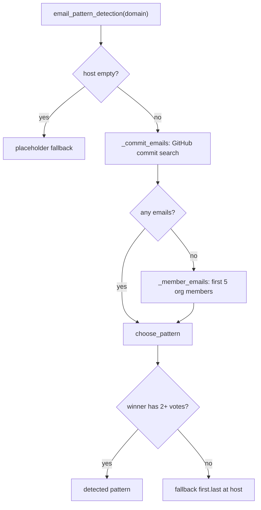

# Contacts: domain inference and email pattern detection

- **Source**: `src/jobdigest/contacts/domain.py` (81 lines), `src/jobdigest/contacts/pattern.py` (112 lines).
- **Role**: turn a company name into an email domain, then guess how that domain forms addresses (`first.last@`, `flast@`, ...).
- **Depends on**: `httpx`, `ats/http_client.USER_AGENT`, `contacts/github.github_headers`. **Used by**: [`run_pipeline`](pipeline-and-run.md#run_pipeline).
- **Tests**: `tests/test_contacts_domain.py`, `tests/test_contacts_email_pattern.py`, `tests/test_contacts_github.py::test_email_pattern_from_commits`.

## Key concepts

**Email pattern.** A format string with placeholders `{first}`, `{last}`, `{fi}` (first initial), `{li}` (last initial) and, before resolution, `{domain}`. Examples: `{first}.{last}@acme.com`, `{fi}{last}@acme.com`. `contacts/email.py:construct_email` fills them ([rank-and-email](rank-and-email.md#construct_email)).

**Vote.** Each observed company email addresses implies one pattern; `choose_pattern` counts them and accepts a winner only with at least `MIN_PATTERN_VOTES = 2` agreeing addresses.

## Domain inference

Strategy: ask Clearbit's autocomplete first (a free, unauthenticated company-name suggestion endpoint), and if that gives nothing, guess `<slug>.<suffix>` hostnames and check that they respond and do not redirect somewhere unrelated.

Constants: `_CLEARBIT = "https://autocomplete.clearbit.com/v1/companies/suggest?query="`, `_SUFFIXES = ("com", "io", "co.in", "in")` (probed in that order; `co.in` and `in` reflect an India-focused job pool).

### `_slug`

**Location** `src/jobdigest/contacts/domain.py:17` · `def _slug(company: str) -> str`. Lowercases and strips every run of non `[a-z0-9]` characters: `_slug("Acme, Inc.") == "acmeinc"`, `_slug("Tata Consultancy Services (TCS)") == "tataconsultancyservicestcs"` (verified by running). Non-ASCII letters are deleted, not transliterated (unlike `email._ascii_token`). Used by `domain_inference` and `_final_host_matches`.

### `_clearbit_domain`

**Location** `src/jobdigest/contacts/domain.py:21` · `def _clearbit_domain(name: str, client: httpx.Client) -> str | None`

1. `GET _CLEARBIT + quote_plus(name)` with `User-Agent` and `timeout=8`. The shared client has `follow_redirects=False`, and this call does not override it.
2. Non-200 -> `None`. JSON decoding or transport failure (`httpx.HTTPError`, `ValueError`) -> warning log, `None`.
3. The payload must be a non-empty list; take element `0` only (Clearbit orders by relevance). It must be a dict with a truthy `"domain"`; return `str(domain).strip().lower() or None`.

Taking only the first suggestion is a precision/recall choice: ambiguous names ("Apple") get the top hit with no verification that it is the right company. Fixtures: `tests/fixtures/contacts/clearbit_hit.json` (`[{"name": "Acme Inc", "domain": "acme.com"}]`) and `clearbit_empty.json`.

### `_final_host_matches`

**Location** `src/jobdigest/contacts/domain.py:43` · `def _final_host_matches(resp: httpx.Response, slug: str) -> bool`

The "final-host check". After redirects, `resp.url.host` is slugified and the probe is accepted only if the company slug is a substring of it: `bool(host) and slug in host`. This rejects parked-domain pages and redirects to unrelated hosts (`acme.com` -> `parked.example`), but accepts `www.acme.com` (host slug `wwwacmecom` contains `acme`). Because it is a substring test, a very short slug can match accidentally (for example a slug `ai` matches any host containing "ai"); no minimum slug length is enforced. Tests: `test_domain_probe_rejects_redirect_to_unrelated_host`, `test_domain_probe_accepts_redirect_to_www_same_slug`.

### `_probe_domain`

**Location** `src/jobdigest/contacts/domain.py:49` · `def _probe_domain(slug: str, client: httpx.Client) -> str | None`

For each suffix: build `candidate = f"{slug}.{suffix}"`, `GET https://{candidate}` with `timeout=5, follow_redirects=True` (this per-request override is what enables redirect following despite the client default). Transport error -> debug log, try next suffix. Status `>= 400` -> next. If the final host does not match the slug -> info log, next. First survivor is returned as the candidate string (the original `candidate`, not the final host). All fail -> `None`. Worst case 4 sequential requests of up to 5 s.

### `domain_inference`

**Location** `src/jobdigest/contacts/domain.py:71` · `def domain_inference(company: str, client: httpx.Client) -> str | None`

1. `name = (company or "").strip()`; empty -> `None` (no requests).
2. `_clearbit_domain(name, client)`; a hit returns immediately (never verified by a probe).
3. `slug = _slug(name)`; empty slug (name with no ASCII alphanumerics, e.g. `"!!!"`) -> `None`.
4. `return _probe_domain(slug, client)`.

Real outputs (mock transport: Clearbit returns `[]`, `acme.io` returns 200, `acme.com` redirects to `parked.example`): `domain_inference("Acme", c) == "acme.io"` (the `.com` probe was rejected by the host check, `.io` accepted), `domain_inference("", c) is None`, `domain_inference("!!!", c) is None`.

Called by `run_pipeline`. Failure behavior: never raises for HTTP/JSON problems; other exceptions propagate to `run_pipeline`'s guard.

## Email pattern detection

### `MIN_PATTERN_VOTES`, `_EXPECTED_ERRORS`, `_PATTERN_REGEXES`

`MIN_PATTERN_VOTES = 2`. `_EXPECTED_ERRORS = (httpx.HTTPError, ValueError, AttributeError, TypeError)`: the last two cover unexpected JSON shapes such as a list where a dict is expected.

`_PATTERN_REGEXES` is an ordered list of `(regex, template)`; the first match wins. Each regex is applied to `local + "@"`:

| Order | Regex | Template | Intended shape |
|---|---|---|---|
| 1 | `^([a-z]+)\.([a-z]+)@` | `{first}.{last}@{domain}` | `john.smith` |
| 2 | `^([a-z])([a-z]{3,})@` | `{fi}{last}@{domain}` | `jsmith` |
| 3 | `^([a-z]{3,})([a-z])@` | `{first}{li}@{domain}` | `johns` |
| 4 | `^([a-z]{3,})@` | `{first}@{domain}` | `john` |

**Observation (verified by running).** Rule 2 matches any all-lowercase local part of 4+ letters, so rules 3 and 4 only ever apply to what rule 2 does not match: 3 letters for rule 4 (`joe` -> `{first}@`), and rule 3 is unreachable (anything it matches has at least 4 letters and rule 2 already matched it). Results: `jsmith`, `johns`, `john` all infer `{fi}{last}@acme.com`; `jo` -> `None`; `john.smith2`, `John-Smith` -> `None` (digits and hyphens do not match, and `John-Smith` is lowercased to `john-smith` first, also no match); `a.b` and `j.smith` -> `{first}.{last}@acme.com`. So a domain that really uses `{first}@` with 4+ letter first names is detected as `{fi}{last}@`. This is the actual behavior; do not rely on `{first}li` or `{first}@` detection for common names.

### `_infer_pattern_from_email`

**Location** `src/jobdigest/contacts/pattern.py:24` · `def _infer_pattern_from_email(email: str, domain: str) -> str | None`. Takes the part before the first `@`, lowercases, tries each regex against `local + "@"`, and returns the template with `{domain}` replaced by `domain`. The domain of the sample email is not checked here; callers pre-filter by host. Returns `None` if nothing matches.

### `choose_pattern`

**Location** `src/jobdigest/contacts/pattern.py:32` · `def choose_pattern(emails: list[str], host: str, *, min_votes: int = MIN_PATTERN_VOTES) -> str | None`

Builds `votes: dict[str, int]` by inferring a pattern for each email and counting; `None` if no email produced a pattern. `best = max(votes, key=lambda key: votes[key])` and returns it only if `votes[best] >= min_votes`. Ties are resolved by `max` returning the first key encountered with the top count (insertion order). Verified:

```
choose_pattern(["a.b@x.com"], "x.com")                                  -> None            (1 vote)
choose_pattern(["john.smith@x.com","mary.jones@x.com","jsmith@x.com"], "x.com") -> "{first}.{last}@x.com"  (2 vs 1)
choose_pattern(["john.smith@x.com","jsmith@x.com"], "x.com")            -> None            (1 vs 1)
```

Why a threshold: a single GitHub commit email may be an alias or an individual quirk; two agreeing samples are weak but meaningful evidence. Test: `test_choose_pattern_needs_two_votes`.

### `_commit_emails`

**Location** `src/jobdigest/contacts/pattern.py:47` · `def _commit_emails(host: str, client: httpx.Client, headers: dict[str, str]) -> list[str]`

Searches public GitHub commits whose committer email is at the company domain: `https://api.github.com/search/commits?q={quote_plus(host)}+committer-email:{host}&per_page=10`. For each item it checks `commit.author.email` and `commit.committer.email` and keeps those containing `@{host}` (case-insensitive) and not containing `noreply`. Non-200 returns `[]`; errors in `_EXPECTED_ERRORS` are logged and whatever was collected so far is returned. The check is a plain substring test on `@{host}`, so for host `acme.com` an address like `x@acme.community` would also pass. Test: `test_email_pattern_from_commits`.

### `_member_emails`

**Location** `src/jobdigest/contacts/pattern.py:68` · `def _member_emails(host: str, org_slug: str, client: httpx.Client, headers: dict[str, str]) -> list[str]`

Fallback sample source. `GET /orgs/{org_slug}/members?per_page=10`, then for the first 5 members `GET /users/{login}` and keep the public profile `email` if it contains `@{host}`. Non-200 on the list returns `[]`; a non-200 for one user just skips that user. All errors (including a non-list members payload via `TypeError`) are logged and the partial list returned. Up to 6 requests.

### `email_pattern_detection`

**Location** `src/jobdigest/contacts/pattern.py:98` · `def email_pattern_detection(domain: str, client: httpx.Client, *, token: str | None = None) -> str`

Always returns a pattern string, never `None`.

1. `host = (domain or "").strip().lower()`. `fallback = f"{{first}}.{{last}}@{host}"` if host else the literal `"{first}.{last}@{domain}"` (an unresolved placeholder).
2. Empty host -> return the placeholder fallback with no requests.
3. `headers = github_headers(token)`: `Authorization: Bearer` only if a token resolves (the argument, else env var) ([github-and-jd](github-and-jd.md#github_headers)).
4. `emails = _commit_emails(...)`. If empty, `emails = _member_emails(host, host.split(".")[0], ...)`: the org slug is again the first domain label. Member lookup is a fallback only when commit search found nothing, not when it found too few.
5. `return choose_pattern(emails, host) or fallback`.

Real outputs: two commits with `john.smith@` and `mary.jones@` for `"Acme.com"` -> `{first}.{last}@acme.com`; `""` -> `{first}.{last}@{domain}`; a client returning 404 for everything, domain `zzz.com` -> `{first}.{last}@zzz.com`.

The default `{first}.{last}@host` is the most common corporate convention, which is why unsupported domains still produce a (capped, flagged) guess. Tests: `test_detection_single_sample_falls_back`, `test_detection_two_samples_trusted`, `test_detection_http_error_falls_back`, `test_detection_bad_json_falls_back`.



## Failure modes

- GitHub search without a token is heavily rate limited (and `search/commits` may return 403/422); that yields a non-200 -> empty list -> fallback pattern, with only a log line at info/warning level.
- The org slug guess (`domain.split(".")[0]`) frequently does not match a real GitHub org; the members endpoint then returns 404 and the detection falls back.
- Every domain with a resolvable host gets *some* pattern, so downstream cannot tell "detected" from "defaulted"; both produce `email_inferred=True` and the same 40 cap.
- Public GitHub commit/user emails are personal data from a public API; the package only uses addresses at the target company's domain and discards `noreply`.

## How to modify safely

- Add pattern shapes by inserting into `_PATTERN_REGEXES` before the greedy ones and add matching placeholders already supported by `construct_email` (`first`, `last`, `fi`, `li`).
- Add a TLD to `_SUFFIXES`; keep the order from most to least likely.
- If you tighten `_final_host_matches`, update the two redirect tests.
