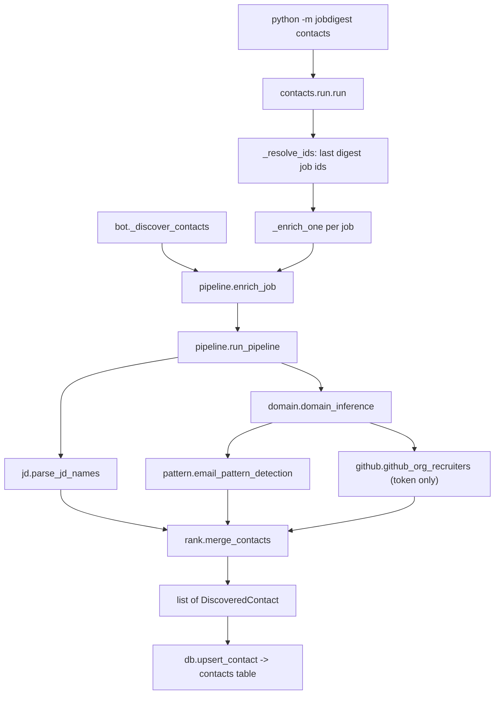

# Contacts package: overview

- **Source**: `src/jobdigest/contacts/` (9 modules, 757 lines): `__init__.py` (5), `types.py` (16), `domain.py` (81), `email.py` (33), `github.py` (126), `jd.py` (91), `pattern.py` (112), `pipeline.py` (92), `rank.py` (74), `run.py` (127).
- **Layer**: post-delivery enrichment. It runs after the digest, never before; nothing upstream depends on its result.
- **Depends on**: `jobdigest.ats.http_client` (`make_client`, `USER_AGENT`), `jobdigest.normalize.collapse_ws`, `jobdigest.db` (`connect`, `insert_run`, `finish_run`, `last_digest_job_ids`, `upsert_contact`), `jobdigest.envfile.load_dotenv`, `jobdigest.logutil`.
- **Used by**: the `contacts` CLI sub-command (`src/jobdigest/cli.py:_cmd_contacts`), the `Contacts enrich` step of `.github/workflows/pipeline.yml`, and the Telegram bot's mail flow (`src/jobdigest/bot.py:_discover_contacts` calls `enrich_job`).
- **Tests**: `tests/test_contacts_domain.py`, `test_contacts_email_pattern.py`, `test_contacts_github.py`, `test_contacts_jd.py`, `test_contacts_pipeline.py`, `test_db_contacts.py`, `test_pipeline_e2e.py`. Fixtures: `tests/fixtures/contacts/`.

## Why this exists

A digest entry is more useful when the reader can write to a person at the company. This package guesses who that person is and what their email might be, using only free sources and without any scraping of social networks. The result feeds the `contacts` table, which the bot (`/mail` draft flow, see [email drafts](../delivery/email-drafts.md)) and the sheet export read.

It never verifies deliverability. Contacts are stored as `verified = 'unverified'` by `upsert_contact`, and any email built from a pattern is capped at confidence 40 and flagged `email_inferred` (the flag lives only on the in-memory `DiscoveredContact`; see [Persistence gap](#persistence-gap)).

The package deliberately has no Playwright, LinkedIn, SMTP, OpenRouter, or hunter.io integration. `tests/test_contacts_pipeline.py::test_contacts_package_has_no_banned_integrations` greps the package source for those strings and for `os.environ.get("github_token")`.

## Pages in this section

| Page | Covers |
|---|---|
| [pipeline-and-run.md](pipeline-and-run.md) | `types.py`, `pipeline.py`, `run.py`: the `DiscoveredContact` dataclass, `run_pipeline`/`enrich_job`, and the batch runner with exit codes |
| [domain-and-pattern.md](domain-and-pattern.md) | `domain.py`, `pattern.py`: company -> domain, domain -> email pattern |
| [github-and-jd.md](github-and-jd.md) | `github.py`, `jd.py`: the two candidate sources (GitHub org members, names in the JD text) |
| [rank-and-email.md](rank-and-email.md) | `rank.py`, `email.py`: merge/dedupe, confidence rules, email construction |

## Architecture



Left to right: two callers (batch CLI and the bot) converge on `enrich_job`, which wraps `run_pipeline`. The pipeline gathers three independent inputs (JD names, an email pattern for the domain, GitHub recruiters) and `merge_contacts` combines them. Persistence happens in the caller, not in the pipeline: `run_pipeline` is pure with respect to the database, which is why the bot can reuse it with its own connection.

A detailed per-step flowchart is in [pipeline-and-run.md](pipeline-and-run.md#run_pipeline).

## Data model

`DiscoveredContact` ([pipeline-and-run.md](pipeline-and-run.md#discoveredcontact)) is the only data type crossing module boundaries. The `contacts` table columns written by `upsert_contact` are `job_id, company, domain, name, email, role, source, verified, confidence, created_at`; see [contacts and digest queries](../storage/contacts-and-digest-queries.md). Valid sources are `CONTACT_SOURCES = {"jd", "github", "pattern"}` (`src/jobdigest/db/schema.py:158`); `upsert_contact` returns `("skip", None)` for anything else.

### `DiscoveredContact`

**Location** `src/jobdigest/contacts/types.py:7` · **Signature** `@dataclass class DiscoveredContact` (mutable, not frozen; re-exported from `jobdigest.contacts`)
The one in-memory record for a candidate hiring contact, produced by the JD parser, the GitHub lookup and the pattern guesser, then merged and persisted. Fields and defaults: `name: str` and `source: str` (required, `"jd"` / `"github"` / `"pattern"`), `company: str = ""`, `domain: str | None = None`, `email: str | None = None`, `role: str | None = None`, `confidence: float = 0.0`, `email_inferred: bool = False` (true when the email came from a domain pattern rather than observation; not persisted, see [Persistence gap](#persistence-gap)). It has no methods and no validation. Verified: `DiscoveredContact('Ana')` fails with a missing `source` argument; `DiscoveredContact('Ana', 'jd')` gets the defaults above. Full field-by-field notes and producers/consumers are in [pipeline-and-run.md](pipeline-and-run.md#discoveredcontact).

## Persistence gap

`DiscoveredContact.email_inferred` is not a column. `upsert_contact` has no parameter for it, and both callers (`run.py:_enrich_one`, `bot.py:_discover_contacts`) do not pass it. After storage, the only trace that an email was guessed is the capped confidence (<= 40) on a row whose email is set. Consumers cannot distinguish "observed email with low confidence" from "inferred" except by that heuristic.

## Environment and secrets

| Variable | Used in | Effect |
|---|---|---|
| `JOBDIGEST_GITHUB_TOKEN` | `github.github_token`, `run.run` | A GitHub personal access token. With it: `github_org_recruiters` runs and API calls send `Authorization: Bearer`. Without it: the GitHub recruiter step is skipped (`stats["github"] = "skip"`), though email-pattern detection still calls the GitHub API unauthenticated. |

The generic `GITHUB_TOKEN` (the Actions-provided token) is intentionally ignored; `tests/test_contacts_github.py::test_github_token_ignores_actions_token` checks that.

In the workflow the token comes from `secrets.JOBDIGEST_GITHUB_TOKEN` (`.github/workflows/pipeline.yml`, step "Contacts enrich", which runs `python -m jobdigest contacts` after the digest steps). See [github workflows](../../infra/github-workflows.md).

## CLI

```
python -m jobdigest contacts [--db PATH] [--limit N] [--job-id ID ...]
```

`--job-id` is repeatable and skips the last-digest lookup; `--limit` truncates the id list. `_cmd_contacts` (`src/jobdigest/cli.py:58`) returns `int(run(...))` as the process exit code. See [cli and entrypoints](../foundation/cli-and-entrypoints.md).

## Cross-cutting design decisions

- **Never raise from the pipeline.** `run_pipeline` swallows every exception and returns `[]`, so a flaky third-party endpoint cannot break the digest workflow or the bot. The trade-off: a bug anywhere inside (even in JD parsing) discards all contacts for that job. Demonstrated offline in [pipeline-and-run.md](pipeline-and-run.md#run_pipeline).
- **Injected `httpx.Client`.** Every network function takes the client as an argument, so tests use `httpx.MockTransport` and nothing touches the network.
- **Confidence is a coarse trust ranking, not a probability.** JD hiring manager 100, JD recruiter 90, GitHub 70, constructed email at most 40. `contacts_for_job` ordering (email present first, then source `jd`, `github`, other, then confidence) is in [contacts and digest queries](../storage/contacts-and-digest-queries.md).
