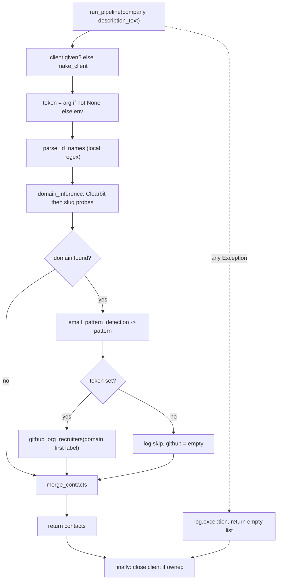

# Contacts: types, pipeline, batch runner

- **Source**: `src/jobdigest/contacts/types.py` (16), `pipeline.py` (92), `run.py` (127), `__init__.py` (5).
- **Role**: orchestration. `pipeline.py` turns one company + job description into `DiscoveredContact`s; `run.py` applies it to the last digest's jobs and persists.
- **Depends on**: the other contacts modules ([domain-and-pattern](domain-and-pattern.md), [github-and-jd](github-and-jd.md), [rank-and-email](rank-and-email.md)), `ats/http_client.py`, `db`.
- **Tests**: `tests/test_contacts_pipeline.py`, `tests/test_pipeline_e2e.py`.

Package re-exports (`__init__.py:1`): `DiscoveredContact`, `enrich_job`, `run`, `run_pipeline`. Note that `from jobdigest.contacts import run` yields the function `contacts.run.run`, shadowing the submodule name `run` on the package attribute (the CLI relies on this: `from jobdigest.contacts import run`).

## Public interface

| Symbol | Signature | Purpose |
|---|---|---|
| `DiscoveredContact` | dataclass | one candidate person |
| `run_pipeline` | `(*, company, description_text=None, client=None, github_token_value=None) -> list[DiscoveredContact]` | all discovery steps for one company; never raises |
| `enrich_job` | `(job_row, *, client=None, github_token_value=None) -> list[DiscoveredContact]` | adapter from a DB row/dict to `run_pipeline` |
| `run` | `(*, db_path=None, limit=None, job_ids=None, client=None) -> int` | batch runner; returns process exit code |

## `DiscoveredContact`

**Location** `src/jobdigest/contacts/types.py:7` · `@dataclass class DiscoveredContact` (mutable, not frozen).

| Field | Type | Default | Meaning |
|---|---|---|---|
| `name` | `str` | required | display name, whitespace-collapsed by `merge_contacts` |
| `source` | `str` | required | `"jd"`, `"github"`, or `"pattern"`; must be in `CONTACT_SOURCES` to be stored |
| `company` | `str` | `""` | filled by `merge_contacts`; sources leave it empty |
| `domain` | `str \| None` | `None` | company email domain, filled by `merge_contacts` |
| `email` | `str \| None` | `None` | observed (GitHub profile) or constructed |
| `role` | `str \| None` | `None` | `"Hiring Manager"`, `"Recruiter"`, `"University Recruiter"` |
| `confidence` | `float` | `0.0` | trust ranking, see [rank-and-email](rank-and-email.md#merge_contacts) |
| `email_inferred` | `bool` | `False` | `True` when `email` was built from a domain pattern rather than observed |

Lifecycle: source modules (`parse_jd_names`, `github_org_recruiters`) create partial instances (no company/domain). `merge_contacts` builds new fully populated instances and may mutate one when merging duplicates (`existing.email = merged.email`). Callers then read the fields and discard the object; it is never persisted as-is. `email_inferred` has no database column, see [overview](overview.md#persistence-gap).

### `_row_get`

**Location** `src/jobdigest/contacts/pipeline.py:20` · `def _row_get(row: Any, key: str, default: Any = None) -> Any`

Uniform accessor for `dict`, `sqlite3.Row`-like, or `None` job rows. `None` returns `default`; `dict` uses `.get`; anything else tries `row[key]` and returns `default` on `KeyError`/`IndexError`/`TypeError`. It exists so `enrich_job` accepts both the bot's DB rows and the dicts used in tests. Called by `enrich_job` only.

### `run_pipeline`

**Location** `src/jobdigest/contacts/pipeline.py:31`
**Signature** `def run_pipeline(*, company: str, description_text: str | None = None, client: httpx.Client | None = None, github_token_value: str | None = None) -> list[DiscoveredContact]`

**Purpose.** Produce candidate contacts for one job: names parsed from the JD, an inferred company domain, an email pattern for that domain, and (token permitting) recruiters from the company's GitHub org. Contract: it never raises; any failure yields `[]` (or fewer contacts) plus a log line.

**Called by** `pipeline.enrich_job`; tests call it directly. **Calls** `make_client`, `github_token`, `parse_jd_names`, `domain_inference`, `email_pattern_detection`, `github_org_recruiters`, `merge_contacts`.

| Parameter | Type | Default | Meaning |
|---|---|---|---|
| `company` | `str` | required (keyword-only) | raw company name, used for Clearbit and slug probes |
| `description_text` | `str \| None` | `None` | JD text for `parse_jd_names` |
| `client` | `httpx.Client \| None` | `None` | injected client; if `None` a fresh `make_client()` is created and closed at the end |
| `github_token_value` | `str \| None` | `None` | `None` means read `JOBDIGEST_GITHUB_TOKEN`; an empty string means "explicitly no token" and is not replaced by the env value |

**Returns** the list from `merge_contacts` on success; `[]` if any exception escapes the body.

**Step by step**

1. Ownership: `own = client is None; http = client or make_client()`. Only a self-created client is closed (in `finally`). `make_client()` builds `httpx.Client` with `follow_redirects=False` and the `JobHunt/0.1` user agent (`src/jobdigest/ats/http_client.py:21`).
2. Token: `github_token_value if github_token_value is not None else github_token()`. This `is not None` test is why `run.run` can pass `""` to force the no-token path regardless of the environment.
3. Enter the `try`. `jd = parse_jd_names(description_text)`: purely local regex work, no network.
4. `domain = domain_inference(company, http)`: Clearbit, then slug probes ([domain-and-pattern](domain-and-pattern.md#domain_inference)). May be `None`.
5. If `domain`: `pattern = email_pattern_detection(domain, http, token=token)` inside its own `try`. It catches `(httpx.HTTPError, ValueError)` and falls back to `f"{{first}}.{{last}}@{domain}"`. Since `email_pattern_detection` already returns that fallback internally, this inner handler is a second safety net; other exception types fall to the outer handler. With a domain, `pattern` is therefore never `None`: every JD name will receive a constructed email.
6. GitHub:
   ```python
   if token and domain:
       org_slug = domain.split(".")[0]
   ```
   The org slug is the first label of the domain (`acme.com` -> `acme`; `acme.co.in` -> `acme`). `github_org_recruiters` failure (`HTTPError`/`ValueError`) is logged and leaves `github = []`. `elif not token:` logs `contacts github skip missing JOBDIGEST_GITHUB_TOKEN`. If there is a token but no domain, nothing is logged and the step is silently skipped.
7. `return merge_contacts(jd=jd, github=github, company=company, domain=domain, pattern=pattern)`.
8. `except Exception:` logs with traceback (`log.exception("contacts pipeline failed company=%r", company)`) and returns `[]`. This is the never-raises guarantee.
9. `finally: if own: http.close()`.



If no domain is found (left branch of F), `pattern` stays `None`, so JD contacts come back without emails and keep their full confidence. The dotted edge shows that the guard covers every step, including `merge_contacts`.

**Real behavior, run offline.** A transport that raises `RuntimeError` on every request (a non-HTTP error, so the inner handlers do not catch it):
```
>>> run_pipeline(company="Acme", description_text="Reports to: Priya Sharma", client=httpx.Client(transport=httpx.MockTransport(boom)))
contacts pipeline failed company='Acme'   (traceback logged)
[]
```
Contrast `tests/test_contacts_pipeline.py::test_run_pipeline_swallows_http_errors`: with `httpx.ConnectError` the lower layers absorb the errors and the JD contact survives (`["Priya Sharma"]`, no email since no domain was found).

**Plain English.** Gather everything cheaply, merge it, and never let a failure propagate. Network failures degrade the result (no email, no GitHub contacts) rather than aborting it; an unexpected bug degrades it to empty.

### `enrich_job`

**Location** `src/jobdigest/contacts/pipeline.py:79` · `def enrich_job(job_row: Any, *, client: httpx.Client | None = None, github_token_value: str | None = None) -> list[DiscoveredContact]`

Extracts `company` (`collapse_ws(_row_get(job_row, "company", "") or "")`) and `description_text` from the row and calls `run_pipeline`. `description` is coerced with `str(...)`. Called by `run._enrich_one` (with the shared client and token) and `bot._discover_contacts` (no client or token arguments: it creates its own client and reads the token from the environment). Test: `test_enrich_job_reads_description`.

## Batch runner (`run.py`)

### `_job_row`

**Location** `src/jobdigest/contacts/run.py:24` · `def _job_row(conn: Any, job_id: int) -> Any`. Executes `SELECT * FROM jobs WHERE id = ?` with `int(job_id)` and returns `fetchone()` (a row or `None`).

### `_resolve_ids`

**Location** `src/jobdigest/contacts/run.py:28` · `def _resolve_ids(conn: Any, job_ids: list[int] | None, limit: int | None) -> list[int]`

1. `ids = list(job_ids) if job_ids is not None else last_digest_job_ids(conn)`. An explicit list (even empty) wins and skips the DB lookup. `last_digest_job_ids` (`src/jobdigest/db/runs.py:105`) reads `stats_json["job_ids"]` of the latest `runs` row with `kind='digest'` and `status='ok'` (`last_ok_run`), returning `[]` for a missing run, bad JSON, a non-dict, or non-list, and dropping non-int or non-positive ids.
2. `if limit is not None: ids = ids[: max(0, int(limit))]` (negative limit gives an empty list).
Ids are not de-duplicated, so `--job-id 5 --job-id 5` enriches job 5 twice (the second pass becomes an `update`).

### `_enrich_one`

**Location** `src/jobdigest/contacts/run.py:37` · `def _enrich_one(conn: Any, jid: int, http: httpx.Client, token: str, stats: dict[str, Any]) -> None`

1. Load the row; if `None` (job deleted or bad id) return silently, without incrementing any counter.
2. `found = enrich_job(row, client=http, github_token_value=token)` (token is a string, possibly `""`).
3. For each `person`: if `person.source == "jd"` increment `stats["jd_hits"]`. Then call `upsert_contact(conn, job_id=..., company=person.company or str(row["company"] or ""), name, source, email, role, domain, confidence)`. `email_inferred` is not passed.
4. `action, _cid = ...`; `if action in ("insert", "update"): stats["contacts"] += 1`. A `"skip"` (blank name, invalid source) is not counted. Note `jd_hits` counts discovered JD people, including those that update an existing row.

`upsert_contact` semantics (dedupe key `job_id + name + source`, keeps the higher confidence, keeps old email/role/domain when new is null) are documented in [contacts and digest queries](../storage/contacts-and-digest-queries.md). It runs inside `transaction(conn)` per contact.

### `_enrich_all`

**Location** `src/jobdigest/contacts/run.py:62` · `def _enrich_all(conn, ids, http, token, stats) -> None`

Loops over ids; each `_enrich_one` is wrapped in `except Exception`, which increments `stats["errors"]` and logs `contacts enrich fail job_id=...` with a traceback, then continues. This per-job isolation means one bad job (for example a DB error on one insert) does not stop the batch, and the run still ends `ok`/exit 0.

### `_record_failure`

**Location** `src/jobdigest/contacts/run.py:73` · `def _record_failure(conn, run_id, stats) -> None`

Calls `finish_run(conn, run_id, "error", stats, error="contacts run failed")`. If that itself raises, the exception is logged and swallowed so the original failure is not masked.

### `run`

**Location** `src/jobdigest/contacts/run.py:80` · `def run(*, db_path: Path | None = None, limit: int | None = None, job_ids: list[int] | None = None, client: httpx.Client | None = None) -> int`

**Called by** `cli._cmd_contacts`; tests (`contacts_run(db_path=..., job_ids=[jid], client=...)`, `tests/test_pipeline_e2e.py`). **Calls** `load_dotenv`, `configure`, `connect`, `insert_run`, `_resolve_ids`, `make_client`, `_enrich_all`, `finish_run`.

**Step by step**

1. `load_dotenv()` and `configure()` (logging) so the module also works as a standalone entry point ([paths-envfile-logutil](../foundation/paths-envfile-logutil.md)).
2. `conn = connect(db_path)`; `run_id = insert_run(conn, "contacts")`. These two lines are outside the `try`: a DB connection failure raises out of `run` (uncaught, traceback to the caller) rather than returning 1.
3. Read the token directly from `os.environ` and strip it. If empty, log the skip message. Initial stats: `{"jobs": 0, "contacts": 0, "github": "ok" if token else "skip", "jd_hits": 0, "errors": 0}`. `"github"` reflects only whether a token was configured, not whether GitHub calls succeeded.
4. In `try`: `ids = _resolve_ids(...)`, `stats["jobs"] = len(ids)`; create a client if none injected (`own_client`), run `_enrich_all` inside an inner `try/finally` that closes only an owned client.
5. `finish_run(conn, run_id, "ok", stats)`, log the summary line, `return 0`.
6. `except Exception`: `stats["errors"] += 1`, log traceback, `_record_failure(...)`, `return 1`.
7. `finally: conn.close()`.

**Exit codes**: `0` after a completed pass even if some jobs errored (`stats["errors"] > 0` is visible only in the `runs` row and log); `1` if resolving ids, creating the client, or `finish_run(ok)` raised. An empty id list (no digest yet) is a normal `0` with `jobs=0`. The workflow step therefore fails only on whole-run failures.

**Example stats** from `test_contacts_run_uses_job_ids_and_exit_zero` (no token): `github == "skip"`, `jobs == 1`, `jd_hits >= 1`, and a contact "Priya Sharma" inserted. `test_pipeline_e2e` runs the same function after `digest` with a client whose every request is a 404 (`dead_http_client`) and asserts exit 0.

## Failure modes

- No digest has run: `last_digest_job_ids` returns `[]`; the run is a no-op that still writes an `ok` run row.
- Missing token: GitHub step skipped; Clearbit, slug probes, and unauthenticated GitHub commit search still run.
- Network down: `domain_inference` returns `None` (Clearbit error is caught, probe errors are caught per suffix), so JD names are stored without email or domain.
- `run_pipeline` returns `[]` for any bug: indistinguishable in stats from "found nobody" apart from the logged traceback. `stats["errors"]` is not incremented for it.
- Shared rate limits: all jobs in a batch hit GitHub sequentially with one client; there is no throttling or caching in this package. Companies repeated across jobs are looked up again.

## How to modify safely

- To add a source: write a function returning `list[DiscoveredContact]`, add a rank in `rank._SOURCE_RANK`, add the value to `CONTACT_SOURCES` (`src/jobdigest/db/schema.py:158`), and pass it into `merge_contacts`. Without the schema constant `upsert_contact` skips it.
- To persist `email_inferred`, add a column + migration ([schema-and-migrations](../storage/schema-and-migrations.md)), a parameter to `upsert_contact`, and update both callers.
- Keep the never-raises contract: the bot depends on it only partly (it also wraps `enrich_job` in its own `try`, `bot._discover_contacts`).
