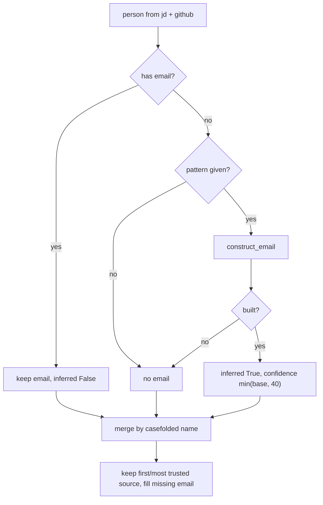

# Contacts: merging, confidence, and email construction

- **Source**: `src/jobdigest/contacts/rank.py` (74 lines), `src/jobdigest/contacts/email.py` (33 lines).
- **Role**: final stage of [`run_pipeline`](pipeline-and-run.md#run_pipeline): combine JD and GitHub candidates into one list per job, assign confidence, and attach guessed emails.
- **Depends on**: `normalize.collapse_ws` (whitespace-collapse helper, `src/jobdigest/normalize.py:11`; see [normalize](../foundation/normalize.md)), `unicodedata`. **Used by**: `run_pipeline`.
- **Tests**: `tests/test_contacts_pipeline.py` (merge tests), `tests/test_contacts_email_pattern.py` (construct_email), `tests/test_contacts_github.py::test_construct_email_first_last`.

## Email construction (`email.py`)

### `_ascii_token`

**Location** `src/jobdigest/contacts/email.py:9` · `def _ascii_token(text: str) -> str`. NFKD-normalizes (splitting `é` into `e` + combining accent), encodes to ASCII with `errors="ignore"` (dropping the accents and any non-Latin characters), lowercases, and removes every non `[a-z0-9]` run. `José` -> `jose`, `Müller` -> `muller`, `O'Brien` -> `obrien`, `Mary-Jane` -> `maryjane`. A fully non-Latin word (`日本`) becomes the empty string.

### `_name_parts`

**Location** `src/jobdigest/contacts/email.py:16` · `def _name_parts(name: str) -> tuple[str, str, str, str]`. Splits on whitespace, tokenizes each word with `_ascii_token`, drops empty tokens, and returns `(first, last, first_initial, last_initial)`. `first` is the first token; `last` is the last token only if there are at least two tokens (so single names have `last == ""`). Middle names are ignored: `"Mary Ann van der Berg"` -> `("mary", "berg", "m", "b")`. `"Müller"` -> `("muller", "", "m", "")`.

### `construct_email`

**Location** `src/jobdigest/contacts/email.py:23` · `def construct_email(name: str, pattern: str) -> str | None`

**Called by** `rank.merge_contacts`. **Parameters**: `name` the person's display name; `pattern` a template such as `{first}.{last}@acme.com`.

1. `first, last, fi, li = _name_parts(name)`; no usable first token (empty name, non-Latin name) -> `None`.
2. `email = pattern.format(first=first, last=last, fi=fi, li=li)`. Unknown placeholders raise `KeyError`; malformed templates raise `ValueError`/`IndexError`; a `None` pattern raises `AttributeError`. All four are caught and give `None`.
3. Reject if `"{" in email` (an unresolved placeholder like the literal `{domain}` left by `email_pattern_detection("")`) or if the result does not match `^[^@\s]+@[^@\s]+\.[^@\s]+$`.
4. Return `email.lower()`.

Verified outputs:

| Call | Result |
|---|---|
| `("José O'Brien-Smith", "{first}.{last}@acme.com")` | `jose.obriensmith@acme.com` |
| `("Priya Sharma", "{fi}{last}@acme.com")` | `psharma@acme.com` |
| `("Priya Sharma", "{first}{li}@acme.com")` | `priyas@acme.com` |
| `("Priya Sharma", "{first}@acme.com")` | `priya@acme.com` |
| `("Priya Sharma", "{foo}@acme.com")` | `None` (KeyError) |
| `("Priya Sharma", "{first}.{last}@{domain}")` | `None` (unknown key `domain`) |
| `("Madonna", "{first}.{last}@acme.com")` | `madonna.@acme.com` |

The last row is an oddity: for a single-word name the empty `last` yields a trailing dot, which still passes the loose email regex, so a syntactically odd (invalid in practice) address is stored as inferred. JD parsing can produce single-word names (see [github-and-jd](github-and-jd.md#parse_jd_names)). Tests: `test_construct_email_strips_diacritics_and_punctuation`, `test_construct_email_rejects_empty_and_bad_pattern`.

## Merging (`rank.py`)

Constants: `_SOURCE_RANK = {"jd": 0, "github": 1, "pattern": 2}` (lower is preferred) and `CONSTRUCTED_EMAIL_MAX_CONFIDENCE = 40.0`.

### `_key`

**Location** `src/jobdigest/contacts/rank.py:12` · `def _key(name: str) -> str`: `collapse_ws(name).casefold()`. Two sources describing "Priya  Sharma" and "priya sharma" collide on one key.

### `_base_confidence`

**Location** `src/jobdigest/contacts/rank.py:16` · `def _base_confidence(person: DiscoveredContact, source: str) -> float`

Rules, in order:
1. `source == "jd"` and `"recruit"` in the lowercased role -> `90.0`.
2. `source == "jd"` otherwise -> `100.0` if the contact's own `confidence < 90`, else keep the contact's own value (so a hiring manager defaults to 100, and anything the caller pre-set at 90+ is preserved).
3. `source == "github"` -> `70.0` regardless of the input.
4. Any other normalized source (`"pattern"`) -> the contact's own confidence.

For contacts produced by `parse_jd_names` this reproduces their own 100 (hiring manager) and 90 (recruiter) values.

### `merge_contacts`

**Location** `src/jobdigest/contacts/rank.py:27`
**Signature** `def merge_contacts(*, jd: list[DiscoveredContact], github: list[DiscoveredContact], company: str, domain: str | None, pattern: str | None) -> list[DiscoveredContact]`

**Purpose.** Produce one record per distinct person (by casefolded, whitespace-collapsed name), fully populated with company/domain, an email where possible, and a confidence score reflecting how trustworthy the data is. The key policy: an email that was **observed** (present on the input contact) keeps the source's confidence; an email **constructed** from `pattern` is flagged `email_inferred=True` and capped at `CONSTRUCTED_EMAIL_MAX_CONFIDENCE` (40).

**Called by** `pipeline.run_pipeline`. **Calls** `collapse_ws`, `construct_email`, `_key`, `_base_confidence`.

**Returns** `list(by_name.values())` in insertion order (JD contacts first, then new GitHub names). Empty if both inputs are empty or all names blank.

**Step by step**

1. `by_name: dict[str, DiscoveredContact] = {}`. Iterate `list(jd) + list(github)`: JD candidates are always processed before GitHub ones.
2. `name = collapse_ws(person.name)`; blank -> skip. `key = _key(name)`.
3. Email decision:
   ```python
   email = person.email
   inferred = False
   if not email and pattern:
       email = construct_email(name, pattern)
       inferred = email is not None
   ```
   An existing (observed) email is never replaced. If there is none and a pattern is available, try to construct one; `inferred` is true only if construction succeeded.
4. Source normalization: `source = person.source if person.source in _SOURCE_RANK else "pattern"`; unknown sources are demoted to the lowest-ranked `pattern`.
5. `confidence = _base_confidence(person, source)`; `if inferred: confidence = min(confidence, 40.0)`.
6. Build a **new** `DiscoveredContact(name, source, company=company, domain=domain, email, role, confidence, email_inferred=inferred)`. The `company` and `domain` arguments are stamped onto every record, even if the person had none.
7. De-duplication against `existing = by_name.get(key)`:
   - none -> store.
   - `_SOURCE_RANK[merged.source] < _SOURCE_RANK[existing.source]` (the new one is a more trusted source) -> replace the stored record, first copying `existing.email` and `existing.email_inferred` if the replacement has no email.
   - otherwise, if `not existing.email and merged.email` -> copy the email and inferred flag onto `existing`, and fill `existing.domain` if empty.
   - otherwise the duplicate is discarded.

**Real run** (jd: Priya = Hiring Manager, Arun = Recruiter with observed `arun@real.com`; github: `priya  sharma` with observed `p@acme.com`, and `Zed Q`; pattern `{first}.{last}@acme.com`):

```
Priya Sharma  jd      priya.sharma@acme.com  Hiring Manager  conf 40.0  email_inferred=True
Arun Mehta    jd      arun@real.com          Recruiter       conf 90.0  email_inferred=False
Zed Q         github  zed.q@acme.com         Recruiter       conf 40.0  email_inferred=True
```

Two consequences worth knowing:

1. **Observed email can lose to an inferred one.** The GitHub record for Priya carries a real profile email (`p@acme.com`), but the JD record was processed first and already received a constructed email. Step 7's "else" branch only copies when `existing.email` is empty, so the observed address is dropped in favor of the inferred one. This is current behavior, not a documented intent. In practice it only occurs when a pattern exists and both sources name the same person.
2. **The replacement branch is effectively dead for the pipeline's own inputs.** Since JD contacts always come first and have rank 0, a later contact can never outrank an earlier one (rank 1 vs 0). The branch would only matter if a caller passed a `jd` list containing non-JD sources or reordered inputs. Equal-rank duplicates (two JD labels for one person are already deduped upstream) fall to the "else" paths.

The confidence cap also applies to JD hiring managers (100 -> 40) whenever an email is constructed, which makes the number mostly reflect email trust, not role certainty. Downstream, `contacts_for_job` ranks rows with an email first, then by source (`jd` before `github`), then by confidence ([contacts and digest queries](../storage/contacts-and-digest-queries.md)).

Tests: `test_merge_attaches_constructed_email_onto_jd`, `test_merge_observed_email_keeps_full_confidence_constructed_is_capped`, `test_merge_without_pattern_has_no_email_and_full_confidence`, and the integration assertions in `test_run_pipeline_never_raises_and_merges` (all three contacts end at 40.0 because every email is constructed).

**Plain English.** Treat names case-insensitively, prefer the most trusted source for each person, guess emails only when none was observed, and never rate a guessed email above 40.



## Failure modes and edge cases

- Single-word names: `construct_email` may produce `first.@domain` for `{first}.{last}` patterns.
- The package cannot detect a wrong domain (for example a Clearbit homonym); every email derived from it is wrong but looks plausible.
- Names that differ by diacritics (`José` vs `Jose`) are different keys; `casefold` does not fold accents.

## How to modify safely

- Changing `CONSTRUCTED_EMAIL_MAX_CONFIDENCE` affects ordering in `contacts_for_job` and the bot's "best contact" choice; update `test_merge_observed_email_keeps_full_confidence_constructed_is_capped` and the 40.0 assertions in `test_run_pipeline_never_raises_and_merges`.
- To fix the observed-vs-inferred precedence, replace the `elif not existing.email and merged.email` condition with one that also upgrades when `existing.email_inferred and not merged.email_inferred`, and add a test.
- New placeholders in patterns must be added both to `construct_email`'s `format(...)` call and to `pattern._PATTERN_REGEXES` templates.
