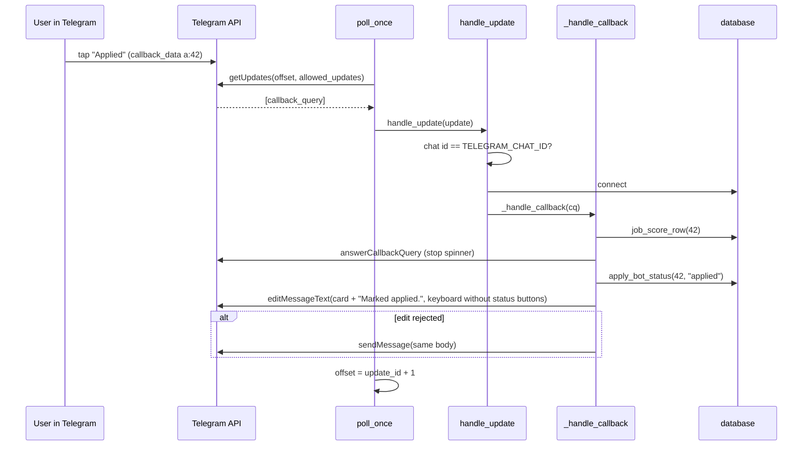

# Telegram bot (`bot.py`)

- Source: `src/jobdigest/bot.py` (583 lines)
- Layer: delivery, interactive side. Everything the digest does is one-way; this module makes the buttons and slash commands work.
- Depends on: [`telegram.py`](telegram.md), [`digest._guest_dicts`](digest.md#_guest_dicts), `summarize.render_card` ([summarize](../ranking/summarize.md)), [`blurb.py`](../ranking/blurb.md) (`draft_blurb`, `ground`), [`email_draft.py`](email-drafts.md), [`followups.py` and `health.py`](followups-and-health.md), `db` ([applications](../storage/applications.md), [contacts](../storage/contacts-and-digest-queries.md)), `contacts.enrich_job` ([contacts](../contacts/overview.md)), `openrouter.chat`, [`config`](../foundation/config.md).
- Used by: `python -m jobdigest.bot` (`.github/workflows/bot.yml` runs `python -m jobdigest.bot --max-seconds 3300` hourly), tests.
- Tests: `tests/test_bot.py` (handlers, gates, mail cache), `tests/test_bot_buttons.py` (the button contract and poller loops; also checks `bot.yml`).

## Why this exists / responsibility

The digest message lists numbered jobs and a keyboard of numbers. Tapping a number must open that job's card; each card has Save, Applied, Hide, Why me? and Mail buttons; `/followups` and `/health` are commands. There is no webhook server: the process *polls* Telegram, handles each update, and exits after a time budget. In production that process is a scheduled GitHub Actions job (`bot.yml`: cron `5 * * * *`, long-polling about 55 minutes per run; taps made between runs wait in Telegram and are handled at the next start).

Because the bot and the pipeline are separate processes, **they must share one database** (`DATABASE_URL`). If the bot sees a different database, every tap fails with "I can't find that job" (`_NOT_FOUND_TEXT`), and `bot.yml` refuses to run with an empty `DATABASE_URL` (`tests/test_bot_buttons.py::test_bot_workflow_refuses_to_run_without_the_shared_database`).

## Public interface at a glance

| Symbol | Signature | Purpose |
|---|---|---|
| `handle_update` | `(update, *, db_path=None, conn=None, now=None, http_post=None, chat_fn=None) -> None` | Authorize and dispatch one Telegram update. |
| `poll_once` | `(*, offset=0, db_path=None, http_post=None, timeout=25) -> int` | One `getUpdates` call plus handling; returns next offset. |
| `drain` | `(*, db_path=None, http_post=None, max_batches=20) -> int` | Handle everything pending, then return. |
| `run_for` | `(seconds, *, db_path=None, http_post=None, clock=time.monotonic, sleep=time.sleep, timeout=25) -> None` | Long-poll for a bounded time. |
| `main` | `(argv=None) -> int` | CLI: `--db`, `--once`, `--max-seconds`. |
| `NO_CONTACT_TTL_SECONDS` | `6 * 3600` | Negative-cache lifetime for Mail. |
| internals | `_handle_callback`, `_status_outcome`, `_edit_card`, `_handle_slow_action`, `_handle_why_me`, `_why_me_gate`, `_handle_mail`, `_mail_gate`, `_discover_contacts`, `_no_contact_key`, `_recently_empty`, `_application_status`, `_answer`, `_send_plain`, `_update_chat_id`, `_slash_command` | Documented below. |

## Key concepts

- **Update**: one JSON object from `getUpdates`. This bot cares about two shapes: `{"message": {...}}` (text, for slash commands) and `{"callback_query": {...}}` (a button tap). A callback query has `id`, `data` (our `kind:job_id`), and `message` (the message the button was attached to, containing `message_id` and `chat.id`).
- **Answering a callback**: Telegram shows a spinner on the button until `answerCallbackQuery` is called. The code answers exactly once per tap (optionally with a toast).
- **Offset**: the next `getUpdates` call passes `last_update_id + 1`, which tells Telegram to forget earlier updates. Updates not yet acknowledged are redelivered on the next poll.
- **The button contract**: every tap by the authorized chat must (a) be answered once and (b) leave a lasting visible result (a message edit or a new message), including for missing jobs, crashes and an unreachable database. See [the contract section](#why-every-tap-ends-visibly).
- **Slow vs fast actions**: `o/s/a/h` are quick DB operations. `w` (LLM blurb) and `m` (network contact lookup plus optional LLM) are slow; they answer the tap *first* so the spinner stops, then work.

## Detailed walkthrough

### `_CB`, `_CB_STATUS`, `_STATUS_LINE`, texts

- `_CB = re.compile(r"^(o|s|a|h|w|m):(\d+)$")` (`:50`) accepts exactly the callback protocol in [telegram.md](telegram.md#callback-data-protocol). Verified: `o:12` matches; `o:12x` does not.
- `_CB_STATUS = {"s": "saved", "a": "applied", "h": "hidden"}` maps button kinds to application statuses.
- `_STATUS_LINE = {"saved": "Saved.", "applied": "Marked applied.", "hidden": "Hidden."}` is appended to the edited card.
- `_FAILED_TEXT` ("Something went wrong handling that button. Try again in a moment.") and `_NOT_FOUND_TEXT` (explains the mismatched-database cause) are the two fallback messages.

### `_slash_command`

**Location** `:65`. `text.split()[0]`, then `split("@", 1)[0].casefold()`: so `"/Health@my_bot  foo"` becomes `/health` (verified). Group-chat command suffixes are thereby ignored.

### `_update_chat_id`

**Location** `:70` · `def _update_chat_id(update: dict) -> str`. Extracts the chat id used for authorization, as a string. For a callback query it prefers `callback_query.message.chat.id`, falling back to `callback_query.from.id`; for a plain message it uses `message.chat.id`; otherwise `""`. Every `isinstance(..., dict)` check guards against malformed updates.

### `_send_plain`

**Location** `:89`. Sends `text` to the configured chat via `send_blurb`. Silently returns if credentials are absent. A `TelegramError` is logged and swallowed (nothing more can be done). This is the "new message" path for every non-edit outcome (refusals, drafts, errors).

### `_answer`

**Location** `:286` · `def _answer(cq: dict, *, http_post, text: str = "") -> None`. Needs both a token and `cq["id"]`, else returns. Calls `answer_callback_query`; `TelegramError` is logged and swallowed. Because failures are swallowed, a second `answerCallbackQuery` for an already-answered tap (Telegram rejects it) is harmless.

### `_application_status`

**Location** `:99`. Looks up `applications.status` for the job's `apply_url_norm` and returns it lowercased, or `None` if the row has no norm column/value or no application exists. Used by both gates to refuse drafts for hidden jobs.

### `_why_me_gate` and `_mail_gate`

**Location** `:115`, `:176`. Pure functions returning a refusal string or `None`. Checked in order:

| Check | Message | Why-me | Mail |
|---|---|---|---|
| `row is None` | `Can't draft: job not found.` | yes | yes |
| `hard_status != "pass"` | `Can't draft: this job failed hard filters.` | yes | yes |
| `is_active != 1` | `Can't draft: job is no longer active.` | yes | yes |
| `canonical_job_id is not None` | `Can't draft: open the canonical posting.` (this row is a duplicate) | yes | yes |
| application status `hidden` | `Can't draft: job is hidden.` | yes | yes |
| no non-blank `profile.internships` | `Can't draft: no internships in profile to cite.` | yes | no |
| `blurb_model` or `blurb_prompt_version` unset | `Can't draft: blurb model not configured.` | yes | no |

The extra two why-me checks exist because the blurb must cite real internships from the profile and needs a configured model ([blurb](../ranking/blurb.md)). Tests: `tests/test_bot.py::test_handle_update_why_me_refuses_reject`, `_refuses_inactive`, `_refuses_hidden`, `_allows_saved`, `_does_not_call_chat_on_refuse`, `_missing_blurb_config_refuses`, `test_handle_update_mail_refuses_hidden`.

### `_handle_why_me`

**Location** `:134` · **Signature** `def _handle_why_me(job_id: int, *, conn, http_post, chat_fn) -> None`

**Purpose** Generate a short, grounded "why me" blurb for the job and send it as a new message.

**Steps**

1. `models = load_models(); profile = load_profile()`; `row = job_score_row(conn, job_id, models.score_model, models.score_prompt_version)` (job joined to its current score; `None` if the job id does not exist).
2. `refuse = _why_me_gate(row, conn, profile, models)`; if set, `_send_plain(refuse)` and return.
3. `fn = chat_fn`; `api_key` from `OPENROUTER_API_KEY`. If `fn is None` and no key: send `Can't draft: missing OPENROUTER_API_KEY.` and return; otherwise `fn = openrouter_chat`. An injected `chat_fn` therefore works without a key (tests).
4. `text, path = draft_blurb(profile=..., job_row=row, chat_fn=fn, model=str(models.blurb_model), api_key=api_key, prompt_version=str(models.blurb_prompt_version))`. `OpenRouterError` -> `Can't draft: model error.` and return.
5. `if path == "refuse": _send_plain(text)` (the blurb module itself declined; `text` is its message).
6. `body, flags = ground(text, profile, row)`; if `flags` (claims the grounding check could not verify), append `"\n\nUngrounded: <flags>"`. Send `body`.

Returns `None`; the visible result is the sent message. Any other exception is caught one level up by `_handle_slow_action`.

### `_handle_mail`

**Location** `:238` · **Signature** `def _handle_mail(job_id: int, *, conn, http_post, chat_fn) -> None`

**Purpose** Produce an email draft addressed to the best known contact for the job, discovering contacts on demand.

**Steps**

1. Load models/profile; `row = job_score_row(...)`; `refuse = _mail_gate(row, conn)`; refusal -> `_send_plain` and return.
2. `key = _no_contact_key(job_id, row)`. If the job has **no stored contacts and was not recently found empty**, run discovery: `_discover_contacts(conn, job_id, row)`. If that returns `False` (the lookup raised), send `Can't draft: contact lookup failed. Try again later.` and return *without* caching, so the next tap retries (`test_mail_lookup_failure_tells_user_and_is_not_cached`).
3. `contact = best_contact_for_job(conn, job_id)`. If `None`: `_NO_CONTACT[key] = time.monotonic() + NO_CONTACT_TTL_SECONDS` and send `No hiring manager found for this job.` (`test_mail_negative_result_cached_no_rerun`: three taps, one lookup, three identical replies).
4. LLM wiring: `fn = chat_fn`; `model = models.blurb_model`; `if fn is None and model and api_key: fn = openrouter_chat`. Unlike why-me, a missing key is *not* an error: `draft_email` falls back to a canned observation sentence ([email-drafts.md](email-drafts.md)).
5. `draft = draft_email(profile=..., job_row=row, contact=contact, chat_fn=fn, model=model, api_key=api_key)` inside `try/except Exception`. Any failure (template missing, rendering error) logs with traceback and sends `Can't draft: email template missing.`. The message text is the same for every exception type.
6. `_send_plain(format_telegram(draft))`.

### `_no_contact_key`, `_recently_empty`, `_NO_CONTACT`, `NO_CONTACT_TTL_SECONDS`

A process-local negative cache: `dict[(job_id, marker)] -> monotonic expiry`. `marker` is `apply_url_norm`, else `company`, else `""`, so a recycled job id with a different URL does not inherit the entry. `_recently_empty(key)` returns `False` if the key is absent or expired (and deletes expired entries), `True` otherwise. TTL is 6 hours. The cache lives only in memory: it is lost when the process exits (each `bot.yml` run), and each expiry check uses `time.monotonic()` (`test_mail_negative_cache_expires` sets entries to `0.0` to expire them). It exists because contact discovery hits the network and is slow, and users may tap Mail repeatedly.

### `_discover_contacts`

**Location** `:214`. Imports `jobdigest.contacts.enrich_job` lazily (the contacts package is heavy), calls `enrich_job(row)`, and on any `Exception` logs and returns `False`. On success it `upsert_contact(...)`s every returned person with `job_id`, `company` (`person.company` or the job's company), `name`, `source`, `email`, `role`, `domain`, `confidence` and returns `True` (an empty result is still success; the caller then finds no contact). Tests monkeypatch `jobdigest.contacts.enrich_job` to stay offline. See [contacts overview](../contacts/overview.md).

### `_status_outcome`

**Location** `:297` · **Signature** `def _status_outcome(result: str, job_id: int, apply_url: str, status: str) -> tuple[str, dict]`

Maps the result of `apply_bot_status` (`"ok"`, `"skip"`, `"missing"`) to the line shown under the card and the keyboard to attach:

- `"ok"`: line `_STATUS_LINE[status]`; keyboard `action_markup(job_id, apply_url, status_buttons=False, why_me=show, mail=show)` with `show = status != "hidden"`. So after Save/Applied the Save/Applied/Hide buttons disappear but Apply, Why me and Mail remain; after Hide only Apply remains.
- otherwise: line `"Already tracking."` for `"skip"` (the application is in a protected state such as `oa`/`interview`/`offer`, or the URL is not http) else `"Job not found."`; keyboard `action_markup(job_id, apply_url, status_buttons=True, why_me=True)` (full keyboard so the user can retry). Note `mail` keeps its default `True` here.

Verified: `_status_outcome("ok", 42, "https://x.io/a", "hidden")` -> `("Hidden.", {'inline_keyboard': [[{'text': 'Apply ↗', ...}]]})`.

### `_edit_card`

**Location** `:311`. Rewrites the tapped message. Gets `message_id` from `cq["message"]`. If there is no token or no `message_id`, it falls back to `_send_plain(body)`. Otherwise `edit_message_text(chat_id, int(message_id), body, ..., reply_markup=markup if markup.get("inline_keyboard") else None)`; on `TelegramError` (e.g. the message is too old to edit or the text is unchanged) it logs and *also* falls back to `_send_plain(body)`. That fallback is what keeps "every tap ends visibly" true when the edit is rejected.

### `_handle_slow_action`

**Location** `:338`. Picks `_handle_why_me` for kind `w`, else `_handle_mail`, runs it inside `try/except Exception`, and on failure logs the traceback and sends `Something went wrong. Try again later.` (`test_slow_action_exception_sends_message`).

### `_handle_callback`

**Location** `:354` · **Signature** `def _handle_callback(cq: dict, *, conn, now: datetime, http_post, chat_fn=None) -> None`

**Purpose** Decode one button tap and run the right action.

**Steps**

1. `match = _CB.match(str(cq.get("data") or ""))`. No match: `_answer(cq, text="Unknown action.")`, return (`test_unknown_callback_answered_with_text`, `test_unknown_button_is_answered`).
2. `kind, job_id = match.group(1), int(match.group(2))`.
3. Slow kinds `w`/`m`: `_answer(cq)` first (stop the spinner), then `_handle_slow_action(...)`; return.
4. Fast kinds: `models = load_models()`; `row = job_score_row(...)`; `guest = _guest_dicts([row], now=now) if row is not None else []`. Note `_guest_dicts` is called **without** a `profile`, so the card shows the raw LLM score (the digest and urgent cards show the blended quality score). An observed inconsistency; see the oddities below.
5. Missing job (`not guest`): `_answer(cq, text="Job not found.")` and `_send_plain(_NOT_FOUND_TEXT)`; return.
6. `_answer(cq)`. `card = render_card(guest[0], 1, now=now)`; `apply_url = str(guest[0].get("url") or "")`.
7. Kind `o` (open): `send_action_card(card, job_id=..., apply_url=..., required=True, http_post=..., why_me=True, status_buttons=True)` sends a **new** message with the full keyboard and returns. (`mail` keeps its default `True`.)
8. Kinds `s/a/h`: `status = _CB_STATUS[kind]`; `result = apply_bot_status(conn, job_id, status)`; `line, markup = _status_outcome(...)`; `_edit_card(cq, f"{card}\n\n{line}", markup, http_post=...)`. `apply_bot_status` ([applications](../storage/applications.md)) inserts or updates the `applications` row keyed by normalized URL, stamping `applied_on` when entering `applied`, and refuses to overwrite `oa`/`interview`/`offer`.

### `handle_update`

**Location** `:398` · **Signature** `def handle_update(update: dict, *, db_path: Path | None = None, conn: Any = None, now: datetime | None = None, http_post: HttpPost | None = None, chat_fn: ChatFn | None = None) -> None`

**Purpose** Authorize, open a DB connection if needed, and route one update. It is the safety net that enforces the button contract.

**Steps**

1. Non-dict updates are ignored.
2. **Authorization by chat id**: `allow = credentials()[1]` (the configured `TELEGRAM_CHAT_ID`), `chat_id = _update_chat_id(update)`. `if not allow or chat_id != allow:` the update is dropped. If it was a callback query it is still answered (empty answer, to stop the spinner) but nothing else happens: no DB access, no message. Anyone who messages the bot from another chat gets no response and no data. With no configured chat id, *nobody* is authorized (`test_handle_update_wrong_chat_silent`, plus `_why_me_wrong_chat_silent`, `_mail_wrong_chat_silent`, `_followups_wrong_chat_silent`).
3. `when = now or datetime.now(timezone.utc)`; `own = conn is None`. If no connection was injected, `connect(db_path)` is attempted; on any exception it logs, and for callbacks answers `"Error."` and sends `_FAILED_TEXT`, then returns (`tests/test_bot_buttons.py::test_tap_when_database_is_down_reports_failure`).
4. Callback: `_handle_callback` wrapped in `try/except Exception`; on failure log with traceback, `_answer(cq, text="Error.")`, `_send_plain(_FAILED_TEXT)`. Return.
5. Message: `text = str(msg.get("text") or "").strip()`; if it starts with `/`, `cmd = _slash_command(text)`:
   - `/followups` or `/followup`: `rows = due_followups(conn, now=when)`; `deliver(format_followups(rows, now=when), required=True, http_post=...)`.
   - `/health`: `deliver(format_health(collect_health(conn)), required=True, ...)`.
   - any other command or plain text: ignored silently (`test_handle_update_ignores_slash_commands`, `test_handle_update_unknown_slash_ignored`).
6. `finally:` closes the connection only if `own`.

Slash command errors are *not* wrapped; they propagate to `poll_once`, which logs and continues.

### `poll_once`

**Location** `:457` · **Signature** `def poll_once(*, offset: int = 0, db_path=None, http_post=None, timeout: int = 25) -> int`

1. `token, _ = credentials()`; no token -> `return offset` immediately (no HTTP, no sleep).
2. `updates = get_updates(token=..., offset=offset, timeout=timeout, http_post=..., allowed_updates=list(ALLOWED_UPDATES))`. A `TelegramError` here propagates to the caller's loop.
3. For each dict update: `handle_update(upd, db_path=..., http_post=...)` in `try/except Exception` ("One bad update must not crash the poller or be redelivered forever"). Then `last = int(uid) + 1` regardless of whether handling failed, so a poisonous update is acknowledged and never retried.
4. `return last`.

Each update opens its own DB connection (`conn` is not injected here).

### `drain`

**Location** `:489`. Loops up to `max_batches` (20) calling `poll_once(offset=..., timeout=0)` (timeout 0 means Telegram answers immediately rather than long polling). It stops when the returned offset equals the offset passed in (no updates) and counts a batch otherwise. Because the last batch's offset is passed on the following call, those updates are acknowledged before the loop ends. The docstring says it "Returns updates handled", but the value returned is the number of **non-empty batches**, not updates (`test_drain_handles_everything_pending_then_stops` asserts only `handled >= 1`).

### `run_for`

**Location** `:509` · **Signature** `def run_for(seconds: float, *, db_path=None, http_post=None, clock=time.monotonic, sleep=time.sleep, timeout: int = 25) -> None`

1. `deadline = clock() + max(0.0, seconds)`.
2. While `clock() < deadline`: `wait = max(0, min(timeout, int(deadline - clock())))` so a long poll never runs past the deadline; `offset = poll_once(offset=offset, ..., timeout=wait)`.
3. `KeyboardInterrupt` returns; `TelegramError` sleeps 2 s; any other exception is logged and sleeps 2 s. The loop continues, so transient Telegram or DB outages do not kill a 55-minute run.
4. `clock` and `sleep` are injectable; `test_run_for_stops_at_its_deadline` uses a fake clock.

Caveats: the offset is kept only in memory, starting at 0 each process, and updates handled in the final poll before the deadline are acknowledged only on the *next* poll; they would be redelivered to the next run. Status buttons are idempotent enough that this is mostly harmless, but Why me/Mail would answer twice. Also, with no token `poll_once` returns instantly and `run_for` (and the infinite loop in `main`) would spin without sleeping until the deadline.

### `main`

**Location** `:537`. Flags: `--db PATH`, and a mutually exclusive group `--once` (drain, then exit `0`) or `--max-seconds N` (call `run_for`, exit `0`). With neither, it runs an infinite `poll_once` loop (`KeyboardInterrupt` -> `0`; errors sleep 2 s). Production uses `--max-seconds 3300` (`bot.yml`, job timeout 62 minutes; `test_bot_workflow_runs_the_poller_on_a_schedule` asserts the seconds are below the job timeout and that overlapping runs queue instead of cancelling).

## Sequence: one button tap (Applied)

The tap is answered before the DB write so the user's spinner clears quickly; the lasting result is the edited card. If anything throws, `handle_update` answers "Error." and sends the failure text.

## Why every tap ends visibly

Contract (module docstring of `tests/test_bot_buttons.py`): for each button and each way a tap can go wrong, the bot answers the tap exactly once and leaves a lasting message. The code achieves this by layering:

| Failure | Where handled | Visible result |
|---|---|---|
| unknown `callback_data` | `_handle_callback` step 1 | toast "Unknown action." |
| job id not in this database | step 5 | toast "Job not found." + `_NOT_FOUND_TEXT` message |
| gate refusal (hidden, rejected, inactive, ...) | `_why_me_gate`/`_mail_gate` | "Can't draft: ..." message |
| edit of the card rejected | `_edit_card` | new message with the same body |
| slow action raises | `_handle_slow_action` | "Something went wrong. Try again later." |
| anything else in a handler | `handle_update` `except Exception` | toast "Error." + `_FAILED_TEXT` |
| database unreachable | `handle_update` connect `except` | toast "Error." + `_FAILED_TEXT` |

`tests/test_bot_buttons.py` parametrizes all six kinds (`KINDS = ["o","s","a","h","w","m"]`) over: existing job (`test_tap_on_existing_job_ends_visibly`), missing job (`..._missing_job_explains_itself`), handlers monkeypatched to raise (`..._handler_crashes_reports_failure`) and `connect` raising (`..._database_is_down_reports_failure`). Each asserts exactly one `answerCallbackQuery` and at least one `sendMessage`/`editMessageText`.

The contract covers the authorized chat. Updates from other chats are deliberately silent. It does not cover the process being down: the workflow design (hourly restart, Telegram queues updates) bounds that delay.

## Failure modes, oddities and edge cases

- **Wrong database**: documented above; the fix is shared `DATABASE_URL`.
- **Card score differs**: opening a card through `o:` re-renders it with `_guest_dicts([row], now=now)` (no profile) -> raw LLM score, whereas the digest and urgent cards show `round(0.65*fit + 0.35*LLM)`. The status-edit path does the same, so a card's number can change after a tap.
- **Double answer**: if an exception occurs *after* `_handle_callback` has answered the tap (for example in `apply_bot_status`), `handle_update` answers a second time; Telegram rejects it and `_answer` swallows the error. The tests' crash cases patch `job_score_row` as well, which fails before the first answer, so they do not exercise this.
- **Slash commands** use `deliver(... required=True)`, so a missing chat id never matters there (authorization already required it).
- **In-memory only**: offset and `_NO_CONTACT` do not persist across processes.

## How to modify / extend safely

- Add a button kind: update `action_markup`, `_CB`, `_handle_callback`; make sure it answers once and ends with a message; add it to `KINDS` in `tests/test_bot_buttons.py`, which then verifies the contract automatically.
- Add a slash command: add the name set at the top, branch in `handle_update`; remember it runs after authorization.
- Keep new handlers behind `_handle_slow_action`-style exception capture if they do network or LLM work.
