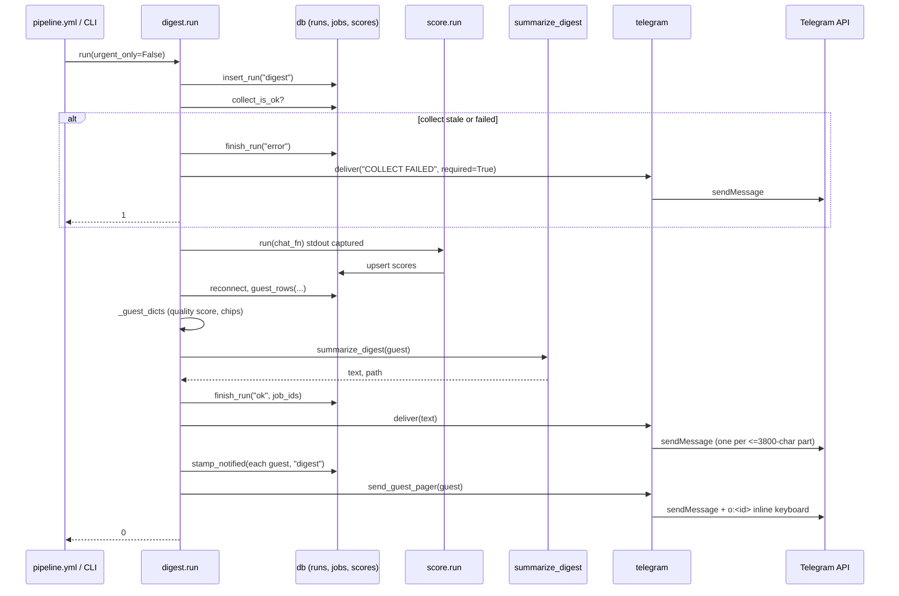

# Digest orchestration (`digest.py`)

- Source: `src/jobdigest/digest.py` (406 lines)
- Layer: delivery. This module is the *end of the daily pipeline*: it gates on a healthy collect run, scores, selects the guests, renders the digest and hands it to Telegram.
- Depends on: [`score.run`](../ranking/score-llm.md), `db` ([digest queries](../storage/contacts-and-digest-queries.md), [runs](../storage/runs-scores-errors.md), [jobs](../storage/jobs.md)), [`fit.py`](../ranking/fit-and-tiers.md), [`summarize.py`](../ranking/summarize.md), [`legitimacy.py`](../filtering/legitimacy.md), [`rank.py`](../ranking/rank-and-selection.md), [`telegram.py`](telegram.md), [`followups.parse_iso`](followups-and-health.md), [`config`](../foundation/config.md).
- Used by: `src/jobdigest/cli.py:_cmd_digest` (CLI `python -m jobdigest digest [--urgent-only]`), `src/jobdigest/bot.py` (imports `_guest_dicts` to render a card for a tapped button), and `.github/workflows/pipeline.yml` (the `digest` and `digest --urgent-only` steps).
- Tests: `tests/test_digest.py`, `tests/test_digest_telegram.py`, `tests/test_urgent.py`, `tests/test_pipeline_e2e.py`.

## Why this exists / responsibility

Every other stage works on the database. `digest.run` is the only stage that decides *what the human sees*. It owns four decisions:

1. **Is it safe to send anything?** If the last collect run is stale or failed (`collect_is_ok`) or scoring fails, it sends a loud failure message instead of a possibly misleading digest.
2. **Which jobs?** It delegates ranking and diversity to `guest_rows` (see [rank-and-selection](../ranking/rank-and-selection.md)) and converts rows to plain dicts (`_guest_dicts`), the shape the renderer and pager understand.
3. **What text?** It delegates to `summarize_digest` (LLM intro + deterministic cards, with a pure-deterministic fallback).
4. **When is a job urgent?** `maybe_send_urgent` pushes individual action cards for exceptional jobs outside the daily digest, under a daily cap.

The two cron "slots" are `digest` (daily, `run(urgent_only=False)`) and `urgent` (`run(urgent_only=True)`); they share the same entry point and the same gating.

## Public interface at a glance

| Symbol | Signature | Purpose |
|---|---|---|
| `run` | `run(*, db_path=None, chat_fn=None, score_chat_fn=None, summarize_chat_fn=None, telegram_http_post=None, urgent_only=False) -> int` | Whole slot: gate, score, then digest or urgent. Returns process exit code. |
| `maybe_send_urgent` | `maybe_send_urgent(conn, *, models, profile, now, http_post=None) -> list[int]` | Send up to the remaining daily budget of urgent action cards. Returns the job ids sent. |
| `_guest_dicts` | `_guest_dicts(rows, *, now, profile=None) -> list[dict]` | DB rows to card dicts (also used by the bot). |
| `URGENT_MIN_FIT` | `70.0` | Minimum deterministic fit for a non-watchlisted urgent job. |
| private helpers | `_digest_url`, `_row_get`, `_reasons`, `_legitimacy_codes`, `_print_digest`, `_loud_fail`, `_company_meta`, `_watchlisted`, `_within_urgent_lookback`, `_run_urgent`, `_deliver_digest`, `_run_digest` | Documented below. |

## Key concepts

- **Guest**: a job selected for the digest. The code calls the rows `guest_rows` and the dicts `guest` / `guest_dicts`.
- **Quality as the card score**: the number printed on each card is not the raw LLM score. When a `profile` is passed to `_guest_dicts`, `score` is `round(quality_score(row, profile, now))`, i.e. `0.65 * fit + 0.35 * LLM` (`FIT_WEIGHT`/`LLM_WEIGHT`, `src/jobdigest/fit.py:18`). Without a profile it falls back to the raw LLM score (`float(row["score"] or 0)`). `digest.py` always passes the profile; `bot.py` does not (see [bot.md](bot.md#_handle_callback) and the oddity list there).
- **Notified stamp**: `stamp_notified(conn, job_id, kind)` writes `jobs.notified_at` and `jobs.notify_kind` (`"digest"` or `"urgent"`). `guest_rows` excludes already-notified jobs; `relevant_unapplied_jobs` does not. This is what makes a second digest run send nothing new (`tests/test_pipeline_e2e.py::test_second_digest_does_not_resend_notified_jobs`).
- **`would_post`**: true when Telegram credentials exist. Used so that jobs are only stamped "notified" if a real send could have happened (see [telegram.md](telegram.md#credentials-would_post-require_telegram)).

## Detailed walkthrough

### `run`

**Location** `src/jobdigest/digest.py:349` · **Signature** `def run(*, db_path: Path | None = None, chat_fn: ChatFn | None = None, score_chat_fn: ChatFn | None = None, summarize_chat_fn: ChatFn | None = None, telegram_http_post: TelegramHttpPost | None = None, urgent_only: bool = False) -> int`

**Purpose** Single entry point for both cron slots. It sequences gate, score and delivery, and guarantees the DB connection is closed. The `*_chat_fn` and `telegram_http_post` parameters are injection seams so tests and the e2e harness run with no network.

**Called by** `cli.py:_cmd_digest`; tests. **Calls** `load_dotenv`, `configure`, `load_models`, `load_profile`, `connect`, `insert_run`, `collect_is_ok`, `_loud_fail`, `score.run`, `_run_urgent`, `_run_digest`.

| Parameter | Type | Default | Meaning |
|---|---|---|---|
| `db_path` | `Path \| None` | `None` | SQLite file; `None` means the usual resolution in `connect` (DATABASE_URL/Postgres or `data/jobs.db`, see [connection](../storage/connection-and-postgres-shim.md)). |
| `chat_fn` | callable | `None` | One LLM function used for both scoring and summarizing. |
| `score_chat_fn` | callable | `None` | Overrides `chat_fn` for scoring only. |
| `summarize_chat_fn` | callable | `None` | Overrides `chat_fn` for the summarizer only. |
| `telegram_http_post` | callable | `None` | Replaces `httpx` POSTs to the Telegram API. |
| `urgent_only` | `bool` | `False` | Take the urgent path instead of the digest path. |

**Returns** `0` on success (including "nothing to send"), `1` on loud failure, on a failed Telegram send, or a failed pager send.

**Step-by-step**

1. `load_dotenv()` and `configure()` load `.env` (see [paths-envfile-logutil](../foundation/paths-envfile-logutil.md)) and set up logging.
2. Resolve the LLM functions: `score_fn = score_chat_fn or chat_fn`; `sum_fn = summarize_chat_fn or chat_fn`; if `sum_fn is None`, `sum_fn = default_chat` (the real OpenRouter chat). Note that `score_fn` can stay `None`; `score.run` then chooses its own default.
3. Load `models` and `profile`, open `conn = connect(db_path)`, and `run_id = insert_run(conn, "digest")`. A row in `runs` with kind `digest` now exists, status `running`.
4. Inside `try`: `collect_ok = collect_is_ok(conn)`. If false, `return _loud_fail(conn, run_id, "COLLECT FAILED", ...)`. (`collect_is_ok` requires a recent successful collect run, default max age 26 h; see [runs](../storage/runs-scores-errors.md).)
5. Score. Scoring prints progress to stdout, which would pollute the digest output, so it is captured:

```python
with redirect_stdout(io.StringIO()):
    score_code = score_run(db_path=db_path, chat_fn=score_fn)
if score_code != 0:
    return _loud_fail(conn, run_id, "SCORE FAILED", ...)
```

   `score.run` takes `db_path` and so manages its own connection (see [score-llm](../ranking/score-llm.md)); `run` then discards its first connection and opens a new one (step 6), presumably so it reads the freshly written scores from a clean connection. The code does not state the reason.
6. `conn.close(); conn = connect(db_path)` opens a fresh connection, and `now = datetime.now(timezone.utc)` is captured once and passed down so every time-dependent calculation in this run agrees.
7. Branch: `urgent_only` goes to `_run_urgent`; otherwise `_run_digest`. Both return the exit code.
8. `finally: conn.close()` closes whatever `conn` currently refers to (the second connection on the normal path; the first connection if a failure returned early).

**Data flow** DB state + env -> gate -> score (LLM, writes `scores`) -> select (`guest_rows`) -> render -> Telegram -> `stamp_notified` -> exit code.

**Plain-English summary** "Refuse to send if the data is stale or scoring failed; otherwise score, then either send urgent cards or the daily digest." The reconnect and the single `now` are the only subtle parts.

### `_loud_fail`

**Location** `src/jobdigest/digest.py:167` · **Signature** `def _loud_fail(conn, run_id: int, message: str, *, telegram_http_post: TelegramHttpPost | None = None) -> int`

**Purpose** Make a pipeline failure impossible to miss. A failed collect or score would otherwise mean a silently missing digest.

**Called by** `run` (twice). **Calls** `finish_run`, `telegram.deliver`.

**Steps** (1) `finish_run(conn, run_id, "error", {"job_ids": []}, error=message)` records the failure in `runs`. (2) logs at error level. (3) prints `message` to stdout and again to stderr (stdout for the log reader, stderr so a CI step shows it as an error). (4) `telegram_deliver(message, required=True, http_post=...)` posts the text to Telegram; `required=True` means that if credentials are missing *and* `JOBDIGEST_REQUIRE_TELEGRAM` is set, `deliver` returns `False` (and the failure is already reported on stderr). The return value of `deliver` is ignored here. (5) returns `1`.

**Returns** always `1`. The messages are exactly `"COLLECT FAILED"` and `"SCORE FAILED"`; `tests/test_digest_telegram.py::test_digest_collect_failed_sends_alert` and `::test_digest_score_failed_sends_alert` check that the alert reaches Telegram, and `tests/test_digest.py::test_digest_score_fail_skips_summarizer` checks the summarizer is never called.

### `_run_digest`

**Location** `src/jobdigest/digest.py:309` · **Signature** `def _run_digest(conn, run_id, *, models, profile, now, sum_fn, http_post) -> int`

**Purpose** The daily path. Selects guests, builds the text, records the run, then delivers.

**Calls** `guest_rows`, `_guest_dicts`, `summarize_digest`, `_print_digest`, `finish_run`, `_deliver_digest`.

**Steps**

1. `rows = guest_rows(conn, models.score_model, models.score_prompt_version, profile.digest_max, profile=profile, now=now)`. Only scores for the *current* model + prompt version are considered; notified jobs are excluded; ranking, the company cooldown and diversity are applied inside (see [rank-and-selection](../ranking/rank-and-selection.md)).
2. `guest = _guest_dicts(rows, now=now, profile=profile)`, and a log line with the `Company: Title` list.
3. Empty case: `if not guest:` it records `finish_run(conn, run_id, "ok", {"guest": 0, "path": "empty", "job_ids": []})` and returns `0` without calling the LLM or Telegram. `tests/test_digest.py::test_digest_zero_pass_jobs_silent` and `test_digest_telegram.py::test_digest_empty_guest_does_not_send` cover this.
4. `text, path = summarize_digest(guest, chat_fn=sum_fn, model=models.summarize_model, api_key=os.environ.get("OPENROUTER_API_KEY") or "", prompt_version=models.summarize_prompt_version)`. `path` describes how the text was produced (LLM intro vs deterministic fallback; see [summarize](../ranking/summarize.md)).
5. `_print_digest(text)` writes the digest to stdout (split into numbered parts if longer than the Telegram limit), so a local run shows exactly what would be sent.
6. `finish_run(..., "ok", {"guest": n, "path": path, "job_ids": [...]})`. The run is marked `ok` **before** delivery, and `job_ids` is the data later consumers (such as `contacts`, via `last_digest_job_ids`) use to know which jobs were in the last digest.
7. `return _deliver_digest(conn, guest, text, http_post=http_post)`.

### `_deliver_digest`

**Location** `src/jobdigest/digest.py:296` · **Signature** `def _deliver_digest(conn, guest, text, *, http_post) -> int`

**Steps**

1. `sent = telegram_deliver(text, required=True, http_post=http_post)`. This splits the text at `SPLIT_LIMIT` (3800 chars) on blank lines so cards are never split mid-card, and POSTs each part ([telegram.md](telegram.md#deliver)).
2. `if not sent: return 1`. A required send that failed (HTTP error, or missing credentials with `JOBDIGEST_REQUIRE_TELEGRAM`) leaves jobs un-stamped, so the next run will pick them up again.
3. `if would_post(http_post):` stamp every guest with `stamp_notified(conn, id, "digest")`. When credentials are absent locally, `deliver` returned `True` without sending; stamping would then hide jobs the human never saw, so it is skipped.
4. `pager_ok = send_guest_pager(guest, required=True, http_post=http_post)` sends the second message, "Tap a number to open a card.", with numbered `o:<job_id>` buttons.
5. Returns `0 if pager_ok else 1`. Note the stamp happens *before* the pager; a pager failure returns exit code 1 but the jobs remain stamped, so the pager is not retried by the next digest.

### `_run_urgent`

**Location** `src/jobdigest/digest.py:281` · **Signature** `def _run_urgent(conn, run_id, *, models, profile, now, http_post) -> int`

Calls `maybe_send_urgent`, then `finish_run(conn, run_id, "ok", {"urgent": n, "path": "urgent", "job_ids": sent_ids})` and returns `0` always. There is no pager and no digest text on this path (`tests/test_urgent.py::test_urgent_only_no_pager`). Note: a failed urgent send does not fail the run; `maybe_send_urgent` simply `continue`s past it.

### `maybe_send_urgent`

**Location** `src/jobdigest/digest.py:223` · **Signature** `def maybe_send_urgent(conn, *, models: Models, profile: Profile, now: datetime, http_post: TelegramHttpPost | None = None) -> list[int]`

**Purpose** Send individual action cards (with buttons) for jobs that are exceptional enough not to wait for the daily digest, under a per-day cap.

**Called by** `_run_urgent`; tests (`tests/test_urgent.py`). **Calls** `urgent_sent_count`, `_company_meta`, `relevant_unapplied_jobs`, `_row_get`, `_within_urgent_lookback`, `_watchlisted`, `fit_score`, `_guest_dicts`, `render_card`, `send_action_card`, `would_post`, `stamp_notified`.

**Step-by-step**

1. Budget: `already = urgent_sent_count(conn, now)` counts jobs with `notify_kind = 'urgent'` whose `notified_at` falls on today's **IST** date (`db/digest_queries.py:181`). `budget = max(0, int(profile.urgent_daily_cap) - already)`; if `<= 0` return `[]` immediately (default cap 3, `src/jobdigest/config.py:117`). `tests/test_urgent.py::test_daily_cap_3_ist`.
2. `meta = _company_meta(conn)` loads `{company_id: (slug, display_name)}` once so the watchlist check does not query per row.
3. `min_score = float(profile.urgent_score_min)` (default 85).
4. `rows = relevant_unapplied_jobs(...)` returns the full ranked candidate list *including* already-notified jobs (that is why step 5 re-checks `notified_at`).
5. Filter loop, in this order, `continue`-ing on failure:
   - already notified (`notified_at` non-blank): skip. A job sent in a digest is never sent again as urgent.
   - `_within_urgent_lookback(first_seen_at, now)`: the job must have been first seen at most 36 hours ago (and not in the future).
   - Threshold:

```python
llm_score = float(_row_get(row, "score", 0) or 0)
if not _watchlisted(row, profile, meta) and (
    llm_score < min_score or fit_score(row, profile, now) < URGENT_MIN_FIT
):
    continue
```

   A watchlisted company bypasses both thresholds (`test_watchlist_bypasses_threshold`); everyone else needs LLM score >= `urgent_score_min` **and** deterministic fit >= `URGENT_MIN_FIT` (70). The comment in code states the intent: urgent means a high LLM score *and* a strong deterministic fit. I did not find a test that exercises `URGENT_MIN_FIT` directly (`tests/test_urgent.py` varies the LLM score and watchlist only).
6. Send loop over candidates: stop when `len(sent_ids) >= budget`. For each: `guest = _guest_dicts([row], now=now, profile=profile)` (the card score is quality, not the LLM score); `send_action_card(render_card(guest[0], 1, now=now), job_id=..., apply_url=..., required=True, http_post=...)`. The card is numbered `1.` because it is standalone.
7. `if not ok: continue` (send failed, try the next candidate and do not stamp). Otherwise `if would_post(http_post): stamp_notified(conn, job_id, "urgent"); sent_ids.append(job_id)`. In mute mode (no credentials) `send_action_card` returns `True` but nothing is stamped (`test_mute_does_not_stamp`); the stamp follows a real send (`test_stamp_after_real_send`).
8. Returns `sent_ids`.

**Example** (from the tests' setup): a Pune "Backend Software Engineer New Grad" scored 90 with a strong JD, not yet notified, first seen 2 hours ago, budget 3 -> one `sendMessage` with `reply_markup` containing Apply/Save/Applied/Hide/Why me/Mail, and `jobs.notify_kind='urgent'`.

### `_guest_dicts`

**Location** `src/jobdigest/digest.py:116` · **Signature** `def _guest_dicts(rows, *, now: datetime, profile: Profile | None = None) -> list[dict]`

**Purpose** Turn DB rows (joined `jobs` + `scores` + `reasons_json`) into the flat dict the renderer, pager and bot consume. It is the single place where the displayed score, chips and gap labels are decided.

**Called by** `_run_digest`, `maybe_send_urgent`, `bot._handle_callback`. **Calls** `_reasons`, `_row_get`, `_legitimacy_codes`, `merge_flag`, `age_codes`, `quality_score`, `age_chip`, `source_chip`, `chip`, `_digest_url`.

**Steps per row**

1. `reasons = _reasons(row.reasons_json)`: the LLM's `why` (cut to 160 chars), the three booleans and `kill`, plus `gap_labels`.
2. `ats`, `first_seen`, `posted_at` pulled with `_row_get` (tolerant of missing columns, so partial rows from tests still work).
3. Legitimacy: `structural = _legitimacy_codes(legitimacy_reasons_json)` (codes stored at collect time) and `merge_flag(structural, age_codes(posted_at, first_seen, now=now))` combine them with age-derived codes (e.g. a posting that has been up a long time) into a `flag` and `codes`; `chip(flag, codes)` is the short label shown on the card. See [legitimacy](../filtering/legitimacy.md).
4. Score: `round(quality_score(row, profile, now) if profile is not None else float(row["score"] or 0))`. Always an `int`-valued number. The tests call `_guest_dicts([row], now=now)` with no profile; `test_guest_dicts_keeps_why_and_chips` asserts the raw score (`guest[0]["score"] == 91.0`). No test in `tests/test_digest*.py` or `tests/test_urgent.py` asserts the quality-blended score.
5. The dict: `id`, `company`, `title`, `location` (from `location_raw`), `url` (via `_digest_url`), `score`, `why`, `first_seen_at`, `ats`, `age_chip`, `source_chip`, `legitimacy_flag`, `legitimacy_chip`, `stack_ok`, `level_ok`, `location_ok`, `kill`, `gap_labels`.

**Tests** `tests/test_digest.py::test_guest_dicts_keeps_why_and_chips`, `::test_guest_dicts_gap_location`, `::test_guest_dicts_age_overlay_sets_chip`.

### `_reasons`

**Location** `src/jobdigest/digest.py:60` · **Signature** `def _reasons(reasons_json: str | None) -> dict`

Parses the `scores.reasons_json` blob written by the scorer. Defaults (`why=""`, all three `*_ok` true, `kill=""`) are returned for empty input, invalid JSON (`json.JSONDecodeError` caught) or a non-object. Otherwise: `why` truncated to 160, booleans via `bool(data.get(..., True))`, `kill` stringified (`None` becomes `""`). `gap_labels` joins the failing aspects with `+`: `"stack"`, `"level"`, `"location"` and the kill reason with whitespace collapsed and cut to 32 chars. Verified output:

```text
_reasons('{"why":"x","stack_ok":false,"location_ok":false,"kill":"needs   US citizen"}')
-> {'why': 'x', 'stack_ok': False, 'level_ok': True, 'location_ok': False,
    'kill': 'needs   US citizen', 'gap_labels': 'stack+location+needs US citizen'}
```

(`render_card` recomputes its own gap labels from the booleans; see [summarize](../ranking/summarize.md).)

### `_legitimacy_codes`

**Location** `src/jobdigest/digest.py:96` · **Signature** `def _legitimacy_codes(reasons_json: str | None) -> list[str]`
**Purpose** Decodes `jobs.legitimacy_reasons_json` (the structural reason codes stamped at upsert time, for example `company_mismatch`, `no_responsibilities`) into a clean list that `merge_flag` can combine with age-derived codes.
**Called by** `_guest_dicts` (`digest.py:123`). **Calls** `json.loads`.
**Returns** a de-duplicated, order-preserving list of non-empty stripped strings; `[]` for falsy input, invalid JSON (`json.JSONDecodeError` caught), or JSON that is not a list.
**Step by step**
1. `if not reasons_json: return []` (`None` and `""`).
2. `json.loads`; `JSONDecodeError` -> `[]`; a non-list result (object, string, number) -> `[]`.
3. For each `item`: `text = str(item or "").strip()`; skip it if empty or already in the `seen` set; otherwise record it and append to `out`. `None` and whitespace items vanish; a number is stringified.
Verified offline: `'["a","a"," ","b",null,3]'` -> `['a', 'b', '3']`; `'["x","x"]'` -> `['x']`; `'[]'`, `'{"a":1}'`, `'not json'`, `''`, `None` -> `[]`.

### `_print_digest`

**Location** `src/jobdigest/digest.py:154` · **Signature** `def _print_digest(text: str) -> None`
**Purpose** Writes the digest text to stdout (what shows in the CI log and what `deliver` later re-reads when digest stdout is captured), splitting it with the same pager the Telegram sender uses so the console shows what Telegram would receive.
**Called by** `_run_digest` (`digest.py:335`, right after `summarize_digest`). **Calls** `telegram.split_message` (limit `SPLIT_LIMIT = 3800`, `telegram.py:14`). **Returns** `None`; only prints.
**Step by step**
1. `parts = split_message(text)`; `n = len(parts)`. `split_message` strips leading/trailing newlines and returns `[text]` when it fits; otherwise it packs `\n\n`-separated blocks into parts of at most 3800 characters, hard-slicing a block that is itself longer than the limit.
2. `n == 1`: `print(parts[0])` and return (no header).
3. Otherwise for each part: `print(f"{i}/{n}")`, `print(part)`, and a blank line only between parts (`if i < n: print()`).
Verified offline: `"hello"` prints `hello`; a text of 3000 `A`, 3000 `B`, 100 `C` (blocks separated by blank lines) prints `1/2`, the A block, a blank line, `2/2`, then the B and C blocks together.

### `_watchlisted`

**Location** `src/jobdigest/digest.py:190` · **Signature** `def _watchlisted(row, profile: Profile, meta: dict[int, tuple[str, str]]) -> bool`
**Purpose** Decides whether a job belongs to a company the user put on `profile.watchlist`. Watchlisted jobs bypass the LLM-score and fit thresholds for urgent pushes, so the match is deliberately strict: exact, case-insensitive, never a substring.
**Called by** `maybe_send_urgent` (`digest.py:252`): `if not _watchlisted(row, profile, meta) and (llm_score < min_score or fit_score(...) < URGENT_MIN_FIT): continue`. `meta` comes from `_company_meta` (`{companies.id: (slug, display_name)}`). **Calls** `_row_get`.
**Parameters** `row` (job row or dict with `company`, optionally `company_id`), `profile` (uses `profile.watchlist: list[str]`), `meta`. **Returns** `bool`.
**Step by step**
1. `needles = {(w or "").strip().casefold() for w in profile.watchlist if (w or "").strip()}`: normalised, blank/`None` entries dropped. Empty set -> `return False` (an empty watchlist watches nothing).
2. `company = str(_row_get(row, "company", "") or "").strip().casefold()`; `company in needles` -> `True`. This covers jobs from portals/feeds that carry only a company string.
3. `cid = _row_get(row, "company_id", None)`; `None` -> `False`. (`_row_get` maps a missing or NULL value to the default.)
4. `pair = meta.get(int(cid))`; unknown company -> `False`.
5. `slug, display = pair`; return `slug.casefold() in needles or display.casefold() in needles`, so a watchlist entry may name either the `companies.yaml` slug or its display name.
Verified offline with `watchlist=["Stripe ", " ", None]`: `{"company":"stripe"}` -> `True`; `company_id` whose slug is `stripe` -> `True`; display name `STRIPE` -> `True`; display `Stripe Payments` -> `False` (not a substring match); unknown id -> `False`; empty watchlist -> `False`. Test: `tests/test_urgent.py::test_watchlist_exact_casefold_not_substring`.

### Small helpers (compact form)

- `_digest_url` (`:43`): returns the apply URL only if it starts with `http://` or `https://`, else `""`. Keeps non-http values (e.g. `mailto:`) out of cards and out of Telegram URL buttons.
- `_row_get` (`:50`): `row[key]` returning `default` for `KeyError`/`IndexError`/`TypeError` or a `None` value. Lets the same code accept sqlite rows, psycopg-shim rows and dicts.
- `_legitimacy_codes` (`:96`): see [`_legitimacy_codes`](#_legitimacy_codes).
- `_print_digest` (`:154`): see [`_print_digest`](#_print_digest).
- `_company_meta` (`:182`): `SELECT id, slug, display_name FROM companies` into `{id: (slug, display_name)}`.
- `_watchlisted` (`:190`): exact casefold match on company, slug or display name; see [`_watchlisted`](#_watchlisted).
- `_within_urgent_lookback` (`:213`): `parse_iso(first_seen)`; `None` -> False; naive `now` is treated as UTC; true iff `0 <= age_seconds <= 36*3600` (`tests/test_urgent.py::test_lookback_36h`).

## Sequence: one digest send



The run row is finished `ok` before delivery; stamps are written only after the digest text was accepted by Telegram and only when credentials exist; the pager is a separate message because inline buttons attach to one message and the digest may span several.

## Failure modes and edge cases

- **Collect stale/failed**: `COLLECT FAILED`, exit 1, no scoring. **Score failed**: `SCORE FAILED`, exit 1, summarizer never called.
- **No credentials locally**: everything prints, nothing is stamped, exit 0. Set `JOBDIGEST_REQUIRE_TELEGRAM=1` on hosted cron to make that a failure instead ([telegram.md](telegram.md#_gate_send)).
- **Telegram rejects a part**: `deliver` returns `False`; `_deliver_digest` returns 1 before stamping, so the jobs are candidates again next run (earlier parts may already have been delivered, so a partial digest can repeat).
- **Pager failure**: exit 1 but jobs are already stamped.
- **Digest run row is `ok` even if delivery fails**: `finish_run` precedes delivery; only the exit code reports the failure.
- **Large digests**: `test_digest_twelve_guests_split_does_not_straddle_cards` checks every POSTed part is at most 3800 characters and no part begins mid-card.

## How to modify / extend safely

- Changing what a card shows: edit `_guest_dicts` (data) and `render_card` in `summarize.py` (layout) together; the bot reuses both.
- Changing urgency policy: `profile.urgent_score_min`, `profile.urgent_daily_cap`, `profile.watchlist` are config; `URGENT_MIN_FIT` and the 36 h lookback are code constants.
- Any new "send then mark" flow must keep the `would_post` guard, otherwise a local dry run silently consumes jobs.
- `bot.py` imports the private `_guest_dicts`; renaming it breaks the bot.
