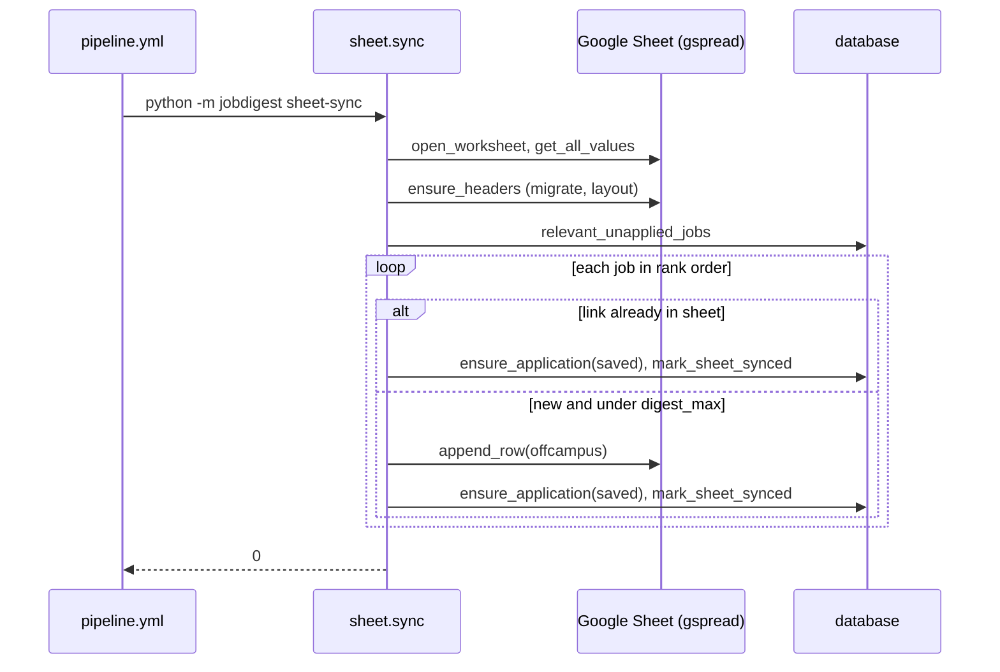

# Google Sheet sync (`sheet.py`)

- Source: `src/jobdigest/sheet.py` (400 lines)
- Layer: delivery (a human-facing mirror). One-way: the database is the source of truth; the sheet is a convenience tracker the user can also edit by hand.
- Depends on: `gspread` (imported lazily inside functions, so the rest of the package never needs it: `tests/test_sheet.py::test_collect_score_digest_source_has_no_gspread`), `db` ([applications](../storage/applications.md), [digest queries](../storage/contacts-and-digest-queries.md)), `normalize.normalize_url` ([normalize](../foundation/normalize.md)), `config`, `envfile`.
- Used by: `cli.py` (`sheet-append` -> `run`, `sheet-sync` -> `sync`); `.github/workflows/pipeline.yml` step "Sheet sync" runs `python -m jobdigest sheet-sync` (skipped for the `urgent` slot).
- Tests: `tests/test_sheet.py` (1220 lines; also holds many `guest_rows`/application DB tests), `tests/test_pipeline_e2e.py::test_full_pipeline_happy_path`, `::test_cli_contacts_and_sheet_sync_run_offline`.

## Why this exists / responsibility

Two different jobs share one worksheet (`sheet1` of the spreadsheet named by `GOOGLE_SHEET_ID`):

1. **`sync`** (the pipeline step): append the *currently relevant, unapplied* jobs (the same ranked candidate list the digest draws from) as new rows with `Campus=offcampus`, and register each as a `saved` application in the DB so it will not be offered again.
2. **`run`** (`sheet-append`, manual or ad hoc): push `applications` rows that have no sheet row yet (e.g. jobs marked Applied through the bot or the CLI) into the sheet.

Both are idempotent: they de-duplicate on the **normalized apply link**.

## Public interface at a glance

| Symbol | Signature | Purpose |
|---|---|---|
| `run` | `run(*, db_path=None, url=None, company="", title="", status="applied", notes="", source="", worksheet=None) -> int` | Optionally record one application, then push all not-yet-synced applications. |
| `sync` | `sync(*, db_path=None, worksheet=None) -> int` | Append new relevant jobs, record them as `saved`. |
| `open_worksheet` | `() -> gspread.Worksheet` | Authenticate and open `sheet1`. |
| `ensure_headers` | `(worksheet) -> None` | Create/migrate header row, apply layout. |
| `migrate_if_needed` | `(values) -> (values, changed)` | Old 7-column layout to the 9-column layout. |
| `apply_sheet_layout` | `(worksheet) -> None` | Header style, freeze row, dropdown validation. |
| `require_sheet` | `() -> bool` | `JOBDIGEST_REQUIRE_SHEET` in `{1,true,yes}`. |
| constants | `HEADERS`, `OLD_HEADERS`, `CAMPUS_OFF="offcampus"`, `CAMPUS_CHOICES`, `APPLIED_CHOICES`, `HEADER_RANGE="A1:I1"`, `CAMPUS_RANGE="F2:F5000"`, `APPLIED_RANGE="G2:G5000"`, `LINK_COL=3`, `HEADER_FORMAT` | Layout. |

Return codes: `0` success or skipped-because-credentials-absent; `1` error or missing credentials when `JOBDIGEST_REQUIRE_SHEET` is set.

## Key concepts

- **Columns** (`HEADERS`, `src/jobdigest/sheet.py:23`): `Date, Company, Role, Link, Source, Campus, Applied, Status, Notes` (A to I). `Link` is index `LINK_COL = 3`. `Campus` has a dropdown (`offcampus`/`oncampus`) and `Applied` has a dropdown (`yes`/`no`), both non-strict so hand-typed values remain legal.
- **Dedupe by normalized link.** `normalize_url` strips tracking junk (for example `utm_source`) and normalizes the URL; `applications.apply_url_norm` is `norm_http_url(url)` which uses the same function. A link already present in the sheet, however written, is matched via `_existing_norms`, which maps `normalize_url(link) -> 1-based sheet row number` (`tests/test_sheet.py::test_utm_pair_one_application_and_sheet_row`).
- **The sheet is hand-editable.** `sync` never reads Campus/Applied/Status/Notes back into the DB and never overwrites sheet cells; it only appends. A job already present (even if you set its Status to `oa`) is just recorded as `saved` in the DB if absent (`test_sheet_sync_keeps_hand_edited_applied_status`, `test_sheet_sync_leaves_existing_oa_application`).
- **`FakeSheet`** (`tests/test_sheet.py:35`) is the in-memory stand-in used throughout: `rows` list-of-lists, `get_all_values`, `append_row`, `update`, `format`, `freeze`, `add_validation`, counters `appends`, `formats`, `validations`, `frozen_rows`. Passing `worksheet=FakeSheet()` skips credentials entirely, so the logic is tested with no Google dependency. The e2e test uses its own copy.

## Detailed walkthrough

### `require_sheet`, `_missing_sheet_creds`, `_resolve_worksheet`

`require_sheet()` (`:52`) mirrors `telegram.require_telegram`. `_missing_sheet_creds()` (`:60`) is true when `GOOGLE_SHEET_ID` or `GOOGLE_SERVICE_ACCOUNT_JSON` is empty.

`_resolve_worksheet(kind, worksheet) -> (ws, exit_code)` (`:66`) returns either `(worksheet, None)` or a `(None, code)` early exit:

1. An injected `worksheet` is used as-is (no credential check).
2. Credentials missing: if `require_sheet()` -> prints `SHEET FAILED missing GOOGLE_SHEET_ID or GOOGLE_SERVICE_ACCOUNT_JSON` to stderr, `(None, 1)`; else prints `<kind> skip missing credentials` and `(None, 0)`. Tests: `test_missing_creds_exits_1`, `test_sheet_append_missing_creds_skips_when_not_required`, `test_sheet_sync_require_sheet_missing_creds_exits_1`, `test_sheet_sync_missing_creds_skips_when_not_required`.
3. Otherwise `open_worksheet()`; any exception prints `<kind> error <exc>` to stderr and `<kind> error` to stdout, `(None, 1)`.

`kind` is `"sheet-append"` or `"sheet-sync"` and only labels messages.

### `open_worksheet`

**Location** `:83`. Calls `load_dotenv()`, re-reads the two env vars, raises `RuntimeError` if either is missing. The service-account path is `Path(json_path).expanduser()`; a relative path is resolved against `repo_root()`; a missing file raises `RuntimeError("service account JSON not found: ...")`. Then (import inside the function) `gspread.service_account(filename=str(path))` and `gc.open_by_key(sheet_id).sheet1`. The CI workflow writes the secret JSON to `google-sa.json` before this step. Not unit-tested for real (no network).

### `migrate_if_needed`

**Location** `:106` · `def migrate_if_needed(values: list[list[str]]) -> tuple[list[list[str]], bool]`

1. Empty sheet -> `([HEADERS], True)`.
2. If the first nine header cells (stripped) already start with `HEADERS` -> `(values, False)`.
3. If the first seven cells are not exactly `OLD_HEADERS` (`Date, Company, Role, Link, Source, Status, Notes`) -> `(values, False)` (unknown layout, left alone by this function).
4. Otherwise rebuild: new header row, and for each old row (padded with 7 empty strings) place `padded[0..4]` in A-E, `CAMPUS_OFF` in F, `""` in G (Applied), old Status `padded[5]` in H, old Notes `padded[6]` in I. Returns `(out, True)`.

Verified: old row `["2026-01-01","A","R","http://l","gh","Applied","n"]` becomes `["2026-01-01","A","R","http://l","gh","offcampus","","Applied","n"]`. Test: `test_sheet_sync_migrates_old_headers`.

### `_call_sheet` and `apply_sheet_layout`

`_call_sheet(worksheet, name, *args, **kwargs)` (`:134`) calls `worksheet.<name>` if it exists; any exception prints `sheet-<name> skip <exc>` to stderr and is swallowed. Cosmetics must never fail a sync.

`apply_sheet_layout` (`:144`): `format(HEADER_RANGE, HEADER_FORMAT)` (dark background, white bold centered), `freeze(rows=1)`, then, importing `ValidationConditionType` from `gspread.utils` inside a `try` (a failed import prints `sheet-validation skip` and returns), two `add_validation` calls: `one_of_list` over `F2:F5000` with `CAMPUS_CHOICES` and over `G2:G5000` with `APPLIED_CHOICES`, `showCustomUi=True, strict=False`. It runs on **every** call of `ensure_headers`, even when the header already matches (`test_sheet_sync_applies_layout_when_headers_already_match`, `test_ensure_headers_styles_and_dropdowns_without_rewriting_rows`).

### `_replace_values`, `ensure_headers`

`_replace_values` (`:172`) writes a whole grid with `worksheet.update("A1", rows)` (gspread >= 6 argument order, per the comment) and raises if the worksheet has no `update`.

`ensure_headers` (`:180`):

1. `values = list(worksheet.get_all_values() or [])`; `migrated, changed = migrate_if_needed(values)`.
2. Empty sheet: write `HEADERS` with `update("A1:I1", [HEADERS])` (or `append_row` if there is no `update`), apply layout, return.
3. If row 1 does not start with `HEADERS`: if `changed` (old layout) replace everything with the migrated grid; otherwise **overwrite A1:I1 with the headers** (this also happens for an unrecognized layout, replacing whatever was in row 1).
4. `apply_sheet_layout(worksheet)`.

### `_existing_norms`

**Location** `:204`. For rows after the header, takes column `LINK_COL`, ignores blanks and non-http(s) values, and returns `{normalize_url(text): i + 1}` (1-based sheet row). If two rows share a normalized link the later row wins.

### `_sheet_link`

**Location** `:221`. Chooses the best http(s) link from a DB row: `job_apply_url` (the joined job's URL), else `apply_url`, else `apply_url_norm`; `None` if none starts with http(s). Rows with no usable link are skipped (`run` counts and prints `sheet-append skip non-http link`).

### `_guest_row` and `_ensure_saved_application`

`_guest_row(job, date)` (`:241`) builds the 9-cell row for a new job: `[date, company, title, link, source, "offcampus", "", "", ""]`. `_ensure_saved_application(conn, job, link, sheet_row)` (`:256`) calls `ensure_application(..., status="saved", source=..., job_id=...)` which *inserts only if absent* (returns `"exists"` otherwise, never changing the status), then `mark_sheet_synced(conn, app_id, sheet_row)` when it has an id. Marking synced means `pending_sheet_rows` will not later try to append the same row again.

### `run`

**Location** `:270` · **Signature** `def run(*, db_path: Path | None = None, url: str | None = None, company: str = "", title: str = "", status: str = "applied", notes: str = "", source: str = "", worksheet: Any | None = None) -> int`

**Purpose** `sheet-append`: record an application (optional) and push every application that has not been synced.

**Step-by-step**

1. `load_dotenv()`, `conn = connect(db_path)`, counters `appended`, `synced_existing`, `skipped`.
2. If `url`: `upsert_application(conn, apply_url=url, ... status=status ...)` (creates or updates the `applications` row; see [applications](../storage/applications.md)).
3. `pending = pending_sheet_rows(conn)`: all `applications` with `sheet_row IS NULL`, oldest id first, with the job's URL joined as `job_apply_url`.
4. `ws, gate_code = _resolve_worksheet("sheet-append", worksheet)`; if `gate_code is not None`, return it. (Note that the DB upsert from step 2 has already happened by then, even when credentials are missing.)
5. `ensure_headers(ws)`, `values = list(ws.get_all_values() or [])` (or `[HEADERS]`), `existing = _existing_norms(values)`.
6. For each pending row:
   - `link = _sheet_link(row)`; `None` -> `skipped += 1`, print, continue.
   - `norm = str(row["apply_url_norm"])`; if in `existing`: the sheet already has it, so `mark_sheet_synced(conn, id, existing[norm])` and `synced_existing += 1` (no append) (`test_reconnect_existing_link_does_not_append`).
   - Else build `values_row = [date(applied_on[:10]), company, title, link, source, "offcampus", "", status or "applied", notes]`, `ws.append_row(values_row, value_input_option="USER_ENTERED")`, `values.append(values_row)`; `sheet_row = len(values)`; `mark_sheet_synced`; `existing[normalize_url(link)] = sheet_row`; `appended += 1`.
7. Print `sheet-append ok pending=N appended=N synced_existing=N skipped=N`; return `0`.
8. `except Exception`: stderr `sheet-append error <exc>`, stdout `sheet-append error`, return `1`. `finally: conn.close()`.

The computed `sheet_row = len(values)` assumes `append_row` places the row immediately after the last row returned by `get_all_values()`. If the sheet contained fully blank rows in the middle, Google's "append after the table" behaviour and this arithmetic could disagree. The code does not guard that; it only affects the recorded `sheet_row`.

Test `test_append_twice_one_row`: calling twice with the same URL yields one application and one sheet row.

### `sync`

**Location** `:349` · **Signature** `def sync(*, db_path: Path | None = None, worksheet: Any | None = None) -> int`

**Purpose** Make sure the sheet lists the jobs worth looking at, and that the DB knows about each of them.

**Step-by-step**

1. `conn = connect(db_path)`; resolve worksheet with kind `"sheet-sync"` (early exit as above, **before** touching the DB further).
2. `ensure_headers(ws)`; `values`; `existing = _existing_norms(values)`.
3. `models = load_models()`, `profile = load_profile()`; `jobs = relevant_unapplied_jobs(conn, models.score_model, models.score_prompt_version, profile=profile)` is the ranked list (blend of fit and LLM, diversity not applied, notified jobs included) described in [rank-and-selection](../ranking/rank-and-selection.md). `test_relevant_unapplied_jobs_matches_guest_order_without_limit`, `test_sheet_sync_appends_in_blend_order` (the fresher Pune job precedes the staler Mumbai job).
4. `date = utc_now()[:10]` (UTC date) and `limit = max(int(profile.digest_max), 0)`.
5. For each job in rank order:
   - no http link -> skip silently;
   - `norm = normalize_url(link)`; if in `existing` -> `skipped_existing += 1` and `_ensure_saved_application(conn, job, link, existing[norm])` (register what the user already has in the sheet);
   - elif `appended >= limit` -> `continue` (cap on *new* appended rows per run is `digest_max`, but the loop keeps going so later jobs that are already in the sheet are still registered);
   - else append `_guest_row(job, date)`, update `values`/`existing`, `_ensure_saved_application(conn, job, link, sheet_row)`, `appended += 1`.
6. Print `sheet-sync ok appended=N skipped_existing=N`, return `0`; errors print `sheet-sync error <exc>` and return `1`.

Consequence of registering `saved` applications: those jobs drop out of future digests (applications are excluded from `guest_rows`), so appending a job to the sheet effectively "takes it off the digest list" (`test_sheet_sync_keeps_hand_edited_applied_status` asserts `guest_rows(...) == []` afterwards). `test_sheet_sync_skips_oncampus_url` covers the case where the URL is already in the sheet marked `oncampus`.

## Sequence: pipeline sheet sync

### `_header_row`
**Location** `src/jobdigest/sheet.py:100` · **Signature** `def _header_row(values: list[list[str]]) -> list[str]`
Returns the first sheet row with every cell converted to a stripped string, or `[]` when the sheet is empty. Used by `ensure_headers` (line 191) to compare row 1 with `HEADERS`;
it normalises surrounding whitespace so a header cell such as `" Date "` still compares equal to `HEADERS`. (gspread returns strings, so `None` cells do not occur; `str(None)` would give `"None"`.)

## Failure modes and edge cases

- Missing credentials: skip with code 0 locally, code 1 under `JOBDIGEST_REQUIRE_SHEET`.
- Any gspread/API error is caught at the top and becomes exit code 1 with a short stdout message and the detail on stderr; DB changes made before the error (individual `mark_sheet_synced`/`ensure_application` commits) persist.
- Partial progress is safe to rerun because everything keys on the normalized link.
- A sheet whose row 1 is some other layout is overwritten with `HEADERS` (see `ensure_headers`).
- Edits made in the sheet (Status, Notes, Applied) are never imported into the DB.

## How to modify / extend safely

- Adding a column: update `HEADERS`, `HEADER_RANGE`, both row builders (`_guest_row` and the literal in `run`), the validation ranges if relevant, and `migrate_if_needed` (add a new migration branch, as the old 7-column layout has).
- Keep `gspread` imports inside functions.
- Test with `FakeSheet`; remember its `update` semantics are simplified (one-row payload replaces row 1, multi-row payload replaces everything).
