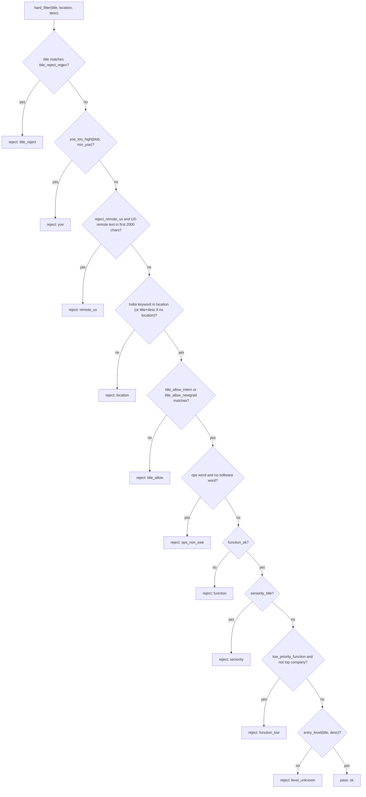

# Hard filter (`jobdigest.hard_filter`)

- **Source:** `src/jobdigest/hard_filter.py` (240 lines)
- **Layer:** filtering, runs inside the storage write path (not as a separate pipeline stage).
- **Depends on:** `jobdigest.config.Profile`, `jobdigest.tiers.is_top_company`, `re`.
- **Used by:** `src/jobdigest/db/jobs.py:_build_job_row` (calls `hard_filter` on every `upsert_job`, so on every sighting of every job); `legitimacy.py` imports `_remote_us`; `score.py` imports `ops_non_swe` and `yoe_too_high`; `fit.py` imports `low_priority_function`; `expand.py` imports `function_ok` and `seniority_title`.
- **Tests:** `tests/test_hard_filter.py` (72 test functions, including the parametrized "quality gates" at the bottom), `tests/test_fit.py` (e.g. `test_zero_to_two_years_is_not_entry_level_evidence`), `tests/test_legitimacy.py` (remote-US interplay), `tests/test_pipeline_e2e.py` (through collect).

## Why this exists / responsibility

The user is a fresher/intern candidate looking at India-based jobs. Calling an LLM on thousands of jobs would be slow and costly, so a deterministic, regex-based gate rejects obviously wrong jobs at ingest. `hard_filter` returns `(hard_status, hard_reason)` where `hard_status` is `"pass"` or `"reject"`. The result is stored in `jobs.hard_status` / `jobs.hard_reason`; downstream stages only consider `pass` jobs ([score-llm](../ranking/score-llm.md), [rank-and-selection](../ranking/rank-and-selection.md)).

Two kinds of rules coexist:
1. **Profile-driven** rules, from the user's (secret, user-edited) `profile.yaml`: `title_reject_regex`, `min_yoe_reject`, `reject_remote_us`, `india_keywords`, `title_allow_intern`, `title_allow_newgrad`, `top_companies`.
2. **Code-level quality gates** (the regexes `_STRONG_ENG` ... `_ENTRY_JD`): they do not depend on the profile, "so a loose profile can never let non-engineering or experienced roles through" (comment at `hard_filter.py:49`).

The filter is a pure function of its arguments (no DB, no network), so it is safe to call from anywhere and trivial to unit-test.

## Public interface at a glance

| Symbol | Signature | Purpose |
|---|---|---|
| `hard_filter` | `(profile, *, title, location_raw, description_text, employment_hint=None, company="") -> tuple[str, str]` | The full gate; first failing rule wins. |
| `yoe_too_high` | `(blob: str, min_yoe_reject: int) -> bool` | Years-of-experience detector (also used by `score.py`). |
| `function_ok` | `(title: str) -> bool` | Is the title an engineering/technical role. |
| `low_priority_function` | `(title: str) -> bool` | Frontend/QA/mobile without core signals. |
| `seniority_title` | `(title: str) -> bool` | Experienced-role title (Engineer II, Architect...). |
| `entry_level` | `(title: str, description_text: str) -> bool` | Positive evidence of an entry-level role. |
| `ops_non_swe` | `(title: str) -> bool` | Operations/support/sales style title without a software word. |
| `_remote_us` | `(blob: str) -> bool` | US-only remote / work-authorization language. |
| `_india_ok`, `_kw_hit` | private | India location test. |

## Key concepts

- All regexes are compiled with `re.I`. `\b` boundaries matter: `\bintern\b` must not match "internal", `\bncr\b` must not match "increase" (tests `test_internal_audit_not_intern`, `test_increase_not_ncr`).
- "Blob": the filter does not look at one field. YOE detection sees `title + location_raw + the whole description`; remote-US sees only the first 2000 characters of the description (`desc2000`); the India test uses location if present, else title + `desc2000`.
- `min_yoe_reject` comes from the profile (the example profile has `3`, which is also what `load_profile()` returns in tests because the code falls back to `config/profile.example.yaml` when `config/profile.yaml` is missing). For non-interns the code lowers it to `1`.

## Detailed walkthrough

### Years-of-experience regexes

All five are consumed by `yoe_too_high`. The outputs below were produced by calling `yoe_too_high(text, min)` on the working tree (`True` = "too much experience").

| Regex | Location | Pattern (summary) | Matches |
|---|---|---|---|
| `_RANGE` | `hard_filter.py:8` | `(?<!\d)(\d+)\s*(?:[-–]\|to)\s*(\d+)\s*(?:\+)?\s*(?:years?\|yrs?)\b` | `3-5 years`, `3 to 5 yrs`, `2-8+ years`, `2-3 years` (also `3 to 5 years ago`, see oddities) |
| `_PLUS` | `:12` | `(?<!\d)(\d+)\s*\+\s*(?:years?\|yrs?)\b` | `5+ years`, `4 + years`, `1+ years` |
| `_MIN` | `:13` | `(?:minimum\|min(?:imum)?\|at least)\s*(\d+)\s*(?:years?\|yrs?)\b(?!\s+ago)` | `minimum 2 years`, `at least 3 years of exp`, `min 2 yrs`, `at least 1 year` |
| `_MIN_OVER` | `:19` | `over\|more than` + N years + up to two filler words + `experience\|exp\|relevant\|industry\|professional` | `over 5 years of experience`, `more than 3 years relevant` |
| `_PLUS_N` | `:24` | `\bplus\s+(\d+)\s*years?\s+(?:of\s+)?(?:experience\|relevant\|professional\|related)\b` | `plus 4 years of experience` |

Non-matches verified: `over 10 years of innovation` (company-history text, hence the "experience-ish word required" comment on `_MIN_OVER`), `plus 4 years vesting`, `founded 10 years ago`, `2 - 3 months`, `between 2 and 8 years`, `5-3 years` (hi < lo), `0-5 years`, `freshers 0-1 years`.

### `yoe_too_high`

**Location** `src/jobdigest/hard_filter.py:150` · **Signature** `def yoe_too_high(blob: str, min_yoe_reject: int) -> bool`

**Purpose.** Return True if any experience requirement in `blob` is at or above the threshold. **Called by** `hard_filter` (with `blob_yoe`, threshold `min_yoe`) and `score.py` (the post-LLM relevance guard, with the profile threshold applied to title + first 3000 chars of the description; see [score-llm](../ranking/score-llm.md)). **Calls** only the regexes.

**Step-by-step**
1. For each `_RANGE` match, `lo, hi = int(g1), int(g2)`:
   - `lo == 0` -> skip (a "0-N years" range means freshers are welcome: `0-5 years` is not rejected).
   - `hi < lo` -> skip (nonsense like `5-3`).
   - reject if `lo >= min_yoe_reject or (lo >= 1 and hi >= min_yoe_reject)`. So with threshold 3: `3-5` (lo>=3) rejects; `1-3` rejects (hi>=3, lo>=1); `1-2` does not. With threshold 1 every range with `lo >= 1` rejects.
2. For each `_PLUS` match: reject if N `>= min_yoe_reject` (`5+ years` with 3; `1+ years` only with threshold 1).
3. For each of `_MIN`, `_MIN_OVER`: reject if N `>= min_yoe_reject`.
4. For each `_PLUS_N`: same.
5. Otherwise `False`.

Verified table (threshold 1 = non-intern, threshold 3 = profile default for interns):

| Text | min=1 | min=3 |
|---|---|---|
| `3-5 years` | True | True |
| `1-2 years` | True | False |
| `1-3 years` | True | True |
| `1+ years` | True | False |
| `minimum 2 years` | True | False |
| `at least 1 year` | True | False |
| `0-5 years` | False | False |
| `over 10 years of innovation` | False | False |

**Data flow.** text -> five regex scans -> integer compare -> bool. Note `yoe_too_high` does not know about titles; the interns-vs-others threshold is chosen by the caller.

### `_REMOTE_US` and `_remote_us`

**Location** `hard_filter.py:29` (tuple of 7 compiled regexes) and `:182`. `_remote_us(blob)` is `any(pat.search(blob) for pat in _REMOTE_US)`.

| Pattern | Verified matches |
|---|---|
| `work authorization in the united states` | "work authorization in the United States" |
| `eligible to work in the (us\|u.s.?\|united states)` | "eligible to work in the U.S." |
| `remote\s*[-–/]?\s*(us\|u.s.?\|usa\|united states)\b` | "Remote - US", "remote us", "Remote USA" |
| `(?<![a-z])(?:us\|u.s.?\|usa\|united states)\s*[-–/]\s*remote\b` | "US-Remote", "US - remote", "usa/remote" (does not match "bus - remote") |
| `\bus[- ]?perm\b` | "US Perm role" |
| `united states only` | "United States only" |
| `us only remote` | "US only remote" |

Not matched: "Remote India", "focus remote". The same function is reused by [legitimacy](legitimacy.md#evaluate_structural) to find US-only language *after* the first 2000 characters.

### `_SWE_TITLE`, `_OPS_TITLE`, `ops_non_swe`

`_SWE_TITLE` (`:39`) = `software|engineer|developer|\bsde\b|\bswe\b`. `_OPS_TITLE` (`:43`) = `operations?|\bsupport\b|\bsales\b|marketing|financial crimes|\baml\b|\bedd\b|\bpep\b|verifications?`.

`ops_non_swe(title)` (`:143`): returns False if no ops word; otherwise returns `not _SWE_TITLE.search(title)`. So an ops word only rejects when the title also lacks any software/engineer word. Verified: "Operations Associate" True, "Product Operations Intern" True, "Customer Support Associate" True, "Verifications Analyst" True; "Support Engineer" False, "Sales Engineer" False, "Software Engineer" False. Used as gate 6 below and in `score.py` (which forces `relevant = False` for such titles).

### `_STRONG_ENG`, `_WEAK_ENG`, `_NON_ENG`, `function_ok`

- `_STRONG_ENG` (`:53`): `engineer|developer|\bsde\b|\bswe\b|software|programmer|devops|\bsre\b|scientist|\bsdet\b|\bqa\b|full[- ]?stack|back[- ]?end|front[- ]?end|\bandroid\b|\bios\b`
- `_WEAK_ENG` (`:59`): `\bml\b|machine learning|\bai\b|\bgenai\b|\bllm\b|research|security|\bdata\b|cloud|infra|platform|embedded|firmware`
- `_NON_ENG` (`:64`): a long list: HR, talent, recruiting, content/copywriter/writer, social media, business development/BD, sales, marketing, growth, go-to-market/GTM, finance, accounts/accountant, compliance, secretarial, legal, operations, support, customer, onboarding, admin, payroll, procurement, designer, UI/UX, brand, community, PR, SEO, annotator, transcription, data collection, verification, specialist, coordinator, executive, insights, evaluation, delivery, PM/product manager, analyst.

**`function_ok(title)`** (`:111`):
```python
strong = bool(_STRONG_ENG.search(text))
if _NON_ENG.search(text) and not strong:
    return False
if strong:
    return True
return bool(_WEAK_ENG.search(text)) and bool(_INTERNISH.search(text))
```
1. A non-engineering word rejects only when no strong engineering word is present, so "Growth Engineer" and "Sales Engineer" stay `True`.
2. A strong word means `True`.
3. A weak-only title (ML, AI, data, cloud, security...) is acceptable only if it also looks like an intern/entry title (`_INTERNISH` = `\bintern(?:ship)?s?\b|trainee|apprentice|graduate|fresher`).
4. Otherwise `False`.

Verified: "Software Engineer" True, "HR Intern" False, "Data Analyst Intern" False (analyst is non-eng, no strong), "Data Science Intern" True, "Data Intern" True (weak + internish), "Research Scientist" True (strong via scientist), "Product Manager Intern" False, "Technical Writer" False (non-eng `\bwriter\b`).

### `_LOW_FN`, `_CORE_FN`, `low_priority_function`

`_LOW_FN` (`:76`): frontend, QA, SDET, quality assurance, test/testing engineer, test automation, android, ios, mobile, UI, web developer. `_CORE_FN` (`:81`): backend, full stack, platform, infra, ML, machine learning, AI, LLM, security, data, devops, SRE, cloud, system(s), distributed, research, scientist. `low_priority_function` (`:122`) = low signal present **and** no core signal. Verified: "Frontend Engineer" True, "QA Intern" True, "Android Developer" True, "iOS Intern" True; "Full Stack Frontend" False, "Frontend Platform Engineer" False, "Backend Engineer" False, "Mobile ML Engineer" False. Frontend/QA/mobile roles survive only at "top" companies (gate 9). `fit.py:role_points` reuses the same predicate to give such titles a low role score (14 points) (see [fit-and-tiers](../ranking/fit-and-tiers.md)).

### `_SENIORITY_TITLE` and `seniority_title`

`_SENIORITY_TITLE` (`:89`): `architect|principal|specialist|consultant|evangelist|(?:engineer|developer|sde|swe|scientist)\s*[-,:]?\s*(?:ii|iii|iv|v|2|3|4)\b|\bsde[- ]?(?:2|3|ii|iii)\b|\bl[3-9]\b`. `seniority_title` (`:128`) is `bool(search)`. Verified True: "Software Engineer II", "SDE 2", "SDE-3", "Security Engineer 2", "Solutions Architect", "Principal Engineer", "Software Engineer L5", "Developer Specialist", "SDE II", "Engineer, III". False: "Staff Engineer" (handled by the profile's `title_reject_regex` instead, test `test_experienced_titles_are_rejected` accepts either rejection), "Software Engineer 1", "Software Engineer Intern".

### `_ENTRY_TITLE`, `_ENTRY_JD`, `entry_level`

`_ENTRY_TITLE` (`:95`): intern(ship)(s), trainee, apprentice, new grad, graduate, fresher, junior, `SDE 1`/`SDE I`, `Engineer I`, associate, early career, entry, campus, `0-1`. `_ENTRY_JD` (`:101`): freshers, new grad, recent graduate(s), entry-level, `0-1 years` / `0 to 1 years`, `no prior/previous (work) experience`, `graduat(e|ing|ion) ... 20xx`, `class of 20xx`, `campus hire/hiring/recruit`.

`entry_level(title, description_text)` (`:136`): title match -> True; else description match. Verified True: "Software Engineer Intern", "Associate Software Engineer", "Campus Hiring Engineer"; with description "freshers welcome", "0-1 years", "graduating 2026", "class of 2026", "entry-level", "no prior experience required". False: plain "Software Engineer" with "hello". The key design decision: a bare "Software Engineer" is not assumed to be entry-level; it needs positive evidence (test `test_bare_software_engineer_needs_entry_level_evidence`).

### `_INTERN_TITLE`, `_INTERNISH`

`_INTERN_TITLE` (`:133`) = `\bintern(?:ship)?s?\b|trainee|apprentice` (decides the YOE threshold). `_INTERNISH` (`:87`) adds `graduate|fresher` (used by `function_ok` for weak-only titles).

### `_india_ok` and `_kw_hit`

`_kw_hit(keyword, blob)` (`:172`) = `re.search(r"\b" + re.escape(keyword.lower()) + r"\b", blob)`; word boundaries avoid "NCR" inside "increase" and "India" inside "Indiana". `_india_ok(profile, title, location_raw, desc2000)` (`:176`): `loc = location_raw.strip()`; `blob = f"{title}\n{loc}".lower() if loc else f"{title}\n{desc2000}".lower()`; True if any `profile.india_keywords` matches. **When a location exists, the description is ignored**: a job located "New York, USA" is rejected even if its text mentions Pune; only jobs with an *empty* location get the title + description fallback (tests `test_empty_loc_bangalore_in_jd_pass`, `test_empty_loc_no_india_reject`, `test_indiana_location_not_india`).

### `hard_filter`

**Location** `src/jobdigest/hard_filter.py:186` · **Signature** `def hard_filter(profile: Profile, *, title: str, location_raw: str, description_text: str, employment_hint: str | None = None, company: str = "") -> tuple[str, str]`

**Purpose.** Run all gates in a fixed order and return the first rejection or `("pass", "ok")`. **Called by** `db/jobs.py:_build_job_row` (also directly in tests and `tests/test_fit.py`). **Calls** the helpers above and `tiers.is_top_company`.

**Parameters**

| name | type | default | meaning |
|---|---|---|---|
| `profile` | `Profile` | n/a | Supplies the regex strings and thresholds. |
| `title` | str | n/a | Raw (un-normalized) job title; falsy treated as `""`. |
| `location_raw` | str | n/a | Location text from the source. |
| `description_text` | str | n/a | Plain-text description. |
| `employment_hint` | `str \| None` | None | Source's employment type (e.g. "Intern"); appended to the title for the allow-list test only. |
| `company` | str | `""` | Raw company name, used only for the top-company exemption. |

**Returns** `(status, reason)`; every reason code is in the table below.

**Step-by-step (execution order = decision order)**

1. **Prepare text.** `desc2000 = (description_text or "")[:2000]`; `blob_yoe = title + "\n" + location_raw + "\n" + full description`; `blob_remote = title + "\n" + location_raw + "\n" + desc2000`.
2. **Gate 1, `title_reject`.** If `profile.title_reject_regex` is non-empty and matches the title -> `("reject", "title_reject")`. In the example profile this removes staff, principal, distinguished, fellow, senior, sr, lead, manager, director, VP, "head of".
3. **Gate 2, `yoe`.** `min_yoe = profile.min_yoe_reject if _INTERN_TITLE.search(title) else min(profile.min_yoe_reject, 1)`. Interns tolerate stray mentions ("3+ years" still rejects an intern when the profile threshold is 3, but "at least 1 year of university education" passes: `test_at_least_1_year_not_yoe_reject`), everyone else is rejected at 1 year or more. `yoe_too_high(blob_yoe, min_yoe)` true -> `("reject", "yoe")`. This is why "Software Engineer" + "1-2 years of experience" is `yoe`, not `level_unknown`.
4. **Gate 3, `remote_us`.** If `profile.reject_remote_us` and `_remote_us(blob_remote)` -> `("reject", "remote_us")`.
5. **Gate 4, `location`.** `not _india_ok(profile, title, location_raw, desc2000)` -> `("reject", "location")`.
6. **Gate 5, `title_allow`.** `allow_text = title` plus `" " + employment_hint` when present. `intern_ok = bool(profile.title_allow_intern and re.search(profile.title_allow_intern, allow_text, re.I))`, similarly `newgrad_ok` with `title_allow_newgrad`. If neither -> `("reject", "title_allow")`. Example: "Data Scientist" with the example profile fails here because neither regex matches it.
7. **Gate 6, `ops_non_swe`.** `ops_non_swe(title)` -> `("reject", "ops_non_swe")`.
8. **Gate 7, `function`.** `not function_ok(title)` -> `("reject", "function")`.
9. **Gate 8, `seniority`.** `seniority_title(title)` -> `("reject", "seniority")`.
10. **Gate 9, `function_low`.** `low_priority_function(title) and not is_top_company(company, profile.top_companies)` -> `("reject", "function_low")`. `is_top_company` ([fit-and-tiers](../ranking/fit-and-tiers.md)) checks a built-in list (Google, Stripe, Razorpay ...) plus `profile.top_companies`.
11. **Gate 10, `level_unknown`.** `not entry_level(title, description_text)` -> `("reject", "level_unknown")`.
12. Otherwise `("pass", "ok")`.

**Why this order.** Cheap, profile-driven, high-recall rejections come first (title, years, US-remote, location) so that the specific code gates only classify what is left. `ops_non_swe` precedes `function` so ops jobs get the more specific `ops_non_swe` reason ("Marketing Intern" -> `ops_non_swe`, but "Content Writer Intern" -> `function`, since `content`/`writer` is in `_NON_ENG` but not in `_OPS_TITLE`). `seniority` and `function_low` come after `function` so the reason reflects the first violated property. `level_unknown` is last because it is the weakest signal (absence of evidence).



The ten gates are evaluated top to bottom; the first one that fires determines `hard_reason`, so a job that would fail several gates only reports the earliest.

**Reject reasons**

| `hard_reason` | Gate | Meaning |
|---|---|---|
| `title_reject` | 1 | Title hit the profile reject regex (senior, staff, manager ...). |
| `yoe` | 2 | Experience requirement at/over threshold. |
| `remote_us` | 3 | US-only remote / US work authorization in first 2000 chars. |
| `location` | 4 | No India keyword. |
| `title_allow` | 5 | Neither intern nor new-grad title pattern. |
| `ops_non_swe` | 6 | Operations/support/sales-style, no software word. |
| `function` | 7 | Not an engineering function. |
| `seniority` | 8 | Engineer II / architect / principal / L5 style. |
| `function_low` | 9 | Frontend/QA/mobile at a non-top company. |
| `level_unknown` | 10 | No entry-level evidence in title or text. |
| `ok` | n/a | Passed (status `pass`). |

**Real examples** (run against `load_profile()`, which uses `config/profile.example.yaml` here; company "Acme" unless noted; location "Bengaluru, India" unless noted):

| Title | Location / description | Result |
|---|---|---|
| Senior Software Engineer | | `reject title_reject` |
| Software Engineer Intern | "Bengaluru", "3+ years of experience" | `reject yoe` |
| Software Engineer | "Bengaluru", "1-2 years of experience" | `reject yoe` |
| Backend Engineer Intern | "Remote - US" | `reject remote_us` |
| Backend Engineer Intern | "New York, USA" | `reject location` |
| Backend Engineer Intern | "" (empty), desc "Join our Pune office" | `pass ok` |
| Software Engineer Intern | "Indiana, USA" | `reject location` |
| Data Scientist | | `reject title_allow` |
| Marketing Intern | | `reject ops_non_swe` |
| Product Operations Intern | | `reject ops_non_swe` |
| Content Writer Intern | | `reject function` |
| Data Analyst Intern | | `reject function` |
| Software Engineer II | "Pune", "freshers welcome" | `reject seniority` |
| Frontend Engineer Intern | company "Random Startup" | `reject function_low` |
| Frontend Engineer Intern | company "Stripe" | `pass ok` |
| Software Engineer | "Pune", "Own the platform." | `reject level_unknown` |
| Software Engineer | "Pune", "We hire freshers" | `pass ok` |
| Machine Learning Intern | | `pass ok` |
| Data Intern | | `pass ok` |
| Hardware Engineer Intern | | `pass ok` (see oddities) |
| Software Engineer Intern | "Bengaluru", "United States only" | `reject remote_us` |
| Software Engineer Intern | "Bengaluru", 2100 filler chars then "Remote - US" | `pass ok` (US text beyond 2000 chars; [legitimacy](legitimacy.md) catches it later) |

**Plain-English summary.** A job passes only if it is in India, not senior, not US-bound, within the experience limits, titled like an intern/new-grad engineering role (not ops, not HR, not frontend/QA at an unremarkable company), and has some positive sign of being entry-level.

## Failure modes and edge cases

- **Profile regexes are user-provided strings**; an invalid regex in `title_reject_regex`, `title_allow_intern` or `title_allow_newgrad` raises `re.error` inside `upsert_job`, which is not caught in `collect`, aborting the run. Empty strings disable the respective check, except `title_allow_*` where both empty means every job is rejected with `title_allow`.
- **Every update re-evaluates** the filter, so changing the profile or code changes `hard_status` on the next collect for every job still on a board; there is no "grandfathering".
- **Descriptions are plain text**; YOE detection scans the whole description, which also includes unrelated numbers.
- **`_RANGE` has no `ago` guard**: `3 to 5 years ago` is a positive (`_MIN` has `(?!\s+ago)` but `_RANGE` does not). `Upto 20-30 years` also matches.
- **`_MIN` matches "min" inside words**: the alternation `min(?:imum)?` has no leading word boundary, so "admin 2 years" matches (checked: `yoe_too_high("admin 2 years", 1)` is True; "terminal 3 years" is False because `min` must be followed directly by whitespace/digits).
- **Hardware / non-software engineers pass**: "Hardware Engineer Intern" passes since "engineer" is a strong word.
- **Location ignores the description** when a location string exists, so remote jobs with non-Indian default location text are rejected.
- `_remote_us` only inspects the first 2000 characters here; later text is the legitimacy check's job.

## How to modify / extend safely

- Add or change a code-level regex and update/extend the parametrized lists in `tests/test_hard_filter.py` (`test_non_engineering_interns_are_rejected`, `test_experienced_titles_are_rejected`, `test_real_entry_level_engineering_roles_pass`) and `tests/test_fit.py` if fit depends on it.
- Remember that `function_ok`, `seniority_title`, `low_priority_function`, `ops_non_swe`, `yoe_too_high` are imported by other modules; behavior changes ripple into `fit.py`, `score.py`, `expand.py`.
- Adding a new reject reason: add the gate at the right position in `hard_filter`, and grep for places that display or aggregate `hard_reason` (digest/sheet code) before choosing a name.
- Keep gate order in mind: it determines the reported reason, and the reason is what users debug with.
