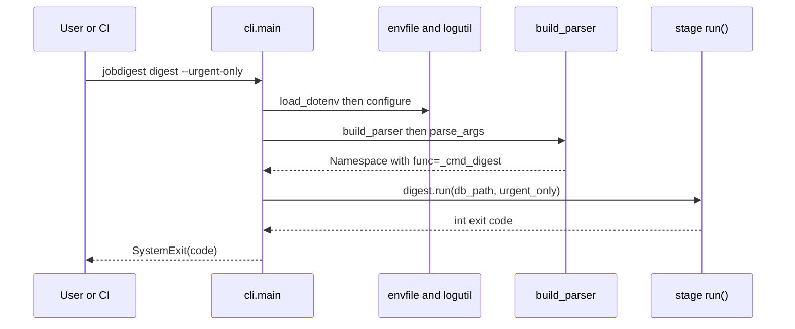

# cli and entry points

- Source: `src/jobdigest/cli.py` (191 lines), `src/jobdigest/__main__.py` (4 lines), `src/jobdigest/__init__.py` (3 lines), plus the console-script declaration in `pyproject.toml`.
- Layer: entry point. Nothing imports `cli.py` except `__main__.py`, the console script and tests.
- Depends on: `argparse`, `pathlib`; lazily imports `jobdigest.envfile`, `jobdigest.logutil` and one stage module per subcommand.
- Tests: `tests/test_cli.py` (`test_cli_parser_has_contacts_flags`, `test_cli_parser_contacts_defaults`), `tests/test_collect_portals.py` (line ~206, `main(["collect","--ats-only","--db",...]) == 0`), `tests/test_collect_marketplaces.py::test_cli_collect_skip_marketplaces`, `tests/test_pipeline_e2e.py` (lines ~316-317: `main(["contacts",...])`, `main(["sheet-sync",...])`). `tests/test_sheet.py` imports `build_parser` and `main` but grep finds no call to them there.

## Why this exists / responsibility

A single command, `jobdigest`, fronts the pipeline stages so a scheduler (GitHub Actions, `start.sh`, cron) only needs `python -m jobdigest <stage> [flags]`. `cli.py` builds the argument parser, loads `.env`, configures logging, and dispatches to the stage's `run()` function, converting its return value to the process exit code.

Stage modules are imported **inside** each `_cmd_*` function rather than at module top. This keeps `jobdigest --help` and the parser tests fast and free of heavy imports (scrapling, playwright, gspread, psycopg) and means a missing optional dependency only breaks the stage that needs it.

## How the entry points fit together

| Invocation | Resolves to |
|---|---|
| `jobdigest ...` (installed console script) | `pyproject.toml` `[project.scripts]` `jobdigest = "jobdigest.cli:main"` |
| `python -m jobdigest ...` | `src/jobdigest/__main__.py`: `from jobdigest.cli import main` then `raise SystemExit(main())` under `if __name__ == "__main__"` |
| `python -m jobdigest.cli` | `cli.py` bottom: `sys.exit(main())` |
| `python -m jobdigest.cron` | the schedule gate, see [cron-gate.md](cron-gate.md) |
| `python -m jobdigest.bot`, `.expand`, `.probe`, `.discover` | separate `main()` functions in their own modules (not subcommands of `jobdigest`): `bot.py:537`, `expand.py:188`, `probe.py:44`, `discover.py:533` |

`src/jobdigest/__init__.py` only defines `__version__ = "0.1.0"` (the same string as `pyproject.toml`; they are not linked automatically).

There is no `bot` subcommand: the Telegram button-handling loop is started as `python -m jobdigest.bot` (see [../delivery/bot.md](../delivery/bot.md)).

## Public interface at a glance

| Symbol | Signature | Purpose |
|---|---|---|
| `main` | `def main(argv: list[str] \| None = None) -> int` | Entry point; returns the exit code. |
| `build_parser` | `def build_parser() -> argparse.ArgumentParser` | Construct the full parser with all subcommands. |
| `_cmd_collect` | `(args) -> int` | Dispatch to `jobdigest.collect.run`. |
| `_cmd_score` | `(args) -> int` | Dispatch to `jobdigest.score.run`. |
| `_cmd_digest` | `(args) -> int` | Dispatch to `jobdigest.digest.run`. |
| `_cmd_sheet` | `(args) -> int` | Dispatch to `jobdigest.sheet.run` (`sheet-append`). |
| `_cmd_sheet_sync` | `(args) -> int` | Dispatch to `jobdigest.sheet.sync`. |
| `_cmd_contacts` | `(args) -> int` | Dispatch to `jobdigest.contacts.run`. |
| `_add_db`, `_add_flag`, `_add_collect_parser`, `_add_digest_parser`, `_add_sheet_parser`, `_add_contacts_parser`, `_add_simple_parser` | parser-construction helpers | Register subparsers and flags. |

## Subcommand reference

| Subcommand | Handler | Calls (lazy import) | Flags | Notes |
|---|---|---|---|---|
| `collect` | `_cmd_collect` (cli.py:8) | `jobdigest.collect.run` (`collect.py:512`) | `--ats-only`, `--skip-ats`, `--skip-discovered`, `--skip-portals`, `--skip-feeds`, `--skip-marketplaces` (all `store_true`), `--portal-fetch {http,dynamic,stealth}` (repeatable, `action="append"`, `dest="portal_fetch"`), `--db` | `--ats-only` makes `run` set skip portals/feeds/marketplaces. `portal_fetch` becomes a `tuple` or `None`. |
| `score` | `_cmd_score` (cli.py:27) | `jobdigest.score.run` (`score.py:305`) | `--db` | Built with `_add_simple_parser`. |
| `digest` | `_cmd_digest` (cli.py:34) | `jobdigest.digest.run` (`digest.py:349`) | `--db`, `--urgent-only` | `urgent_only=bool(args.urgent_only)`. Help text: "score then print and send Telegram digest". |
| `sheet-append` | `_cmd_sheet` (cli.py:41) | `jobdigest.sheet.run` (`sheet.py:270`) | `--db`, `--url` (default `None`), `--company` (`""`), `--title` (`""`), `--status` (`"applied"`), `--notes` (`""`), `--source` (`""`) | Marks the URL as applied and pushes to Google Sheets. |
| `sheet-sync` | `_cmd_sheet_sync` (cli.py:66) | `jobdigest.sheet.sync` (`sheet.py:349`) | `--db` | Built with `_add_simple_parser`. |
| `contacts` | `_cmd_contacts` (cli.py:58) | `jobdigest.contacts.run` (re-export of `contacts/run.py:80`) | `--db`, `--limit N` (int, default `None`), `--job-id N` (int, repeatable, `dest="job_id"`) | `job_ids` is a `list` or `None`; when given, "skips last-digest lookup" per its help. |

`--db` default is `None`; every handler does `db = Path(args.db) if args.db else None` and passes `db_path=db`. The effective DB is then chosen inside `db/connection.py` (the help string says: "SQLite path (default DATABASE_PATH or data/jobs.db)"; `DATABASE_URL` selects Postgres, see [../storage/connection-and-postgres-shim.md](../storage/connection-and-postgres-shim.md)).

## Detailed walkthrough

### `main`
**Location** `src/jobdigest/cli.py:176` · **Signature** `def main(argv: list[str] | None = None) -> int`
**Called by** `__main__.py`, the console script, tests. **Calls** `load_dotenv` ([paths-envfile-logutil.md](paths-envfile-logutil.md#load_dotenv)), `configure` ([logging](paths-envfile-logutil.md#configure)), `build_parser`, the handler `args.func`.
1. Local imports of `load_dotenv` and `configure` (kept local so importing `cli` stays cheap).
2. `load_dotenv()` then `configure()`: environment first, so `JOBDIGEST_LOG_LEVEL` / `JOBDIGEST_LOG_FILE` from `.env` take effect.
3. `parser = build_parser(); args = parser.parse_args(argv)`. `argv=None` means `sys.argv[1:]`.
4. `if not getattr(args, "command", None): parser.print_help(); return 0`. Subparsers are created with `required=False`, so a bare `jobdigest` prints help and exits 0 (verified).
5. `return int(args.func(args))`. Every subparser sets `func` via `set_defaults`.
Exit codes: the stage's integer (0 success, 1 failure by convention in `collect.py`, `score.py`, `digest.py`, `sheet.py`, `contacts/run.py`); argparse errors (unknown subcommand, bad flag, non-int `--limit`) call `sys.exit(2)` (verified: `jobdigest bogus` prints "invalid choice" and exits 2). Unhandled exceptions from a stage propagate as a traceback with exit 1.

### `build_parser`
**Location** `src/jobdigest/cli.py:156` · **Signature** `def build_parser() -> argparse.ArgumentParser`
1. `ArgumentParser(prog="jobdigest", description=...)`.
2. `sub = parser.add_subparsers(dest="command", required=False)`.
3. Registers, in order: `collect`, `score` (via `_add_simple_parser`), `digest`, `sheet-append`, `sheet-sync` (via `_add_simple_parser`), `contacts`. The order matches `--help` output.
The `description` string mentions "Daily intern job digest (collect, score, digest, contacts, sheet-append, sheet-sync)".

### Parser helpers
- `_add_db` (cli.py:76): `--db`, default `None`, shared help `_DB_HELP`.
- `_add_flag` (cli.py:80): `store_true` flag.
- `_add_collect_parser` (cli.py:84): see [`_add_collect_parser`](#_add_collect_parser); `--portal-fetch` restricts which portal fetch modes run (the restriction is applied in `collect.run`, see [../collection/collect-orchestrator.md](../collection/collect-orchestrator.md)).
- `_add_digest_parser` (cli.py:105), `_add_sheet_parser` (cli.py:116), `_add_contacts_parser` (cli.py:128): as in the table.
- `_add_simple_parser` (cli.py:150): `name`, help text, handler, with only `--db`. Used for `score` and `sheet-sync`.

### `_cmd_collect`

**Location** `src/jobdigest/cli.py:8` · **Signature** `def _cmd_collect(args: argparse.Namespace) -> int`
**Purpose** Bridge from the parsed `collect` arguments to `jobdigest.collect.run`, translating the argparse types into what `run` expects.
**Called by** `main` through `args.func` (set by `_add_collect_parser`). **Calls** `jobdigest.collect.run` ([collect-orchestrator.md](../collection/collect-orchestrator.md)), imported inside the function.
**Parameters** `args` with attributes `db`, `ats_only`, `skip_ats`, `skip_discovered`, `skip_portals`, `skip_feeds`, `skip_marketplaces`, `portal_fetch`. **Returns** `int(run(...))`, the process exit code.
**Step by step**
1. `from jobdigest.collect import run` (lazy; the heavy fetch stack is only imported for this subcommand).
2. `db = Path(args.db) if args.db else None` (an empty `--db ""` also becomes `None`).
3. `portal_fetch = tuple(args.portal_fetch) if getattr(args, "portal_fetch", None) else None`: argparse's `append` action yields a list (or `None`); `run` wants a tuple, and an absent flag must stay `None` (meaning "all fetch modes").
4. Call `run` with exactly eight keyword arguments: `db_path`, `ats_only=bool(args.ats_only)` (direct attribute access), and `skip_ats`, `skip_discovered`, `skip_portals`, `skip_feeds`, `skip_marketplaces`, each `bool(getattr(args, name, False))`, then `portal_fetch`. The `getattr` defaults make the handler tolerant of a Namespace built by hand without those keys; `ats_only` is the one attribute accessed directly, so a Namespace without it raises `AttributeError`.
Verified offline with `collect.run` replaced by a recorder: `parse_args(["collect","--ats-only","--portal-fetch","http","--portal-fetch","stealth","--db","x.db"])` produced the call `{'db_path': PosixPath('x.db'), 'ats_only': True, 'skip_ats': False, ..., 'portal_fetch': ('http', 'stealth')}`; plain `collect` produced `db_path=None`, all flags `False`, `portal_fetch=None`.

### `_cmd_sheet`

**Location** `src/jobdigest/cli.py:41` · **Signature** `def _cmd_sheet(args: argparse.Namespace) -> int`
**Purpose** Handler for `sheet-append`. Forwards the optional "mark this URL as applied" fields plus the DB path to `jobdigest.sheet.run`.
**Called by** `main` via `args.func`. **Calls** `jobdigest.sheet.run` (`sheet.py:270`).
**Behavior** Lazy-imports `run`, converts `--db` as in every handler, then passes `url=args.url, company=args.company, title=args.title, status=args.status, notes=args.notes, source=args.source` (all direct attribute accesses, no `getattr` defaults) and returns `int(...)`. The parser defaults are `url=None`, `status="applied"` and `""` for the rest. What those values do lives in `sheet.run`: when `url` is truthy it calls `upsert_application(...)` before pushing pending rows (`sheet.py:287`); with no `--url` it only pushes already-pending rows. See [../delivery/sheet.md](../delivery/sheet.md).
Verified: `["sheet-append","--url","https://e.com/j","--company","Acme"]` produced `run(db_path=None, url='https://e.com/j', company='Acme', title='', status='applied', notes='', source='')` and the handler returned the stub's `3`.

### `_add_collect_parser`

**Location** `src/jobdigest/cli.py:84` · **Signature** `def _add_collect_parser(sub) -> None` (`sub` is the object returned by `add_subparsers`, untyped in the source)
**Purpose** Registers the `collect` subcommand and its flags. **Called by** `build_parser`. **Calls** `sub.add_parser`, `_add_flag`, `_add_db`.
**Step by step**
1. `p = sub.add_parser("collect", help="fetch ATS JSON, portals, RSS, and marketplaces into SQLite")`.
2. Five-plus-one boolean flags through `_add_flag` (each `store_true`, default `False`): `--ats-only`, `--skip-ats`, `--skip-discovered`, `--skip-portals`, `--skip-feeds`, `--skip-marketplaces`.
3. The one non-boolean option:
```python
p.add_argument("--portal-fetch", action="append",
               choices=("http", "dynamic", "stealth"),
               dest="portal_fetch", ...)
```
`action="append"` makes it repeatable and yields a list or `None`; `choices` makes argparse reject other values (verified: `--portal-fetch bogus` prints `invalid choice` and exits 2).
4. `_add_db(p)` adds `--db`; `p.set_defaults(func=_cmd_collect)` is how `main` finds the handler.

### `_add_sheet_parser`

**Location** `src/jobdigest/cli.py:116` · **Signature** `def _add_sheet_parser(sub) -> None`
**Purpose** Registers `sheet-append` (note: the function says "sheet", the subcommand name is `sheet-append`; `sheet-sync` is registered separately by `_add_simple_parser`). **Called by** `build_parser`. **Calls** `sub.add_parser`, `_add_db`.
**Behavior** `--db`, then `--url` (default `None`, help "mark this apply URL then push"), `--company`, `--title`, `--notes`, `--source` (default `""`), and `--status` (default `"applied"`); `set_defaults(func=_cmd_sheet)`. None of the options validates its content; unlike `collect`, all are plain strings.

### `_add_contacts_parser`

**Location** `src/jobdigest/cli.py:128` · **Signature** `def _add_contacts_parser(sub) -> None`
**Purpose** Registers `contacts`. **Called by** `build_parser`. **Calls** `sub.add_parser`, `_add_db`.
**Behavior** `--db`; `--limit` with `type=int, default=None` ("max jobs to enrich (default: all last-digest ids)"); `--job-id` with `action="append", type=int, dest="job_id"` ("enrich this job id (repeatable; skips last-digest lookup)"); `set_defaults(func=_cmd_contacts)`. Verified: `contacts --limit 5 --job-id 3 --job-id 9` gives `limit=5, job_id=[3, 9]`; plain `contacts` gives `limit=None, job_id=None`; `--limit x` exits 2 with `invalid int value`. `_cmd_contacts` turns the list into `job_ids` (a fresh `list`, or `None`).

### `_cmd_*` handlers
Each follows the same pattern: lazy-import the stage function, convert `--db` to `Path | None`, call with keyword arguments, wrap in `int(...)`.
- `_cmd_collect`: reads optional flags with `getattr(args, "skip_ats", False)` (defensive; all flags exist on the parser) and `bool(...)`; passes eight keyword arguments incl. `portal_fetch` (see [`_cmd_collect`](#_cmd_collect)). Note that `collect.run` also accepts test-injection parameters (`client`, `sleep`, `fetch_fn`, ...) that the CLI never sets.
- `_cmd_digest`: `run(db_path=db, urgent_only=bool(args.urgent_only))`.
- `_cmd_sheet`: forwards `url, company, title, status, notes, source` (see [`_cmd_sheet`](#_cmd_sheet)).
- `_cmd_contacts`: `job_ids = list(args.job_id) if getattr(args, "job_id", None) else None`; `run(db_path=db, limit=args.limit, job_ids=job_ids)`.
- `_cmd_score`, `_cmd_sheet_sync`: only `db_path`.


The diagram shows that environment and logging are prepared before any stage runs, and that the stage module is imported only when its handler executes.

## Failure modes and edge cases
- Missing optional dependency for one stage fails only that subcommand at import time (lazy import).
- Stages also call `load_dotenv()`/`configure()` themselves (`collect.run`, `score.run`, `digest.run`, `contacts/run.py`), so they are idempotent when invoked directly from tests or other scripts.
- `sheet-append` and `sheet-sync` exit 0 with a "skip missing credentials" message when Google credentials are absent and `JOBDIGEST_REQUIRE_SHEET` is unset (tests delete that variable; its exact effect is documented in [../delivery/sheet.md](../delivery/sheet.md)) (asserted in `tests/test_sheet.py` lines ~372 and ~947 and in the e2e test); this is stage behaviour, not CLI behaviour.

## How to modify / extend safely
1. Write `run(*, db_path=None, ...) -> int` in the new stage module.
2. Add `_cmd_<name>` here with a lazy import and the `Path | None` conversion.
3. Add an `_add_<name>_parser` (or use `_add_simple_parser`) and register it in `build_parser`; update the `description` text.
4. Add parse tests to `tests/test_cli.py` (pattern: `build_parser().parse_args([...])`).
5. If the stage runs in CI, add a step in `.github/workflows/pipeline.yml` (see [../../infra/github-workflows.md](../../infra/github-workflows.md)).
