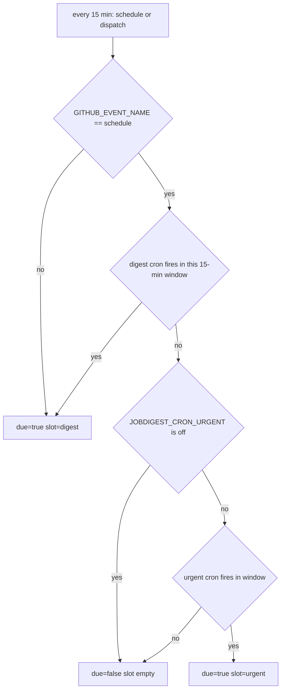

# cron: the schedule gate

- Source: `src/jobdigest/cron.py` (154 lines). Stdlib only (`os`, `sys`, `datetime`); `test_cron_module_is_stdlib_only` asserts the file does not mention `gspread`, `httpx`, `openrouter`, `openai`.
- Layer: entry point / CI infrastructure. Run as `python3 -m jobdigest.cron` from the `gate` job of `.github/workflows/pipeline.yml` (with `PYTHONPATH: src`, before any `pip install`, which is why it must be stdlib-only).
- Used by: the workflow only (plus tests). Nothing in `src/` imports it.
- Tests: `tests/test_cron.py` (all tests named below), `tests/test_workflows.py` (asserts the workflow text contains `python3 -m jobdigest.cron`).

## Why this exists / responsibility

GitHub Actions `schedule:` triggers are coarse, can be delayed by many minutes, and the cron string lives in a YAML file that cannot read secrets. The workflow therefore fires **every 15 minutes** (`cron: "*/15 * * * *"`) and a cheap first job decides whether this tick is a real run. The decision cron strings come from the repository secrets `JOBDIGEST_CRON` (digest) and `JOBDIGEST_CRON_URGENT` (urgent), so the schedule can be changed without editing the workflow. The gate writes `due` and `slot` as job outputs; the heavy `pipeline` job runs only `if: needs.gate.outputs.due == 'true'`, and individual steps branch on `needs.gate.outputs.slot` (`!= 'urgent'` for collect/digest/contacts/sheet steps, `== 'urgent'` for `digest --urgent-only`).

Terms: a **slot** is `digest` (the daily full run) or `urgent` (push of watchlist/high-score cards only). All cron expressions are interpreted in **UTC** (the code uses `datetime.now(timezone.utc)`; naive datetimes are assumed UTC). The default digest cron `30 3 * * *` is 03:30 UTC = 09:00 IST; the default urgent cron `30 8 * * 1-5` is 08:30 UTC (14:00 IST) on weekdays (note `test_default_cron_is_0930_ist_not_0400` has an outdated name; it only asserts `DEFAULT_CRON == "30 3 * * *"` and that it is not `0 4 * * *` or `30 4 * * *`).

## Public interface at a glance

| Symbol | Signature | Purpose |
|---|---|---|
| `DEFAULT_CRON`, `DEFAULT_URGENT_CRON`, `TICK_MINUTES` | `"30 3 * * *"`, `"30 8 * * 1-5"`, `15` | Defaults and tick width (cron.py:7-9). |
| `scheduled_slot` | `def scheduled_slot(now: datetime) -> datetime` | Floor a time to the 15-minute tick. |
| `_matches_field` | `def _matches_field(field: str, value: int, minimum: int, maximum: int) -> bool` | Does one cron field match one value. |
| `cron_matches` | `def cron_matches(expr: str, when: datetime) -> bool` | Does a 5-field expression match an exact minute. |
| `_weekday_matches` | `def _weekday_matches(field: str, dow: int) -> bool` | Day-of-week with 0 and 7 both Sunday. |
| `_day_matches` | `def _day_matches(day: str, weekday: str, when: datetime, dow: int) -> bool` | Day-of-month / day-of-week combination rule. |
| `is_due` | `def is_due(*, now=None, event=None, cron=None) -> bool` | Is any minute of this tick's window matched. |
| `due_slot` | `def due_slot(*, now=None, event=None, cron=None, urgent_cron=None) -> str \| None` | `"digest"`, `"urgent"` or `None`. |
| `_emit` | `def _emit(due: bool, slot: str \| None = None) -> None` | Print and append `due=`/`slot=`. |
| `main` | `def main() -> int` | CLI entry. |

## Detailed walkthrough

### `scheduled_slot`
**Location** `src/jobdigest/cron.py:12`. `now.replace(second=0, microsecond=0)` then `minute = (now.minute // 15) * 15`. Gives the start of the 15-minute window containing `now`. Verified: 03:44 -> 03:30, 03:15 -> 03:15. The timezone of the argument is preserved. **Called by** `is_due`.

### `_matches_field`
**Location** `src/jobdigest/cron.py:18`. Supports one field of standard cron syntax: `*`, `N`, `A-B`, lists `a,b`, and steps `*/n`, `A-B/n`.
1. Strip; an empty field raises `ValueError("empty cron field")`.
2. For each comma-separated part (empty part raises `ValueError`):
   - `step = 1`. If `/` is present, the right side must be `isdigit()` and > 0 else `ValueError("invalid cron step ...")`; `part` becomes the left side (or `*` if blank).
   - `*` gives `start, end = minimum, maximum`; `A-B` parses both ints (each must be digits after `lstrip("-")`); a single number gives `start = end = int(part)`; anything else (e.g. `MON`) raises `ValueError("invalid cron value ...")`.
   - Range check: `start < minimum or end > maximum or start > end` raises `ValueError("cron field out of range ...")`. This validation happens for every part *before* the value test, but parts after an earlier match are never reached, because of the early `return True`.
   - If `value` is outside `[start, end]` continue; if `(value - start) % step == 0` return `True`.
3. Return `False` if no part matched.
Verified: `*/20` matches minute 40 but not minute 30 (`(30-0) % 20 != 0`). `61 * * * *` raises "out of range '61'"; `*/0` raises "invalid cron step". Limitation: `5/15` is treated as the single value 5 (the step is ignored because start = end), unlike Vixie cron, which reads it as 5-59/15. Names (`MON`, `JAN`) and `?`, `L`, `#` are unsupported and raise.

### `cron_matches`
**Location** `src/jobdigest/cron.py:53`.
1. `fields = (expr or "").split()`; not exactly 5 raises `ValueError("cron must have 5 fields: ...")`.
2. `dow = when.isoweekday() % 7` (Python ISO Monday=1..Sunday=7 becomes cron Sunday=0..Saturday=6).
3. Check minute (0-59), hour (0-23), month (1-12) with `_matches_field`; any miss returns `False`.
4. `return _day_matches(day, weekday, when, dow)`.
The order means invalid day or weekday fields only raise if minute, hour and month already matched.

### `_weekday_matches`
**Location** `src/jobdigest/cron.py:68`. Range for weekday is 0-7. `_matches_field(field, dow, 0, 7)` true returns `True`; else if `dow == 0` also tries value 7 (so `7` and `5-7` match Sundays). Verified: `30 3 * * 7` and `30 3 * * 0` both match Sunday 2026-09-06 03:30.

### `_day_matches`
**Location** `src/jobdigest/cron.py:74`. Implements the classic cron quirk. `dom_restricted = not day.strip().startswith("*")`, same for `dow_restricted` from the weekday field. `dom_ok = _matches_field(day, when.day, 1, 31)` and `dow_ok = _weekday_matches(...)` are both always evaluated (so both fields are always validated here). If **both** are restricted the date matches when **either** matches (OR); otherwise AND. Because "restricted" means "does not start with `*`", `*/2` counts as unrestricted (tested: `0 0 */2 * 1` on Thursday 3 Sept is `False`, AND semantics). Tests: `test_dom_and_dow_restricted_use_or_semantics` (`0 0 15 * 1` matches the 15th, matches a Monday the 14th, not the 16th) and `test_single_restricted_day_field_still_and_semantics`.

### `is_due`
**Location** `src/jobdigest/cron.py:86` · **Signature** `def is_due(*, now: datetime | None = None, event: str | None = None, cron: str | None = None) -> bool`
**Called by** `due_slot`; tests.
1. `event_name = event` if not `None` else `os.environ.get("GITHUB_EVENT_NAME", "")`. If it is not exactly `"schedule"` return `True`: manual dispatches and pushes always run (`test_dispatch_always_due`).
2. `raw = cron` if not `None` else `os.environ.get("JOBDIGEST_CRON", "")`; `expr = raw.strip() or DEFAULT_CRON`. Empty secret falls back to the default (`test_empty_cron_uses_default`).
3. `stamp = now or datetime.now(timezone.utc)`; naive datetimes get `tzinfo=utc`.
4. `slot = scheduled_slot(stamp)`; loop `for offset in range(15)`: if `cron_matches(expr, slot + timedelta(minutes=offset))` return `True`. So the gate is due if the cron expression fires on **any minute inside the current 15-minute tick**. This tolerates GitHub delaying a `*/15` run (it fires at 03:41 for the 03:30 tick; `test_schedule_due_when_delayed_inside_slot`) and makes cron minutes that are not multiples of 15 still work (`test_custom_cron_1030_ist_still_works`).
5. `False` otherwise.
Verified on 2026-09-03 with expr `30 3 * * *`: due at 03:30 and 03:44, not at 03:14, 03:15, 03:29 or 03:45.
Plain English: "does the cron expression fire sometime during the quarter-hour that contains now".

### `due_slot`
**Location** `src/jobdigest/cron.py:107` · **Signature** `def due_slot(*, now=None, event=None, cron=None, urgent_cron=None) -> str | None`
1. Non-`schedule` events return `"digest"` immediately (a manual run does the full digest).
2. `stamp = now or datetime.now(timezone.utc)`; `if is_due(now=stamp, event="schedule", cron=cron): return "digest"`. Digest has priority: if both crons match the same tick the slot is `digest` (`test_due_slot_both_match_prefers_digest`).
3. Urgent expression: argument, else `os.environ.get("JOBDIGEST_CRON_URGENT", "")`, stripped. `"off"` (case-insensitive) returns `None` (urgent disabled, `test_due_slot_urgent_off`). Empty uses `DEFAULT_URGENT_CRON`.
4. `is_due(..., cron=urgent_expr)` true returns `"urgent"`; else `None`.
Verified (2026-09-03 is a Thursday, 2026-09-05 a Saturday): 08:37 Thursday -> `urgent`; 08:37 Saturday -> `None`; 12:00 -> `None`; event `push` -> `digest`; Sunday 2026-09-06 03:30 -> `digest` (`test_due_slot_sunday_0330_utc_is_digest`).

### `_emit`
**Location** `src/jobdigest/cron.py:134`. Builds `line = "due=true|false\nslot=<slot or empty>\n"`. If `GITHUB_OUTPUT` is set and non-blank, appends the line to that file (GitHub's mechanism for step outputs: each `key=value` line becomes `steps.<id>.outputs.<key>`), and always writes it to stdout too. `slot=` is empty when not due. Tests: `test_main_writes_github_output`, `test_main_writes_slot`.

### `main`
**Location** `src/jobdigest/cron.py:143`. `slot = due_slot()` using environment only. A `ValueError` (bad cron expression in a secret) prints `cron error <msg>` to stderr and returns `1` without emitting any outputs, which fails the gate job (`test_main_invalid_cron_exits_1`: stdout has no `due=`). Otherwise `_emit(slot is not None, slot)` and return `0`. `if __name__ == "__main__": raise SystemExit(main())`.

The gate prefers digest, then urgent, otherwise the pipeline job is skipped.

## Failure modes and edge cases
- An invalid cron secret fails the gate (exit 1) and the pipeline does not run; the error text goes to stderr only.
- Because the window is a whole tick, a cron with minute `*` or `*/5` is "due" on every tick.
- Everything is UTC; the profile `timezone` field is not used (see [config.md](config.md#profile)).
- A tick missed entirely (GitHub skipping a schedule) is lost; there is no catch-up.

## How to modify / extend safely
- To support names (`MON`) or `N/step`, change `_matches_field` and add cases in `tests/test_cron.py`; keep the module stdlib-only.
- A new slot kind needs: a branch in `due_slot`, a new secret/env var read there, and workflow `if:` conditions on `needs.gate.outputs.slot` (see [../../infra/github-workflows.md](../../infra/github-workflows.md)).
