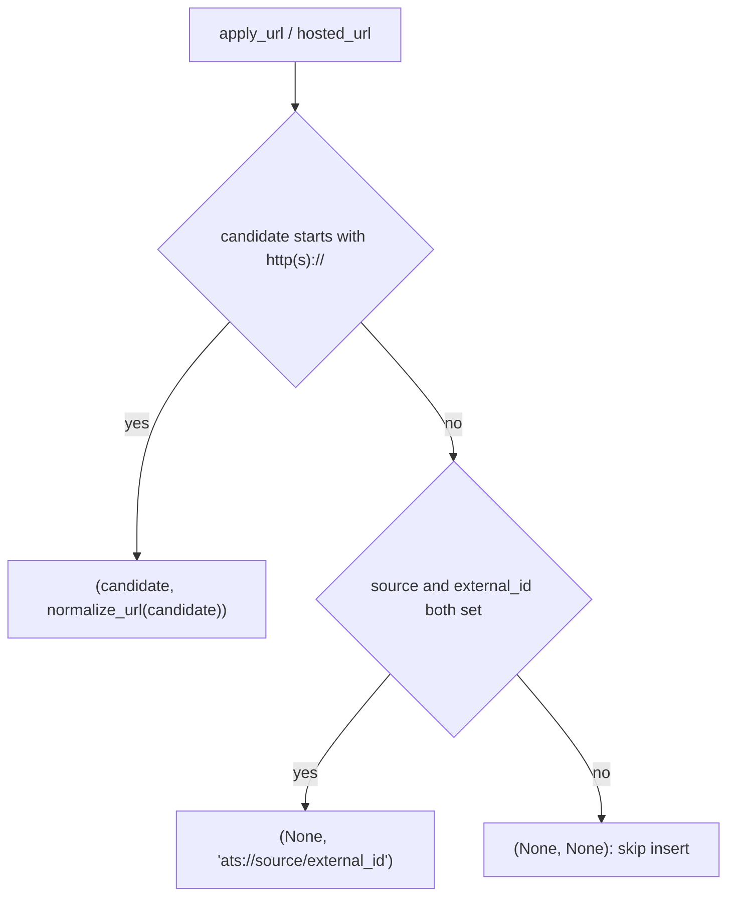

# normalize: text, URL and identity normalization

- Source: `src/jobdigest/normalize.py` (125 lines). Stdlib only (`hashlib`, `re`, `urllib.parse`).
- Layer: foundation. Pure functions with no I/O and no state; safe to call anywhere.
- Used by: `db/jobs.py` (`_build_job_row` at ~line 330, `upsert_job` at ~line 429), `db/_common.py:norm_http_url`, `db/contacts.py`, `db/digest_queries.py`, `collect.py` (`job_identity` at line 164), `legitimacy.py`, `rank.py`, `sheet.py` (`normalize_url`), `email_draft.py`, `contacts/pipeline.py`, `contacts/jd.py` (`collapse_ws`).
- Tests: `tests/test_normalize_text.py` (company/title/location), `tests/test_normalize_url.py` (`normalize_url`, `job_identity`), `tests/test_dual_hash.py` (`posting_key`, and the dedupe behaviour it enables), `tests/test_content_hash.py` (description hashing in the DB path; not read in detail for this page).

## Why this exists / responsibility

The same posting reaches the pool several ways: from an ATS API and again from a job portal, from two tracking-parameter variants of one URL, or under company names such as `Razorpay` and `Razorpay Software Private Limited`. This module defines the canonical forms used to detect those duplicates:

| Concept | Column / use | Function |
|---|---|---|
| Canonical apply URL | `jobs.apply_url_norm` (unique identity of a posting) | `normalize_url`, `job_identity` |
| Cross-source "same posting" key | `jobs.posting_key` (links ATS and portal copies; see `../storage/jobs.md`) | `posting_key` |
| Description fingerprint | `jobs.description_hash` (used for repost / duplicate-description detection in `legitimacy.py`) | `description_hash` |
| Display-clean title/company | `jobs.title`, `jobs.company` (raw versions kept in `raw_title`, `raw_company`) | `normalize_title`, `normalize_company` |

## Public interface at a glance

| Symbol | Signature | Purpose |
|---|---|---|
| `collapse_ws` | `def collapse_ws(text: str \| None) -> str` | Collapse whitespace runs to one space, strip. |
| `description_hash` | `def description_hash(text: str \| None) -> str` | SHA-256 hex of whitespace-collapsed text. |
| `normalize_company` | `def normalize_company(name: str \| None) -> str` | Strip legal suffixes, `&` to `and`. |
| `normalize_title` | `def normalize_title(title: str \| None) -> str` | Drop city suffixes, years, "campus" words. |
| `normalize_location` | `def normalize_location(location_raw: str \| None) -> str` | First `\|` segment, casefolded, city alias. |
| `posting_key` | `def posting_key(title: str, company: str, location_raw: str) -> str \| None` | Hash of normalized (title, company, location). |
| `normalize_url` | `def normalize_url(url: str) -> str` | Canonical URL without tracking params or fragment. |
| `job_identity` | `def job_identity(apply_url, hosted_url, source, external_id) -> tuple[str \| None, str \| None]` | Pick the URL column value and the identity key. |

Module constants: `_DROP_EXACT = {"gclid","fbclid","mc_cid","mc_eid","_ga","ref"}`, `_WS = re.compile(r"\s+")`, `_LEGAL_TRAIL`, `_CITIES`, `_TITLE_PAREN_CITY`, `_TITLE_TRAIL_CITY`, `_TITLE_YEAR`, `_TITLE_CAMPUS`, `_LOC_ALIAS = {"bangalore": "bengaluru", "gurgaon": "gurugram"}`.

## Detailed walkthrough

### `collapse_ws`
**Location** `src/jobdigest/normalize.py:11` · `_WS.sub(" ", text or "").strip()`. `None` becomes `""`. Every other function in the module starts with it. Verified: `collapse_ws("  a \n\t b  ")` gives `'a b'`; `collapse_ws(None)` gives `''`. Also imported directly by `email_draft.py`, `legitimacy.py`, `db/contacts.py`, `contacts/pipeline.py`, `contacts/jd.py`.

### `description_hash`
**Location** `src/jobdigest/normalize.py:15`. `hashlib.sha256(collapse_ws(text).encode("utf-8")).hexdigest()`. Whitespace-insensitive: `description_hash("a  b") == description_hash(" a b ")` is `True`; `description_hash(None)` is the SHA-256 of the empty string (`e3b0c442...`), which `legitimacy.py` captures as `EMPTY_DESCRIPTION_HASH = description_hash("")` so empty descriptions never count as duplicates. Written by `_build_job_row` (`description_hash=description_hash(description_text)`); when it changes on re-fetch `upsert_job` notes a content change (`db/jobs.py:477`).

### Regex constants
- `_LEGAL_TRAIL`: anchored at end of string; matches an optional comma or whitespace run, then one of `private limited`, `pvt[.] ltd[.]`, `corporation`, `limited`, `private`, `software`, `gmbh`, `llp`, `llc`, `plc`, `inc`, `corp`, `ltd`, `pvt`, then an optional `.` and trailing space. Case-insensitive. The alternation order matters: longer alternatives (`private limited`) come before shorter (`private`) so `Foo Private Limited` loses both words at once.
- `_CITIES`: `pune|bengaluru|bangalore|hyderabad|mumbai|chennai|noida|gurugram|gurgaon|delhi|ncr|india` (note: no `kolkata`, `ahmedabad`, `remote`).
- `_TITLE_PAREN_CITY`: `\s*\((?:CITIES)(?:,[^)]*)?\)` removes a parenthesised group that *starts* with a city. `Intern (Pune, Maharashtra)` loses it; `SDE (Remote)` keeps it.
- `_TITLE_TRAIL_CITY`: `\s*[-–|/]\s*(?:CITIES)\s*$` removes `- Pune`, `– Pune`, `| India`, `/ Pune` at the end only, and only if the city is the entire tail. `Intern - Delhi NCR` is *not* changed (the tail is two city words).
- `_TITLE_YEAR`: `\b20\d\d\b` (four-digit years 2000-2099); `Intern 20267` is untouched.
- `_TITLE_CAMPUS`: `\b(?:off[-\s]?campus|on[-\s]?campus|campus)\b`, case-insensitive; also matches `Oncampus`.

### `normalize_company`
**Location** `src/jobdigest/normalize.py:49` · **Called by** `db/jobs.py:_build_job_row` (stored company), `posting_key`, `rank.py`, `legitimacy.py`, `db/digest_queries.py`, `db/contacts.py`.
1. `text = collapse_ws(name)`; empty returns `""`.
2. `text.replace("&", " and ")` then collapse again (`Foo&Bar` gives `Foo and Bar`).
3. Loop until a fixed point:
```python
prev = None
while prev != text:
    prev = text
    text = collapse_ws(_LEGAL_TRAIL.sub("", text))
```
Repeating strips stacked suffixes: `Acme Corp Ltd` gives `Acme`. Case of the remaining text is preserved (`posting_key` casefolds later).
Verified outputs: `Razorpay Software Private Limited` -> `Razorpay`; `Razorpay Pvt. Ltd.` -> `Razorpay`; `Foo & Bar LLP` -> `Foo and Bar`; `Acme, Inc.` -> `Acme`; `Zoho Corporation` -> `Zoho`; `Google Cloud India` unchanged (so it stays distinct from `Google`, see `test_normalize_company_google_cloud_india_distinct`).
Edge cases: a name that is *only* a suffix word, such as `LLC` or `Software`, is returned unchanged because the regex requires a preceding separator; `Private Limited` becomes `Private` (only `Limited` strips). `Acme Software` becomes `Acme`, which is intentional for Indian entities (`Razorpay Software Private Limited`) but would also merge a genuinely different "X Software" company with "X".

### `normalize_title`
**Location** `src/jobdigest/normalize.py:62` · **Called by** `db/jobs.py:_build_job_row` (`job_title = normalize_title(raw_title) or "(untitled)"`), `posting_key`.
1. `collapse_ws`; empty returns `""`.
2. Apply in order: `_TITLE_PAREN_CITY` (removed), `_TITLE_TRAIL_CITY` (removed), `_TITLE_YEAR` (replaced by space), `_TITLE_CAMPUS` (replaced by space).
3. `collapse_ws` to remove the gaps.
Verified: `Software Engineer (Bengaluru, India)` -> `Software Engineer`; `SDE Intern - Pune` -> `SDE Intern`; `Intern 2026` -> `Intern`; `Off-campus SDE` -> `SDE`; `SWE Intern | India` -> `SWE Intern`; `Backend Engineer – Noida` -> `Backend Engineer`; `Campus Hiring 2025 Analyst` -> `Hiring Analyst`. Role words (`Intern`) are never removed (`test_normalize_title_keeps_intern`). Important: the **hard filter runs on the raw title** (`hard_filter(profile, title=raw_title, ...)` in `_build_job_row`) because it needs the word "campus" for allow-rules (`test_hard_filter_uses_raw_campus_title`); only the stored/dedupe title is normalized.

### `normalize_location`
**Location** `src/jobdigest/normalize.py:73` · **Called by** `posting_key`.
1. `collapse_ws`; empty returns `""`.
2. `text.split("|", 1)[0]` keeps only the first segment (ATS strings like `Bengaluru | Karnataka`).
3. Collapse, `casefold()`, then map through `_LOC_ALIAS` (`bangalore` -> `bengaluru`, `gurgaon` -> `gurugram`) by *exact* match of the whole string.
Verified: `Bangalore` -> `bengaluru`; `Bengaluru | Karnataka` -> `bengaluru`; `Gurgaon` -> `gurugram`; `Pune, Maharashtra, India` -> `pune, maharashtra, india`; `Bangalore, India` -> `bangalore, india` (alias does not apply to comma strings, so such a posting gets a different `posting_key` from a plain `Bengaluru` one).

### `posting_key`
**Location** `src/jobdigest/normalize.py:82` · **Signature** `def posting_key(title: str, company: str, location_raw: str) -> str | None`
**Purpose** A deterministic fingerprint of "same role at same company in same place", independent of URL, used to link an ATS posting and its portal duplicate (`../storage/jobs.md`, `link_duplicate_jobs` in `db/jobs.py:141`, and `db/digest_queries.py` / `db/runs.py` self-joins on `posting_key`).
1. `title_n = normalize_title(title).casefold()`, `company_n = normalize_company(company).casefold()`, `loc_n = normalize_location(location_raw)`.
2. If `title_n` or `company_n` is empty return `None` (location may be empty).
3. `blob = f"{title_n}\n{company_n}\n{loc_n}"`; return `sha256(blob).hexdigest()`.
Example (verified): `posting_key("SDE Intern (Pune)", "Razorpay Software Private Limited", "Bangalore")` equals `posting_key("sde intern", "RAZORPAY", "bengaluru | KA")`; both give `1960bcea6dc5...`. `_build_job_row` passes the already-normalized `job_title` and `job_company`, so the functions are applied twice (idempotent).
Data flow: raw fields -> three normalizers -> newline-joined string -> SHA-256.

### `normalize_url`
**Location** `src/jobdigest/normalize.py:92` · **Signature** `def normalize_url(url: str) -> str`
1. `parts = urlsplit(url.strip())`.
2. Host: `parts.hostname` lowercased (`hostname` already drops user:password), leading `www.` removed. Port: if `parts.port` is truthy it is appended (`:8443`); the default port is *not* removed (`https://x.com:443/a` keeps `:443`).
3. Path: `parts.path.rstrip("/")`; a bare `/` becomes empty, so `https://x.com/?b=2` becomes `https://x.com?b=2`.
4. Query: `parse_qsl(..., keep_blank_values=True)` keeping pairs whose lowercased key is not in `_DROP_EXACT` and does not start with `utm_`; re-encoded with `urlencode` (order preserved, not sorted; `%20` becomes `+`). Key matching is exact, so `REF_ID` survives while `Ref` is dropped.
5. Scheme: `(parts.scheme or "https").lower()`. Fragment always dropped (`urlunsplit((scheme, netloc, path, query, ""))`).
Verified: `https://WWW.Example.com:8443/a/b/?utm_source=x&gclid=1&ref=2&id=5&flag#frag` -> `https://example.com:8443/a/b?id=5&flag=`. Note blank values are re-emitted as `flag=`.
Oddities: a scheme-less string such as `example.com/jobs` has no netloc, so the result is `https:///example.com/jobs`; `normalize_url("")` returns `https://`. Callers therefore check for `http(s)://` first (`job_identity`, `db/_common.py:norm_http_url`).

### `job_identity`
**Location** `src/jobdigest/normalize.py:111` · **Signature** `def job_identity(apply_url: str, hosted_url: str, source: str, external_id: str) -> tuple[str | None, str | None]`
**Purpose** Decide what URL to store in `jobs.apply_url` and what to use as the unique identity `apply_url_norm`. Returns `(None, None)` to tell the caller to skip the insert.
**Called by** `db/jobs.py:upsert_job` (line 448), `collect.py` (line 164, to compute a seen-key).
1. `candidate = apply_url.strip() or hosted_url.strip()` (apply URL wins; hosted URL is the fallback). `ext` and `src` are stripped.
2. If `candidate` starts with `http://` or `https://` (case-insensitive): return `(candidate, normalize_url(candidate))`. The raw candidate (not normalized) is the clickable column value.
3. Else if both `src` and `ext` are non-empty: return `(None, f"ats://{src}/{ext}")`, a synthetic identity key for jobs that have no usable URL; the URL column stays `NULL` because it is not clickable.
4. Else `(None, None)`.
Verified: `job_identity("https://a.com/x/?utm_x=1", " ", "s", "e")` -> `('https://a.com/x/?utm_x=1', 'https://a.com/x')`; `job_identity("mailto:x","","lever","abc")` -> `(None, 'ats://lever/abc')`; `job_identity("/rel/path","","","abc")` -> `(None, None)`; `job_identity("HTTPS://a.com","","","")` -> `('HTTPS://a.com', 'https://a.com')`. Covered by `test_job_identity_http_uses_normalize` and `test_job_identity_synthetic_requires_external_id`.


The diagram shows the three outcomes of `job_identity`; only the first yields a clickable link.

## Failure modes and edge cases
- Functions never raise on `None`/empty input except `normalize_url`/`job_identity`, which require `str` for `url`/`apply_url` (the latter coerces with `or ""`).
- `normalize_url` can raise `ValueError` from `urlsplit`/`.port` on malformed input such as an out-of-range port (stdlib behaviour; not guarded here).
- Changing any regex changes `posting_key` for existing rows: old keys stored in the DB will no longer match new ones.

## How to modify / extend safely
- Add a tracking parameter: extend `_DROP_EXACT` (exact, case-insensitive match) or the `utm_` prefix rule; add a case to `tests/test_normalize_url.py`.
- Add a city: extend `_CITIES` (shared by both title regexes); tests in `tests/test_normalize_text.py`.
- Treat any change to `normalize_*`/`posting_key` as a data migration: existing `jobs.posting_key` and `apply_url_norm` values are not recomputed automatically.
