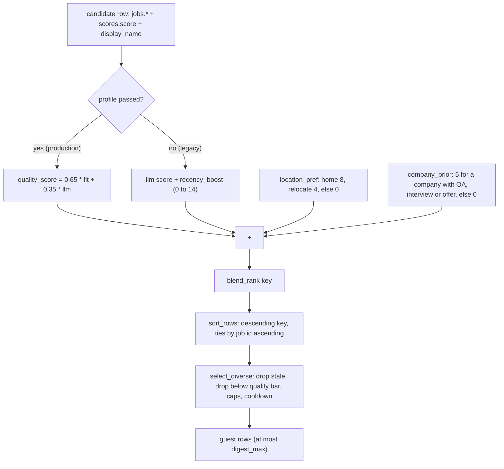

# Ranking key and digest selection (`rank.py`)

- Source: `src/jobdigest/rank.py` (273 lines)
- Layer: ranking. Pure functions over rows; no I/O.
- Depends on: `jobdigest.fit.quality_score` ([fit-and-tiers.md](fit-and-tiers.md)), `jobdigest.normalize.normalize_company`, `jobdigest.config.Profile`.
- Used by: `jobdigest.db.digest_queries` (`sort_rows`, `select_diverse`, `PRIOR_POSITIVE`; see [../storage/contacts-and-digest-queries.md](../storage/contacts-and-digest-queries.md)), `jobdigest.digest` (`age_chip`, `source_chip`), `jobdigest.summarize` (`age_chip`, `source_chip`).
- Tests: `tests/test_rank.py` (recency, location, blend examples, chips), `tests/test_priors.py` (company prior and the `guest_rows` interplay), `tests/test_fit.py` (sort by quality, `select_diverse` caps, cooldown, staleness, company variants), `tests/test_urgent.py` (`guest_rows` skips notified jobs, `relevant_unapplied_jobs` still sees them), `tests/test_pipeline_e2e.py`.

## Why this exists / responsibility

Scoring produces numbers; this module turns them into an **ordered, diverse shortlist**. It has two jobs:

1. `blend_rank` / `sort_rows` compute one ranking key per job and sort the candidate pool.
2. `select_diverse` walks that sorted list and keeps the best rows subject to quality, age, per-company, per-portal and cooldown rules, and returns *fewer* rows rather than padding the digest with weak jobs.

It also holds the two display helpers `age_chip` and `source_chip` used on the Telegram cards.

## How a job's final rank is computed

The `fit` inside `quality_score` is itself the sum of role, level, skill, trust and freshness points ([fit-and-tiers.md](fit-and-tiers.md)). Note that the *sort key* and the *quality bar* differ: the key adds location and prior, but `select_diverse` re-computes plain `quality_score` (without location/prior) for the bar and the cooldown bypass.

So, with a profile: **rank key = 0.65 * fit + 0.35 * llm + location_pref + company_prior**, range 0 to 113 (100 + 8 + 5).

Worked example, example profile (Pune home, Bengaluru relocate), job A ("Backend Software Engineer, New Grad", Acme, greenhouse, Pune, 1 day old, LLM 90): quality 89.35 + location 8 + prior 0 = **97.35** (verified by running `blend_rank`). Job B (Stripe intern via portal, Bengaluru, 10 days old, LLM 70): quality 61.0625 + 4 + 0 = **65.0625**. Without a profile (legacy mode) the same rows give `90 + 12 + 8 = 110.0` and `70 + 0 + 4 = 74.0`, since the recency boost is `(7 - 1) * 2 = 12` for A and 0 for B (older than 7 days).

## Public interface at a glance

| Symbol | Signature | Purpose |
|---|---|---|
| `RECENCY_WINDOW_DAYS`, `RECENCY_MAX`, `RECENCY_PER_DAY` | `7.0`, `14.0`, `2.0` | Legacy recency boost parameters |
| `LOC_HOME`, `LOC_RELOCATE`, `LOC_OTHER` | `8.0`, `4.0`, `0.0` | Location bonus |
| `PRIOR_POSITIVE`, `PRIOR_MAX` | `5.0`, `5.0` | Company prior value and cap |
| `COOLDOWN_BYPASS_QUALITY` | `85.0` | Quality that overrides the company cooldown |
| `age_chip` | `(first_seen_at, now) -> str` | `<1h`, `5h`, `4d` or empty |
| `source_chip` | `(ats) -> str` | `rss` / `portal` / `marketplace` / `ats` |
| `recency_boost` | `(first_seen_at, now) -> float` | 0-14 legacy boost |
| `location_pref` | `(location_raw, title, *, home, relocate) -> float` | 8 / 4 / 0 |
| `company_prior` | `(row, priors) -> float` | 0-5 |
| `blend_rank` | `(row, *, home, relocate, now, priors=None, profile=None) -> float` | Ranking key |
| `sort_rows` | `(rows, *, home, relocate, now, priors=None, profile=None) -> list` | Sorted candidates |
| `company_key` | `(name) -> str` | normalised, case-folded company |
| `select_diverse` | `(rows, limit, *, profile, now, recent_companies=()) -> list` | Final selection |

## Detailed walkthrough

### `_try_parse_iso`

**Location** `src/jobdigest/rank.py:30` · `def _try_parse_iso(value: str) -> datetime | None`. Strips, replaces a trailing `Z` with `+00:00`, `datetime.fromisoformat`; `TypeError/ValueError` -> `None`; a naive datetime is assumed UTC; the result is converted to UTC. Shared by `age_chip`, `recency_boost`, `_age_days`.

### `_needles` and `_hits`

**Location** `src/jobdigest/rank.py:41` and `:48`. `_needles(city)` lower-cases/strips the city and expands it through `_ALIASES` (`bengaluru`, `bangalore`, `bengalooru` are all equivalent); an empty city gives `()`. `_hits(hay, city)` is true if any needle appears as a whole word: `re.search(r"\b" + re.escape(needle) + r"\b", hay)`. The word boundary means "Punekar" does not match "Pune" (verified 0.0), while "Pune, India" does.

### `age_chip`

**Location** `src/jobdigest/rank.py:55` · `def age_chip(first_seen_at: str | None, now: datetime) -> str`
Returns a short age label for cards. Blank/None/unparseable -> `""`. `age_seconds = (now_utc - dt).total_seconds()`: `< 3600` -> `"<1h"` (this includes future timestamps, which are negative); `< 86400` -> `f"{int(age_seconds // 3600)}h"`; else `f"{int(age_seconds // 86400)}d"`. Verified: 30 minutes -> `<1h`; 5 hours -> `5h` (naive input treated as UTC); 4 days -> `4d`. It measures `first_seen_at` (when the crawler first saw the job), not `posted_at`. Called by `digest._guest_dicts` and `summarize.render_card` (fallback when the dict has no `age_chip`).

### `source_chip`

**Location** `src/jobdigest/rank.py:71` · `def source_chip(ats: str | None) -> str`. Case-folded `ats`: `"rss"` -> `rss`, `"portal"` -> `portal`, `"marketplace"` -> `marketplace`, anything else (including `None`) -> `ats`. The three non-ATS values are the same set `fit.trust_points` and `select_diverse` treat as "aggregator".

### `recency_boost`

**Location** `src/jobdigest/rank.py:82` · `def recency_boost(first_seen_at: str | None, now: datetime) -> float`
`age_days = max(0, (now_utc - dt) / 86400)`; returns `max(0, RECENCY_WINDOW_DAYS - age_days) * RECENCY_PER_DAY`, i.e. 14 at age 0, falling by 2 per day to 0 at 7 days; future timestamps clamp to age 0 (14); missing/unparseable -> 0. **Only used when `blend_rank` is called without a profile.** With a profile, recency is already inside `fit` (`freshness_points`, max 10), so adding it again would double count.

### `location_pref`

**Location** `src/jobdigest/rank.py:94` · `def location_pref(location_raw: str, title: str, *, home: str, relocate: Sequence[str]) -> float`
`hay = f"{location_raw}\n{title}".casefold()` (the description is not read; `test_location_pref_does_not_read_description`). Home city hit -> `LOC_HOME` 8; else any relocate city hit -> `LOC_RELOCATE` 4; else 0. Home wins when both match the same string. Verified: "Pune, India" -> 8, "Bangalore" with relocate ["Bengaluru"] -> 4 (alias), "Punekar" -> 0. The title is included because some boards put the city only in the title.

### `_row_text`

**Location** `src/jobdigest/rank.py:110` · `def _row_text(row, key) -> str`. Safe column read: missing key or `None` -> `""`, else `str(value)`.

### `company_prior`

**Location** `src/jobdigest/rank.py:120` · **Signature** `def company_prior(row: RowLike, priors: Mapping[str, float]) -> float`
**Purpose** A small bonus for companies where the user has previously reached an OA, interview or offer. `priors` is built by `db.digest_queries.load_company_priors`, which returns an empty dict until at least `MIN_OUTCOMES = 20` outcome rows exist, so the feature stays off until there is enough history (see [../storage/contacts-and-digest-queries.md](../storage/contacts-and-digest-queries.md)). Every positive company gets `PRIOR_POSITIVE` (5.0); statuses `rejected`/`ghosted` count toward the 20-row gate but add nothing.

1. Empty `priors` -> `0.0` immediately.
2. Candidate keys: `normalize_company(company).casefold()` first, then the same for `display_name` if different and non-empty.
3. For the first key present in `priors`: `float(priors[key])`; `TypeError/ValueError` -> 0; negative -> 0; else `min(raw, PRIOR_MAX)` (5.0 cap, so a corrupt big value cannot dominate). A key found stops the search even if the value yields 0.
4. No key found -> 0.0.

Verified: prior 9 for "Acme" -> 5.0; "Acme Inc" with `{'acme': 3}` -> 3.0 (the legal suffix is normalised away); negative -> 0. Design intent (tests `test_llm_lead_beats_max_boost_including_prior`, `test_prior_can_flip_5_point_llm_gap`): the prior is a tie-breaker-sized nudge, not an override.

### `blend_rank`

**Location** `src/jobdigest/rank.py:143`
**Signature** `def blend_rank(row: RowLike, *, home: str, relocate: Sequence[str], now: datetime, priors: Mapping[str, float] | None = None, profile: Profile | None = None) -> float`
**Purpose** The ranking key described in the diagram above.
**Called by** `sort_rows`. **Calls** `quality_score` or `recency_boost`, `location_pref`, `company_prior`.

1. `profile is not None`: `base = quality_score(row, profile, now)`. Else `base = float(row["score"] or 0) + recency_boost(row["first_seen_at"], now)` (the legacy path; it reads `row["first_seen_at"]` directly, so a row without that column raises).
2. Return `base + location_pref(row["location_raw"] or "", row["title"] or "", home=home, relocate=relocate) + company_prior(row, priors or {})`.

Production always passes `profile` (`digest_queries._ranked_candidates`). The no-profile branch is retained for tests and legacy callers (`tests/test_rank.py` examples A-C use it).

### `sort_rows`

**Location** `src/jobdigest/rank.py:170` · same keyword parameters as `blend_rank`, plus `rows`. `sorted(rows, key=lambda r: (-blend_rank(...), int(r["id"])))`: highest key first, ties broken by smaller job id (older row first), which makes the order deterministic (`test_sort_rows_tie_breaks_on_id_asc`). Does not mutate the input.

### `company_key`

**Location** `src/jobdigest/rank.py:193` · `def company_key(name: Any) -> str` = `normalize_company(str(name or "")).casefold()`. The identity used for per-company caps and cooldown. Note `fit`/`tiers` use a slightly different key (`tiers._key` also strips punctuation).

### `_NAME_SUFFIXES` and `_alias`

**Location** `src/jobdigest/rank.py:197` and `:203` · **Signature** `def _alias(key: str, known: Collection[str]) -> str`
**Purpose** Treat "Episode Six US" and "Episode Six" as the same company for the per-company cap and the cooldown, without merging real sub-brands. `_NAME_SUFFIXES` = `us usa uk eu india in global inc llc ltd corp limited pvt private gmbh sa emea apac`.

1. `words = key.split()`.
2. For each `other` in `known`: split it; `long_, short` = the longer and shorter word lists.
3. They are aliases if `long_[:len(short)] == short` (the shorter is a word-prefix of the longer) **and** all the extra trailing words of the longer are in `_NAME_SUFFIXES`.
4. First match returns `other` (so the *already-seen* spelling is used); no match returns `key` unchanged.

Verified: `_alias("episode six us", ["episode six"])` -> "episode six"; `_alias("google cloud india", ["google"])` -> "google cloud india" (`cloud` is not a suffix, so it stays a separate company; `test_google_not_merged_with_google_cloud_india` in test_priors covers the DB-level behaviour); `_alias("acme global", ["acme"])` -> "acme". Edge case I confirmed: with an empty `key` and a known entry made only of suffix words (e.g. "us"), the empty key aliases to that entry; it needs a company with an empty name, which `select_diverse` guards against with `if key and ...`.

### `_age_days`

**Location** `src/jobdigest/rank.py:218` · `def _age_days(row, now) -> float | None`. Tries `posted_at` then `first_seen_at`; the first one that is non-blank and parses gives `max(0, (now - dt) / 86400)` (UTC assumed for a naive `now`); none -> `None`. Unlike `age_chip`, this prefers the ATS posting date.

### `select_diverse`

**Location** `src/jobdigest/rank.py:231`
**Signature** `def select_diverse(rows: Sequence[RowLike], limit: int, *, profile: Profile, now: datetime, recent_companies: Collection[str] = ()) -> list[RowLike]`
**Purpose** Pick the best `limit` rows from an **already sorted** list so a digest is fresh, strong and varied.
**Called by** `db.digest_queries.guest_rows` (production, with `limit = digest_max`; `recent_companies` from `recently_notified_companies(conn, now, profile.digest_company_cooldown_days)`). Not used by the urgent path, which iterates `relevant_unapplied_jobs` itself.
**Calls** `_age_days`, `quality_score`, `company_key`, `_alias`.

Profile knobs (defaults from `Profile` in `config.py`, overridable in `profile.yaml`): `digest_max_age_days` 21, `digest_min_quality` 50.0, `digest_per_company` 1, `digest_per_portal` 2, `digest_company_cooldown_days` 3.

**Step-by-step**

1. Initialise `chosen`, `per_company: dict[str,int]`, `per_portal: dict[str,int]`, and `cooling = {company_key(c) for c in recent_companies}`.
2. For each `row` in order (the incoming order is the rank; this function never reorders):
   1. If `len(chosen) >= max(int(limit), 0)` -> `break`.
   2. **Max age.** `age = _age_days(row, now)`; if not `None` and `age > profile.digest_max_age_days` -> skip. A row with no parseable date is **kept** (age unknown is not stale).
   3. **Quality bar.** `quality = quality_score(row, profile, now)`; `quality < profile.digest_min_quality` -> skip.
   4. **Aggregator rows.** If `ats` (lower-cased) is in `{"portal","rss","marketplace"}`: `key = str(row["source"] or "")` (the portal/feed name, not the company); if `per_portal.get(key, 0) >= profile.digest_per_portal` -> skip; else increment. Aggregator rows are *not* subject to the company cap or the cooldown, because their "company" is often a generic or missing name.
   5. **Direct-ATS rows.** `key = _alias(company_key(row["company"]), [*per_company, *cooling])`.
      - `if key and key in cooling and quality < COOLDOWN_BYPASS_QUALITY` -> skip. A company already notified in the last N days is skipped unless the job's quality is 85 or more (the bypass is "exceptional job").
      - `if key and per_company.get(key, 0) >= profile.digest_per_company` -> skip.
      - `per_company[key] += 1`.
   6. `chosen.append(row)`.
3. Return `chosen`.

Note that skipped rows do not consume capacity, so a lower row can fill the slot; and the function returns fewer than `limit` rows when not enough rows pass ("Returns fewer rows rather than padding"; `test_select_diverse_returns_fewer_rather_than_padding`). Empty digest = no message (`digest` logs "digest empty skip send").

Verified with the real code (example profile, `now` = 2026-11-03 12:00Z, 12 synthetic rows already sorted by `sort_rows`):

| id | company | reason |
|---|---|---|
| 12 | Cool2 (LLM 100) | selected |
| 1 | Acme | selected |
| 2 | "Acme Inc" | skipped: same `company_key` as Acme, cap 1 |
| 3 | Beta | selected |
| 6 / 7 | "Ep Six US" / "Ep Six" | one selected, the other aliased and capped |
| 11 | Cool (in `recent_companies`) | selected, because quality 91.3 >= 85 bypass |
| 8, 9, 10 | three portal rows from source "naukri" | 8 and 9 selected, 10 skipped by `digest_per_portal = 2` |
| 4 | Gamma, 30 days old | skipped: older than 21 days (quality was 86.1) |
| 5 | Delta, LLM 0 | skipped: quality 44.2 < 50 |

Result with `limit=20`: ids `[12, 1, 3, 6, 11, 8, 9]`. A separate run with `recent_companies=["Cool","Cool2"]` and qualities 75.3 (Cool), 92.8 (Cool2), 78.8 (Other) selected `[2, 3]`: Cool is cooling and below 85, so it is skipped; Cool2 bypasses at 92.8.

**Plain-English summary** Walk the ranked list from the top; skip anything stale, weak, or from a company we already showed (today or in the last few days) unless it is outstanding; stop at the limit.

## Failure modes and edge cases

- `blend_rank` indexes `row["score"]`, `row["location_raw"]`, `row["title"]` directly (and `row["first_seen_at"]` in the legacy path). Rows must come from the digest queries (`jobs.*` joined with `scores`); a bare dict missing those keys raises `KeyError`.
- `select_diverse` re-computes `quality_score` per row, so it is O(n) regex work; fine at hundreds of rows.
- The cooldown compares against `jobs.notified_at` of *any* job of that company (digest or urgent), via `recently_notified_companies`. A company the user has applied to is excluded earlier, in SQL.
- `age_chip` uses `first_seen_at`, `_age_days` and `freshness_points` prefer `posted_at`: a card can show `2d` for a job whose ATS posting date is a month old, in which case `select_diverse` will already have dropped it for staleness.

## How to modify / extend safely

- Adding a ranking term: add it inside `blend_rank` only; leave `quality_score` for the quality bar, or the digest card number and the bar will drift apart from the sort order.
- A new aggregator type must be added in three places: `source_chip`, `fit.trust_points` and `select_diverse` (the `{"portal","rss","marketplace"}` sets are not shared constants).
- Changing `COOLDOWN_BYPASS_QUALITY` also changes how often a company can reappear within the cooldown.
- Keep `sort_rows` tie-breaking on `id`: tests and digest idempotence rely on it.
