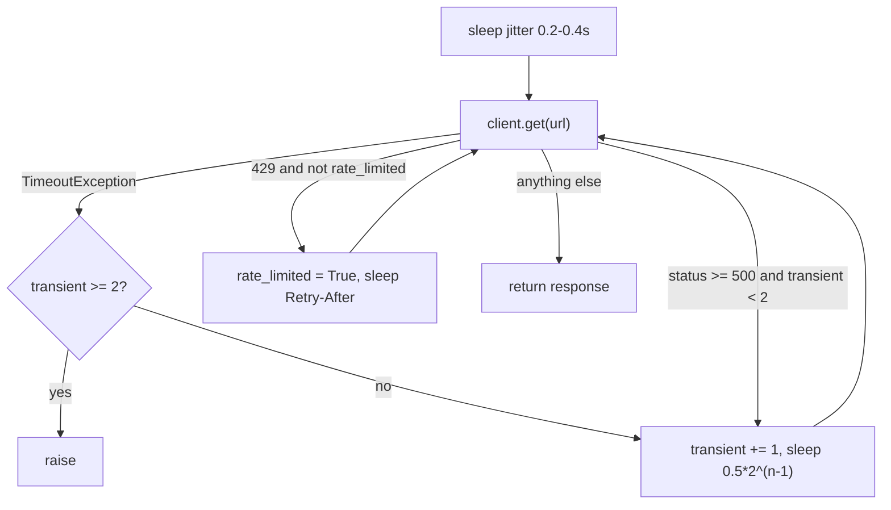

# ATS base types, shared helpers and HTTP client

- Source: `src/jobdigest/ats/base.py` (210 lines), `src/jobdigest/ats/http_client.py` (91), `src/jobdigest/ats/__init__.py` (57).
- Layer: source acquisition, shared foundation of every ATS adapter. See [ats-overview](ats-overview.md) for how the pieces fit.
- Depends on: `httpx`, stdlib (`html`, `re`, `random`, `email.utils`). Used by: all six adapters, `collect.py`, `probe.py`, and non-ATS sources (`feeds.py`, `portals/generic.py`, `marketplaces/jobspy_bridge.py`, `score.py`, `blurb.py`, `db/jobs.py`, `contacts/*`).
- Tests: `tests/test_ats_status.py`, `test_ats_posted_at.py`, `test_http_client.py`, `test_ats_registry.py`.

## Public interface at a glance

| Symbol | Signature | Purpose |
|---|---|---|
| `FetchStatus` | `class FetchStatus(str, Enum)` | `OK`, `EMPTY_BOARD`, `DEAD_TOKEN`, `ERROR` |
| `CompanyConfig` | frozen dataclass | one board's identity: `id, name, ats, token, enabled, notes` |
| `NormalizedJob` | dataclass | vendor-neutral job record |
| `FetchResult` | dataclass | what `fetch` returns |
| `BoardAdapter` | `Protocol` | `ats: str`, `fetch(company) -> FetchResult` |
| `Page` | dataclass | one fetched JSON page or a ready failure |
| `JobCollector` | class | dedupe-by-id accumulator for paginated boards |
| `get_json_page` | `(client, url, *, sleep, valid, label) -> Page` | GET + classify + parse + validate |
| `classify_http_status` | `(status_code) -> FetchStatus \| None` | non-200 mapping |
| `empty_or_ok` | `(n_jobs) -> FetchStatus` | `EMPTY_BOARD` vs `OK` |
| `decode_html_content` | `(raw) -> str` | HTML/entity stripping |
| `join_locations` | `(parts) -> str` | de-duplicated `" \| "`-joined location |
| `parse_posted_at` / `posted_at_from_item` | `(value) -> str \| None` | timestamp normalization |
| `KNOWN_ATS` | `frozenset[str]` | adapters that exist |
| `get_adapter` | `(ats, client, *, sleep) -> BoardAdapter` | registry |
| `make_client` | `() -> httpx.Client` | shared client |
| `request_get` | `(client, url, *, sleep) -> httpx.Response` | polite GET with retries |
| `parse_json_or_none`, `looks_like_html` | `(response)` | guarded JSON parse |

## Key concepts

- **Adapter pattern.** `BoardAdapter` is a structural `typing.Protocol`: any class with an `ats` attribute and a `fetch(company)` method qualifies, with no inheritance. This is why the six adapters do not subclass anything.
- **Dependency injection for I/O.** Every adapter receives the `httpx.Client` and a `sleep` callable. Production passes `make_client()` and `time.sleep`; tests pass `httpx.Client(transport=httpx.MockTransport(handler))` and `lambda _: None`. No test touches the network.
- **Failure as data.** Network and HTTP problems do not raise out of `fetch`; they are encoded in `FetchResult.status`.

## Detailed walkthrough: types

### `FetchStatus`
**Location** `src/jobdigest/ats/base.py:19` · **Signature** `class FetchStatus(str, Enum)`
Four values: `OK = "ok"`, `EMPTY_BOARD = "empty_board"`, `DEAD_TOKEN = "dead_token"`, `ERROR = "error"`. Because it subclasses `str`, `result.status.value` is what `probe` prints and what `collect` logs. `collect.py` maps it to company-row state (see [overview](ats-overview.md#the-contract-fetchresult)). The key semantic: `EMPTY_BOARD` means "I parsed a valid response and it had zero jobs"; it must never be used for "I could not understand the response".

### `CompanyConfig`
**Location** `base.py:27` · frozen dataclass
Fields: `id: str` (YAML id, becomes `NormalizedJob.source`), `name: str` (fallback company display name), `ats: str`, `token: str` (vendor slug interpolated into URLs), `enabled: bool = False`, `notes: str = ""`. Frozen so it can be shared safely. Built by `collect._row_company` (`collect.py:55`) and `probe.main` from YAML rows. The adapters use only `id`, `name`, `token`; `enabled` and `notes` are carried for the callers.
Note the token is interpolated into the URL unescaped (`f"...{company.token}..."`); tokens come from trusted config.

### `NormalizedJob`
**Location** `base.py:37` · dataclass (mutable)

| Field | Type | Meaning |
|---|---|---|
| `title` | `str` | stripped title |
| `company` | `str` | display name (Greenhouse `company_name`, Workable envelope `name`, SmartRecruiters `company.name`, else `CompanyConfig.name`) |
| `location_raw` | `str` | locations joined with `" \| "`; the hard filter later pattern-matches this |
| `apply_url` | `str` | direct apply link; may be `""` |
| `hosted_url` | `str` | public posting page; may be `""` |
| `employment_hint` | `str \| None` | vendor's employment type text |
| `workplace_hint` | `str \| None` | vendor's remote/hybrid/onsite text |
| `description_text` | `str` | plain text description (can be `""`) |
| `source` | `str` | `company.id` |
| `ats` | `str` | adapter key |
| `external_id` | `str` | vendor id |
| `raw_json` | `str` | compact JSON of the raw item |
| `fetched_at` | `datetime` | `datetime.now(timezone.utc)` at construction (default factory) |
| `posted_at` | `datetime \| str \| None` | normally an ISO `...Z` string or `None`; the `datetime` arm of the annotation is used by non-ATS sources, no ATS adapter produces it |

### `FetchResult`
**Location** `base.py:55` · fields `status`, `http_status: int | None`, `jobs: list[NormalizedJob]`, `error: str | None = None`, `complete: bool = True`.
`http_status` is `None` when the failure was a transport exception; for paginated adapters it is the status of the **last** page request made. `error` is set only for `ERROR` results (`str(exc)` or `"invalid <label> json"`); terminal statuses from `classify_http_status` carry `error=None`. `complete` is explained in [overview](ats-overview.md#why-complete-matters-tombstone-sweep).

### `BoardAdapter`
**Location** `base.py:63` · `Protocol` with `ats: str` and `fetch(self, company: CompanyConfig) -> FetchResult`. Used purely for typing the return of `get_adapter`; nothing checks it at runtime.

### `Page`
**Location** `base.py:151` · dataclass `payload: Any = None`, `http_status: int | None = None`, `failure: FetchResult | None = None`. Exactly one of `payload` / `failure` is meaningful. When `failure is not None` the adapter decides whether to return it as-is (first page) or fold it into a partial result (later page). `http_status` is set even on failure when a response existed, so adapters can still record the last status.

### `JobCollector`
**Location** `base.py:185`
**Purpose** Accumulate raw items across pages, de-duplicating by vendor id, while keeping id-less items.
**State** `_id_of` (callable `dict -> str`), `by_id: dict[str, dict]` (insertion-ordered, first seen wins), `extras: list[dict]` (items whose id is falsy).
**Methods**
- `absorb(items)`: for each item compute `jid = self._id_of(item)`; if `jid` is falsy append to `extras`, elif not already in `by_id` store it. A duplicate id is dropped silently (first occurrence wins).
- `new_ids(items) -> set[str]`: ids in `items` not yet absorbed (`{id_of(i)} - {""}` minus `by_id` keys). Greenhouse uses it as a "did this page add anything" test to stop paginating on repeated pages.
- `items()`: `list(by_id.values()) + extras`, so id-less items always sort last.
- `__len__`: `len(by_id)` only; `extras` are not counted. This matters for the comparison against vendor totals (`total > len(collector)`), where id-less items do not help close the gap.

Used by Greenhouse (`_item_id` = `str(item.get("id") or "")`) and SmartRecruiters (`id` or `uuid`). Lever does its own list append and does not de-duplicate.

## Detailed walkthrough: functions in `base.py`

### `get_json_page`
**Location** `base.py:159` · **Signature** `def get_json_page(client: httpx.Client, url: str, *, sleep: Callable[[float], None], valid: Callable[[Any], bool], label: str) -> Page`
**Purpose** The single place where "fetch one JSON page" is turned into either a usable payload or a ready-made failing `FetchResult`. Greenhouse, Lever and SmartRecruiters call it per page. (Ashby, Workable and BambooHR inline the same logic.)
**Called by** `GreenhouseAdapter.fetch`, `LeverAdapter.fetch`, `SmartRecruitersAdapter.fetch` · **Calls** `request_get`, `classify_http_status`, `parse_json_or_none`, the caller's `valid`.

| Param | Meaning |
|---|---|
| `client`, `sleep` | injected I/O, forwarded to `request_get` |
| `url` | full URL |
| `valid` | predicate on the parsed JSON (`dict` with a `jobs` list, or a `list`, etc.) |
| `label` | vendor name for the error text `invalid {label} json` |

**Returns** `Page`. Four paths:
1. `request_get` raised `httpx.HTTPError` (timeouts after retries, connect errors, etc.): `Page(failure=FetchResult(ERROR, None, [], error=str(exc)))`.
2. Non-200: `terminal = classify_http_status(code)` is not `None`: `Page(http_status=code, failure=FetchResult(terminal, code, [], error=None))`.
3. 200 but body is HTML, not JSON, or fails `valid`: `Page(http_status=code, failure=FetchResult(ERROR, code, [], error="invalid <label> json"))`.
4. Success: `Page(payload=payload, http_status=code)`.

**Step-by-step**
1. `response = request_get(client, url, sleep=sleep)` inside `try/except httpx.HTTPError`. Only `httpx.HTTPError` is caught; a programming error still propagates.
2. `terminal = classify_http_status(code)`; any non-`None` ends the call (200 yields `None`).
3. `payload = parse_json_or_none(response)` returns `None` for HTML or undecodable bodies.
4. `valid(payload)` is called with that possibly-`None` payload, so predicates written as `isinstance(...)` checks handle `None` naturally (e.g. `isinstance(payload, list)` is False for `None`).

Offline check (HTML challenge on a Lever board) printed `FetchResult(status=<FetchStatus.ERROR: 'error'>, http_status=200, jobs=[], error='invalid lever json', complete=True)`.

### `classify_http_status`
**Location** `base.py:88` · `def classify_http_status(status_code: int) -> FetchStatus | None`
Maps: 404, 410 and 301/302/303/307/308 -> `DEAD_TOKEN`; any other non-200 -> `ERROR`; 200 -> `None` ("parse the body"). Verified outputs: 200 `None`; 301, 404, 410 `DEAD_TOKEN`; 403, 429, 500, 304 `ERROR`. Tests: `tests/test_ats_status.py`.
**Why redirects are DEAD_TOKEN:** vendors redirect a non-existent or renamed company slug to a marketing or generic page (HTTP 301/302). Since the client never follows redirects (see [`make_client`](#make_client)), the 3xx is the only signal that the slug no longer resolves. 304, 300 and 305 are not in the list and map to `ERROR`; there is no conditional-GET logic so 304 should not occur.
**Why 403/429/5xx are `ERROR` and not dead:** these are transient or policy responses; treating them as dead tokens would raise `dead_streak` for healthy boards.

### `empty_or_ok`
`base.py:99` · `def empty_or_ok(n_jobs: int) -> FetchStatus`: `EMPTY_BOARD` if `n_jobs == 0` else `OK`. Every adapter calls it with the number of **mapped** jobs, after filtering (Ashby drops unlisted, BambooHR/SmartRecruiters drop unmappable), so a board whose jobs are all filtered out reports `EMPTY_BOARD`.

### `decode_html_content`
**Location** `base.py:70` · `def decode_html_content(raw: str | None) -> str`
**Purpose** Turn HTML-ish vendor descriptions (sometimes entity-escaped, sometimes double-escaped) into one line of plain text.
**Called by** Greenhouse, Lever, Ashby, Workable `_map`; `feeds.py`, `portals/generic.py`, `jobspy_bridge.py`; and at prompt time by `score.py` and `blurb.py` (so stored descriptions are decoded again).
**Steps**
1. `if not raw: return ""`.
2. `text = html.unescape(html.unescape(raw))`: two unescape passes. Greenhouse's `content` is escaped (`&lt;p&gt;`), and some boards escape twice (`&amp;lt;p&amp;gt;`, see `tests/fixtures/ats/greenhouse/encoded_html.json`). Two passes turn both into real tags.
3. `text = _TAG.sub(" ", text)` with `_TAG = re.compile(r"<[^>]+>")` (`base.py:15`): each tag becomes a space (so `a</p><p>b` does not glue into `ab`).
4. `text = html.unescape(text)` again, to convert entities (`&amp;`, `&nbsp;`) that were exposed after step 3 and could not have been tags.
5. `_WS.sub(" ", text).strip()` with `_WS = re.compile(r"\s+")` (`base.py:16`): collapse all whitespace (including `\xa0`, which `\s` matches in Python 3 `str` patterns) to single spaces.

Verified outputs:
```
decode_html_content("&amp;lt;p&amp;gt;Bengaluru  intern&amp;lt;/p&amp;gt;") -> 'Bengaluru intern'
decode_html_content("&lt;p&gt;Build APIs&lt;/p&gt;")                      -> 'Build APIs'
decode_html_content("a<br>b &nbsp;c")                                      -> 'a b c'
```
Caveat: it is a regex strip, not an HTML parser. Text containing a literal `<` followed later by `>` (e.g. `"x < 5 and y > 3"`) loses the span between them. Script/style content would be kept as text. A triple-escaped payload would stay partially escaped.

### `join_locations`
`base.py:79` · `def join_locations(parts: list[str | None]) -> str`. Iterates `parts`, strips each (`(part or "").strip()`), skips empty strings and exact duplicates (case-sensitive; `seen` is a list preserving order), then `" | ".join(seen)`. Example: `["A", None, " ", "A", "B"] -> "A | B"`. The separator `" | "` is what the hard filter and fit code later treat as a multi-location delimiter. Lever also (ab)uses it to join description chunks (see [ats-lever](ats-lever.md#quirks)).

### `parse_posted_at`
**Location** `base.py:105` · `def parse_posted_at(value: object) -> str | None`
**Purpose** Normalize every vendor timestamp style to `YYYY-MM-DDTHH:MM:SSZ` in UTC, or `None`.
**Steps**
1. `bool` or `None` -> `None` (`bool` is checked first because `True` is an `int`).
2. `int`/`float`: `seconds = float(value)`; if `> 1e12` divide by 1000 (epoch **milliseconds**, Lever's `createdAt`). `datetime.fromtimestamp(seconds, tz=utc)`; `OSError/OverflowError/ValueError` -> `None`. Format as ISO and replace `+00:00` with `Z`.
3. Non-`str` other types -> `None`. Empty/whitespace string -> `None`.
4. A trailing `Z` is rewritten to `+00:00` (Python 3.12 `fromisoformat` accepts `Z`, but the rewrite keeps behavior uniform).
5. `datetime.fromisoformat(text)`; `ValueError` -> `None`.
6. Naive datetimes are assumed UTC; aware ones are converted with `astimezone(timezone.utc)`.
7. `replace(microsecond=0)` and format with the `Z` suffix.

Verified: `1700000000 -> 2023-11-14T22:13:20Z`; `1700000000000 -> same`; `"2024-06-01" -> 2024-06-01T00:00:00Z`; `"2024-06-01T12:30:00.123+05:30" -> 2024-06-01T07:00:00Z`; `True`, `"x"`, `1e30 -> None`. Tests: `tests/test_ats_posted_at.py`. Heuristic limit: values between 1e10 and 1e12 are interpreted as seconds (year 2286+), fine in practice.

### `posted_at_from_item`
`base.py:136` · `def posted_at_from_item(item: dict, *keys: str) -> str | None`: returns the first non-`None` `parse_posted_at(item.get(key))` over `keys`, so a bad first key falls through to the next (Ashby: `publishedAt`, `publishedDate`; SmartRecruiters: `releasedDate`, `createdOn`; BambooHR: `datePosted`, `postedDate`). Test: `test_posted_at_from_item_first_nonempty_key`.

### `KNOWN_ATS`
`base.py:145` · `frozenset({"greenhouse","lever","ashby","workable","smartrecruiters","bamboohr"})`. Used by `get_adapter`, `collect.py` (skip unknown), `probe.py`, `db/jobs.py:_ats_rank`.

## Detailed walkthrough: registry

### `get_adapter`
**Location** `src/jobdigest/ats/__init__.py:38` · **Signature** `def get_adapter(ats: str, client: httpx.Client, *, sleep: Callable[[float], None]) -> BoardAdapter`
**Steps**
1. `key = (ats or "").strip().lower()` (tolerates `None`, whitespace, mixed case; `CompanyConfig.ats` is not normalized by callers).
2. `if key not in KNOWN_ATS: raise ValueError(f"unimplemented ats: {ats!r}")`. Verified: `get_adapter("workday", ...)` raises `ValueError: unimplemented ats: 'workday'`. Test: `test_get_adapter_workday_and_getro_still_unimplemented`.
3. A chain of `if key == ...: return XAdapter(client, sleep=sleep)`; the final line returns `WorkableAdapter` for whatever is left, so Workable has no explicit `if`.
Only default constructor args are used; `page_limit`/`max_pages` can be overridden only by constructing adapters directly (tests do).
**Called by** `collect._default_fetch` (`collect.py:96`), `probe.main`. Both check `KNOWN_ATS` before calling, so the `ValueError` is a guard rather than a normal path.

## Detailed walkthrough: `http_client.py`

Constants (`http_client.py:11-17`): `USER_AGENT = "JobHunt/0.1"`, `DEFAULT_TIMEOUT = 30.0`, `JITTER_MIN_S = 0.2`, `JITTER_MAX_S = 0.4`, `RETRY_AFTER_CAP_S = 30.0`, `DEFAULT_RETRY_AFTER_S = 2.0`, `MAX_TRANSIENT_RETRIES = 2`, `BACKOFF_BASE_S = 0.5`.

### `make_client`
**Location** `http_client.py:21` · `def make_client() -> httpx.Client`
```python
return httpx.Client(
    headers={"User-Agent": USER_AGENT},
    timeout=DEFAULT_TIMEOUT,
    follow_redirects=False,
)
```
Verified: `follow_redirects=False`, `Timeout(timeout=30.0)`, header `JobHunt/0.1`. One client is created lazily by `collect` (first enabled company) and reused for all boards, or by `probe`; `contacts/pipeline.py` and `contacts/run.py` reuse it too.
**Why `follow_redirects=False` and 3xx = `DEAD_TOKEN`:** httpx defaults to not following, but it is set explicitly as a contract. When a company slug does not exist (or the company migrated to another ATS) a vendor may answer with a redirect to a landing page; if the client followed it, the final response would typically be a 200 HTML page and surface as a generic "invalid JSON" error rather than a definitive "this token is gone". Staying on the 3xx lets `classify_http_status` produce `DEAD_TOKEN`, which is what drives `dead_streak` in `collect` so persistently dead tokens are visible. The claim about which vendors redirect is the design rationale inferred from the classification code and tests (`test_classify_404_410_redirects_are_dead_token`); I did not verify vendor behavior against live endpoints.

### `request_get`
**Location** `http_client.py:47` · **Signature** `def request_get(client: httpx.Client, url: str, *, sleep: Callable[[float], None]) -> httpx.Response`
**Purpose** The only function that performs ATS HTTP. It adds rate-limit politeness and bounded retries so adapters do not each re-implement them.
**Called by** `get_json_page`, `AshbyAdapter.fetch`, `WorkableAdapter.fetch`, `BambooHRAdapter.fetch`.
**Returns** the final `httpx.Response` (any status, including a 4xx/5xx after retries are exhausted). **Raises** `httpx.TimeoutException` after `MAX_TRANSIENT_RETRIES` timeouts; any other `httpx.HTTPError` (e.g. `ConnectError`) raises immediately with no retry.
**Step-by-step**
1. `sleep(random.uniform(JITTER_MIN_S, JITTER_MAX_S))`: a random 0.2-0.4 s delay before the **first** attempt of every request (polite spacing between calls to the same host; also de-synchronizes bursts). Tests count this as the single `sleep` in the no-retry case (`test_ok_no_retry`).
2. State: `rate_limited = False`, `transient = 0`; then `while True`.
3. `client.get(url)` in `try`. `except httpx.TimeoutException`: if `transient >= 2` re-raise; else `transient += 1`, `sleep(0.5 * 2 ** (transient - 1))` (0.5 s, then 1.0 s), `continue`.
4. `if response.status_code == 429 and not rate_limited`: set `rate_limited = True`, `sleep(_retry_after_seconds(response))`, `continue`. Only **one** 429 retry; a second 429 falls through and is returned (the adapter then reports `ERROR`; `test_429_only_once` asserts 2 calls total).
5. `if response.status_code >= 500 and transient < 2`: `transient += 1`, backoff sleep (same 0.5/1.0 s), `continue`. 5xx after two retries is returned as-is.
6. Otherwise `return response` (2xx, 3xx, 4xx other than the first 429).

The 429 budget (1) and the transient budget (2, shared by timeouts and 5xx) are independent, so the worst case is 1 + 1 + 2 = 4 GETs for one URL. Total attempts for persistent timeouts: 3 (`test_timeout_raises_after_retries`).



The diagram shows that timeouts and 5xx share one counter while 429 has its own single retry, matching the code order (timeout handler, then 429, then 5xx).

### `_retry_after_seconds`
**Location** `http_client.py:29` · `def _retry_after_seconds(response: httpx.Response) -> float`
Parses the `Retry-After` header, which per HTTP can be delta-seconds or an HTTP-date.
1. Header missing -> `DEFAULT_RETRY_AFTER_S` (2.0).
2. `float(raw.strip())` -> seconds. On `ValueError`: `parsedate_to_datetime(raw)`; failure (`TypeError`/`ValueError`) -> 2.0; naive result is made UTC; `seconds = (when - now_utc).total_seconds()`.
3. Clamp: `max(0.0, min(seconds, RETRY_AFTER_CAP_S))`, so a past date or negative number gives 0.0 and a huge value is capped at 30 s (a hostile or buggy header cannot stall a run).
Verified: `"3" -> 3.0`, `"99" -> 30.0`, `"abc" -> 2.0`, missing -> `2.0`, `"-5" -> 0.0`. HTTP-date case is `test_retry_after_http_date`; garbage and cap: `test_retry_after_garbage_and_cap`.

### `looks_like_html`
`http_client.py:77`. True if the `content-type` header contains `text/html`, or if the first 64 characters of the left-stripped body (lowercased) start with `<!doctype` or `<html`. The body sniff covers servers that mislabel HTML as JSON, which is what bot-challenge and login pages often do (tests `test_200_html_challenge_is_error`, `test_200_html_login_is_error`).

### `parse_json_or_none`
`http_client.py:85`. `None` if `looks_like_html`; else `response.json()`, returning `None` on `ValueError` (includes `json.JSONDecodeError`). Note a literal JSON `null` body also yields `None`, which every adapter's validity check rejects.

## Failure modes and edge cases

- Timeouts: three attempts, then `httpx.TimeoutException` (an `httpx.HTTPError`) reaches the adapter, which returns `ERROR` with `http_status=None`.
- A page whose JSON is valid but of the wrong shape is `ERROR`, never `EMPTY_BOARD`.
- Jitter is applied per request, so a 20-page Greenhouse board spends roughly 4-8 s just in jitter.
- `request_get` does not cap the response body size.

## How to modify safely

- Changing retry counts: update `MAX_TRANSIENT_RETRIES` and the assertions in `tests/test_http_client.py`.
- Adding a new status-to-`FetchStatus` rule belongs in `classify_http_status`; add a case to `tests/test_ats_status.py`.
- If you add a new field to `NormalizedJob`, give it a default (the other non-ATS sources construct it too) and check `db/jobs.py:upsert_job`.
