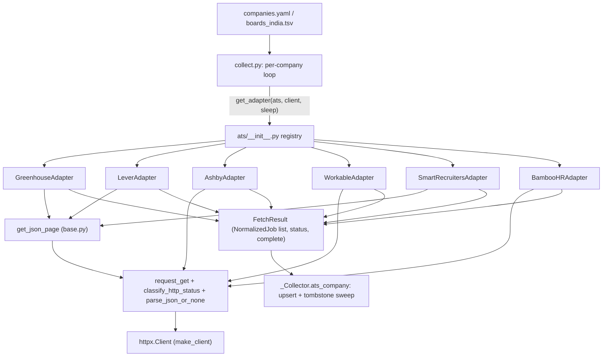
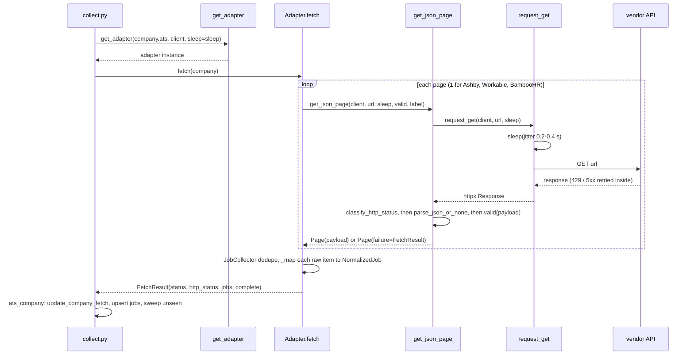

# ATS adapters: overview

- Source: `src/jobdigest/ats/__init__.py` (57 lines), `base.py` (210), `http_client.py` (91), six adapters (`greenhouse.py` 151, `lever.py` 98, `ashby.py` 95, `workable.py` 110, `smartrecruiters.py` 208, `bamboohr.py` 153), plus `src/jobdigest/probe.py` (101).
- Layer: source acquisition. This is the first stage of the pipeline: it turns each configured company job board into a list of `NormalizedJob` objects that `collect` then upserts into the database.
- Depends on: `httpx`, `jobdigest.logutil` (Greenhouse and SmartRecruiters only). Used by: `src/jobdigest/collect.py` (`_default_fetch`, `_Collector.ats_company`), `src/jobdigest/probe.py`, and indirectly the whole pipeline. Several non-ATS modules reuse helpers from `ats/base.py` (see [Reuse outside the ATS package](#reuse-outside-the-ats-package)).
- Tests: `tests/test_ats_greenhouse.py`, `test_ats_lever.py`, `test_ats_ashby.py`, `test_ats_workable.py`, `test_ats_smartrecruiters.py`, `test_ats_bamboohr.py`, `test_ats_registry.py`, `test_ats_status.py`, `test_ats_posted_at.py`, `test_http_client.py`, `test_probe.py`. Fixtures live in `tests/fixtures/ats/<ats>/`.

## Why this exists

Companies publish their openings on third-party applicant tracking systems (ATS). Each of the six supported vendors exposes a public, unauthenticated JSON endpoint for a company's board. The shapes differ (different field names, different pagination, different ways of encoding location and HTML), but the pipeline downstream wants one shape. The ATS package is the translation layer: one small adapter class per vendor, all returning the same `FetchResult` containing `NormalizedJob` rows, with all failure modes collapsed into four `FetchStatus` values.

A "board" is one company's job board at one ATS, identified by a `token` (the vendor's slug for the company, for example `stripe` in `boards-api.greenhouse.io/v1/boards/stripe/jobs`). Boards are listed in `config/companies.yaml` (falls back to `companies.example.yaml`; see [config](../foundation/config.md)) and additionally by `data/boards_india.tsv` (written by [expand](expand.md)).

## Supported ATS and comparison

| ATS (`KNOWN_ATS` key) | Endpoint (one board) | Pagination | `complete` can be False? | Description in payload | Page |
|---|---|---|---|---|---|
| `greenhouse` | `GET boards-api.greenhouse.io/v1/boards/{token}/jobs?content=true[&page=N]` | `page=N`, driven by `meta.total`, max 20 pages | yes | yes (HTML-escaped `content`) | [ats-greenhouse](ats-greenhouse.md) |
| `lever` | `GET api.lever.co/v0/postings/{token}?mode=json&limit=100&skip=N` | `skip` offset, until a short page; no page cap | yes (a later page fails) | yes (`descriptionPlain` or HTML parts) | [ats-lever](ats-lever.md) |
| `ashby` | `GET api.ashbyhq.com/posting-api/job-board/{token}` | none (single response) | no | yes (`descriptionPlain` / `descriptionHtml`) | [ats-ashby](ats-ashby.md) |
| `workable` | `GET apply.workable.com/api/v1/widget/accounts/{token}?details=true` | none (single response) | no | yes (HTML) | [ats-workable](ats-workable.md) |
| `smartrecruiters` | `GET api.smartrecruiters.com/v1/companies/{token}/postings?limit=N&offset=M` | `offset`, driven by `totalFound`, max 20 pages | yes | no (always `""`) | [ats-smartrecruiters](ats-smartrecruiters.md) |
| `bamboohr` | `GET https://{token}.bamboohr.com/careers/list` | none (single response) | no (hard-coded `True`) | usually no (looks for 4 candidate keys; the fixture has none) | [ats-bamboohr](ats-bamboohr.md) |

`KNOWN_ATS` is defined in `src/jobdigest/ats/base.py:145` and is the single source of truth for "does an adapter exist". Companies in the YAML with other `ats` values (for example `getro`, `workday` in `companies.example.yaml`) are skipped by `collect` and printed as `unimplemented` by `probe`; `get_adapter` raises `ValueError` for them.

## Architecture

Three adapters (Greenhouse, Lever, SmartRecruiters) are paginated and use the shared `get_json_page` helper in `base.py`. The three single-response adapters (Ashby, Workable, BambooHR) duplicate the same four-step request/classify/parse/validate sequence inline instead of calling `get_json_page`. Both paths end in `request_get` and `classify_http_status`, so retry and status semantics are identical.

## One board fetch, end to end

The adapter never touches the database; it is a pure "URL in, `FetchResult` out" function apart from logging. `sleep` is injected (tests pass `lambda _: None`), and so is the `httpx.Client` (tests pass a client built on `httpx.MockTransport`), which is how the whole package is tested offline.

## The contract: `FetchResult`

`FetchResult(status, http_status, jobs, error=None, complete=True)` (`base.py:55`). How `collect.py` consumes each field (`_Collector.ats_company`, `src/jobdigest/collect.py:286`):

| `status` | Meaning | What collect does |
|---|---|---|
| `OK` | HTTP 200, valid JSON, at least one job mapped | updates company row (`job_count = len(jobs)`), upserts the jobs, then runs the tombstone sweep with `success=complete` |
| `EMPTY_BOARD` | HTTP 200, valid JSON, zero jobs | resets `dead_streak`, then runs the sweep with an empty job list and `success=complete` (so a board that genuinely closed all roles tombstones its old jobs) |
| `DEAD_TOKEN` | 404, 410 or a 3xx redirect | increments `companies.dead_streak`; no jobs touched, **no error row recorded** |
| `ERROR` | anything else: transport error, 403, 429 after retry, 5xx after retries, HTML body, invalid JSON shape | records a portal error row with `result.error`; jobs are not touched |

`dead_streak` logic is `_dead_streak` in `collect.py:83`: DEAD_TOKEN adds 1, OK/EMPTY_BOARD resets to 0, ERROR keeps the current value. The distinction between `EMPTY_BOARD` and `ERROR`/`DEAD_TOKEN` is the key safety property: an adapter must never report `EMPTY_BOARD` for a response it did not actually understand, because an `EMPTY_BOARD` triggers a sweep that closes jobs. Every adapter therefore validates the JSON shape before it counts jobs (tests: `test_invalid_json_structure_is_error` in ashby/workable, `test_200_html_challenge_is_error` in greenhouse/smartrecruiters/bamboohr).

### Why `complete` matters (tombstone sweep)

After a successful fetch, `collect` calls `bump_unseen_for_source(conn, source, seen_keys, success=complete)` (`src/jobdigest/db/jobs.py:509`, see [storage jobs](../storage/jobs.md)). The sweep walks every active job of that source that was not in this fetch; each such job gets `miss_count + 1`, and at `miss_count >= 2` it is deactivated (`is_active = 0`, `close_reason = 'unseen_board'`). That is a tombstone: the row is kept but marked closed.

This is only safe if the fetch actually saw the whole board. If page 3 of 5 failed, the jobs that live on pages 3-5 are "unseen" for a reason unrelated to being closed, and two such runs in a row would wrongly close them. So an adapter that knows it saw only part of the board sets `complete=False`, and `bump_unseen_for_source` returns `{"missed": 0, "tombstoned": 0}` immediately when `success` is false. New and updated jobs from the partial fetch are still upserted; only the closing step is suppressed.

Only Greenhouse, Lever and SmartRecruiters can produce `complete=False`. Ashby, Workable and BambooHR get everything in one response, so they rely on the dataclass default (`True`; BambooHR passes it explicitly).

## Shared helpers at a glance

All documented in detail in [ats-base-and-http-client](ats-base-and-http-client.md).

| Symbol | Location | Purpose |
|---|---|---|
| `FetchStatus`, `CompanyConfig`, `NormalizedJob`, `FetchResult`, `BoardAdapter`, `Page`, `JobCollector` | `base.py` | data contract and pagination dedupe helper |
| `get_json_page`, `classify_http_status`, `empty_or_ok` | `base.py` | request/classify/validate pipeline |
| `decode_html_content`, `join_locations`, `parse_posted_at`, `posted_at_from_item` | `base.py` | text, location and timestamp normalization |
| `make_client`, `request_get`, `parse_json_or_none`, `looks_like_html` | `http_client.py` | polite HTTP with retries |
| `get_adapter` | `ats/__init__.py:38` | registry |

### Reuse outside the ATS package

Non-ATS sources build `NormalizedJob` too, and reuse helpers from `ats/base.py`: `feeds.py` and `portals/generic.py` use `NormalizedJob` and `decode_html_content`; `marketplaces/jobspy_bridge.py` uses `parse_posted_at`; `score.py` and `blurb.py` call `decode_html_content` on stored descriptions at prompt time; `db/jobs.py:_ats_rank` (line 137) uses `KNOWN_ATS` to give known-ATS rows rank 0 and others rank 1; `contacts/pipeline.py` and `contacts/run.py` reuse `make_client`. Documenting these in one place keeps behavior consistent: the same HTML unescape and timestamp format everywhere.

## Common conventions every adapter follows

1. Constructor: `Adapter(client: httpx.Client, *, sleep: Callable[[float], None], ...)`; class attribute `ats = "<key>"`; `fetch(company: CompanyConfig) -> FetchResult`.
2. `source` on every job is `company.id` (the YAML id, not the ATS name). The sweep and `bump_unseen_for_source` key on this `source`.
3. `external_id` is the vendor's id (Workable: `shortcode`), as a string; it is part of the dedupe/seen key downstream.
4. `raw_json` is the raw vendor item serialized with `json.dumps(item, separators=(",", ":"), ensure_ascii=False)`, kept for debugging and later re-parsing.
5. `posted_at` is an ISO-8601 UTC string like `2024-06-01T00:00:00Z` or `None` (see `parse_posted_at`).
6. `employment_hint` and `workplace_hint` are free-form strings from the vendor (`"Intern"`, `"OnSite"`, `"on_site"`, `"remote"`); interpretation happens later in [hard-filter](../filtering/hard-filter.md) and [fit](../ranking/fit-and-tiers.md), not here. Casing is not normalized.
7. HTTP errors never raise out of `fetch`: `httpx.HTTPError` is caught and returned as `FetchResult(ERROR, None, [], error=str(exc))`. `collect` additionally wraps `fetch_fn` in `except httpx.HTTPError` as a second safety net.
8. Non-dict items inside the list are silently skipped.

## How to add a new ATS

1. Add `jobdigest/ats/<name>.py` with a class exposing `ats = "<name>"`, `__init__(client, *, sleep)`, and `fetch(company) -> FetchResult`. Use `get_json_page` if you paginate; if single-response, copy the Ashby shape.
2. Never return `EMPTY_BOARD` for a payload whose shape you did not validate.
3. If you paginate, use `JobCollector` and set `complete=False` whenever you stop early or a page fails (and log a warning).
4. Add the key to `KNOWN_ATS` in `base.py`, import and export the class in `ats/__init__.py`, and add a branch in `get_adapter` (the last `return WorkableAdapter(...)` is an unconditional fall-through, so an unlisted key added to `KNOWN_ATS` without a branch would silently get the Workable adapter).
5. Add a board-URL branch in `_board_url` (`src/jobdigest/collect.py:66`) (otherwise the resolved URL falls back to `ats://<ats>/<token>`; see `tests/test_ats_registry.py::test_collect_knows_smartrecruiters_board_url`).
6. Add fixtures under `tests/fixtures/ats/<name>/` (`two_jobs`, `empty`, `not_found`) and a `tests/test_ats_<name>.py` mirroring the existing ones.

## Failure modes and edge cases (package-wide)

- Redirects are never followed, so a 3xx is treated as a dead token (see [ats-base-and-http-client](ats-base-and-http-client.md#make_client)).
- A 200 HTML page (Cloudflare challenge, login page, soft 404) is `ERROR`, not `EMPTY_BOARD`: `parse_json_or_none` refuses HTML bodies.
- 403 is `ERROR`, not `DEAD_TOKEN`: `test_403_is_error_not_dead_token` in `test_ats_greenhouse.py`.
- Greenhouse, Lever and SmartRecruiters can return partial results with `status=OK, complete=False`.
- `FetchResult` values for failures carry the dataclass default `complete=True`, but `collect` only reads `complete` for `OK` and `EMPTY_BOARD`, so it is irrelevant there.

See also: [probe](probe.md) (the manual CLI that calls this layer for every configured company), [collect orchestrator](../collection/collect-orchestrator.md), [jobs storage](../storage/jobs.md).
