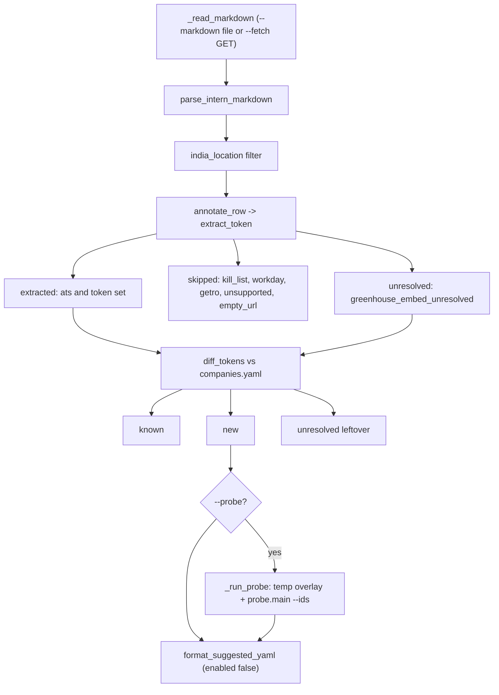

# `jobdigest.discover`: intern-list markdown to suggested ATS tokens

- **Source**: `src/jobdigest/discover.py` (577 lines). Maintainer CLI: `python -m jobdigest.discover`.
- **Layer**: sources / tooling. It is **not** part of the scheduled pipeline (`tests/test_discover.py::test_workflows_pipeline_has_no_discover` asserts `jobdigest.discover` appears in neither `pipeline.yml`, `start.sh` nor `ci.yml`).
- **Depends on**: `httpx`, `yaml`, `jobdigest.config` (`load_companies`, `config_dir`), lazily `jobdigest.probe.main` ([probe](probe.md)).
- **Tests**: `tests/test_discover.py`; fixtures `tests/fixtures/discover/intern_intl_sample.md`, `companies_mini.yaml`.

## Why this exists / responsibility

A public GitHub list (`INTERN_INTL.md` in `speedyapply/2027-SWE-College-Jobs`, constant `INTERN_INTL_RAW`) tracks international internships as a markdown table with apply links. For India rows whose apply link points at Greenhouse, Lever or Ashby, the board token can be read straight from the URL. `discover` automates: parse table -> keep India rows -> extract `(ats, token)` -> diff against `config/companies.yaml` -> print a ready-to-paste YAML block (all `enabled: false`) and optionally probe the new boards. It never writes the real config (`write_overlay` refuses the config dir).

## Public interface at a glance

| Symbol | Purpose |
|---|---|
| `InternRow` (frozen dataclass: `company_name, location, apply_url, ats="", token="", skip_reason=""`) | one table row, later annotated |
| `Unresolved(reason="greenhouse_embed_unresolved")`, `Skip(reason)` | non-token outcomes of `extract_token` |
| `Diff(known, new, unresolved)` | result of `diff_tokens` |
| `india_location`, `extract_token`, `parse_intern_markdown`, `annotate_row`, `slugify_token`, `diff_tokens`, `format_suggested_yaml`, `write_overlay`, `load_companies_payload`, `main` | public functions |
| `_table_bodies`, `_split_row`, `_is_separator`, `_cell_text`, `_apply_url`, `_col_index`, `_parse_table`, `_host`, `_path_parts`, `_is_kill_host`, `_is_workday`, `_is_getro`, `_company_rows`, `_inventory_keys`, `_existing_ids`, `_name_has_greenhouse`, `_assign_id`, `_build_parser`, `_read_markdown`, `_print_section`, `_config_dir_override`, `_run_probe` | private helpers |

## Pipeline (what `main` does)

Explanation: every India row ends in exactly one bucket; only `new` rows become YAML suggestions.

## Detailed walkthrough

### Regexes and constants
- `INDIA_RE` `\b(india|bengaluru|bangalore|hyderabad|mumbai|pune|chennai|noida|gurgaon|gurugram|delhi|ncr|kolkata)\b` (case-insensitive). Verified: `Bengaluru`, `bangalore`, `Remote, India`, `Gurgaon` match; `Canada`, `Indiana` do not (word boundary).
- `_TABLE_MARK` `<!--\s*(TABLE_[A-Z0-9_]*)\s*-->`; `_HREF_RE` `href=["']...["']`; `_MD_LINK_RE` `[text](http...)`; `_BARE_URL_RE`; `_TAG_RE` `<[^>]+>`; `_SEP_RE` `^:?-{2,}:?$` (markdown separator cell); `_SLUG_RE` `[^a-z0-9-]+`.
- Host sets: `_GH_HOSTS` (four greenhouse hosts incl. EU), `_LEVER_HOSTS` (`jobs.lever.co`, `jobs.eu.lever.co`), `_ASHBY_HOSTS` (`jobs.ashbyhq.com`), `_KILL_HOST_SUFFIXES` (linkedin, internshala, otta, discord, llmhire), `_GH_SKIP_SEGMENTS = {"embed","jobs"}`.

### `india_location`
**Location** `src/jobdigest/discover.py:86` · `bool(INDIA_RE.search(location or ""))`. Called by `main` and tests.

### `extract_token`
**Location** `:119` · `def extract_token(url: str) -> tuple[str, str] | Unresolved | Skip`
**Purpose** classify one apply URL. **Called by** `annotate_row`. **Calls** `urlparse`, `parse_qs`, `_host`, `_path_parts`, `_is_kill_host`, `_is_workday`, `_is_getro`.
1. `raw = url.strip()`; empty -> `Skip("empty_url")`.
2. `urlparse(raw)`; if no scheme, re-parse with `https://` prepended. `host` = lower-cased hostname minus `www.`; `path`, `query` (`parse_qs`), `parts` (URL-decoded non-empty path segments).
3. `_is_kill_host(host, path)` -> `Skip("kill_list")`: suffix match on the kill suffixes, any host containing `llmhire`, or `huggingface.co` with path starting `/jobs`.
4. `_is_workday` (`myworkdayjobs.com`/`myworkday.com` in host) -> `Skip("workday")` (no adapter); `_is_getro` (`getro.com` or subdomain) -> `Skip("getro")`.
5. Greenhouse host: `for_token = query["for"][0]`; `first = parts[0]`. If `first` and not in `_GH_SKIP_SEGMENTS` -> `("greenhouse", first)`; elif `for_token` -> `("greenhouse", for_token)`; else `Unresolved()` (embed URL with no token).
6. Lever host: no path -> `Skip("unsupported")`, else `("lever", parts[0])`. Ashby likewise `("ashby", parts[0])` (tokens may contain dots).
7. Any other host with `gh_jid` in the query (a company careers page embedding Greenhouse) -> `Unresolved()`: the board token cannot be derived from the URL.
8. Else `Skip("unsupported")`.
Verified: `https://job-boards.greenhouse.io/cloudsek/jobs/6149788004` -> `('greenhouse','cloudsek')`; `https://boards.greenhouse.io/embed/job_board?for=acme` -> `('greenhouse','acme')`; `.../embed/jobs` -> `Unresolved`; `https://stripe.com/jobs/search?gh_jid=7` -> `Unresolved`; `jobs.lever.co/zed/1` (no scheme) -> `('lever','zed')`; a `myworkdayjobs.com` URL -> `Skip('workday')`; `example.com/careers` -> `Skip('unsupported')`.

### Markdown parsing: `_table_bodies`, `_split_row`, `_is_separator`, `_cell_text`, `_apply_url`, `_col_index`, `_parse_table`, `parse_intern_markdown`
- `_table_bodies(text)` (`:162`): find all `<!-- TABLE_* -->` markers. For each marker whose name is not `TABLE_END`/`*_END`, the body is the text up to the **next** marker (or end). Tables outside a `TABLE_START`..marker region (intro text, the `IgnoreMe` pre-marker table in the fixture) are ignored. No markers -> no rows.
- `_split_row(line)` (`:175`): non-`|` lines -> `[]`; split on `|`, drop the empty first/last pieces.
- `_is_separator(cells)` (`:187`): every cell (spaces removed) matches `_SEP_RE`.
- `_cell_text(cell)` (`:193`): `[t](url)` -> `t`; strip tags; unescape entities; remove `**`/`__`; cut at the first `↳`; collapse whitespace.
- `_apply_url(cell)` (`:202`): first `href`, else first markdown link, else first bare URL (trailing `).,;]` stripped), else `""`.
- `_col_index(headers, *needles)` (`:215`): first header whose lower-cased text contains any needle.
- `_parse_table(body)` (`:223`): defaults `name_i, loc_i, apply_i = 0, 2, 3`. For each line: skip non-rows and separators; the first row whose cleaned labels contain "company" (or equal "name") is the header and re-derives the three indexes (`company|name`, `location|city`, `application|posting|apply`, fallback `link`) and `continue`s. Data rows shorter than `max(indexes)+1` are skipped; `name = _cell_text(cells[name_i])`, `location`, `apply_url = _apply_url(cells[apply_i])`; rows with neither name nor URL are skipped; otherwise `InternRow(company_name, location, apply_url)`.
- `parse_intern_markdown(text)` (`:258`): concatenates `_parse_table` over all bodies. On the fixture: 9 rows (first: `CloudSEK`, `Bengaluru`, greenhouse URL).

### `annotate_row`
**Location** `:304` · runs `extract_token`; a tuple -> `replace(row, ats=..., token=..., skip_reason="")`; otherwise `replace(row, skip_reason=result.reason)` (works for both `Skip` and `Unresolved`).

### `slugify_token`
**Location** `:265` · lower-case, non `[a-z0-9-]` runs -> `-`, strip `-`, collapse repeats, fallback `"company"`. `Rivianvw.tech` -> `rivianvw-tech`; `!!` -> `company`.

### Inventory helpers
`_company_rows(payload)` (`:271`) list of dict rows under `companies` (else `[]`); `_inventory_keys` (`:278`) set of lower-cased `(ats, token)`; `_existing_ids` (`:288`) set of row ids; `_name_has_greenhouse(name, rows)` (`:292`): see [`_name_has_greenhouse`](#_name_has_greenhouse).

### `_name_has_greenhouse`

**Location** `src/jobdigest/discover.py:292` · **Signature** `def _name_has_greenhouse(name: str, rows: Sequence[Mapping[str, Any]]) -> bool`
**Purpose** Some intern-list rows link to a company's own page with only a Greenhouse embed (`gh_jid`), so no token can be extracted and the row is "unresolved". This check asks whether the company is nevertheless already tracked as a Greenhouse board in `companies.yaml`, in which case the row is counted as known instead of leftover.
**Called by** `diff_tokens` (`discover.py:362`), for each row of its `unresolved` argument. **Calls** nothing outside builtins.
**Parameters** `name` (the row's `company_name`), `rows` (inventory rows from `_company_rows`). **Returns** `True` iff some inventory row has `ats` equal to `greenhouse` and `name` equal to `name`, both compared stripped and case-folded.
**Step by step**
1. `want = name.strip().casefold()`; empty -> `False`.
2. For each row: skip unless `str(row.get("ats") or "").casefold() == "greenhouse"`; return `True` when `str(row.get("name") or "").strip().casefold() == want`.
3. After the loop: `False`.
Matching is on the display `name`, exact after normalisation (no suffix stripping such as "Inc", no substring). Verified offline with inventory `[{"ats":"Greenhouse","name":" Stripe "}, {"ats":"lever","name":"Acme"}, {"ats":"greenhouse","name":None}, {"ats":"greenhouse","name":"Stripe Inc"}]`: `"stripe"`, `"STRIPE  "` and `"Stripe"` -> `True`; `"Acme"` (lever, not greenhouse), `"Str"`, `""`, `"  "` -> `False`.

### `_assign_id`
**Location** `:311` · candidate `slugify_token(token)`; on collision with `used` append `-<ats>`, then `-<ats>-2`, `-3`... Adds the winner to `used`. Ensures suggested ids never clash with existing ids or each other.

### `diff_tokens`
**Location** `:324` · `def diff_tokens(extracted, companies_payload, unresolved=None) -> Diff`
1. `keys = _inventory_keys(inventory)`, `used_ids = _existing_ids(inventory)`; `new_map` keyed by `(ats.casefold(), token.casefold())`.
2. For each extracted row: key in inventory -> `known`; key already in `new_map` -> merge the location into the existing note (`notes.replace("; probe before enable", f", {loc}; probe before enable")`) if not already present, `continue`; else create `{"id": _assign_id(...), "name", "ats", "token", "enabled": False, "notes": "INTERN_INTL.md <location>; probe before enable"}`.
3. For each unresolved row: if `_name_has_greenhouse(company_name, inventory)` -> `known` (the board is already tracked, e.g. Stripe via `gh_jid`), else leftover.
4. Return `Diff(tuple(known), tuple(new_map.values()), tuple(leftover))`.
Verified with the fixture: new = cloudsek, merklescience, boardsgh, acme-india; known = Mactores and Stripe. Duplicate rows with two locations produce one entry with notes `INTERN_INTL.md Pune, Mumbai; probe before enable`; the same token under another ATS gets id `foo-ashby`/`foo-lever`.

### `format_suggested_yaml`
**Location** `:370` · `yaml.safe_dump({"companies": [...6 keys...]}, sort_keys=False, allow_unicode=True)` with `enabled: False` forced (test `test_suggested_yaml_enabled_false_six_keys`).

### `write_overlay`
**Location** `:386` · `dest = dest_dir.resolve()`; if equal to `config.config_dir().resolve()` raise `RuntimeError("refusing to write overlay into hunt config dir")`; mkdir; write `dest/companies.yaml` = base companies + new rows (all `enabled: False`); return the path.

### `load_companies_payload`
**Location** `:418` · with a path: `yaml.safe_load` (non-dict -> `{"companies": []}`); without: `config.load_companies()`.

### `_build_parser`, `_read_markdown`, `_print_section`
- `_build_parser` (`:427`): `--markdown PATH`, `--fetch`, `--url URL` (requires `--fetch`), `--companies PATH`, `--probe`.
- `_read_markdown(args, client)` (`:462`) -> `(text | None, exit_code)`. `--markdown` file must exist (else stderr + `(None, 1)`). Otherwise `--fetch` is required; GET `args.url or INTERN_INTL_RAW` with an `httpx.Client` (created and closed here unless a `client` was injected); status >= 400 or `httpx.HTTPError/OSError/ValueError` -> stderr + `(None, 1)`.
- `_print_section(title, rows)` (`:490`): `## title` then `company<TAB>reason<TAB>url` per row.

### `_config_dir_override`
**Location** `:499` (`@contextmanager`) · sets env `JOBDIGEST_CONFIG_DIR=dest`, always restores the previous value (or deletes it) in `finally`. Documented as **not thread-safe** (mutates `os.environ`); needed because `probe.main` only reads companies via `config.load_companies()` (test `test_probe_failure_restores_config_env`).

### `_run_probe`
**Location** `:517` · `ids = ",".join(row["id"] for row in new_rows)`; in a `TemporaryDirectory`, `write_overlay`, then inside `_config_dir_override(dest)` and `redirect_stdout(buf)` call `probe_main(argv=["--ids", ids], client=client)`; returns the captured text. Only new ids are probed, so already-known boards are not hit (test `test_probe_overlay_calls_probe_with_new_ids_only`). The overlay rows are `enabled: False`.

### `main`
**Location** `:533` · `def main(argv=None, client=None) -> int`
1. Parse args; `--url` without `--fetch` -> stderr, return 1.
2. `_read_markdown`; `None` -> return its code.
3. `parsed = parse_intern_markdown(text)`; `india_rows` filtered; `classified = [annotate_row(r)]`; `extracted` (ats and token), `skipped` (skip_reason set and not the unresolved reason), `unresolved_raw`.
4. `payload = load_companies_payload(args.companies)`; `diff = diff_tokens(extracted, payload, unresolved=unresolved_raw)`.
5. Print `# discover intern_intl`, a counts line (`parsed_rows= india_rows= extracted= new= known= skipped= unresolved=`), `## skipped`, `## unresolved`; if `--probe` and `diff.new`, `## probe` with the captured probe output; finally `## suggested yaml`. Return 0.
Real run on the fixture: `parsed_rows=9 india_rows=7 extracted=5 new=4 known=2 skipped=1 unresolved=0`.
`test_discover_does_not_write_companies_path` verifies the target YAML is unchanged.

## Failure modes and edge cases
- The table layout is parsed by marker comments; if the upstream list drops the `TABLE_START` marker, zero rows are found silently.
- `main` returns 0 even when nothing is found. Probe exceptions propagate (after env restore).
- A kill-listed or Workday host is reported in `## skipped`, with the reason.
- `--fetch` is maintainer-only; tests never hit the network.

## How to modify / extend safely
Add a host family by extending `extract_token` and the `Skip` reasons; add a case to `tests/test_discover.py`. Keep suggestions `enabled: False` so humans review before enabling. Compare with [`expand`](expand.md), which is the automated, scheduled-friendly path that does enable boards.
