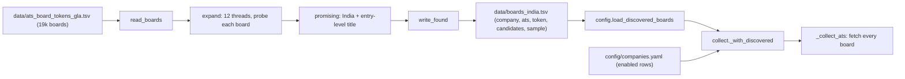

# `jobdigest.expand`: widening the pool with discovered boards

- **Source**: `src/jobdigest/expand.py` (221 lines). CLI: `python -m jobdigest.expand`.
- **Layer**: sources / offline tooling that feeds the ATS lane of [collect](../collection/collect-orchestrator.md).
- **Depends on**: `httpx`, `jobdigest.config.load_profile` / `Profile.india_keywords`, `jobdigest.hard_filter.function_ok` and `seniority_title`, `jobdigest.paths.repo_root`.
- **Consumed by**: `config.load_discovered_boards` (`src/jobdigest/config.py:143`) and `collect._with_discovered` (`src/jobdigest/collect.py:114`).
- **Tests**: `tests/test_expand.py` (screen, probe shapes, expand + TSV round-trip, read_boards); `tests/test_pipeline_e2e.py::test_collect_includes_discovered_boards_without_duplicating_curated`, `::test_skip_discovered_flag_leaves_only_curated_boards`.

## Why this exists / responsibility

The curated `config/companies.yaml` is small. The repo ships big lists of known ATS tokens (`data/ats_board_tokens_gla.tsv`, 19043 lines; also `_all` and `_gla_2000`). Fetching all of them on every scheduled run would be wasteful, so `expand` is run occasionally (by hand): it probes each board **once**, keeps only boards that currently list at least one India entry-level engineering role, and writes them to `data/boards_india.tsv` (222 boards in the checked-in file). The scheduled pipeline then fetches only those. Re-run it periodically to refresh.

## Public interface at a glance

| Symbol | Signature | Purpose |
|---|---|---|
| `DEFAULT_OUT` | `"data/boards_india.tsv"` | default output path |
| `Board` | frozen dataclass `(company, ats, token)` | one board to probe |
| `Found` | frozen dataclass `(board, candidates, sample)` | a board with hits |
| `read_boards` | `(path) -> list[Board]` | parse the input TSV |
| `promising` | `(profile, title, location) -> bool` | title+location screen |
| `probe` | `(board, profile, client, *, sleep=time.sleep) -> Found \| None` | probe one board |
| `expand` | `(boards, profile, *, client, workers=12, sleep=..., progress=None) -> list[Found]` | thread-pool driver |
| `write_found` | `(path, found) -> None` | write the TSV |
| `main` | `(argv=None) -> int` | CLI |
| `_url`, `_jobs`, `_india` | private | URL building, payload parsing, location test |

## Key concepts

- Supported ATS (`_SUPPORTED = ("greenhouse","lever","ashby")`): the three with unauthenticated JSON listing endpoints.
- Screening is **recall-oriented on title and location only** (no descriptions are fetched), so it errs toward keeping boards; the full hard filter and scoring decide later per job.
- A `ThreadPoolExecutor` is used because the work is thousands of independent network waits.

## Detailed walkthrough

### Regexes
- `_ENTRYISH` (case-insensitive): intern/internship, trainee, apprentice, new grad, graduate, fresher, junior, `sde 1/i`, `engineer i`, associate, early career, entry, campus, `software (development) engineer`, `sde`, `swe`, and `(backend|back-end|platform|ml|machine learning|ai|security|data|devops|full-stack) engineer`. Matches "Data Engineer", "Software Engineer, Intern"; not "Account Executive".
- `_TITLE_REJECT`: `staff`, `principal`, `distinguished`, `senior`, `sr.`, `lead`, `manager`, `director`, `vp`, `head of`.
- `UA = "JobHunt/0.1 (+board discovery)"`.

### `read_boards`
**Location** `src/jobdigest/expand.py:59` · `def read_boards(path: Path) -> list[Board]`
1. Read lines; skip line 0 if it starts with `company\t` (header).
2. Split on tab; fewer than 3 columns -> skip. `company, ats, token` = stripped, `ats` lower-cased.
3. Skip if `ats` not in `_SUPPORTED`, token empty, or `(ats, token)` already seen (exact-case token).
4. `Board(company or token, ats, token)`.
Extra columns (the input has a 4th `sources` column) are ignored. Test: duplicate `A` and a `workday` row are dropped.

### `_url`
**Location** `:76` · greenhouse `https://boards-api.greenhouse.io/v1/boards/{token}/jobs`; lever `https://api.lever.co/v0/postings/{token}?mode=json`; otherwise (ashby) `https://api.ashbyhq.com/posting-api/job-board/{token}`.

### `_jobs`
**Location** `:84` · `def _jobs(board, payload) -> list[tuple[str, str]]` returns `(title, location)` pairs.
- **Lever**: payload must be a list; each dict gives `(it["text"], it["categories"]["location"])`.
- **Greenhouse/Ashby**: payload dict -> `jobs` list; location is `it["location"]` (if a dict, its `name`); if `secondaryLocations` is a list, location becomes `" | ".join([primary] + [x["location"] or str(x)])`. So an Ashby job located "Remote" with a secondary "Hyderabad" is screened as `Remote | Hyderabad`.
- Non-dict items and malformed payloads are skipped, never raised.

### `_india`
**Location** `:112` · true if any `profile.india_keywords` entry matches as a whole word (`\b...\b`, case-insensitive) in the location. With the example profile the keywords are India, Pune, Bengaluru, Bangalore, Hyderabad, Mumbai, Chennai, Noida, Gurugram, Gurgaon, Delhi, NCR, PAN India, Remote India (the repo had no `config/profile.yaml`, so `load_profile` fell back to the example).

### `promising`
**Location** `:119` · `def promising(profile, title, location) -> bool` = all of: `_india(profile, location)`; `_ENTRYISH.search(title)`; not `_TITLE_REJECT.search(title)`; not `hard_filter.seniority_title(title)` (e.g. "Engineer II"); `hard_filter.function_ok(title)` (engineering role, not HR/sales). Reusing the pipeline's own title rules keeps `expand` consistent with what the hard filter will later accept.
Verified: `Software Engineer, Intern` @ `Bengaluru, India` True; `Backend Engineer` @ `Pune` True; `Data Engineer` @ `Remote | Hyderabad` True; `Senior Software Engineer` False (reject word); `Software Engineer II` False (seniority); `Account Executive` @ Mumbai False; `Marketing Associate` @ Pune False (`function_ok`).

### `probe`
**Location** `:130` · `def probe(board, profile, client, *, sleep=time.sleep) -> Found | None`
1. In `try`: `resp = client.get(_url(board), timeout=20.0)`.
2. HTTP 429: `sleep(min(float(resp.headers.get("Retry-After", "5") or 5), 20.0))` and retry **once**.
3. Status != 200 -> `None` (dead/renamed boards, 404, redirects since the client is built with `follow_redirects=False`).
4. `payload = resp.json()`. `except (httpx.HTTPError, ValueError): return None`. Because the `Retry-After` conversion is inside the same `try`, a non-numeric `Retry-After` (an HTTP date) raises `ValueError` and silently drops that board for this run.
5. `hits = [t for t, loc in _jobs(board, payload) if promising(profile, t, loc)]`; none -> `None`.
6. `Found(board, len(hits), hits[0])`: the count of matching titles and the first one as a sample.

### `expand`
**Location** `:153` · `def expand(boards, profile, *, client, workers=12, sleep=time.sleep, progress=None) -> list[Found]`
1. `todo = list(boards)`; `ThreadPoolExecutor(max_workers=max(1, workers))`.
2. `pool.submit(probe, b, profile, client, sleep=sleep)` for every board; iterate `as_completed`; increment `done`; keep non-`None` results; if `progress` and `done % 500 == 0` call `progress(done, len(todo), len(found))`.
3. Sort by `(-candidates, company.lower())` so the richest boards are first, ties alphabetical.
The single shared `httpx.Client` is used by all threads (httpx clients are thread-safe). There is no per-host throttle other than the worker count, and all Greenhouse boards hit the same API host.

### `write_found`
**Location** `:178` · header `company\tats\ttoken\tcandidates\tsample` then one line per `Found`; creates parent dirs; trailing newline. Sample titles containing tabs would corrupt the TSV (not handled).

### `main`
**Location** `:188` · options `--tsv` (default `data/ats_board_tokens_gla.tsv`), `--out` (default `data/boards_india.tsv`), `--workers` (12), `--limit N` (probe only the first N).
1. Relative paths are resolved against `repo_root()`.
2. `read_boards`, optional `--limit` slice, `load_profile()`.
3. Print `probing N boards with W workers`; build `httpx.Client(headers={"User-Agent": UA}, follow_redirects=False)`; call `expand(..., progress=print every 500)`; always `client.close()`.
4. `write_found(out, found)`; print `kept N boards -> path`; return 0.
Real network is used only when run as a CLI.

## The expand -> collect handoff

`expand` is a separate, manual step. `collect` reads its output file on every run: the path comes from `config.discovered_boards_path()` (`data/boards_india.tsv`, or env `JOBDIGEST_DISCOVERED_BOARDS`; values `off`, `none`, `0`, `false` disable it). `load_discovered_boards` skips the header and rows with fewer than 3 columns or an empty token, lower-cases `ats`, and emits company dicts `{"id": "<ats>:<token>", "name": name or token, "ats", "token", "enabled": True, "notes": "discovered by jobdigest.expand"}`; the `candidates` and `sample` columns are ignored. It does **not** validate that `ats` is supported. `_with_discovered(rows, discovered)` appends only entries whose `(ats, token)` is not already among the curated rows (the curated side is compared lower-cased/stripped; discovered tokens as written), logging `collect discovered boards added=N`. Curated rows come first. In `collect.run` it is applied when `not skip_ats and not skip_discovered` (`--skip-discovered` on the CLI). Test coverage: the two e2e tests above (a duplicate of a curated board is fetched once; the flag leaves only curated boards).

## Failure modes and edge cases
- Dead boards, 404s, redirects, timeouts and bad JSON are all silently dropped (`None`); a transient outage can remove a good board from the file until the next run. Because the file is overwritten wholesale, re-runs can shrink it.
- Unknown `Retry-After` format drops the board (see `probe`).
- The screen is title/location only; a board may be kept for "Data Engineer" in Pune that the hard filter later rejects.
- Missing/stale `boards_india.tsv` simply means no discovered boards (empty list).
- Setting `JOBDIGEST_DISCOVERED_BOARDS` to a file with unsupported `ats` values would hand them to the ATS adapter lookup unvalidated.

## How to modify / extend safely
Tune recall by editing `_ENTRYISH`/`_TITLE_REJECT` and adding cases to `tests/test_expand.py::test_promising_screens_title_and_location`. Adding an ATS means adding it to `_SUPPORTED`, `_url`, `_jobs` and making sure an adapter exists for collect. Keep output columns `company, ats, token` in positions 0-2, since `load_discovered_boards` reads them positionally.
