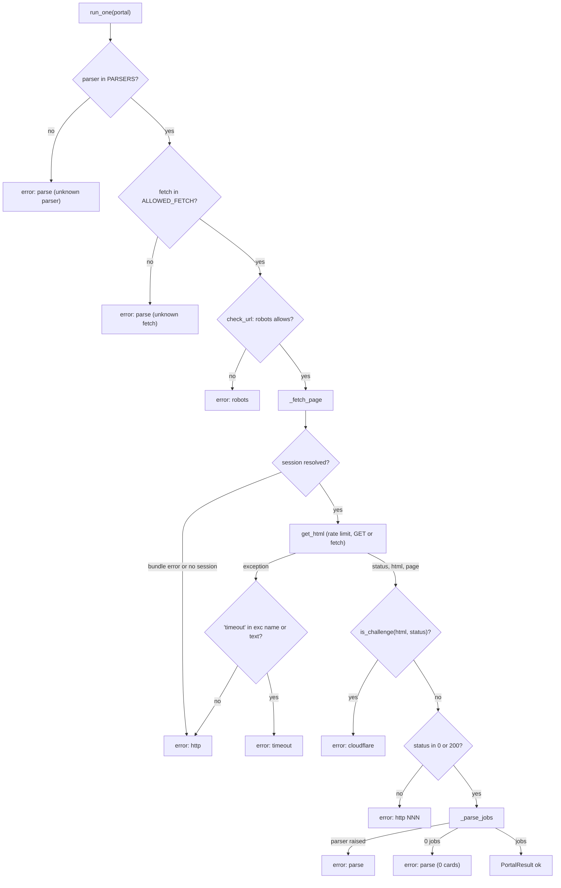

# Portals: overview and `run_one`

- **Source**: `src/jobdigest/portals/__init__.py` (285 lines). Siblings: [session and robots](portals-session-and-robots.md), [parsers](portals-parsers.md).
- **Layer**: collection sources (non-ATS lane). A "portal" is a job website with no public JSON API, scraped from HTML (or an HTML-wrapped JSON blob).
- **Used by**: `src/jobdigest/collect.py:_collect_side_lanes` (calls `portals.portal_fetch_mode`, `portals.open_bundle`, `portals.run_one`, `portals.ALLOWED_FETCH`); `src/jobdigest/feeds.py` and `src/jobdigest/marketplaces/__init__.py` reuse `PortalResult`.
- **Depends on**: `jobdigest.ats.base.NormalizedJob`, the four parsers, `portals.robots.check_url`, `portals.session.*`.
- **Tests**: `tests/test_portals_parsers.py` (the `run_one_*` tests at the bottom), `tests/test_portal_session.py`, `tests/test_collect_portals.py`, `tests/test_no_stealthy.py`.

## Why this exists / responsibility

The ATS adapters ([ats-overview](ats-overview.md)) cover companies that host a Greenhouse/Lever/Ashby board. Many India-focused internship boards (FOSS United, null community, Hasjob, HuntYourTribe, ...) have no API. `portals.run_one` turns one row of `config/portals.yaml` into either a list of `NormalizedJob` or a classified error, without ever raising to its caller. The classification (`robots | http | timeout | cloudflare | parse`) is persisted by `collect` into the `portal_errors` table so a broken scraper is visible in the health report.

A portal row looks like this (from `config/portals.yaml`):

```yaml
- name: huntyourtribe-intern
  url: https://huntyourtribe.com/jobs/startup-internships-in-india
  enabled: true
  parser: generic_cards
  fetch: dynamic
```

Row keys read by this package: `name`, `url`, `parser` (key into `PARSERS`), `fetch` (`http` default | `dynamic` | `stealth`), `solve_cloudflare` (bool, only meaningful with `stealth`). `enabled` is read by `collect._enabled_rows`, not here.

## Public interface at a glance

| Symbol | Signature | Purpose |
|---|---|---|
| `PARSERS` | `dict[str, Callable[..., list[NormalizedJob]]]` | maps the YAML `parser:` value to a parse function |
| `PortalResult` | dataclass | uniform result for portals, feeds and marketplaces |
| `run_one` | `run_one(portal, *, session=None, sessions=None, sleep=None, last_host=None, robots_cache=None, allowed_fn=None, get_html_fn=None) -> PortalResult` | fetch and parse one portal |
| `_error`, `_Failure`, `_unpack_fetched`, `_resolve_session`, `_fetch_page`, `_check_response`, `_parse_jobs` | private | stages of `run_one` |
| re-exports (`__all__`) | `ALLOWED_FETCH, FETCH_*, OpenedSession, SessionBundle, close_bundle, is_challenge, jobs_from_cards, open_bundle, open_session, portal_fetch_mode` | so callers import from `jobdigest.portals` |

## Key concepts

- **Result type, not exceptions.** Every failure inside `run_one` is turned into `PortalResult(status="error", error_class=...)`. Internally this is done with a private exception `_Failure` that carries the finished `PortalResult` out of a deep stage; `run_one` catches it once.
- **Error classes** written by this package: `robots` (disallowed), `http` (non-200, session missing, any fetch exception that is not a timeout), `timeout`, `cloudflare` (challenge page), `parse` (unknown parser, unknown fetch mode, parser exception, or zero cards). `feeds` and `marketplaces` add their own (`config` for a missing `python-jobspy`).
- **Dependency injection for tests.** `allowed_fn` replaces the robots check, `get_html_fn` replaces `session.get_html`, `sleep`/`last_host`/`robots_cache` are injectable. This is why the whole flow runs offline in tests.
- **Three fetch modes** (`http`, `dynamic`, `stealth`) correspond to three kinds of Scrapling session; see [session and robots](portals-session-and-robots.md).

## Detailed walkthrough

### `PortalResult`
**Location** `src/jobdigest/portals/__init__.py:35` · dataclass.

| Field | Type | Default | Meaning |
|---|---|---|---|
| `status` | `str` | required | `"ok"` or `"error"`. `collect._result_ok` compares `str(status).lower() == "ok"` |
| `jobs` | `list[NormalizedJob]` | `[]` | parsed jobs (empty on error) |
| `error_class` | `str \| None` | `None` | one of the classes above |
| `http_status` | `int \| None` | `None` | last HTTP status seen |
| `detail` | `str \| None` | `None` | human message; collect stores it in `portal_errors.detail` |
| `name`, `url` | `str` | `""` | echo of the portal row |

Same class is returned by `feeds.run_one` and `marketplaces.run_one`, so `collect` has one code path (`_Collector.side_unit`) for all three lanes.

### `_error`
**Location** `src/jobdigest/portals/__init__.py:45` · `def _error(*, name, url, error_class, detail, http_status=None) -> PortalResult`. Trivial keyword-only factory for an error `PortalResult`. Called by every stage below and by `run_one` directly.

### `_Failure`
**Location** `src/jobdigest/portals/__init__.py:63` · `class _Failure(Exception)`. Stores `self.result` (a `PortalResult`) and passes `result.detail` to `Exception.__init__`. Raised by `_resolve_session`, `_fetch_page`, `_check_response`, `_parse_jobs`; caught only at the bottom of `run_one`. It exists so each stage can early-exit with a fully classified result without threading return codes through three call levels.

### `_unpack_fetched`
**Location** `:71` · `def _unpack_fetched(fetched: tuple) -> tuple[int, str, Any]`. Accepts `(status, html)` or `(status, html, page)` and always returns a triple (page `None` for the two-tuple). Needed because the real `get_html` returns three items while test hooks (`get_html_fn=lambda *a, **k: (200, html)`) often return two.

### `_resolve_session`
**Location** `src/jobdigest/portals/__init__.py:78` · **Signature** `def _resolve_session(*, name, url, fetch, session, sessions) -> tuple[Any, OpenedSession | None]`
**Purpose** choose the Scrapling session to use for `fetch`. The second tuple item is a session this function opened itself and which the caller must close.
**Called by** `_fetch_page` (only when no `get_html_fn` is injected). **Calls** `SessionBundle.get`, `open_session`.

Step by step:
1. `session is not None` -> return `(session, None)`. An explicit session always wins and is never closed here.
2. `sessions` (a `SessionBundle`) given:
   - if `fetch in sessions.errors` raise `_Failure(error_class="http", detail=sessions.errors[fetch])`. This is how a failure to launch Chromium (recorded at `open_bundle` time) surfaces per portal, with the original message (test: `test_run_one_bundle_error_is_http`).
   - `active = sessions.get(fetch)`; if not `None` return `(active, None)`.
3. Still no session and `fetch != FETCH_HTTP` -> `_Failure(http, "no session for fetch 'dynamic'")`. Browser modes are never opened ad hoc, because starting Chromium per portal is expensive.
4. Only for `http`: `opened = open_session()` and return `(opened.session, opened)`. That is the standalone path (no bundle), used e.g. when running `run_one` by hand. Note `open_session` can raise `RuntimeError` (Scrapling missing); that exception is caught in `_fetch_page` and classified.

### `_fetch_page`
**Location** `:105` · **Signature** `def _fetch_page(*, name, url, fetch, solve_cf, extra_headers, session, sessions, sleep, last_host, get_html_fn) -> tuple[int, str, Any]`
**Purpose** perform the single network GET and convert any exception into `_Failure`.

1. `opened = None`; enter `try`.
2. `fetcher = get_html_fn`, `active = session`. If no `get_html_fn`, call `_resolve_session`, set `fetcher = get_html` (the real one from `session.py`).
3. Call `fetcher(active, url, sleep=sleep, last_host=last_host, fetch=fetch, solve_cloudflare=solve_cf, extra_headers=extra_headers)`; return `_unpack_fetched(...)`.
4. `except _Failure: raise` (already classified).
5. `except Exception as exc`: class is `"timeout"` if `"timeout"` appears (case-insensitive) in `type(exc).__name__` or `str(exc)`, else `"http"`:
```python
klass = (
    "timeout"
    if "timeout" in type(exc).__name__.lower() or "timeout" in str(exc).lower()
    else "http"
)
```
   This is a name heuristic because Scrapling/Playwright/curl_cffi each raise different timeout types. `ReadTimeout`, `TimeoutError` and a message like "Timeout 30000ms exceeded" all match. Raises `_Failure` chained `from exc`.
6. `finally`: `opened.close()` if this call opened a session (so ad hoc http sessions never leak).

### `_check_response`
**Location** `:152` · `def _check_response(*, name, url, status, html) -> None`. Two ordered checks:
1. `is_challenge(html, status)` -> `_Failure(error_class="cloudflare", detail="challenge page", http_status=status)`.
2. `status not in (0, 200)` -> `_Failure(http, f"http {status}", http_status=status)`.

Status `0` is allowed because `get_html` coerces a missing `.status` to 0 and test hooks may omit it. Order matters: a 403/429/503 is *always* classified `cloudflare` by `is_challenge` (see caveat below), so the `http` branch only fires for other statuses such as 404/500.

### `_parse_jobs`
**Location** `:176` · `def _parse_jobs(parser, *, name, url, status, html, page) -> list[NormalizedJob]`
1. `target = page if page is not None and hasattr(page, "css") else html`. The parser gets the live Scrapling `Response` when one exists (so CSS selection works on the real DOM), otherwise the raw HTML string. Parsers accept either (`generic.to_root`).
2. `parser(target, source=name, base_url=url)`; any exception -> `_Failure(parse, str(exc), http_status=status)`.
3. Empty list -> `_Failure(parse, "0 cards", http_status=status or 200)`. A page that parses to zero jobs is an error, *not* a success: it signals that the site changed its markup. (Contrast: `collect.side_unit` comment notes that an empty *ok* result would sweep/tombstone the source, so zero cards must never be reported as ok.)

### `run_one`
**Location** `src/jobdigest/portals/__init__.py:205`
**Signature** `def run_one(portal: dict, *, session=None, sessions: SessionBundle | None = None, sleep=None, last_host: dict | None = None, robots_cache: dict[str, str] | None = None, allowed_fn=None, get_html_fn=None) -> PortalResult`
**Purpose** the full pipeline for one portal row; never raises for network/parse problems.
**Called by** `collect._collect_side_lanes.run_portal` (passing `sessions=bundle, sleep, last_host, robots_cache`); tests. **Calls** `PARSERS.get`, `portal_fetch_mode`, `check_url`, `_fetch_page`, `_check_response`, `_parse_jobs`.

| Param | Meaning |
|---|---|
| `portal` | the YAML row (dict) |
| `session` | explicit Scrapling-like session; overrides everything |
| `sessions` | `SessionBundle` opened once per collect run |
| `sleep` | sleep function, default `time.sleep` (imported lazily) |
| `last_host` | mutable `{"host": ...}` shared across portals for per-host rate limiting; default new `{}` |
| `robots_cache` | `{origin: robots_text}` shared across portals; default new `{}` |
| `allowed_fn` | `url -> bool`, bypasses robots entirely (tests) |
| `get_html_fn` | replaces `session.get_html` (tests) |

Execution order:
1. **Normalise inputs**: `name`, `url`, `parser_name` are `str(portal.get(...) or "")`.
2. **Unknown parser**: `parser = PARSERS.get(parser_name)`; `None` -> return `_error(parse, "unknown parser 'kill'")` (test `test_run_one_unknown_parser`). No network.
3. **Unknown fetch mode**: `fetch = portal_fetch_mode(portal)` (lower-cased, default `http`); not in `ALLOWED_FETCH` -> `_error(parse, "unknown fetch 'chrome'")`. The fetcher must not run (test asserts that).
4. Defaults for `sleep`, `last_host`, `robots_cache`.
5. **Robots**: `check_url(url, cache=robots_cache, session=session, allowed_fn=allowed_fn)`; false -> `_error(robots, "disallowed by robots.txt")`. Note it passes `session` (the explicit one), not the bundle, so under `collect` robots.txt is fetched with plain `httpx` ([details](portals-session-and-robots.md#fetch_robots)).
6. Inside `try`: `_fetch_page(...)`. Two portal-specific arguments: `solve_cf=bool(portal.get("solve_cloudflare"))`, and `extra_headers={"Accept": "application/json"} if parser_name == "hasjob" else None` (the hasjob site returns JSON when asked; see [parsers](portals-parsers.md#hasjob)).
7. Coerce `status_i = int(status or 0)`, `html_s = str(html or "")`.
8. `_check_response(...)` then `jobs = _parse_jobs(...)`.
9. `except _Failure as failure: return failure.result`.
10. Success: `PortalResult(status="ok", jobs=jobs, http_status=status_i or 200, name=name, url=url)`.

Realistic outputs (run offline with `allowed_fn=lambda u: True` and an injected `get_html_fn`):

| Injected response | Result |
|---|---|
| `(200, "<html></html>")` with `generic_cards` | `error`, `parse`, `0 cards`, `http_status=200` |
| `(503, "x")` | `error`, `cloudflare`, `challenge page`, `http_status=503` |
| `(404, "x")` | `error`, `http`, `http 404`, `http_status=404` |
| `allowed_fn=lambda u: False` | `error`, `robots`, `disallowed by robots.txt` |
| fetcher raises `TimeoutError("read timeout")` | `error`, `timeout`, `read timeout` |

**Plain-English summary**: validate config, ask robots, fetch with the right session, reject challenge/bad-status pages, parse, and reject empty parses. Every rejection is a labelled `PortalResult`.



The diagram shows the single exit path per failure class; every `error:` node is built by `_error`; the first three (unknown parser, unknown fetch, robots) are returned directly, the rest travel as a `_Failure`.

## Failure modes and edge cases

- **`is_challenge` false positives.** It lower-cases the *whole body* and looks for `just a moment`, `attention required`, `cf-challenge`, `turnstile`, `checking your browser`; any HTTP 403/429/503 is also a challenge regardless of body. A legitimate job page that merely mentions "Turnstile" (the Cloudflare widget on a login form) or contains the phrase "just a moment" is therefore reported as `cloudflare` (verified: `is_challenge("We use Cloudflare turnstile on our login page", 200)` is `True`). Conversely a real rate limit 429 is labelled `cloudflare`, not `http`. Use `detail` + `http_status` to tell them apart.
- **Challenge only detected on the final response.** With `stealth` + `solve_cloudflare: true` Scrapling may solve the challenge, in which case the returned HTML is the real page and passes.
- **Timeout detection is textual.** A non-timeout error whose message contains the word "timeout" is classified `timeout`.
- **Per-row failure isolation.** `collect.side_unit` also wraps `run_one` in `try/except`, so even a bug in `run_one` would be recorded as an error row, not abort the run.
- **Robots fail-open**: an unreachable robots.txt allows the fetch ([why](portals-session-and-robots.md#fetch_robots)).
- **Empty `ok` is impossible here** (0 cards is an error), which protects the tombstone sweep in collect.

## How to modify / extend safely

- **New parser**: write `parse(page_or_html, *, source, base_url) -> list[NormalizedJob]`, add it to `PARSERS`, add a fixture in `tests/fixtures/portals/` and a test in `tests/test_portals_parsers.py`. Reuse `jobs_from_cards`.
- **New fetch mode**: add the constant to `ALLOWED_FETCH`, an `open_*_session` factory, an `open_bundle` branch, a `SessionBundle.get` branch, and a `get_html` branch. `tests/test_no_stealthy.py` restricts where Scrapling class names may appear.
- **New site-specific request header**: follow the `parser_name == "hasjob"` pattern in `run_one`.
- Keep scrapling imports inside `portals/` (enforced by `tests/test_no_stealthy.py`; `feeds.py` is deliberately httpx+feedparser only).
