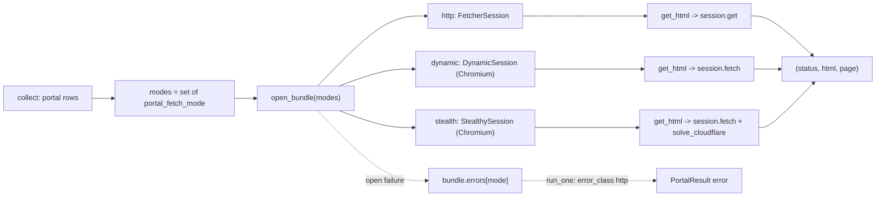

# Portals: sessions, fetch modes and robots.txt

- **Source**: `src/jobdigest/portals/session.py` (215 lines), `src/jobdigest/portals/robots.py` (63 lines).
- **Layer**: collection sources, transport layer for the portal lane ([run_one](portals-overview.md)).
- **Depends on**: `scrapling` (`scrapling.fetchers.FetcherSession | DynamicSession | StealthySession`, pinned `scrapling[fetchers]==0.4.15` in `pyproject.toml`), `httpx`, `protego`.
- **Used by**: `portals/__init__.py` (re-exports), `collect._collect_side_lanes` (opens/closes the bundle), `feeds.py` (imports only `UA`).
- **Tests**: `tests/test_portal_session.py` (get_html modes, bundle), `tests/test_portals_parsers.py` (`is_challenge`), `tests/test_no_stealthy.py` (where Scrapling names may appear).

## Why this exists / responsibility

Some portals serve plain HTML; some are single-page apps that need a real browser; a few sit behind Cloudflare. `session.py` hides those three transports behind one function, `get_html`, and manages the lifetime of the expensive sessions (a Chromium process) so that `collect` opens each kind **once per run** and reuses it for every portal. `robots.py` is a small, polite gate: portals are only fetched if `robots.txt` allows the `JobHunt/0.1` user agent.

## Key concepts

- **Scrapling** is a scraping library with several fetchers. Three are used: `FetcherSession` (HTTP client that impersonates Chrome's TLS fingerprint through curl_cffi), `DynamicSession` (headless Chromium via Playwright, runs JavaScript) and `StealthySession` (Chromium with anti-detection patches and an optional Cloudflare-challenge solver). Pages come back as a Scrapling `Response`, which has `.status`, `.html_content`, `.body` and a `.css(selector)` method.
- **Context-manager sessions.** Scrapling sessions are used as `with FetcherSession(...) as s:`. The object returned by the constructor (the *factory*) is not the object returned by `__enter__` (the *session*); to close it you must call `__exit__` on the factory. `OpenedSession` carries both.
- **Fetch modes** (constants in `session.py`): `FETCH_HTTP="http"`, `FETCH_DYNAMIC="dynamic"`, `FETCH_STEALTH="stealth"`; `ALLOWED_FETCH` is the frozenset of the three. Chosen per portal row by the YAML `fetch:` key.
- Constants: `UA = "JobHunt/0.1"`, `HOST_SLEEP_S = 3.5`.

## Public interface at a glance

| Symbol | Signature | Purpose |
|---|---|---|
| `OpenedSession` | `NamedTuple(session, context)` + `.close()` | a live session and the object to exit |
| `is_challenge` | `(html, status) -> bool` | Cloudflare-style block detector |
| `portal_fetch_mode` | `(portal) -> str` | read `fetch:` from a row |
| `open_session` / `open_dynamic_session` / `open_stealth_session` | `() -> OpenedSession` | create one session of each kind |
| `SessionBundle` | dataclass | holds up to three sessions + per-mode open errors |
| `open_bundle` / `close_bundle` | `(modes) -> SessionBundle` / `(bundle) -> None` | open/close the wanted sessions |
| `get_html` | `(session, url, *, sleep, last_host, fetch, solve_cloudflare, extra_headers) -> (status, html, page)` | one rate-limited fetch |
| `check_url`, `allowed`, `fetch_robots`, `origin_of` | robots helpers | see below |

## Detailed walkthrough: `session.py`

### `OpenedSession` and `_close_context`
**Location** `src/jobdigest/portals/session.py:24` and `:38`.
`OpenedSession(session, context)` is a `NamedTuple`; `.close()` calls `_close_context(self.session, self.context)`. `_close_context`: if `context` has `__exit__`, call `context.__exit__(None, None, None)` and return; otherwise fall back to `session.close()` if callable. The fallback handles test doubles and objects without a context-manager protocol. Note `__exit__` exceptions propagate (callers wrap in `finally`).

### `is_challenge`
**Location** `:47` · `def is_challenge(html: str, status: int) -> bool`
1. `status in (403, 429, 503)` -> `True` immediately (before looking at the body).
2. Otherwise lower-case the body and return `True` if it contains any of `just a moment`, `attention required`, `cf-challenge`, `turnstile`, `checking your browser` (tuple `_CHALLENGE`, `:15`).

Verified: `is_challenge('<html><title>Just a moment...</title>

</html>', 200)` is `True` (fixture `tests/fixtures/portals/challenge.html`); `is_challenge("", 403)` is `True`; `is_challenge("<html>x</html>", 200)` is `False`.
**Caveat** (also in the [overview](portals-overview.md#failure-modes-and-edge-cases)): it is a substring heuristic over the whole document, not a structural check. Pages that legitimately mention "turnstile" or "attention required" are misclassified, and every 429/503 is called a Cloudflare challenge even from a non-Cloudflare origin.

### `portal_fetch_mode`
**Location** `:54` · `str(portal.get("fetch") or "http").strip().lower()`, falling back to `"http"` if the result is empty. Does not validate; `run_one` validates against `ALLOWED_FETCH`. Also used by `collect` to group rows by mode and to implement `--portal-fetch`.

### `_enter`
**Location** `:59` · `def _enter(factory) -> OpenedSession`. If `factory` has `__enter__`, `session = factory.__enter__()`, else the factory itself is the session. Returns `OpenedSession(session, factory)`.

### `open_session`, `open_dynamic_session`, `open_stealth_session`
**Location** `:66`, `:82`, `:98`. Each imports the Scrapling class lazily inside `try` and converts *any* import failure to `RuntimeError` with an install hint (`FetcherSession unavailable; install scrapling[fetchers] and playwright wheels`, or `install Chromium with python -m playwright install chromium`). Lazy import keeps `import jobdigest.portals` cheap and lets tests run without browsers.

| Function | Class | Arguments |
|---|---|---|
| `open_session` | `FetcherSession` | `impersonate="chrome", timeout=30, retries=3, stealthy_headers=False` |
| `open_dynamic_session` | `DynamicSession` | `headless=True, timeout=30000, google_search=False, extra_headers={"User-Agent": UA}` |
| `open_stealth_session` | `StealthySession` | `headless=True, timeout=60000, google_search=False, extra_headers={"User-Agent": UA}` |

Units: HTTP timeout is in seconds, browser timeouts in milliseconds. `stealthy_headers=False` and `google_search=False` switch off Scrapling's fake-referrer behaviour so the request identifies itself honestly with `JobHunt/0.1`.

### `SessionBundle`
**Location** `:115` · dataclass with fields `http`, `dynamic`, `stealth` (each `Any = None`), `errors: dict[str, str]` (mode -> failure message), `contexts: dict[str, Any]` (mode -> factory to exit; `repr=False`).
- `adopt(mode, opened)` (`:123`): `setattr(self, mode, opened.session)` and `self.contexts[mode] = opened.context`. Works because mode names equal field names.
- `get(mode)` (`:127`): returns the matching attribute for the three modes, `None` for anything else (test `test_session_bundle_get`).

Design: a bundle is the "connection pool" for the portal lane: opened once, shared by all portals of the run, closed at the end.

### `open_bundle`
**Location** `:137` · `def open_bundle(modes: Iterable[str]) -> SessionBundle`
1. `bundle = SessionBundle()`; `wanted = {str(m) for m in modes}`.
2. For each of `http`, `dynamic`, `stealth` present in `wanted`: `bundle.adopt(mode, open_*())` inside `try`; on any exception `bundle.errors[mode] = str(exc)`. Failure to launch one kind of session therefore does not prevent the others (tests `test_open_bundle_records_mode_errors`, `test_open_bundle_empty_does_not_open_sessions`).
3. Returns the bundle. Unknown mode names in `modes` are silently ignored.

Caller (`collect._collect_side_lanes`) computes `modes` as the set of `portal_fetch_mode(row)` over enabled rows that are in `ALLOWED_FETCH`, so a run with only `http` portals never starts Chromium. The bundle is created only when `portal_run_fn is None and portal_rows`.

### `close_bundle`
**Location** `:158` · `None` -> no-op. Otherwise for each mode in order http, dynamic, stealth: take `bundle.get(mode)`; skip `None`; call `_close_context(session, bundle.contexts.pop(mode, None))`. Because `contexts` is popped, closing twice is harmless for already-closed modes.

### `_page_html`
**Location** `:168` · extracts HTML text from a Scrapling response: first truthy of `page.html_content`, `page.html`, `page.body`, else `str(page)`; `bytes` are decoded as UTF-8 with `errors="replace"`.

### `get_html`
**Location** `:180`
**Signature** `def get_html(session, url, *, sleep, last_host, fetch=FETCH_HTTP, solve_cloudflare=False, extra_headers=None) -> tuple[int, str, Any]`
**Purpose** the one function that actually performs a request, with per-host politeness.
**Called by** `portals._fetch_page` (as `fetcher`). **Calls** `urlsplit`, `sleep`, `session.get` or `session.fetch`, `_page_html`.

Steps:
1. `host = (urlsplit(url).hostname or "").lower()`.
2. **Rate limit**: `prev = last_host.get("host")`; if `prev and prev == host`, `sleep(HOST_SLEEP_S)` (3.5 s). Then `last_host["host"] = host`. `last_host` is a single-slot dict shared by `collect` across all portals, so only *consecutive* requests to the same host wait; interleaving hosts resets it. (Test `test_get_html_same_host_sleeps`.)
3. `headers = {"User-Agent": UA}` merged with `extra_headers` (extras win; e.g. hasjob adds `Accept: application/json`).
4. `mode = (fetch or "http").strip().lower() or "http"`.
5. **dynamic / stealth**: `kwargs = {"extra_headers": headers, "google_search": False}`; for stealth also `kwargs["solve_cloudflare"] = bool(solve_cloudflare)`; `page = session.fetch(url, **kwargs)`. `solve_cloudflare` is ignored in dynamic mode.
6. **http**: `page = session.get(url, headers=headers, stealthy_headers=False)`. Tests assert http mode never calls `fetch` and browser modes never call `get` (`_HttpSession` / `_BrowserSession` doubles).
7. `status = int(getattr(page, "status", 0) or 0)`; return `(status, _page_html(page), page)`.

No retry here for browser modes; the HTTP session itself was created with `retries=3`.

## Detailed walkthrough: `robots.py`

### `origin_of`
**Location** `src/jobdigest/portals/robots.py:12` · `scheme://netloc` of a URL, used as the cache key (`https://fossunited.org`).

### `fetch_robots`
**Location** `:17` · `def fetch_robots(session, origin: str) -> str`
**Purpose** return the text of `<origin>/robots.txt`, or `""` on *any* error.
1. `url = origin.rstrip("/") + "/robots.txt"`.
2. If `session is not None and hasattr(session, "get")`: `page = session.get(url, headers={"User-Agent": UA}, stealthy_headers=False)`, body = `page.html` or `page.body` or `""`, bytes decoded as UTF-8 (replace). In the installed Scrapling 0.4.15 the `Response` class exposes `body` and `html_content`; the code reads `html` then `body`, so in practice `body` is what is used (I did not run a live fetch to confirm).
3. Else: `httpx.get(url, headers={"User-Agent": UA}, timeout=30.0, follow_redirects=True).text`. No `raise_for_status`, so a 404 HTML page is returned as text and then parsed as robots (it contains no `Disallow` lines, so it allows everything).
4. `except Exception: return ""`.

**Fail-open by design** (comment in source): an empty body is "allow all", so a network error or 5xx on robots.txt lets the portal be fetched; failing closed would silently disable portals on transient errors.
**Note**: `run_one` passes its own `session` argument, which is `None` under `collect` (only `sessions=bundle` is given), so in production robots.txt is always fetched with `httpx`, not through Scrapling.

### `allowed`
**Location** `:44` · `def allowed(url, robots_txt, *, user_agent=UA) -> bool`. Blank/whitespace-only robots text -> `True`. Otherwise `Protego.parse(robots_txt).can_fetch(url, user_agent)`. Verified: with `User-agent: *\nDisallow: /jobs`, `https://a.example/jobs` -> `False`, `https://a.example/x` -> `True`; empty text -> `True`. The parse is redone for every call; only the raw text is cached.

### `check_url`
**Location** `:51` · `def check_url(url, *, cache, session=None, allowed_fn=None) -> bool`
1. `allowed_fn` given -> `bool(allowed_fn(url))` and stop (test hook).
2. `origin = origin_of(url)`; if not in `cache`, `cache[origin] = fetch_robots(session, origin)`; return `allowed(url, cache[origin])`.
Caching is per origin and per run (the dict is created in `_collect_side_lanes` and shared by all portals). A failed fetch caches `""`, so the origin is not retried within the run.

## Failure modes and edge cases

- **Chromium not installed**: `open_bundle` records the error; each portal needing that mode returns `error_class="http"` with the install hint as `detail`. Other modes keep working.
- **Mixed `last_host` semantics**: the 3.5 s delay is not enforced when two portals share a host but another host is fetched in between.
- **robots user agent**: matching uses `JobHunt/0.1`; rules for `*` apply unless the file names that agent.
- **`google_search=False` / `stealthy_headers=False`** are deliberate; do not enable stealth headers without reviewing politeness (see the `test_no_stealthy.py` convention).
- **Process cleanup**: `collect` registers the bundle via `on_bundle` immediately after opening so its caller can call `close_bundle` even if a lane raises.

## How to modify / extend safely

Change timeouts in the three `open_*` functions (mind seconds vs ms). To add a header for one site, pass `extra_headers` from `run_one`, not from `get_html`. Keep new Scrapling imports inside `portals/` and update `tests/test_no_stealthy.py` expectations if you add new class names.
