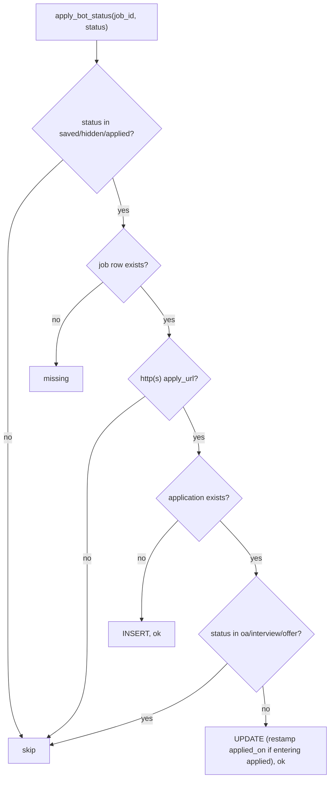

# Applications (`db/applications.py`)

- **Source**: `src/jobdigest/db/applications.py` (289 lines)
- **Layer**: persistence for the user's application tracker (`applications` table), the sheet-sync bookkeeping and the bot's status buttons.
- **Depends on**: `db._common` (`norm_http_url`, `now`), `db.connection.transaction`.
- **Used by**: `bot.py` (`apply_bot_status`, `job_score_row`), `sheet.py` (`upsert_application`, `ensure_application`, `pending_sheet_rows`, `mark_sheet_synced`), indirectly every digest query (applications hide jobs).
- **Tests**: `tests/test_bot.py` (`test_apply_bot_status_applied_excludes_guest_rows`, `_hide_is_not_applied`, `_save`, `_preserves_oa_notes`, `_restamps_applied_on_when_entering_applied`, `_does_not_restamp_if_already_applied`), `tests/test_sheet.py` (`test_upsert_application_excludes_guest_rows`, `test_upsert_application_saved_and_rejects_unknown`, `test_upsert_application_restamps_applied_on_when_entering_applied`, `test_ensure_application_does_not_overwrite_status`), `tests/test_dual_hash.py::test_application_on_alias_suppresses_canonical_guest`, `tests/test_priors.py`, `tests/test_followups.py`, `tests/test_bot_buttons.py`.

## Why this exists

An application row records "I did something with this job URL". Statuses: `applied, oa, interview, offer, rejected, ghosted, saved, hidden` (`_APP_STATUSES`, also the DB CHECK). The same table is written from three places: the user editing the Google Sheet (`sheet.py` -> `upsert_application`), the Telegram buttons (`bot.py` -> `apply_bot_status`) and the sheet export of saved jobs (`ensure_application`). Any job whose `apply_url_norm` appears in `applications` disappears from the digest and from the scoring queue regardless of status (including `hidden`, which is how "not interested" works).

## Key concepts

- **Join by URL, not id.** `applications.apply_url_norm` is UNIQUE and matches `jobs.apply_url_norm`. `job_id` is filled when a matching job exists but is optional, so applications can be entered by URL for jobs never collected.
- **Protected statuses.** `_PROTECTED_APP = {oa, interview, offer}`: progress states that button presses from the bot must never overwrite.
- **Status sets.** `_BOT_STATUSES = {saved, hidden, applied}` are the only statuses the bot may set.
- **`norm_http_url`** (see [connection-and-postgres-shim.md](connection-and-postgres-shim.md#_commonpy-helpers)) returns `None` for non-http URLs, so synthetic `ats://` jobs cannot become applications through these functions.

## Public interface at a glance

| Symbol | Signature (abridged) | Purpose |
|---|---|---|
| `upsert_application` | `(conn, *, apply_url, company="", title="", status="applied", notes="", source="", job_id=None) -> tuple[str, int \| None]` | sheet-driven insert/update; last write wins |
| `ensure_application` | `(conn, *, apply_url, ..., status="saved", ...) -> tuple[str, int \| None]` | insert only if absent |
| `apply_bot_status` | `(conn, job_id: int, status: str) -> str` | bot button handler (`ok`/`skip`/`missing`) |
| `pending_sheet_rows` | `(conn) -> list[RowLike]` | rows not yet in the sheet |
| `mark_sheet_synced` | `(conn, application_id, sheet_row)` | record sheet row |
| `job_score_row` | `(conn, job_id, model, prompt_version) -> RowLike \| None` | one job joined to its score |

## Detailed walkthrough

### `_fill_from_job`
**Location** `src/jobdigest/db/applications.py:21` · returns `(job_id, company, title, source)`. Looks up `SELECT id, company, title, source FROM jobs WHERE apply_url_norm = ?`. No job: inputs returned unchanged. Job found: `job_id` is set from the job only if the caller passed `None`; `company`, `title`, `source` fall back to the job's values only when the caller's are empty strings (`company or str(job_row["company"] or "")`). Caller-supplied values always win.

### `_insert_application`
`applications.py:46`: runs `_INSERT_APPLICATION` (`INSERT INTO applications (job_id, apply_url_norm, company, title, applied_on, status, source, notes) VALUES (?, ?, ?, ?, ?, ?, ?, ?)`) and returns `int(cur.lastrowid)`. `sheet_row` and `synced_at` stay NULL, which marks the row as pending for the sheet.

### `_update_application`
`applications.py:65`: `cols = dict(fields)`; if `applied_on is not None`, add it to `cols`; `UPDATE applications SET <col = ?, ...> WHERE id = ?`. Column names come from dict keys built inside this module (never from user input). Hence `applied_on` is rewritten only when the caller passes a value, which callers do solely when a row **enters** `applied`.

### `upsert_application`
**Location** `src/jobdigest/db/applications.py:83`
**Purpose**: apply a status/notes edit coming from the sheet; creating or fully overwriting the row's editable fields.
**Called by** `sheet.py:288`. **Calls** `norm_http_url`, `_fill_from_job`, `_update_application`, `_insert_application`, `transaction`.
1. `norm = norm_http_url(apply_url)`; `None` -> `("skip", None)`.
2. `st = (status or "applied").strip().lower()`; not in `_APP_STATUSES` -> `("skip", None)` (test: `test_upsert_application_saved_and_rejects_unknown`).
3. `_fill_from_job(...)` with stripped `company/title/source`; `notes_s = notes or ""`.
4. `existing = SELECT id, status FROM applications WHERE apply_url_norm = ?` (outside the transaction).
5. In `transaction`: if existing: `entering_applied = st == "applied" and prev != "applied"`; `_update_application` sets `company, title, status, notes, source, job_id` (all overwritten, even with blanks from the caller after fill) and `applied_on = now()` only when `entering_applied`; return `("update", app_id)`.
6. Otherwise `_insert_application(..., applied_on=now())` and return `("insert", new_id)`.
Note: unlike `apply_bot_status`, there is **no protection** of `oa/interview/offer` here, since the sheet is the user's own source of truth. Run offline: after forcing a row to `interview`, `upsert_application(..., status="rejected")` returned `('update', 1)`.

### `ensure_application`
**Location** `src/jobdigest/db/applications.py:148`
Same validation as above but default status `saved`. If a row for the URL exists, return `("exists", id)` without touching it (test: `test_ensure_application_does_not_overwrite_status`). Else fill from the job and insert (`applied_on = now()`), returning `("insert", id)`. **Called by** `sheet.py:257`. Verified: first call `('insert', 2)`, second `('exists', 2)`.

### `pending_sheet_rows`
`applications.py:196`: `SELECT applications.*, jobs.apply_url AS job_apply_url FROM applications LEFT JOIN jobs ON jobs.id = applications.job_id WHERE applications.sheet_row IS NULL ORDER BY applications.id`. The LEFT JOIN supplies the original (non-normalized) URL for display.

### `mark_sheet_synced`
`applications.py:208`: `UPDATE applications SET sheet_row = ?, synced_at = ? WHERE id = ?` with `int(sheet_row)`, `now()`, in a transaction. Called at `sheet.py:267, 315, 333`.

### `job_score_row`
`applications.py:216`: `SELECT jobs.*, scores.score AS score, scores.reasons_json AS reasons_json FROM jobs LEFT JOIN scores ON scores.job_id = jobs.id AND scores.model = ? AND scores.prompt_version = ? WHERE jobs.id = ?`. LEFT JOIN, so unscored jobs return `score = NULL`. Does not filter `stale`. Used by the bot (`bot.py:143, 247, 372`) to rebuild a card for a job id.

### `apply_bot_status`
**Location** `src/jobdigest/db/applications.py:233` · **Signature** `def apply_bot_status(conn: Conn, job_id: int, status: str) -> str`
**Purpose**: translate a Telegram button (Save, Hide, Applied) into an `applications` row without clobbering real progress.
**Called by** `bot.py:393`. **Returns** `"ok"`, `"skip"`, or `"missing"`.
1. `st = (status or "").strip().lower()`; not in `_BOT_STATUSES` -> `"skip"`.
2. Load the job: `SELECT id, apply_url, apply_url_norm, company, title, source FROM jobs WHERE id = ?`; none -> `"missing"`.
3. `norm = norm_http_url(str(job["apply_url"] or ""))`: derived from the **column `apply_url`**, not from `apply_url_norm`; `None` (URL-less synthetic job) -> `"skip"`. Fields company/title/source come from the job row; `resolved_job_id = job["id"]`.
4. `existing = SELECT id, status FROM applications WHERE apply_url_norm = ?`; `stamp = now()`.
5. In `transaction`: if existing and its current status is in `_PROTECTED_APP` -> `return "skip"` (nothing changes; `oa/interview/offer` are never downgraded to saved/hidden/applied; `test_apply_bot_status_preserves_oa_notes`). If existing otherwise: `entering_applied = st == "applied" and cur != "applied"`; `_update_application` sets `company, title, status, source, job_id` (note: `notes` is **not** in the field list, so user notes survive) and `applied_on = stamp` only when entering `applied` (`test_apply_bot_status_does_not_restamp_if_already_applied`). Return `"ok"`.
6. If no existing row: `_insert_application(..., notes="", applied_on=stamp)`; return `"ok"`.
Offline check: `saved` -> `ok`; unknown job id -> `missing`; `"bogus"` -> `skip`; with the row at `interview`, `hidden` -> `skip`. Subtle: `rejected` and `ghosted` rows are **not** protected, so a button press can overwrite them. Also the lookup key is `norm_http_url(apply_url)`, which normally equals `jobs.apply_url_norm` for http(s) jobs, but only because both use `normalize_url`.

The decision tree shows the only paths to `skip`; everything that reaches the writes returns `ok`.

## Failure modes and edge cases

- Reads of `existing` happen before the `with transaction`; two concurrent writers could both decide to insert and one would fail on the UNIQUE `apply_url_norm` (single-writer assumption).
- `upsert_application` on an alias or duplicate job only marks the URL it was given; the `posting_key` subquery in the digest/scoring SQL is what extends the suppression to sibling postings.
- Statuses added to `_APP_STATUSES` must also be added to `schema.APP_STATUS_CHECK`, with a migration (see [schema-and-migrations.md](schema-and-migrations.md#_rebuild_sqlite_applications)).

## How to modify / extend safely

To let the bot set a new status, add it to `_BOT_STATUSES` and `_APP_STATUSES`; to protect another progress state, add it to `_PROTECTED_APP`. `OUTCOME` in `digest_queries.py` (the statuses counted as outcomes for company priors) is a separate list and must be updated independently.
