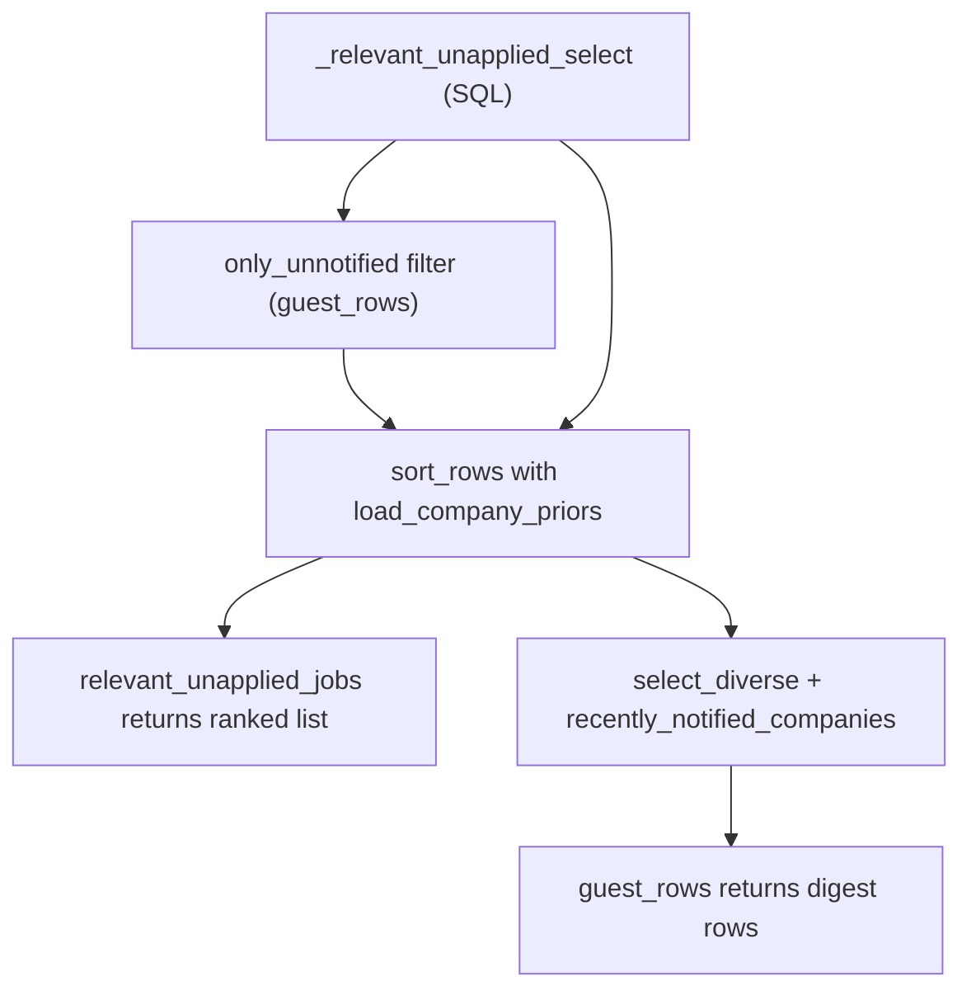

# Contacts and digest queries (`db/contacts.py`, `db/digest_queries.py`)

- **Source**: `src/jobdigest/db/contacts.py` (113 lines), `src/jobdigest/db/digest_queries.py` (198 lines)
- **Layer**: persistence. `contacts.py` writes/reads the `contacts` table; `digest_queries.py` holds the read queries that decide which scored jobs may be shown.
- **Depends on**: `contacts.py`: `schema.CONTACT_SOURCES`, `normalize.collapse_ws/normalize_company`. `digest_queries.py`: `jobdigest.rank` (`PRIOR_POSITIVE`, `select_diverse`, `sort_rows`), `jobdigest.config.Profile`, `normalize.normalize_company`, lazily `jobdigest.followups` (`ist_date`, `parse_iso`).
- **Used by**: contacts: `contacts/run.py:47` and `bot.py:224` (`upsert_contact`), `bot.py:253/260` (`contacts_for_job`, `best_contact_for_job`). Digest queries: `digest.py` (`guest_rows` at 312, `relevant_unapplied_jobs` at 237, `urgent_sent_count` at 231), `sheet.py:365` (`relevant_unapplied_jobs`).
- **Tests**: contacts: `tests/test_db_contacts.py`. Digest queries: `tests/test_priors.py` (priors gate, `guest_rows`, `relevant_unapplied_jobs`), `tests/test_content_hash.py::test_guest_rows_skips_stale_relevant`, `tests/test_tombstone.py::test_tombstoned_job_leaves_guest_rows`, `tests/test_legitimacy.py`, `tests/test_urgent.py`, `tests/test_digest.py`.

# Part 1: contacts

## Why this exists

The contacts stage finds a recruiter or hiring-manager name and possibly an email for a job (from the JD text, GitHub, or an email-pattern guess; see [../contacts/overview.md](../contacts/overview.md)). `contacts` stores them; the bot's "mail" action picks the best one.

## `upsert_contact`
**Location** `src/jobdigest/db/contacts.py:9`
**Signature**
```python
def upsert_contact(conn: Conn, *, job_id: int | None, company: str, name: str, source: str,
                   email: str | None = None, role: str | None = None, domain: str | None = None,
                   confidence: float | None = None) -> tuple[str, int | None]
```
**Purpose**: store a contact once per `(job_id, name, source)` and merge repeated finds without losing better data.
**Called by** `contacts/run.py:47`, `bot.py:224`. **Calls** `collapse_ws`, `normalize_company`, `transaction`.
**Returns** `("skip", None)`, `("update", id)`, `("insert", id)`.
1. Validation, each returning `("skip", None)`: `source.strip()` not in `CONTACT_SOURCES` (`jd, github, pattern`); `name_s = collapse_ws(name)` empty; `job_id is None`.
2. Normalize: `company_s = normalize_company(company) or collapse_ws(company)`, falling back to `"unknown"` if still empty; `email_s = collapse_ws(email).lower() or None`; `role_s = collapse_ws(role) or None`; `domain_s = collapse_ws(domain).lower() or None`; `conf = float(confidence)` or `None`.
3. `existing = SELECT id, confidence, email, role, domain FROM contacts WHERE job_id = ? AND name = ? AND source = ?` (outside the transaction).
4. In `transaction`, **existing row**: keep the higher confidence (`keep_conf` starts as the new `conf`; if the old value parses as float and the new is `None` or smaller, the old wins; an unparseable old value is ignored); blank new `email/role/domain` fall back to the stored values (new non-blank values overwrite). `UPDATE contacts SET company = ?, domain = ?, email = ?, role = ?, confidence = ? WHERE id = ?`; return `("update", cid)`. `verified` and `created_at` are untouched.
5. Otherwise `INSERT INTO contacts (job_id, company, domain, name, email, role, source, verified, confidence, created_at) VALUES (..., 'unverified', ?, ?)` with `now()`; return `("insert", int(cur.lastrowid))`.
Tests: `test_upsert_contact_insert`, `_dedup_same_job_name_source`, `_keeps_higher_confidence_on_conflict`, `_skips_blank_name`, `_skips_invalid_source`.

## `contacts_for_job`
**Location** `src/jobdigest/db/contacts.py:93` · `SELECT * FROM contacts WHERE job_id = ?` ordered by, in priority: has non-empty email first; source rank `jd` (0) < `github` (1) < others (2); non-NULL confidence before NULL; `confidence DESC`; `created_at DESC`; `id DESC`. So a verified-looking email from the JD beats a guessed pattern address. Test: `test_contacts_for_job_and_best_contact`.

## `best_contact_for_job`
`contacts.py:111`: `rows = contacts_for_job(conn, job_id)`; return `rows[0]` or `None`. Test: `test_best_contact_prefers_email_then_jd_source`.

---

# Part 2: digest queries

## Why this exists

The digest must show only jobs that are scored relevant under the **current** model and prompt version, not stale, active, hard-passed, canonical, not yet applied/hidden/saved, and not already sent. `digest_queries.py` builds that candidate set in SQL, ranks it in Python (`rank.sort_rows`), and for digests applies per-company diversity (`rank.select_diverse`). Ranking and quality formulas are documented in [../ranking/rank-and-selection.md](../ranking/rank-and-selection.md); this page documents only the data access.

## Public interface at a glance

| Symbol | Signature | Purpose |
|---|---|---|
| `MIN_OUTCOMES` | `20` | minimum outcome rows before priors apply |
| `OUTCOME` | frozenset `{oa, interview, offer, rejected, ghosted}` | statuses counted as outcomes |
| `load_company_priors` | `(conn) -> dict[str, float]` | company bonus map |
| `recently_notified_companies` | `(conn, now, days) -> set[str]` | cooldown input |
| `guest_rows` | `(conn, model, prompt_version, digest_max, *, profile, now=None) -> list[RowLike]` | rows for the digest |
| `relevant_unapplied_jobs` | `(conn, model, prompt_version, *, profile, now=None) -> list[RowLike]` | all ranked candidates (incl. notified) |
| `urgent_sent_count` | `(conn, now) -> int` | urgent sends today (IST) |

## `_relevant_unapplied_select`
**Location** `src/jobdigest/db/digest_queries.py:16` · **Signature** `def _relevant_unapplied_select(conn, model: str, prompt_version: str) -> list[RowLike]`
**Purpose**: the single SQL candidate query shared by `guest_rows` and `relevant_unapplied_jobs`. **Called by** `_ranked_candidates`.
```sql
SELECT jobs.*, scores.score AS score, scores.reasons_json AS reasons_json,
       companies.display_name AS display_name
FROM jobs JOIN scores ON scores.job_id = jobs.id
LEFT JOIN companies ON companies.id = jobs.company_id
WHERE jobs.hard_status = 'pass' AND jobs.is_active = 1 AND jobs.canonical_job_id IS NULL
  AND scores.relevant = 1 AND scores.stale = 0 AND scores.model = ? AND scores.prompt_version = ?
  AND NOT EXISTS (SELECT 1 FROM applications WHERE applications.apply_url_norm = jobs.apply_url_norm)
  AND NOT EXISTS (SELECT 1 FROM applications a JOIN jobs j2 ON j2.apply_url_norm = a.apply_url_norm
                  WHERE jobs.posting_key IS NOT NULL AND jobs.posting_key != ''
                    AND j2.posting_key = jobs.posting_key)
```
Predicate by predicate: passes the hard filter; not tombstoned; is the canonical copy; the LLM marked it relevant with a non-stale score for exactly this model/prompt version (INNER JOIN, so unscored jobs are absent); the job's URL has no application of any status; and no sibling posting (same `posting_key`) has an application. Result rows are `jobs.*` plus `score`, `reasons_json`, `display_name`. Returns all matches, unsorted. Verified offline: with one scored job the query returned 1 row; after `apply_bot_status(..., "applied")` it returned 0.

## `_row_notified_at`, `_company_key`
`_row_notified_at(row)` (`digest_queries.py:51`): `row["notified_at"]` or `None` on `KeyError/IndexError/TypeError`. `_company_key(name)` (`:59`): `normalize_company(name).casefold()`, so "Acme Pvt Ltd" and "ACME" collide.

## `load_company_priors`
**Location** `src/jobdigest/db/digest_queries.py:63` · `def load_company_priors(conn: Conn) -> dict[str, float]`
**Purpose**: a small learning signal. Companies that previously advanced the user (online assessment, interview, offer) get a bonus in ranking.
**Called by** `_ranked_candidates`. Constants: `MIN_OUTCOMES = 20`, `OUTCOME`, `_PRIOR_POSITIVE_STATUSES = {oa, interview, offer}`; bonus value `rank.PRIOR_POSITIVE` (5.0).
1. Query every application whose status is in `('oa','interview','offer','rejected','ghosted')` with `LEFT JOIN jobs` (via `job_id`) and `LEFT JOIN companies` (via `jobs.company_id`), selecting `status, app_company, job_id, job_company, company_id, display_name`.
2. **Gate**: `if len(rows) < MIN_OUTCOMES: return {}`. With fewer than 20 outcomes the statistics are meaningless, so no bonus at all (`test_load_company_priors_gate_below_20_is_empty`, `..._at_20_enables_bonus`).
3. For each row: `status` lowercased; skip if not in `OUTCOME` (defensive). Key choice: if the application has a `job_id` and the job has a company, `key = _company_key(job_company)`, else `_company_key(app_company)`. Keys list starts with that key; if the job belongs to a board (`company_id` not NULL), also the normalized `display_name` key (so a board's display name and a portal's spelling both match).
4. Rows with status not in `{oa, interview, offer}` (rejected/ghosted) are `continue`d: they count toward the gate but add no bonus (`test_company_prior_rejected_ghosted_are_zero_v1`). Positive rows add all their keys to `positive_keys`.
5. Return `{key: float(PRIOR_POSITIVE) for key in positive_keys}`. Interview and offer do not stack (a set) (`test_company_prior_interview_and_offer_do_not_stack`).
Shape example: `{"acme": 5.0}`. Offline with no applications it returned `{}`.

## `recently_notified_companies`
**Location** `src/jobdigest/db/digest_queries.py:106` · `def recently_notified_companies(conn, now: datetime, days: int) -> set[str]`
`days <= 0` -> empty set (cooldown disabled). `cutoff = (now - timedelta(days=int(days))).isoformat()`; `SELECT DISTINCT company FROM jobs WHERE notified_at IS NOT NULL AND notified_at >= ? AND company IS NOT NULL AND company != ''`; return the set of raw company strings. The comparison is a **string** comparison between `notified_at` (`...Z` format) and an `isoformat()` with `+00:00` offset; the shared `YYYY-MM-DDTHH:MM:SS` prefix keeps the ordering correct to the second, which is all that matters for a day-scale window. `now` must be timezone-aware UTC for the cutoff to be meaningful. Not re-exported from `jobdigest.db`; import from `db.digest_queries`. Verified: after stamping a job, it returned `{'Acme'}`.

## `_ranked_candidates`
**Location** `src/jobdigest/db/digest_queries.py:124` · `def _ranked_candidates(conn, model, prompt_version, *, profile, now, only_unnotified) -> list[RowLike]`
1. `when = now or datetime.now(timezone.utc)`.
2. `rows = _relevant_unapplied_select(conn, model, prompt_version)`.
3. If `only_unnotified`: keep rows whose `notified_at` is blank (`not str(_row_notified_at(r) or "").strip()`).
4. Return `sort_rows(rows, home=profile.location, relocate=profile.relocate, now=when, priors=load_company_priors(conn), profile=profile)`, best first.

## `guest_rows`
**Location** `src/jobdigest/db/digest_queries.py:147` · **Signature** `def guest_rows(conn, model: str, prompt_version: str, digest_max: int, *, profile: Profile, now: datetime | None = None) -> list[RowLike]`
**Purpose**: the final list of jobs for the digest message. **Called by** `digest._run_digest` (`digest.py:312`), passing `profile.digest_max`.
1. `when = now or datetime.now(timezone.utc)`.
2. `ranked = _ranked_candidates(..., only_unnotified=True)`: jobs already sent (digest or urgent) are never repeated.
3. `recent = recently_notified_companies(conn, when, profile.digest_company_cooldown_days)`.
4. `return select_diverse(ranked, digest_max, profile=profile, now=when, recent_companies=recent)`.
How `select_diverse` is invoked and what it does (`rank.py:231`): it walks the ranked rows in order and stops at `limit`; skips rows older than `profile.digest_max_age_days`; skips rows whose `quality_score` is below `profile.digest_min_quality`; for portal-like rows (`ats` in `portal, rss, marketplace`) caps per source at `digest_per_portal`; for company rows caps at `digest_per_company` and skips a company in cooldown unless quality reaches `COOLDOWN_BYPASS_QUALITY`. It returns fewer rows rather than padding. Offline example: one job scored 95.0 was returned by `guest_rows` (default profile example config), the same job scored 9.0 was not (below the quality bar). After `stamp_notified` the result was empty.

## `relevant_unapplied_jobs`
**Location** `src/jobdigest/db/digest_queries.py:168` · `_ranked_candidates(..., only_unnotified=False)`: same candidates and ranking but **including** already-notified jobs, and no diversity/cooldown selection. **Called by** `digest.maybe_send_urgent` (`digest.py:237`, which then applies its own notified/lookback/score filters) and `sheet.py:365` (sheet export). Verified: after the job was stamped, `guest_rows` returned 0 while `relevant_unapplied_jobs` still returned 1 (`test_relevant_unapplied_jobs_uses_same_prior_as_guest_rows`).

## `urgent_sent_count`
**Location** `src/jobdigest/db/digest_queries.py:181` · `def urgent_sent_count(conn: Conn, now: datetime) -> int`
Counts urgent sends on the current **IST** calendar date (the daily cap is per IST day).
1. Lazy import `ist_date, parse_iso` from `jobdigest.followups`.
2. `day = ist_date(now)`.
3. `SELECT notified_at FROM jobs WHERE notify_kind = 'urgent' AND notified_at IS NOT NULL`.
4. For each row `dt = parse_iso(row["notified_at"])`; count when `dt is not None and ist_date(dt) == day`.
Filtering is done in Python because SQL cannot convert to IST portably; it scans every urgent-notified job ever (small table). **Called by** `digest.maybe_send_urgent` (`digest.py:231`) to compute `budget = urgent_daily_cap - already`.



Both public entry points share the same SQL and ranking; `guest_rows` adds the unnotified filter and the diversity/cooldown pass.

## Failure modes and edge cases

- Changing `score_model` or `score_prompt_version` makes every old score invisible here until `score` re-runs (INNER JOIN on the exact pair).
- `recently_notified_companies` compares raw `jobs.company`; `select_diverse` aliases/normalizes keys itself.
- Priors depend on `applications.company`/`jobs.company` spelling; a portal row without a company id relies on `jobs.company` (`test_portal_job_without_company_id_still_matches_on_jobs_company`).
- `contacts.upsert_contact` requires `job_id`; a contact for a job not in `jobs` raises a FK error because `PRAGMA foreign_keys = ON`.

## How to modify / extend safely

Keep the SQL in `_relevant_unapplied_select` and `runs.unscored_pass_jobs` consistent. To add a new exclusion (for example a user blocklist), add it to the SQL once and both `guest_rows` and `relevant_unapplied_jobs` inherit it. New contact sources need an entry in `schema.CONTACT_SOURCES` **and** the table CHECK (plus a rebuild migration).
