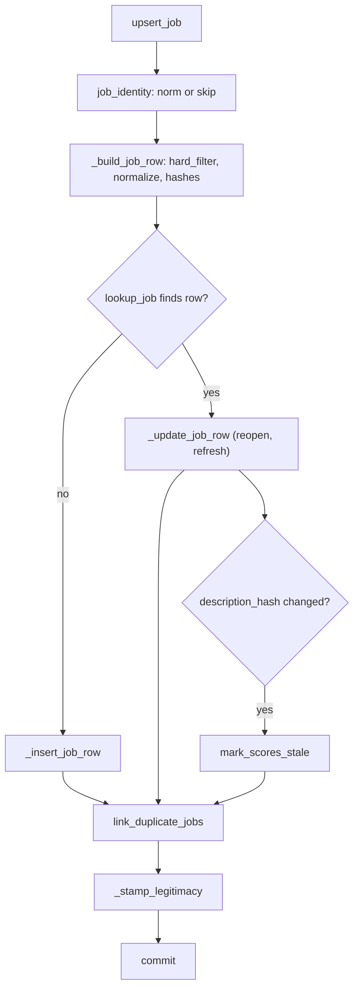

# Jobs and companies (`db/jobs.py`)

- **Source**: `src/jobdigest/db/jobs.py` (581 lines)
- **Layer**: persistence; this is where collected postings become rows and where duplicate, staleness, legitimacy and tombstone state is maintained.
- **Depends on**: `jobdigest.normalize` (`job_identity`, `normalize_title`, `normalize_company`, `description_hash`, `posting_key`, `collapse_ws`), `jobdigest.hard_filter.hard_filter`, `jobdigest.legitimacy.evaluate_structural`, `jobdigest.ats.base.KNOWN_ATS`, `jobdigest.config.Profile`, `db._common` (`now`, `row_get`), `db.connection.transaction`.
- **Used by**: `collect.py` (`upsert_company`, `update_company_fetch`, `upsert_job`, `bump_unseen_for_source`, `job_seen_key`, `job_hard_status`), `digest.py` (`stamp_notified`). `note_seen_job` and `lookup_job`/`link_duplicate_jobs`/`mark_scores_stale` are called outside `db/` only by tests.
- **Tests**: `tests/test_db_upsert.py`, `test_db_internals.py` (`test_upsert_job_single_commit`), `test_tombstone.py`, `test_dual_hash.py`, `test_content_hash.py`, `test_legitimacy.py`, `test_urgent.py` (`stamp_notified`), `test_collect.py`.

## Why this exists

The collector hands in raw postings from many sources: official ATS boards (Greenhouse, Lever, ...), job portals, RSS feeds, marketplaces. The same posting can arrive repeatedly (each run), under tracking-parameter URL variants, and from several sources simultaneously (the company's own ATS **and** a portal that scraped it). `jobs.py` provides one idempotent entry point, `upsert_job`, that:

1. decides the row's **identity** (so reruns update instead of duplicate),
2. applies the **hard filter** (a regex gate on title, location, JD) and normalizes company/title,
3. links **cross-source duplicates** (`posting_key` / `canonical_job_id`),
4. detects **changed descriptions** and marks LLM scores stale,
5. stamps a **legitimacy** flag,
6. and, separately, sweeps jobs that have vanished from a board (**tombstones**).

## Public interface at a glance

| Symbol | Signature (abridged) | Purpose |
|---|---|---|
| `upsert_company` | `(conn, slug, display_name, ats, board_token, enabled) -> int` | insert/update `companies` row by slug |
| `update_company_fetch` | `(conn, company_id, *, http_status, job_count, error, resolved_url=None, dead_streak=None)` | record fetch outcome |
| `lookup_job` | `(conn, apply_url_norm, source, external_id) -> int \| None` | find existing job id |
| `link_duplicate_jobs` | `(conn, job_id) -> None` | pick canonical row among same `posting_key` |
| `mark_scores_stale` | `(conn, job_id) -> None` | `scores.stale = 1` for the job |
| `upsert_job` | `(conn, profile, *, apply_url, hosted_url, source, external_id, company_id, company, title, location_raw, description_text, raw_json, ats, employment_hint=None, workplace_hint=None, posted_at=None) -> tuple[str, int \| None]` | insert or update a job |
| `job_seen_key` | `(*, external_id, apply_url_norm) -> str \| None` | key used by the tombstone sweep |
| `note_seen_job` | `(conn, job_id) -> None` | reset tombstone fields |
| `bump_unseen_for_source` | `(conn, source, seen_keys, *, success) -> dict[str,int]` | miss counting and tombstoning |
| `job_hard_status` | `(conn, job_id) -> str` | hard status or `"pending"` |
| `stamp_notified` | `(conn, job_id, kind) -> None` | record that a job was sent |

## Key concepts

- **Identity**: a job's identity is `apply_url_norm` (normalized URL, or `ats://<source>/<external_id>` for URL-less jobs) and, secondarily, `(source, external_id)`. Both are UNIQUE in the schema (see [schema-and-migrations.md](schema-and-migrations.md)). Normalization (`normalize_url`, `job_identity`) is documented in [../foundation/normalize.md](../foundation/normalize.md).
- **Tombstone**: instead of deleting a job that disappeared, the row is kept with `is_active = 0`, `closed_at`, `close_reason`. This preserves history (applications, scores) and lets a returning posting be "reopened" by the next upsert. A "miss" is only counted when the whole board was fetched successfully and did not list the job, and two consecutive misses are required to avoid reacting to one flaky fetch.
- **Canonical job / alias**: among rows sharing a `posting_key`, one is the winner (`canonical_job_id IS NULL`); the rest point at it. Only canonical rows are scored and shown.
- **Hard filter**: `hard_filter(profile, ...)` returns `(hard_status, hard_reason)`, `pass|reject`; see [../filtering/hard-filter.md](../filtering/hard-filter.md).

## Detailed walkthrough

### `upsert_company`
**Location** `src/jobdigest/db/jobs.py:29` · **Signature** `def upsert_company(conn, slug, display_name, ats, board_token, enabled) -> int`
**Called by** `collect.py` (around line 389) once per board. **Calls** `transaction`.
1. `SELECT id FROM companies WHERE slug = ?` (outside the transaction).
2. `flag = 1 if enabled else 0`.
3. Inside `with transaction(conn)`: if the row exists, `UPDATE companies SET display_name = ?, ats = ?, board_token = ?, enabled = ? WHERE id = ?` and `return int(row["id"])` (the `with` still commits on `return`). Otherwise `INSERT INTO companies (slug, display_name, ats, board_token, enabled) VALUES (?, ?, ?, ?, ?)`.
4. Return `int(cur.lastrowid)` (on Postgres via `RETURNING id`).
The fetch-status columns are not touched here; they belong to `update_company_fetch`. Sample run: `upsert_company(conn, "acme", "Acme Pvt Ltd", "greenhouse", "acme", True)` returned `1`. A race between the SELECT and INSERT would raise on the UNIQUE slug; the pipeline is single-writer so this is not guarded.

### `update_company_fetch`
**Location** `src/jobdigest/db/jobs.py:60`
Builds an UPDATE incrementally: always `last_fetch_at = now()`, `last_http_status`, `last_job_count`, `last_error`; appends `resolved_url = ?` only if the argument is not `None`, and `dead_streak = ?` (cast to `int`) only if not `None`. So passing `None` leaves those columns unchanged rather than nulling them, while `error=None` does clear `last_error`. Executed in one `transaction`. Column names are fixed literals, only values are bound. **Called by** `collect.py` (around line 302), which computes `dead_streak` with `_dead_streak`.

### Small helpers

**`_sanitize_hint`** (`jobs.py:94`): `" ".join(str(value).split())` collapses all whitespace, returns `None` for `None` or empty, else truncates to `_HINT_MAX = 80` characters. Test: `test_upsert_caps_hint_at_80_chars`.

**`_store_posted_at`** (`jobs.py:103`): `None` -> `None`; a `datetime` -> naive values assumed UTC, converted to UTC, microseconds dropped, formatted `...Z`; anything else -> `str(value).strip()` or `None` if empty. Strings are stored as given (not parsed).

**`_ats_rank`** (`jobs.py:137`): `0` if `ats.strip().lower()` is in `KNOWN_ATS` (`greenhouse, lever, ashby, workable, smartrecruiters, bamboohr`), else `1`. Lower rank wins as canonical.

**`mark_scores_stale`** (`jobs.py:196`): `UPDATE scores SET stale = 1 WHERE job_id = ?` (all models and prompt versions). No transaction of its own; it runs inside `upsert_job`'s.

**`_company_display_name`** (`jobs.py:200`): stripped `companies.display_name` or `None`; see [`_company_display_name`](#_company_display_name).

**`job_hard_status`** (`jobs.py:561`): `SELECT hard_status FROM jobs WHERE id = ?`; `"pending"` if no row. Used by `collect._hard_row` as a fallback.

**`_stored_description_hash`** (`jobs.py:386`): returns the current `description_hash` of a job or `""` if no row/NULL.

### `lookup_job`
**Location** `src/jobdigest/db/jobs.py:114` · **Signature** `def lookup_job(conn, apply_url_norm, source, external_id) -> int | None`
**Called by** `upsert_job`.
1. `SELECT id FROM jobs WHERE apply_url_norm = ?`; if found return it.
2. `ext = (external_id or "").strip()`. If non-empty: `SELECT id FROM jobs WHERE source = ? AND external_id = ?`; return if found.
3. Else `None`.
Why two keys: the same ATS posting can change URL (query string, domain alias) but keeps its id; and the `jobs_source_ext` unique index would otherwise make the INSERT fail. Empty ids are never matched (mirrors the partial index).

### `link_duplicate_jobs`
**Location** `src/jobdigest/db/jobs.py:141` · **Signature** `def link_duplicate_jobs(conn: Conn, job_id: int) -> None`
**Purpose**: keep exactly one visible representative for each real-world posting that arrived from several sources, preferring the company's own ATS.
**Called by** `_post_process_job`. **Calls** `_ats_rank`, `row_get`.
1. `SELECT posting_key FROM jobs WHERE id = ?`; return if the row is missing.
2. `key = str(row_get(row, "posting_key", "") or "").strip()`; return if empty (a job whose title or company was empty has `posting_key` NULL and is never linked).
3. `SELECT id, ats, notified_at, notify_kind FROM jobs WHERE posting_key = ?`: every row in the group, **including inactive and alias rows**.
4. If fewer than 2 rows: `UPDATE jobs SET canonical_job_id = NULL WHERE id = ?` (the job is alone, so it is canonical, which also clears a stale alias pointer) and return.
5. `ranked = sorted(rows, key=lambda r: (_ats_rank(r["ats"]), int(r["id"])))`; `winner_id = ranked[0]["id"]`: known-ATS rows beat portal/feed rows, ties go to the lowest id (oldest).
6. **Notification inheritance**: `notify_at`/`notify_kind` start as the winner's; if the winner's `notified_at` is blank, scan `rows` in query order and take the first row that has one. Rationale: if the portal alias was already sent to Telegram and the ATS version arrives later and wins, the winner must not be sent again.
7. `UPDATE jobs SET canonical_job_id = NULL, notified_at = ?, notify_kind = ? WHERE id = ?` on the winner.
8. For every other row: `UPDATE jobs SET canonical_job_id = ? WHERE id = ?` with the winner id.
Verified by running: an ATS (greenhouse) row id 1 and a portal row id 2 with the same normalized title/company/location gave `canonical_job_id = None` for 1 and `1` for 2, regardless of insert order (`test_ats_wins_even_if_portal_inserted_first`).
Edge cases visible in the code: (a) inactive rows take part in ranking, so a tombstoned ATS winner keeps hiding its portal alias; (b) if a job's `posting_key` changes (title or location edited), rows still pointing at it from the old group are not re-evaluated; (c) alias rows keep their own `notified_at`.

### `_company_display_name`

**Location** `src/jobdigest/db/jobs.py:200` · **Signature** `def _company_display_name(conn: Conn, company_id: int | None) -> str | None`
**Purpose** Fetches the human-readable board name (`companies.display_name`, from `companies.yaml`) for a job's `company_id`, so the legitimacy check can compare it with the company name printed on the posting.
**Called by** `_stamp_legitimacy` (`jobs.py:264`), which passes it as `company_display_name=` to `legitimacy.evaluate_structural`. There the name is normalized and compared with the job's `raw_company`/`company` to raise the `company_mismatch` code, only when the job has a `company_id` (`legitimacy.py:141-150`). **Calls** `conn.execute`, `row_get`.
**Returns** the stripped name, or `None` for a falsy `company_id` (`None` or `0`), an unknown id, or a blank/NULL name.
**Step by step**
1. `if not company_id: return None`: jobs from portals/feeds/marketplaces have no company row.
2. `SELECT display_name FROM companies WHERE id = ?` with `int(company_id)`; `row is None` -> `None`.
3. `text = str(row_get(row, "display_name") or "").strip()`; `return text or None`, so whitespace-only names count as absent (and `evaluate_structural` then skips the mismatch test, because it requires both names non-empty).
Verified against a scratch SQLite DB: `display_name = '  Acme Inc '` -> `'Acme Inc'`; `'   '` and `''` -> `None`; `None`, `0` and a non-existent id `999` -> `None`.

### `_legitimacy_peers`
**Location** `src/jobdigest/db/jobs.py:213`: returns `[]` if `desc_hash` is empty; else selects `id, description_hash, source, external_id, apply_url_norm, canonical_job_id, description_text FROM jobs WHERE description_hash = ? AND id != ?` and builds dicts with the same keys plus `description_len = len(collapse_ws(description_text))` (instead of the full text). Used for repost detection in `evaluate_structural`.

### `_stamp_legitimacy`
**Location** `src/jobdigest/db/jobs.py:242` · **Signature** `def _stamp_legitimacy(conn: Conn, job_id: int) -> None`
1. `SELECT * FROM jobs WHERE id = ?`; return if missing. Reading the row **after** insert/update and after `link_duplicate_jobs` means it sees the current `canonical_job_id`.
2. Builds a plain `dict` `job` with the keys `company_id, raw_company, company, description_text, description_hash, source, external_id, apply_url_norm, canonical_job_id, hard_status, title, location_raw`.
3. `flag, codes = evaluate_structural(job, company_display_name=_company_display_name(conn, company_id), peers=_legitimacy_peers(conn, job_id, desc_hash))`.
4. `UPDATE jobs SET legitimacy_flag = ?, legitimacy_reasons_json = ? WHERE id = ?` with `json.dumps(codes, separators=(",", ":"))`.
`evaluate_structural` (see [../filtering/legitimacy.md](../filtering/legitimacy.md)) returns `("suspect", codes)` when any of `company_mismatch`, `no_responsibilities`, `us_lang_india_co`, `jd_repost` fires, else `("ok", [])`. Age-based codes are computed elsewhere at read time (`age_codes`), not stored. The stamp does not change `hard_status` or scores.

### `_JobRow`
**Location** `src/jobdigest/db/jobs.py:281` (dataclass at 280) · frozen dataclass holding the final column values for one job, so INSERT and UPDATE use the same data. Fields: `apply_url, apply_url_norm, source, external_id, company_id, company, title, location_raw, description_text, raw_json, hard_status, hard_reason, ats, employment_hint, workplace_hint, description_hash, raw_title, raw_company, posting_key, posted_at`. `posting_key` is annotated `str` but `normalize.posting_key` can return `None` (when the normalized title or company is empty); `None` is then written to the nullable column.

`_SHARED_COLUMNS` (`jobs.py:307`) lists the 18 columns written by both INSERT and UPDATE, in fixed order: `apply_url, title, location_raw, description_text, raw_json, hard_status, hard_reason, company, company_id, ats, external_id, employment_hint, workplace_hint, description_hash, raw_title, raw_company, posting_key, posted_at`. `_INSERT_ONLY_COLUMNS = ("apply_url_norm", "source")` (`jobs.py:327`): identity columns set only at insert. Therefore an existing job's `source` and `apply_url_norm` are frozen (`test_source_frozen_at_first_insert`), and `first_seen_at` is never rewritten.

### `_build_job_row`
**Location** `src/jobdigest/db/jobs.py:330` · **Signature** `def _build_job_row(profile: Profile, *, col_url, norm, source, external_id, company_id, company, title, location_raw, description_text, raw_json, ats, employment_hint, workplace_hint, posted_at) -> _JobRow`
**Purpose**: all pure computation (no DB access) for a job, isolated from SQL.
**Calls** `_sanitize_hint`, `hard_filter`, `normalize_title`, `normalize_company`, `description_hash`, `posting_key`, `_store_posted_at`.
1. Sanitize both hints.
2. `raw_title = (title or "").strip() or "(untitled)"`; `raw_company = (company or "").strip()`.
3. `status, reason = hard_filter(profile, title=raw_title, location_raw=location_raw, description_text=description_text, employment_hint=employment_hint, company=raw_company)`: the filter sees the **raw** title/company, not the normalized ones.
4. `job_title = normalize_title(raw_title) or "(untitled)"` (strips city suffixes, years, "campus"); `job_company = normalize_company(raw_company) if raw_company else raw_company` (strips legal suffixes like `Pvt Ltd`, `Inc`).
5. Build `_JobRow` with `external_id=(external_id or "").strip() or None`, `description_hash=description_hash(description_text)` (sha256 of whitespace-collapsed text), `posting_key=posting_key(job_title, job_company, location_raw or "")`, `posted_at=_store_posted_at(posted_at)`.
Example (run offline): title `"Software Engineer Intern (Pune) 2026"`, company `"Acme Pvt Ltd"` stored as title `Software Engineer Intern`, company `Acme`, `hard_status='pass'`, `hard_reason='ok'`.

### `_update_job_row`
**Location** `src/jobdigest/db/jobs.py:396`: builds `assignments = ", ".join(f"{col} = ?" for col in _SHARED_COLUMNS)` and executes

```python
f"""UPDATE jobs SET {assignments},
    last_seen_at = ?, is_active = 1, miss_count = 0,
    closed_at = NULL, close_reason = NULL
  WHERE id = ?"""
```
with the row's values in `_SHARED_COLUMNS` order, then `seen_at`, then `job_id`. Beyond refreshing every shared column it **reopens** a tombstoned job (`is_active = 1`, `miss_count = 0`, tombstone fields cleared) and re-evaluates `hard_status`/`hard_reason` (so edits to the profile or the JD can flip a job between `pass` and `reject` on the next run). Column names come from a module constant, values are bound.

### `_insert_job_row`
**Location** `src/jobdigest/db/jobs.py:413`: `cols = _INSERT_ONLY_COLUMNS + _SHARED_COLUMNS`; statement `INSERT INTO jobs (apply_url_norm, source, <shared...>, first_seen_at, last_seen_at, is_active, miss_count) VALUES (?, ... , ?, ?, 1, 0)` with `first_seen_at = last_seen_at = seen_at`. Returns `int(cur.lastrowid)`.

### `_post_process_job`
`jobs.py:424`: `link_duplicate_jobs(conn, job_id)` then `_stamp_legitimacy(conn, job_id)`. The order matters: legitimacy needs the up-to-date `canonical_job_id` to avoid calling a legitimate alias a "repost" (`test_dual_hash_alias_is_not_jd_repost`).

### `upsert_job`
**Location** `src/jobdigest/db/jobs.py:429`
**Signature**
```python
def upsert_job(conn: Conn, profile: Profile, *, apply_url: str, hosted_url: str, source: str,
               external_id: str, company_id: int | None, company: str, title: str,
               location_raw: str, description_text: str, raw_json: str, ats: str,
               employment_hint: str | None = None, workplace_hint: str | None = None,
               posted_at: datetime | str | None = None) -> tuple[str, int | None]
```
**Purpose / why**: the single write path for postings. It is idempotent: calling it again with the same job updates `last_seen_at` and recomputed fields instead of duplicating. Everything for one job (row + duplicate link + legitimacy) is one transaction.
**Called by** `collect._upsert_jobs` (`collect.py:189`), which counts `insert`/`update`/`skip` into run stats and then reads back `hard_status` with `_hard_row`. **Calls** `job_identity`, `_build_job_row`, `now`, `transaction`, `lookup_job`, `_insert_job_row`, `_stored_description_hash`, `_update_job_row`, `mark_scores_stale`, `_post_process_job`.

**Parameters**
| Name | Type | Default | Meaning |
|---|---|---|---|
| `profile` | `Profile` | - | passed to `hard_filter` |
| `apply_url` | `str` | - | direct apply link (preferred) |
| `hosted_url` | `str` | - | listing page, used when `apply_url` is blank |
| `source` | `str` | - | lane name; with `external_id` forms the synthetic key |
| `external_id` | `str` | - | provider job id (blank allowed) |
| `company_id` | `int \| None` | - | `companies.id` for ATS boards, else `None` |
| `company`, `title`, `location_raw`, `description_text`, `raw_json`, `ats` | `str` | - | content columns |
| `employment_hint`, `workplace_hint` | `str \| None` | `None` | ATS hints (sanitized) |
| `posted_at` | `datetime \| str \| None` | `None` | provider posting date |

**Returns** `("skip", None)` when no identity can be built; `("insert", new_id)`; `("update", existing_id)`.

**Step-by-step**
1. `col_url, norm = job_identity(apply_url, hosted_url, source, external_id)`. `job_identity` takes `apply_url` or else `hosted_url`; if it starts with http(s) it returns `(candidate, normalize_url(candidate))`; if not but both `source` and `external_id` are non-blank, `(None, "ats://<source>/<external_id>")`; otherwise `(None, None)`.
2. `if norm is None: return "skip", None`. Verified: a URL-less job with empty external id is skipped, while `source="lever", external_id="abc"` gives `apply_url NULL`, `apply_url_norm 'ats://lever/abc'`.
3. `row = _build_job_row(...)`: pure computation as described above (hard filter, normalization, hashes). Done **before** opening the transaction so no lock is held while computing.
4. `seen_at = now()`.
5. `with transaction(conn):`
   1. `existing = lookup_job(conn, norm, source, external_id)`.
   2. **No existing row** -> `new_id = _insert_job_row(...)`, `_post_process_job(conn, new_id)`, `return "insert", new_id`.
   3. **Existing row**: `old_hash = _stored_description_hash(conn, existing)`; `_update_job_row(conn, existing, row, seen_at)`; then

   ```python
   if old_hash and old_hash != row.description_hash:
       mark_scores_stale(conn, existing)
   ```
   Only when a previous hash existed *and* differs. A job whose hash was previously empty/NULL (migrated before hashes existed) is not staled (`test_first_hash_populate_does_not_stale`); an unchanged JD does not stale (`test_upsert_unchanged_jd_does_not_stale`). Stale scores are excluded by `unscored_pass_jobs` (so the job is re-scored) and by the digest queries until re-scored (see [runs-scores-errors.md](runs-scores-errors.md)). Then `_post_process_job(conn, existing)` and `return "update", existing`.
6. Leaving the `with` (including through `return`) commits once; an exception rolls back everything for that job.

**SQL actually executed on an update** (SQLite flavour, generated): `SELECT id FROM jobs WHERE apply_url_norm = ?`, optionally `SELECT id FROM jobs WHERE source = ? AND external_id = ?`, `SELECT description_hash FROM jobs WHERE id = ?`, the `UPDATE jobs SET apply_url = ?, ... posted_at = ?, last_seen_at = ?, is_active = 1, miss_count = 0, closed_at = NULL, close_reason = NULL WHERE id = ?`, optionally `UPDATE scores SET stale = 1 WHERE job_id = ?`, then the `link_duplicate_jobs` selects/updates and the `_stamp_legitimacy` `SELECT *` + peers select + `UPDATE jobs SET legitimacy_flag = ?, legitimacy_reasons_json = ?`.

**Data flow**: raw posting fields -> `job_identity` (`col_url`, `norm`) -> `_JobRow` (filter verdict, normalized names, `description_hash`, `posting_key`) -> `lookup_job` -> INSERT or UPDATE of `jobs` (+ `scores.stale`) -> `canonical_job_id` and `notified_at` maintenance -> `legitimacy_*` columns -> `(action, id)`.

**Real run** (offline SQLite): 
```
upsert_job(... "https://boards.greenhouse.io/acme/jobs/1?utm_source=x", source="greenhouse", external_id="1") -> ('insert', 1)
upsert_job(... same job, URL without utm_source)                                                           -> ('update', 1)
upsert_job(... "https://portal.example.com/j/9", source="naukri", ats="portal", company="Acme")             -> ('insert', 2)
```
Row 2 ended with `canonical_job_id = 1` because it shares the same `posting_key` as row 1; both have `legitimacy_flag='ok'`.

**Edge cases and failure modes**
- A job found by `apply_url_norm` whose `external_id` collides with a *different* row under `jobs_source_ext` would make the UPDATE violate the unique index and raise `IntegrityError`; the transaction rolls back and the exception propagates to the collector. Not covered by a test that I found.
- `description_text` is compared by hash only; whitespace-only edits do not stale scores.
- On update, `company`/`title` are overwritten with the new normalized values, and `hard_status` may change even if the posting is otherwise unchanged.

**Plain-English summary**: normalize the posting, run the cheap regex gate, then insert it or refresh the existing row; if the text changed invalidate its LLM score; finally re-evaluate duplicate and legitimacy metadata, all in one commit.

### `job_seen_key`
**Location** `src/jobdigest/db/jobs.py:486` · `def job_seen_key(*, external_id, apply_url_norm) -> str | None`: returns the stripped `external_id` if non-empty, else the stripped `apply_url_norm` if non-empty, else `None`. This is the identity used by the sweep: the **same function** builds the keys of what was just fetched (`collect._seen_keys`) and of what is stored (`bump_unseen_for_source`), so they are comparable. Caveat visible in the code: for fetched jobs with an external id the key is the id alone (not namespaced by source); the sweep restricts stored rows to one `source`, so ids from different sources do not interfere.

### `note_seen_job`
`jobs.py:494`: `UPDATE jobs SET is_active = 1, miss_count = 0, closed_at = NULL, close_reason = NULL WHERE id = ?` in a transaction. Not called by production code (only by `tests/test_tombstone.py::test_note_seen_and_bump_unit`); `upsert_job` already performs the same reset.

### `bump_unseen_for_source`
**Location** `src/jobdigest/db/jobs.py:509` · **Signature** `def bump_unseen_for_source(conn, source: str, seen_keys: set[str] | frozenset[str], *, success: bool) -> dict[str, int]`
**Purpose**: after a board/feed/portal fetch finished *successfully*, count one miss against every active job of that source that was not in the fetched set; tombstone it on the second consecutive miss.
**Called by** `collect._sweep_source` (`collect.py:174`), which adds `missed` and `tombstoned` to the run stats.
1. `if not success: return {"missed": 0, "tombstoned": 0}`: failed, partial or dead-token fetches must never close jobs (`test_error_does_not_increment_miss`, `test_dead_token_does_not_increment_miss`, `test_incomplete_ok_does_not_sweep`).
2. `source_s = (source or "").strip()`; blank -> same zero result.
3. `SELECT id, external_id, apply_url_norm, miss_count FROM jobs WHERE source = ? AND is_active = 1` (uses `jobs_source_active`).
4. `missed = tombstoned = 0`; `stamp = now()`; `seen = set(seen_keys)`.
5. In one `transaction`: for each row compute `key = job_seen_key(external_id=row["external_id"], apply_url_norm=row["apply_url_norm"])`. If `key is None or key in seen`: `continue` (seen jobs are not touched here; their counter was already reset by `upsert_job`).
6. Otherwise `missed += 1`, `new_miss = int(row["miss_count"] or 0) + 1`.
   - `new_miss >= 2`: `UPDATE jobs SET miss_count = ?, is_active = 0, closed_at = ?, close_reason = ? WHERE id = ?` with reason `"unseen_board"`; `tombstoned += 1`.
   - else: `UPDATE jobs SET miss_count = ? WHERE id = ?`.
7. Return `{"missed": missed, "tombstoned": tombstoned}`.
Run offline: with an empty `seen_keys` and `success=True`, first call -> `{'missed': 1, 'tombstoned': 0}`, second -> `{'missed': 1, 'tombstoned': 1}`; the job then had `is_active 0, miss_count 2, close_reason 'unseen_board'`; a call with `success=False` returned zeros. Tombstoned jobs drop out of `guest_rows` because the digest queries require `is_active = 1` (`test_tombstoned_job_leaves_guest_rows`). A returning posting is reopened by the next `upsert_job` (`test_reopen_resets_miss_keeps_first_seen`).
Note: a whole-source query means an `ok` fetch that legitimately returned zero jobs closes everything after two runs (`test_empty_board_two_runs_closes`); the collector decides when a fetch counts as `success` (see [../collection/collect-orchestrator.md](../collection/collect-orchestrator.md)).

### `stamp_notified`
**Location** `src/jobdigest/db/jobs.py:571` · `def stamp_notified(conn, job_id: int, kind: str) -> None`
`_NOTIFY_KINDS = {"urgent", "digest"}` (`jobs.py:568`). `notify_kind = kind if kind in _NOTIFY_KINDS else "digest"` (unknown kinds silently become `digest`). Then in a transaction `UPDATE jobs SET notified_at = ?, notify_kind = ? WHERE id = ?` with `now()`. **Called by** `digest.py` after a successful urgent send (`digest.py:275`, kind `"urgent"`) and after a digest send (`digest.py:303`, kind `"digest"`). Effects: `guest_rows` excludes already-notified jobs; `recently_notified_companies` and `urgent_sent_count` read these columns; `link_duplicate_jobs` copies them to a new canonical winner.

## How it fits together



The branch on `lookup_job` separates the first sighting from every later one; both converge on duplicate linking and legitimacy stamping so those columns are always consistent with the row's current content.

## How to modify / extend safely

- New persisted attribute: add it to `schema.ADDED_COLUMNS["jobs"]`, to `_JobRow`, `_SHARED_COLUMNS` and compute it in `_build_job_row`. INSERT/UPDATE statements are generated from `_SHARED_COLUMNS`, so no SQL edit is needed.
- Anything computed in `_build_job_row` should stay free of DB access (it runs outside the transaction).
- If you change `posting_key` inputs (in `normalize.py`) existing rows keep old keys until re-upserted, and `link_duplicate_jobs` only re-groups the job being upserted.
