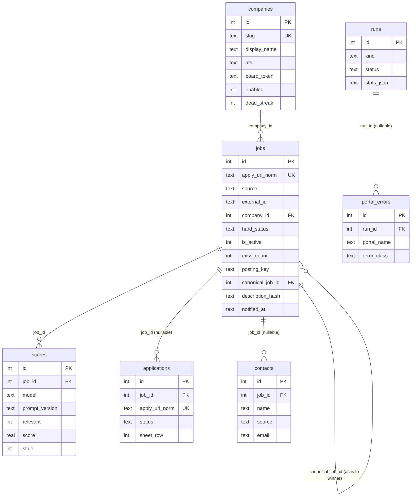
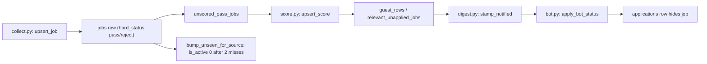

# Storage overview (`jobdigest.db`)

- **Source**: `src/jobdigest/db/` (9 files, 2,120 lines): `__init__.py` (129), `_common.py` (46), `connection.py` (226), `schema.py` (341), `jobs.py` (581), `runs.py` (197), `applications.py` (289), `contacts.py` (113), `digest_queries.py` (198).
- **Layer**: persistence. Every pipeline stage (collect, score, digest, bot, sheet, contacts, health) talks to the database only through this package.
- **Depends on**: `jobdigest.normalize`, `jobdigest.hard_filter`, `jobdigest.legitimacy`, `jobdigest.rank`, `jobdigest.config` (`Profile`), `jobdigest.ats.base` (`KNOWN_ATS`), `jobdigest.paths` (`repo_root`), lazily `jobdigest.followups` (`ist_date`, `parse_iso`).
- **Used by**: `collect.py`, `score.py`, `digest.py`, `bot.py`, `sheet.py`, `health.py`, `contacts/run.py` (all via `from jobdigest.db import ...`).
- **Tests**: `tests/test_db_upsert.py`, `test_db_internals.py`, `test_db_postgres.py`, `test_db_contacts.py`, `test_tombstone.py`, `test_dual_hash.py`, `test_content_hash.py`, `test_priors.py`, `test_legitimacy.py`; see each sub-page for specifics.

## Why this exists

jobdigest is a batch pipeline: a collector fetches thousands of postings, a scorer asks an LLM about the survivors, a digest picks a few and sends them to Telegram, and a bot records what the user did. All of that state lives in one relational database. The package hides two things from callers:

1. **Which engine is in use.** Locally and in tests the engine is SQLite (a single file, `data/jobs.db` by default). In CI/production it can be PostgreSQL when `DATABASE_URL` is set. Callers write SQLite-flavoured SQL with `?` placeholders and the package adapts it (see [connection-and-postgres-shim.md](connection-and-postgres-shim.md)).
2. **Schema evolution.** The `CREATE TABLE IF NOT EXISTS` statements plus a small additive migration step run on every `connect()` (see [schema-and-migrations.md](schema-and-migrations.md)).

There is no ORM. Rows come back as `sqlite3.Row` (SQLite) or `MappingRow` (Postgres); both support `row["col"]`.

## Module map

| File | Responsibility | Page |
|---|---|---|
| `connection.py` | `connect`, engine selection, `_PgConnection` shim, `transaction`, `safe_ident`, `table_columns` | [connection-and-postgres-shim.md](connection-and-postgres-shim.md) |
| `schema.py` | DDL for 7 tables, `ADDED_COLUMNS`, late indexes, migrations, `init_schema` | [schema-and-migrations.md](schema-and-migrations.md) |
| `_common.py` | `Conn`/`RowLike` aliases, `utc_now`/`now`, `row_get`, `norm_http_url` | [connection-and-postgres-shim.md](connection-and-postgres-shim.md#_commonpy-helpers) |
| `jobs.py` | companies and jobs: `upsert_job`, dedupe, legitimacy stamp, tombstones, notify stamp | [jobs.md](jobs.md) |
| `runs.py` | `runs`, `portal_errors`, `scores`, unscored queue | [runs-scores-errors.md](runs-scores-errors.md) |
| `applications.py` | `applications` table, bot status, sheet sync helpers | [applications.md](applications.md) |
| `contacts.py`, `digest_queries.py` | `contacts` table; read queries that feed the digest | [contacts-and-digest-queries.md](contacts-and-digest-queries.md) |

## Entity-relationship diagram

Verified against `src/jobdigest/db/schema.py` (`_COMPANIES`, `_JOBS`, `_SCORES`, `_RUNS`, `_PORTAL_ERRORS`, `_APPLICATIONS`, `_CONTACTS` plus `ADDED_COLUMNS`). Column-level detail is in [schema-and-migrations.md](schema-and-migrations.md).

Reading the diagram: `jobs` is the hub. `applications` links to a job by the nullable `job_id` **and** by the shared `apply_url_norm` text value (not a foreign key; this is how a job and an application are matched in the read queries, so an application can exist for a URL that was never collected). `jobs.canonical_job_id` is a self-reference: a duplicate posting ("alias") points at the winning row. `scores` has a composite uniqueness `(job_id, model, prompt_version)`, so one job can carry several score versions.

## Lifecycle of a job row through the package

Each arrow is one function in this package. The two exits from the digest pool are `applications` (user action) and the tombstone sweep (posting disappeared).

## Cross-cutting conventions

- **Timestamps** are ISO-8601 UTC strings with a trailing `Z`, second precision (`utc_now()` in `_common.py`), stored in `TEXT` columns. String comparison is therefore chronological, which several queries rely on (`notified_at >= ?`).
- **Booleans** are `INTEGER` 0/1 (`is_active`, `enabled`, `relevant`, `stale`).
- **JSON blobs** are `TEXT` (`raw_json`, `reasons_json`, `stats_json`, `legitimacy_reasons_json`), written with compact separators.
- **Transactions**: write helpers wrap their statements in `with transaction(conn):` so one logical unit is one commit. Reads before the `with` are outside the transaction (noted per function).
- **Patchable clock**: submodules call `now()` from `_common`, which re-resolves `jobdigest.db.utc_now` on each call, so tests can `monkeypatch.setattr("jobdigest.db.utc_now", ...)`.

### `norm_http_url`

**Location** `src/jobdigest/db/_common.py:37` · **Signature** `def norm_http_url(raw: str | None) -> str | None`
**Purpose** Produces the comparison key for a user-supplied apply URL, or `None` when the text is not a real web URL. It is used by the `applications` helpers so that the same apply URL maps to the same key irrespective of `www.`, trailing slashes, fragments and tracking parameters.
**Called by** `applications.upsert_application` (`applications.py:94`), `applications.ensure_application` (`:159`), `applications.apply_bot_status` (`:247`). **Calls** `jobdigest.normalize.normalize_url` (imported inside the function; the reason for the late import is not stated in the source).
**Step by step**
1. `text = (raw or "").strip()`; if it does not start (case-insensitively) with `http://` or `https://`, return `None`. This is what rejects `None`, blanks, `ftp:`, `mailto:` and the synthetic `ats://` keys that `normalize.job_identity` allows for jobs.
2. `norm = normalize_url(text)`: lower-cases scheme and host, strips a leading `www.`, keeps an explicit port, removes trailing `/` from the path, drops the fragment, and removes `utm_*` plus `gclid`, `fbclid`, `mc_cid`, `mc_eid`, `_ga`, `ref` query parameters (`normalize.py:7`, `:92`).
3. Re-check that the result still starts with `http://`/`https://` (defensive; `normalize_url` defaults a missing scheme to `https`); otherwise `None`. Return `norm`.
Verified offline: `'https://WWW.Example.com/Jobs/1/?utm_source=a&ref=1#frag'` -> `'https://example.com/Jobs/1'` (path case is preserved); `'HTTP://x.com:8080/a/'` -> `'http://x.com:8080/a'`; `None`, `'  '`, `'ftp://x.com/a'`, `'ats://greenhouse/x/1'`, `'mailto:a@b.c'` -> `None`. Oddity: `'https:///nohost'` passes through as `'https:///nohost'` (no host validation).

## Re-export surface (`db/__init__.py`)

`src/jobdigest/db/__init__.py:1` was created when a single `db.py` was split into submodules. It re-exports every public name (and the test-visible private ones) so `from jobdigest.db import X` keeps working. Anything missing from this file cannot be imported from the package root.

| Group | Names re-exported |
|---|---|
| Types / clock | `Conn`, `RowLike`, `utc_now` |
| Connection | `MappingRow`, `_PgConnection`, `_PgCursor`, `_adapt_row`, `_pg_sql`, `connect`, `connect_postgres`, `default_db_path`, `postgres_url`, `safe_ident`, `table_columns`, `transaction`, `uses_postgres` |
| Schema | `SCHEMA`, `SCHEMA_PG`, `init_schema`, `migrate_schema` |
| Jobs / companies | `bump_unseen_for_source`, `job_hard_status`, `job_seen_key`, `link_duplicate_jobs`, `lookup_job`, `mark_scores_stale`, `note_seen_job`, `stamp_notified`, `update_company_fetch`, `upsert_company`, `upsert_job` |
| Runs / scores | `collect_is_ok`, `finish_run`, `insert_portal_error`, `insert_run`, `last_collect_run`, `last_digest_job_ids`, `last_ok_run`, `unscored_pass_jobs`, `upsert_score` |
| Applications | `apply_bot_status`, `ensure_application`, `job_score_row`, `mark_sheet_synced`, `pending_sheet_rows`, `upsert_application` |
| Contacts | `best_contact_for_job`, `contacts_for_job`, `upsert_contact` |
| Digest queries | `MIN_OUTCOMES`, `OUTCOME`, `guest_rows`, `load_company_priors`, `relevant_unapplied_jobs`, `urgent_sent_count` |
| Misc | `repo_root` (re-exported from `jobdigest.paths`; asserted by `test_repo_root_reexported_from_paths` in `tests/test_db_internals.py`), `_table_columns` (alias of `table_columns`, line 73) |

Facts about the surface:

- `__all__` (line 75) lists 53 names. Importable from the package root but **absent from `__all__`** (so excluded from `import *`): `_PgConnection`, `_PgCursor`, `_adapt_row`, `_table_columns`. `_pg_sql`, `MappingRow` and `repo_root` are in `__all__`. Submodule attributes (`jobs`, `runs`, ...) are also reachable as `jobdigest.db.jobs` etc.
- **Not re-exported**, so import from the submodule: `recently_notified_companies` and `_relevant_unapplied_select` (`digest_queries`), `is_pg`, `split_sql`, `ID_TABLES` (`connection`), `ADDED_COLUMNS`, `LATE_INDEXES`, `CONTACT_SOURCES`, `APP_STATUS_CHECK` (`schema`), `norm_http_url`, `now`, `row_get` (`_common`). `note_seen_job` and `link_duplicate_jobs` are re-exported.
- `utc_now` is the object tests monkeypatch. `_common.now()` does `import jobdigest.db as pkg; return pkg.utc_now()` so that replacing the attribute on the package affects every submodule.
- Because `digest_queries` imports `jobdigest.rank`, and `rank` is imported by many modules, importing `jobdigest.db` pulls in `rank` (and through it `config`). `urgent_sent_count` defers its `followups` import to call time, presumably to avoid a cycle (not verified).

## Failure modes common to the package

- Passing a non-identifier to `table_columns` raises `ValueError` (`safe_ident`).
- A closed or failed connection surfaces as the driver's exception; `transaction()` swallows only errors from the `rollback()` attempt itself.
- SQLite-only syntax inside shared SQL (`INSERT OR IGNORE`, `PRAGMA`) is not translated for Postgres; see the shim page.
