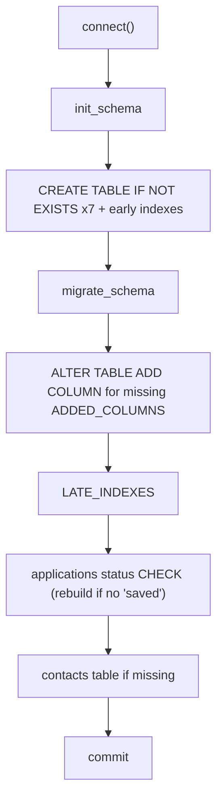

# Schema and migrations

- **Source**: `src/jobdigest/db/schema.py` (341 lines)
- **Layer**: persistence (DDL and additive migration).
- **Depends on**: `jobdigest.db.connection` (`is_pg`, `safe_ident`, `split_sql`, `table_columns`), `jobdigest.db._common` (`Conn`, `row_get`).
- **Used by**: `connection.connect` / `connect_postgres` (call `init_schema`), `contacts.py` (imports `CONTACT_SOURCES`), tests.
- **Tests**: `tests/test_db_postgres.py::test_pg_schema_keeps_identity_rules`, `tests/test_db_internals.py::test_new_indexes_exist` and `::test_migrates_legacy_jobs_table`, `tests/test_db_upsert.py::test_migrate_adds_employment_workplace_hint_columns`, `tests/test_tombstone.py::test_migrate_adds_tombstone_columns`, `tests/test_content_hash.py::test_migrate_adds_description_hash_and_stale`, `tests/test_db_contacts.py::test_migrate_schema_creates_contacts_when_table_missing` and `::test_schema_includes_contacts`.

## Why this exists

There is no migration framework (Alembic etc.). Instead `schema.py` keeps one declaration of every column and builds both the `CREATE TABLE` text and the "upgrade an old database" logic from the same data (`ADDED_COLUMNS`), so they cannot drift. `connect()` runs `init_schema` on every open; all statements are idempotent, so a fresh DB, a current DB, and an old DB all converge to the same shape.

## Key concepts

- **Base columns vs added columns.** A table is declared as a tuple of "base" column definitions (`_JOBS`, ...) plus the entries of `ADDED_COLUMNS[table]` that were introduced after the first release. A fresh DB gets both in `CREATE TABLE`. An old DB already has the base columns and receives the added ones via `ALTER TABLE ... ADD COLUMN`. **Consequence**: the base columns can never be changed or removed by this mechanism; only additive changes are supported (confirmed by running `connect()` on a hand-built legacy DB: it worked only once all base columns existed).
- **Late indexes.** An index on a migrated column cannot be created until `ADD COLUMN` ran, so those indexes live in `LATE_INDEXES` and are created after migration.
- **Dialects.** `SCHEMA` is the SQLite text. `SCHEMA_PG` is `SCHEMA.replace("id INTEGER PRIMARY KEY", "id INTEGER GENERATED BY DEFAULT AS IDENTITY PRIMARY KEY")`, so every table's key becomes an identity column on Postgres. Everything else (TEXT, INTEGER, REAL, CHECK, partial indexes, `REFERENCES`) is valid in both.

## Tables and columns

Each table below lists base columns first, then migrated ones (marked *added*). Constraint text is copied from the `_TABLE` tuples.

### `companies` (`_COMPANIES`, `schema.py:77`)

| Column | Type / constraint | Meaning |
|---|---|---|
| `id` | `INTEGER PRIMARY KEY` | surrogate key |
| `slug` | `TEXT NOT NULL UNIQUE` | stable identifier from the board list file |
| `display_name` | `TEXT NOT NULL` | human name |
| `ats` | `TEXT NOT NULL` | ATS adapter (`greenhouse`, ...) |
| `board_token` | `TEXT NOT NULL` | token/slug used in the ATS URL |
| `enabled` | `INTEGER NOT NULL DEFAULT 0` | 1 = collect this board |
| `resolved_url` | `TEXT` | URL actually working for the board (set by `update_company_fetch`) |
| `last_fetch_at` | `TEXT` | timestamp of last fetch attempt |
| `last_http_status` | `INTEGER` | status of last fetch |
| `last_job_count` | `INTEGER` | jobs returned by last fetch |
| `last_error` | `TEXT` | error text of last fetch |
| `dead_streak` *added* | `INTEGER NOT NULL DEFAULT 0` | consecutive "dead token" fetches (written via `update_company_fetch(dead_streak=...)`) |

### `jobs` (`_JOBS`, `schema.py:91`)

| Column | Type / constraint | Meaning |
|---|---|---|
| `id` | `INTEGER PRIMARY KEY` | |
| `apply_url` | `TEXT` | clickable URL as received; `NULL` for synthetic-key jobs |
| `apply_url_norm` | `TEXT NOT NULL UNIQUE` | normalized URL or synthetic `ats://<source>/<external_id>`; identity key |
| `source` | `TEXT NOT NULL` | lane that produced it (ATS name or portal/feed name); frozen at insert |
| `external_id` | `TEXT` | ATS job id; empty is stored as `NULL` |
| `company_id` | `INTEGER REFERENCES companies(id)` | set for ATS boards, `NULL` for portals/feeds |
| `company` | `TEXT` | normalized company name (`normalize_company`) |
| `title` | `TEXT NOT NULL` | normalized title (`normalize_title`) |
| `location_raw` | `TEXT` | |
| `description_text` | `TEXT` | |
| `raw_json` | `TEXT NOT NULL` | provider payload |
| `first_seen_at` / `last_seen_at` | `TEXT NOT NULL` | first insert / most recent sighting |
| `is_active` | `INTEGER NOT NULL DEFAULT 1` | 0 once tombstoned |
| `hard_status` | `TEXT NOT NULL DEFAULT 'pending' CHECK (hard_status IN ('pending','pass','reject'))` | hard-filter verdict |
| `hard_reason` | `TEXT` | reason string from `hard_filter` |
| `ats` | `TEXT NOT NULL DEFAULT ''` | ATS/lane kind (`greenhouse`, `portal`, `rss`, `marketplace`, ...) |
| `miss_count` *added* | `INTEGER NOT NULL DEFAULT 0` | consecutive successful sweeps that did not list this job |
| `closed_at`, `close_reason` *added* | `TEXT` | tombstone timestamp and reason (`unseen_board`) |
| `employment_hint`, `workplace_hint` *added* | `TEXT` | sanitized ATS hints, max 80 chars |
| `notified_at`, `notify_kind` *added* | `TEXT` | when/how the job was sent (`urgent` or `digest`) |
| `description_hash` *added* | `TEXT` | sha256 of whitespace-collapsed description |
| `raw_title`, `raw_company` *added* | `TEXT` | pre-normalization values |
| `posting_key` *added* | `TEXT` | sha256 over normalized title, company, location; cross-source duplicate key |
| `canonical_job_id` *added* | `INTEGER REFERENCES jobs(id)` | non-NULL = this row is an alias of that winner |
| `legitimacy_flag` *added* | `TEXT` | `ok` or `suspect` (structural checks) |
| `legitimacy_reasons_json` *added* | `TEXT` | JSON array of reason codes |
| `posted_at` *added* | `TEXT` | provider posting date, UTC ISO |

### `scores` (`_SCORES`, `schema.py:112`)
`id` PK; `job_id INTEGER NOT NULL REFERENCES jobs(id)`; `model TEXT NOT NULL`; `prompt_version TEXT NOT NULL`; `relevant INTEGER NOT NULL`; `score REAL`; `reasons_json TEXT`; `created_at TEXT NOT NULL`; *added* `stale INTEGER NOT NULL DEFAULT 0`. Table constraint `UNIQUE(job_id, model, prompt_version)` (this is what `upsert_score`'s `ON CONFLICT` targets).

### `runs` (`_RUNS`, `schema.py:123`)
`id` PK; `kind TEXT NOT NULL` (`collect`, `score`, `digest`, and `contacts` per callers); `started_at TEXT NOT NULL`; `finished_at TEXT`; `status TEXT NOT NULL CHECK (status IN ('running','ok','error'))`; `stats_json TEXT`; `error TEXT`.

### `portal_errors` (`_PORTAL_ERRORS`, `schema.py:133`)
`id` PK; `run_id INTEGER REFERENCES runs(id)` (nullable); `portal_name TEXT NOT NULL`; `url TEXT NOT NULL`; `error_class TEXT NOT NULL`; `http_status INTEGER`; `detail TEXT`; `occurred_at TEXT NOT NULL`.

### `applications` (`_APPLICATIONS`, `schema.py:144`)
`id` PK; `job_id INTEGER REFERENCES jobs(id)` (nullable); `apply_url_norm TEXT NOT NULL UNIQUE`; `company TEXT`; `title TEXT`; `applied_on TEXT NOT NULL`; `status TEXT NOT NULL CHECK (status IN ('applied','oa','interview','offer','rejected','ghosted','saved','hidden'))` (`APP_STATUS_CHECK`, `schema.py:11`); `source TEXT`; `notes TEXT`; `sheet_row INTEGER` (row number in the Google Sheet, `NULL` = not yet synced); `synced_at TEXT`.

### `contacts` (`_CONTACTS`, `schema.py:159`)
`id` PK; `job_id INTEGER REFERENCES jobs(id)`; `company TEXT NOT NULL`; `domain TEXT`; `name TEXT NOT NULL`; `email TEXT`; `role TEXT`; `source TEXT NOT NULL CHECK (source IN ('jd','github','pattern'))`; `verified TEXT NOT NULL DEFAULT 'unverified'`; `confidence REAL`; `created_at TEXT NOT NULL`; table constraint `UNIQUE(job_id, name, source)` (`_CONTACTS_UNIQUE`). `CONTACT_SOURCES = frozenset({"jd","github","pattern"})` (`schema.py:158`) mirrors the CHECK for Python-side validation.

### Indexes

| Index | Definition | Where declared | Purpose |
|---|---|---|---|
| `jobs_source_ext` | `UNIQUE ON jobs(source, external_id) WHERE external_id IS NOT NULL AND external_id != ''` | `_SCHEMA_INDEXES` | second identity key: same ATS id cannot be inserted twice even if the URL changes; partial so URL-less rows with empty ids do not collide |
| `jobs_hard_active` | `jobs(hard_status, is_active)` | `_SCHEMA_INDEXES` | candidate queries for scoring/digest |
| `contacts_job_id` | `contacts(job_id) WHERE job_id IS NOT NULL` | `_CONTACT_INDEXES` | contacts per job |
| `contacts_company` | `contacts(company)` | `_CONTACT_INDEXES` | |
| `jobs_posting_key` | `jobs(posting_key) WHERE posting_key IS NOT NULL AND posting_key != ''` | `LATE_INDEXES` | duplicate lookup in `link_duplicate_jobs` |
| `jobs_description_hash` | `jobs(description_hash) WHERE description_hash IS NOT NULL` | `LATE_INDEXES` | peer lookup in `_legitimacy_peers` |
| `jobs_source_active` | `jobs(source, is_active)` | `LATE_INDEXES` | tombstone sweep (`bump_unseen_for_source`) |
| `jobs_canonical_job_id` | `jobs(canonical_job_id) WHERE canonical_job_id IS NOT NULL` | `LATE_INDEXES` | alias lookups |

I confirmed on a freshly created SQLite DB that these eight indexes (plus the automatic unique indexes) exist.

### Implicit unique indexes
`companies.slug`, `jobs.apply_url_norm`, `applications.apply_url_norm`, `scores(job_id, model, prompt_version)` and `contacts(job_id, name, source)` each create an automatic unique index. Note `applications.apply_url_norm` and `jobs.apply_url_norm` are the join key between the two tables, but there is no foreign key on it.

## Detailed walkthrough

### `_create_table`
**Location** `src/jobdigest/db/schema.py:64` · **Signature** `def _create_table(name: str, base: tuple[str, ...], constraints: tuple[str, ...] = (), *, prefix: str = "CREATE TABLE IF NOT EXISTS") -> str`
1. `added = tuple(f"{col} {ddl}" for col, ddl in ADDED_COLUMNS.get(name, ()))`: turns migrated columns into column definitions.
2. `cols = base + added + constraints`: table constraints (UNIQUE) go last because SQL requires column definitions before table constraints.
3. Join with `",\n  "` and return `"{prefix} {name} (\n  ...\n)"`.
`prefix="CREATE TABLE"` (no `IF NOT EXISTS`) is used for the migration-only variants.

### `SCHEMA` and `SCHEMA_PG`
`SCHEMA` (`schema.py:188`) concatenates, separated by `";\n\n"`: companies; jobs plus its two indexes; scores (with its UNIQUE); runs; portal_errors; applications; contacts plus its two indexes; then `";\n"` and the `LATE_INDEXES` joined by `";\n"`. `SCHEMA_PG = SCHEMA.replace(_PK_PLAIN, _PK_PG)` (line 211). Because the text is split on `;` (`split_sql`), no statement may contain a semicolon inside a literal.

### `_add_missing_columns`
**Location** `src/jobdigest/db/schema.py:221` · `def _add_missing_columns(conn, table)`
1. `table = safe_ident(table)`; `cols = table_columns(conn, table)`.
2. If `cols` is empty (table absent) return without error.
3. For each `(col, ddl)` in `ADDED_COLUMNS[table]` not in `cols`: `conn.execute(f"ALTER TABLE {table} ADD COLUMN {safe_ident(col)} {ddl}")`.
Idempotent: a second run finds all columns. Both engines accept `ADD COLUMN ... REFERENCES jobs(id)` and `NOT NULL DEFAULT 0`.

### `_sql_allows_saved`, `_sqlite_applications_sql`
`_sql_allows_saved(sql)` (`:231`) is the schema-version test: `"'saved'" in (sql or "")`. `_sqlite_applications_sql(conn)` (`:235`) reads `SELECT sql FROM sqlite_master WHERE type='table' AND name='applications'` and returns the stored `CREATE TABLE` text, or `None` if the table does not exist.

### `_rebuild_sqlite_applications`
**Location** `src/jobdigest/db/schema.py:244`
Why: SQLite cannot alter a CHECK constraint in place. The `saved` and `hidden` statuses were added later; an old database's CHECK forbids them. The standard "12-step" workaround is to rebuild the table.
1. `PRAGMA foreign_keys = OFF` (so renaming does not rewrite or violate references).
2. `ALTER TABLE applications RENAME TO applications_migrate_old`.
3. `conn.execute(_APP_CREATE_SQLITE)`: `CREATE TABLE applications (...)` from the current definition (plain `CREATE TABLE`, built at `schema.py:218`).
4. `INSERT INTO applications (id, job_id, apply_url_norm, company, title, applied_on, status, source, notes, sheet_row, synced_at) SELECT <same columns> FROM applications_migrate_old`: ids are preserved.
5. `DROP TABLE applications_migrate_old`; `PRAGMA foreign_keys = ON`.
I ran this on a hand-built legacy DB with one `oa` application: afterwards the row survived with id 1 and `saved` inserts succeeded. Not atomic as a whole: it is DDL plus one INSERT executed statement by statement and committed later by `migrate_schema`; a crash in the middle could leave `applications_migrate_old` behind (not tested). The columns list is hard-coded, so adding a column to `_APPLICATIONS` requires updating this INSERT as well.

### `_migrate_pg_applications_status`
**Location** `src/jobdigest/db/schema.py:263`
Postgres equivalent: find the CHECK constraints and replace them.
1. Query `pg_constraint` joined to `pg_class`/`pg_namespace` for `contype = 'c'` constraints on `public.applications`, returning name and `pg_get_constraintdef`.
2. Collect `(name, def)` pairs (fallback to positional access if the row type is not name-addressable).
3. If any definition already contains `'saved'`, return (already migrated).
4. Else pick every constraint whose definition mentions `status` or `ghosted`, validate the name with `safe_ident` (skip on `ValueError`), and `ALTER TABLE applications DROP CONSTRAINT "<name>"`.
5. `ALTER TABLE applications ADD CONSTRAINT applications_status_check CHECK (<APP_STATUS_CHECK>)`.

### `_migrate_applications_status`
`schema.py:300`: dispatcher. Postgres: call the function above. SQLite: read the table SQL; if `None` (no table) or already allows `saved`, return; otherwise `_rebuild_sqlite_applications`.

### `_migrate_contacts_table`
`schema.py:310`: `if table_columns(conn, "contacts"): return`. Otherwise run the migration-only `CREATE TABLE contacts` (`_CONTACTS_CREATE_PG` or `_CONTACTS_CREATE_SQLITE`) and each `_CONTACT_INDEXES` statement. In practice `init_schema` already created `contacts` from `SCHEMA`, so this only fires when `migrate_schema` is invoked alone on a DB lacking the table (as in `test_migrate_schema_creates_contacts_when_table_missing`).

### `_create_late_indexes`
`schema.py:318`: executes each `LATE_INDEXES` statement (all `CREATE INDEX IF NOT EXISTS`).

### `migrate_schema`
**Location** `src/jobdigest/db/schema.py:323` · `def migrate_schema(conn: Conn) -> None`
Order matters:
1. `_add_missing_columns` for `jobs`, `companies`, `scores`.
2. `_create_late_indexes` (columns now exist).
3. `_migrate_applications_status`.
4. `_migrate_contacts_table`.
5. `conn.commit()`.
Public and re-exported; safe to call repeatedly (`test_migrates_legacy_jobs_table` calls it a second time).

### `init_schema`
**Location** `src/jobdigest/db/schema.py:332` · `def init_schema(conn: Conn) -> None`
1. `late = {sql for _name, sql in LATE_INDEXES}`.
2. `stmts = split_sql(SCHEMA_PG if is_pg(conn) else SCHEMA)`.
3. Execute every statement not in `late` (the `CREATE TABLE IF NOT EXISTS` and early indexes). For an old DB the tables exist already and are untouched, but note `CREATE INDEX IF NOT EXISTS jobs_hard_active ON jobs(hard_status, is_active)` runs now and would fail if those base columns were missing.
4. `migrate_schema(conn)` (adds columns, creates the late indexes, fixes the applications CHECK).
5. `conn.commit()`.

The diagram shows the order in which a connection converges any older database to the current shape.

## Failure modes and edge cases

- Base columns missing (database older than the "base" snapshot): `init_schema` raises `sqlite3.OperationalError: no such column: hard_status` (reproduced). There is no repair path.
- Postgres ALTERs run inside psycopg's implicit transaction; `migrate_schema` commits at the end only.
- `ADDED_COLUMNS` of a table not in `("jobs","companies","scores")` is never applied by `migrate_schema`; adding an entry for another table needs the loop on `schema.py:324` extended.

## How to modify / extend safely

- **Add a column**: append `(name, "TYPE ...")` to `ADDED_COLUMNS[table]`. It becomes part of fresh `CREATE TABLE` and of the migration automatically. Give it a default or make it nullable (SQLite requires a non-NULL default for `NOT NULL` additions). If you then index it, put the index in `LATE_INDEXES`.
- **Add a table**: add a column tuple, a `_create_table(...)` entry in `SCHEMA`, add it to `connection.ID_TABLES`, and extend `ADDED_COLUMNS`/the migrate loop if it will evolve.
- **Widen a CHECK** (like `applications.status`): you need a rebuild (SQLite) and drop/add constraint (Postgres) as shown; the `_sql_allows_saved` probe would need a new token to detect the new version.
