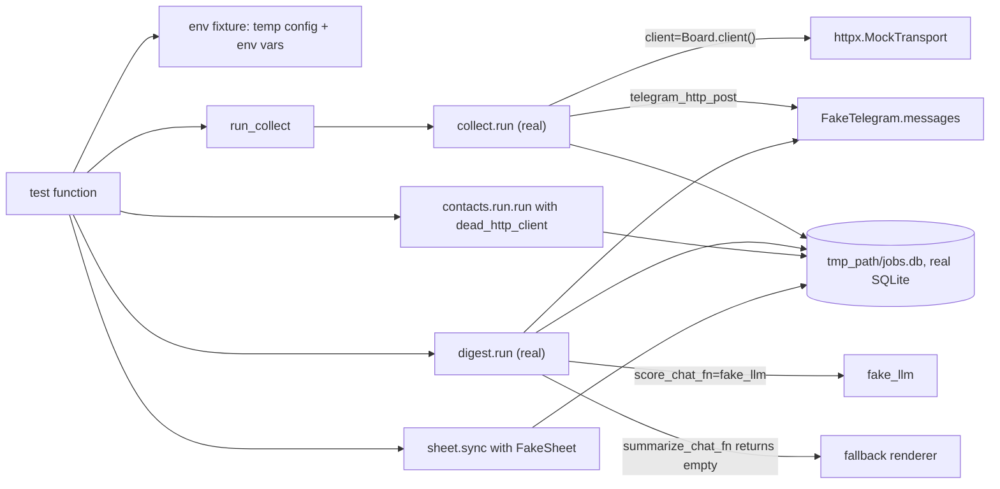

# End-to-end tests and fixtures

- Source: `tests/test_pipeline_e2e.py` (417 lines, 14 tests), helper fakes in `tests/test_sheet.py`, `tests/test_bot.py`, `tests/test_bot_buttons.py`, and the data tree `tests/fixtures/`
- Related: [strategy.md](strategy.md), [test-map.md](test-map.md), [../infra/github-workflows.md](../infra/github-workflows.md)

## The pipeline test

`tests/test_pipeline_e2e.py` runs the real stage functions in the order the hosted workflow runs them: `collect.run`, `digest.run`, `contacts.run.run`, `sheet.sync`. The module docstring states the rule: everything external is faked (ATS HTTP through `httpx.MockTransport`, the LLM, Telegram, the Google worksheet), while the real stages, config loading, SQLite database and CLI wiring execute unchanged.

### The fakes

| Fake | Location | Behaviour |
|---|---|---|
| `_gh_job(job_id, title, location, body)` | `tests/test_pipeline_e2e.py:27` | builds a Greenhouse job JSON dict (`absolute_url` under `boards.greenhouse.io/acme/jobs/<id>`, `updated_at` 2026-11-01, `company_name` "Acme") |
| `GOOD`, `SENIOR`, `US_ONLY` | lines 39-46 | three canned jobs: an intern role in Bengaluru, a "Senior Staff Engineer" in Bengaluru, an intern role in New York with "Remote US only" |
| `Board` | line 49 | mutable fake board. `Board(jobs, status)`; `client()` returns an `httpx.Client` whose `MockTransport` answers every request with `{"jobs": self.jobs, "meta": {"total": len(self.jobs)}}`, or `status` with text `boom` when `status != 200`. Mutating `board.jobs` between runs simulates postings disappearing |
| `FakeTelegram` | line 67 | callable with the `http_post(url, json=None, timeout=30.0)` signature; appends `{"url":..., **json}` to `.messages` and returns a 200 response with `{"ok": true, "result": {"message_id": 1}}`; `.texts` lists the `text` fields |
| `fake_llm(messages, *, model, api_key, json_mode=False, **_kw)` | line 80 | extracts `<<<JOB id=N>>>` markers from the last message with a regex and returns a JSON string scoring every job 88 with `relevant: true`, all `*_ok` true, `why: "fits"`, `kill: null`. This pins the prompt fence format that `score.py` builds |
| `dead_http_client()` | line 104 | `MockTransport` answering 404 to everything; passed to `contacts.run.run` so enrichment finds nothing and touches no network |
| `FakeSheet` | imported from `tests/test_sheet.py:35` | in-memory worksheet (`rows`, `appends`, `formats`, `validations`, `frozen_rows`) |
| `env` fixture | line 109 | builds a private config directory `tmp_path/cfg`: copies `profile.example.yaml` and `models.example.yaml`; writes a `companies.yaml` with one enabled Greenhouse company `acme`; writes empty-list `portals.yaml`, `feeds.yaml`, `marketplaces.yaml`; sets `JOBDIGEST_CONFIG_DIR`, `TELEGRAM_BOT_TOKEN=123:test-token`, `TELEGRAM_CHAT_ID=42`, `JOBDIGEST_REQUIRE_TELEGRAM=1`; removes `DATABASE_URL`, `JOBDIGEST_GITHUB_TOKEN`, `GOOGLE_SHEET_ID`. Returns the db path `tmp_path/"jobs.db"` |
| `run_collect(db, board, tg=None, **kw)` | line 150 | `collect.run(db_path=db, client=board.client(), sleep=lambda _s: None, ats_only=True, telegram_http_post=tg, **kw)` |
| `rows(db, sql, *args)` | line 161 | opens a separate `sqlite3` connection and returns `list[dict]` for assertions |

### Wiring diagram

Every real stage reads and writes the same temporary database; the fakes sit at the edges. Assertions query the database directly (`rows`) and inspect `FakeTelegram.texts` and `FakeSheet.rows`.

### What each test pins

| Test | Scenario and assertions |
|---|---|
| `test_full_pipeline_happy_path` | collect returns 0; `hard_status` values are {pass, reject}; reasons are `title_reject` (senior staff), `remote_us` (New York), `ok` (good). `digest.run` returns 0; only one row in `scores` (rejected jobs never reach the LLM); the Telegram text contains "Acme" and the intern title but not "Senior Staff"; exactly one job has `notified_at` set with `notify_kind = 'digest'`. Contacts returns 0; sheet sync returns 0 with one data row mentioning Acme; the `runs` table kinds are all ok |
| `test_second_digest_does_not_resend_notified_jobs` | a second `digest.run` sends no new message |
| `test_collect_is_idempotent_and_dedupes` | two collects leave 3 rows, all active |
| `test_job_that_leaves_the_board_is_closed_after_two_misses` | after two jobs vanish, the first missed run keeps them active; the second closes them |
| `test_collect_total_failure_exits_1_and_alerts` | board returns 500: exit code 1, a Telegram text containing `COLLECT FAILED`, `runs` row with status `error` |
| `test_digest_fails_loud_when_scoring_fails` | `OpenRouterError` from the chat fn: digest returns 1 and sends a "FAILED" alert |
| `test_score_continues_past_a_failed_batch` | six distinct jobs, `batch_size` patched to 2 (`dataclasses.replace(load_models(), batch_size=2)` and `monkeypatch.setattr("jobdigest.score.load_models", ...)`); first call raises; `score.run` returns 1 yet makes 3 calls and stores 4 scores. Titles are distinct on purpose: identical title/company/location would be merged as duplicates |
| `test_digest_without_a_collect_run_fails_loud` | `digest.run` on an empty database returns 1 and sends `COLLECT FAILED` |
| `test_cli_contacts_and_sheet_sync_run_offline` | `cli.main(["contacts", "--db", ...])` returns 0; `cli.main(["sheet-sync", ...])` returns 0 and prints "skip" (no credentials, not required) |
| `test_collect_includes_discovered_boards_without_duplicating_curated` | `JOBDIGEST_DISCOVERED_BOARDS` points at a temp TSV with `acme` (duplicate of curated) and `newco`; a `fetch_fn` records `ats:token`; result `["greenhouse:acme", "greenhouse:newco"]` |
| `test_skip_discovered_flag_leaves_only_curated_boards` | `skip_discovered=True`: only `acme` fetched |

### Workflow wiring tests

Three tests in the same file load `.github/workflows/pipeline.yml` with `yaml.safe_load` and assert structure instead of substrings:

- `test_pipeline_workflow_stage_order_and_gating`: indexes of the steps containing `jobdigest collect`, `jobdigest digest`, `jobdigest contacts`, `jobdigest sheet-sync` ascend; the `pipeline` job `needs` contains `gate` and its `if` contains `due`.
- `test_pipeline_workflow_provides_every_secret_the_code_requires`: `secrets.<NAME>` appears for `DATABASE_URL`, `OPENROUTER_API_KEY`, `TELEGRAM_BOT_TOKEN`, `TELEGRAM_CHAT_ID`, `GOOGLE_SHEET_ID`, `GOOGLE_SERVICE_ACCOUNT_JSON`, `PROFILE_YAML`, `COMPANIES_YAML`, `MODELS_YAML`.
- `test_pipeline_keeps_state_between_runs_even_without_a_database_secret`: job-level `env.DATABASE_PATH` ends in `.db`; the `actions/cache/restore` step precedes the collect step, which precedes the `actions/cache/save` step; the save step has `if: always()`; restore and save use the same `path`; restore has `restore-keys`.

The steps themselves: [../infra/github-workflows.md](../infra/github-workflows.md#state-cache-restore-and-save).

## Other shared test helpers

| Helper | File:line | Purpose |
|---|---|---|
| `FakeSheet` | `tests/test_sheet.py:35` | worksheet double; `update` accepts `(range, values)` or a bare 2D list; records `format`, `freeze`, `add_validation` calls so layout tests can assert on them |
| `_data_rows` | `tests/test_sheet.py:77` | strips the header row if present |
| `NOW`, `_pass_job` | `tests/test_bot.py:22,32` | fixed clock 2026-09-09 12:00 UTC; insert one passing Pune intern job |
| `_OkPost` | `tests/test_bot.py:84` | minimal response object (`status_code` 200, `.json()`) |
| `_mail_update`, `_mail_setup` | `tests/test_bot.py:986,1144` | callback update dict (chat id 7); temp DB with one scored job plus a recording `http_post` |
| `FakeTelegram` (bot version) | `tests/test_bot_buttons.py:122` | serves queued updates through `getUpdates` (honouring `offset`) and records every other POST; counts `get_calls` so `drain` termination can be asserted |
| `_tap`, `_numbered` | `tests/test_bot_buttons.py:21,146` | build a callback-tap update, optionally with an `update_id` |
| `_clear_no_contact_cache` | `tests/test_bot.py` (autouse) | clears `bot._NO_CONTACT` before and after each test so the negative mail cache cannot leak |

There are two unrelated classes named `FakeTelegram` (e2e: records sends; bot buttons: also serves updates).

## The fixture tree

`tests/fixtures/` holds 45 files (589 lines in total). `.gitignore` ignores `*.json` globally but un-ignores `tests/fixtures/**/*.json`, which is why JSON fixtures are tracked.

| Directory | Files | Used by |
|---|---|---|
| `ats/greenhouse/` | `two_jobs.json`, `empty.json`, `not_found.json`, `encoded_html.json`, `offices_parent_vs_leaf.json`, `page2_new.json` | `test_ats_greenhouse.py`, `test_probe.py` (`two_jobs`, `empty`, `not_found`) |
| `ats/lever/` | `page0.json`, `page1.json`, `empty.json`, `not_found.json` | `test_ats_lever.py` |
| `ats/smartrecruiters/` | `two_jobs.json`, `page0.json`, `page1.json`, `empty.json`, `not_found.json` | `test_ats_smartrecruiters.py`, `test_probe.py` (`empty`) |
| `ats/bamboohr/` | `two_jobs.json`, `empty.json`, `not_found.json` | `test_ats_bamboohr.py`, `test_probe.py` (`empty`) |
| `ats/ashby/`, `ats/workable/` | `two_jobs.json`, `empty.json`, `not_found.json` each | not referenced by any test: `test_ats_ashby.py` and `test_ats_workable.py` define payloads inline (verified by grep). Unused fixtures |
| `contacts/` | `clearbit_hit.json`, `clearbit_empty.json`, `github_commits.json`, `github_members.json`, `github_user_engineer.json`, `github_user_recruiter.json`, `jd_hiring_manager.txt`, `jd_recruiter_and_degree.txt` | `test_contacts_domain.py`, `test_contacts_github.py`, `test_contacts_jd.py` |
| `discover/` | `intern_intl_sample.md`, `companies_mini.yaml` | `test_discover.py` |
| `feeds/` | `python_jobs.xml`, `foss_united.xml` | `test_feeds.py` |
| `portals/` | `foss_united.html`, `foss_united_v3.html`, `null_community.html`, `null_community_job_item.html`, `hasjob.html`, `hasjob_stickie.html`, `hasjob.json`, `generic_cards.html`, `challenge.html` | `test_portals_parsers.py` |

Conventions: a `_load(name)` helper reads JSON from the adapter's fixture directory; handlers are plain functions `handler(request) -> httpx.Response` that return the fixture for the expected URL (checking path and query params) and `500 unexpected` otherwise, so an adapter calling the wrong URL fails the test.

### Adding a fixture

1. Save a trimmed real response under `tests/fixtures/<area>/` and remove personal data.
2. Load it with the same `_load` pattern and serve it from a `MockTransport` handler.
3. For a brand-new adapter, copy the `FetchStatus` matrix from `test_ats_greenhouse.py` (OK, empty, 404, invalid body, HTML challenge, pagination).
