# Workflow: widening the pool (`python -m jobdigest.expand`)

Finding more boards worth fetching. An offline, run-occasionally command; its output is consumed automatically by every
later `collect`. Source: `src/jobdigest/expand.py`, `src/jobdigest/config.py`, `src/jobdigest/collect.py`.

## The problem it solves

`data/ats_board_tokens_gla.tsv` lists about 19,000 candidate boards (Greenhouse 9,750, Lever 4,822, Ashby 4,470). Fetching all of
them on every scheduled run would take far too long and would mostly retrieve jobs outside India. `expand` probes them **once**,
keeps only boards that currently list India entry-level engineering roles, and writes that short list for `collect` to use.

## Flow

```mermaid
flowchart LR
    A["data/ats_board_tokens_gla.tsv<br/>company, ats, token, sources"] --> B["read_boards()<br/>dedupe, supported ATS only"]
    B --> C["expand(): ThreadPoolExecutor<br/>12 workers, one GET per board"]
    C --> D["probe(board)<br/>parse payload with _jobs()"]
    D --> E["promising(profile, title, location)<br/>India + entry-ish + engineering + not senior"]
    E -->|"at least one hit"| F["Found(board, candidates, sample)"]
    F --> G["write_found()<br/>data/boards_india.tsv"]
    G --> H["config.load_discovered_boards()"]
    H --> I["collect._with_discovered()<br/>merge with companies.yaml"]
    I --> J["collect._collect_ats"]
```

## Step by step

1. **Entry:** `expand.main` parses `--tsv`, `--out`, `--workers`, `--limit`; resolves paths against `repo_root()`; loads the profile
   (`india_keywords` drive the location screen).
2. **`read_boards(path)`** skips the header, keeps rows whose ATS is `greenhouse`, `lever` or `ashby` and whose token is
   non-empty, and removes duplicate `(ats, token)` pairs, producing `Board(company, ats, token)` records.
3. **`expand(boards, profile, client=..., workers=12)`** submits `probe` for each board to a thread pool sharing one `httpx.Client`
   (no redirects, a descriptive user agent) and collects the non-`None` results, sorted by number of candidates.
4. **`probe(board, profile, client)`** requests the board's public JSON (`_url`), retries once after a 429 using `Retry-After`,
   and returns `None` for non-200, transport errors, or invalid JSON. `_jobs(board, payload)` extracts `(title, location)` pairs
   per ATS shape (Lever returns a list; Greenhouse/Ashby return `{"jobs": [...]}`; Ashby adds `secondaryLocations`).
5. **`promising(profile, title, location)`** is a *recall-oriented* screen on title and location only (descriptions are not
   downloaded): location matches an India keyword; the title looks entry-level or a plain engineering title; no
   `senior/staff/lead/...` word; not an `Engineer II`-style title (`hard_filter.seniority_title`); and an engineering function
   (`hard_filter.function_ok`). The authoritative decision is still made later by `hard_filter` at upsert time with the full job
   text.
6. **`write_found`** writes `company<TAB>ats<TAB>token<TAB>candidates<TAB>sample` rows to `data/boards_india.tsv`.
7. **Consumption:** `config.load_discovered_boards()` turns each row into a company dict with id `"<ats>:<token>"`,
   `enabled: True`; `collect._with_discovered` appends only boards whose `(ats, token)` is not already in `companies.yaml`, so curated
   entries take precedence. `--skip-discovered` on `collect` disables the merge; `JOBDIGEST_DISCOVERED_BOARDS=off` disables it for
   tests.

## Practical notes

* A full run issued roughly 19,000 requests with 12 workers and took about 15 minutes; on the day it was written it kept 222
  boards (140 Greenhouse, 44 Lever, 38 Ashby).
* The list ages: boards open and close roles, so re-run `expand` occasionally and commit the refreshed TSV.
* The older `jobdigest.discover` (parsing a GitHub markdown list) and `jobdigest.probe` (checking configured boards) are
  separate tools; see [discover](../modules/sources/discover.md), [probe](../modules/sources/probe.md) and
  [expand](../modules/sources/expand.md).
* Tests: `tests/test_expand.py` (offline, `httpx.MockTransport`) and the discovered-board cases in `tests/test_pipeline_e2e.py`.
