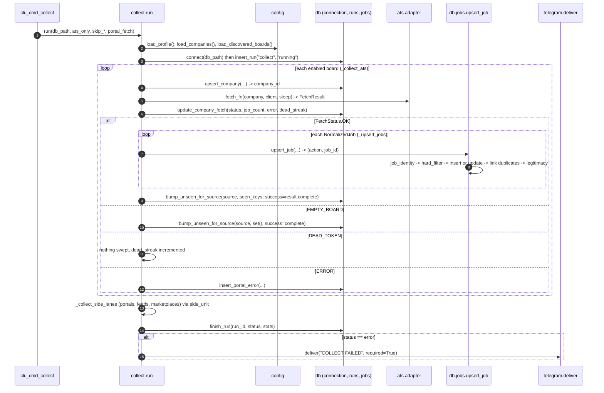

# Workflow: `python -m jobdigest collect`

Traces one collect run from the command line to rows in the database, following every important function call.
Read [architecture/overview](../architecture/overview.md) first for the big picture. Source of truth:
`src/jobdigest/collect.py`, `src/jobdigest/db/jobs.py`.

## Trigger and entry point

* **Start:** the `collect` step in `.github/workflows/pipeline.yml`, or `start.sh`, or a human running
  `python -m jobdigest collect [--ats-only] [--skip-portals] [--portal-fetch http] [--db PATH]`.
* **Entry chain:** `python -m jobdigest` -> `src/jobdigest/__main__.py` -> `cli.main` (loads `.env`, configures logging,
  builds the argparse parser) -> `cli._cmd_collect` -> `collect.run(...)`. See
  [cli-and-entrypoints](../modules/foundation/cli-and-entrypoints.md).

## Sequence

## Step by step

### 1. Setup (`collect.run`)

1. `load_dotenv()` and `configure()` - environment and logging (see [paths-envfile-logutil](../modules/foundation/paths-envfile-logutil.md)).
2. `sleep` defaults to `time.sleep`; `fetch_fn` defaults to `collect._default_fetch`; `ats_only=True` forces
   `skip_portals = skip_feeds = skip_marketplaces = True`.
3. `load_profile()` (the candidate; needed by the hard filter) and `load_companies()` (rows from `companies.yaml`).
4. Unless `skip_ats` or `skip_discovered`, `_with_discovered(rows, load_discovered_boards())` appends boards from
   `data/boards_india.tsv` whose `(ats, token)` is not already present - curated companies always win a conflict.
5. `connect(db_path)` opens SQLite (or Postgres when `DATABASE_URL` is set and `db_path is None`) and creates/migrates the
   schema. `insert_run(conn, "collect", "running")` creates the `runs` row whose id is stored in a `_Collector`.

### 2. One ATS board (`_collect_ats` and `_Collector.ats_company`)

For each row:

1. `_row_company` builds a `CompanyConfig(id, name, ats, token, enabled, notes)`.
2. `upsert_company` mirrors the row into `companies` (even disabled ones) and returns `company_id`.
3. Disabled rows and ATS names outside `KNOWN_ATS` are skipped. Otherwise `enabled_units += 1` and an `httpx.Client` is
   created lazily the first time (`make_client`, no redirect following).
4. `fetch_fn(company, client, sleep)` -> `get_adapter(company.ats, ...).fetch(company)` returns a `FetchResult`
   (`status`, `http_status`, `jobs`, `error`, `complete`). Only `httpx.HTTPError` is caught here and turned into an
   `ERROR` result. See [ats-overview](../modules/sources/ats-overview.md#the-contract-fetchresult).
5. `ats_company` calls `update_company_fetch` with a status-dependent `error` (`None`, `"dead_token"` or the error text) and a
   `dead_streak` computed by `_dead_streak` (increments on `DEAD_TOKEN`, resets on `OK`/`EMPTY_BOARD`, otherwise unchanged).
6. By status:
   * `OK` -> `_upsert_jobs` then `_sweep_source(conn, company.id, jobs, stats, success=complete)`.
   * `EMPTY_BOARD` -> sweep with an empty set (jobs previously seen start accumulating misses).
   * `DEAD_TOKEN` -> nothing more (and it is not an error unit).
   * anything else -> `record_error`, which inserts a `portal_errors` row and increments `error_units`.

### 3. Storing one job (`_upsert_jobs` -> `db.jobs.upsert_job`)

For every `NormalizedJob` the code calls `upsert_job(conn, profile, apply_url=..., ...)`:

1. `normalize.job_identity` -> `(apply_url column value, apply_url_norm)`; if no usable URL or `(source, external_id)` the
   job is skipped (`("skip", None)`).
2. `_build_job_row` runs **`hard_filter(profile, title, location_raw, description_text, employment_hint, company)`**, gets
   `(hard_status, hard_reason)`, normalizes title/company, hashes the description and computes `posting_key`. See
   [hard-filter](../modules/filtering/hard-filter.md#hard_filter).
3. Inside one transaction: `lookup_job` finds an existing row by `apply_url_norm`, then by `(source, external_id)`.
   * none -> `_insert_job_row` (`"insert"`).
   * found -> `_update_job_row` re-writes all shared columns (including the fresh `hard_status`), sets `is_active = 1`,
     `miss_count = 0`, clears `closed_at` (a reappearing job is revived). If the description hash changed, existing
     scores are marked `stale` so the job is re-scored (`"update"`).
4. `_post_process_job`: `link_duplicate_jobs` picks one canonical row per `posting_key`; `_stamp_legitimacy` evaluates
   [legitimacy](../modules/filtering/legitimacy.md#evaluate_structural) and stores the flag/reasons.
5. Back in `_upsert_jobs`, stats are updated (`inserted` / `updated` / `skipped`) and `_hard_row` re-reads the stored
   `hard_status` to count `pass` vs `reject`.

See [storage/jobs#upsert_job](../modules/storage/jobs.md#upsert_job) for the SQL.

### 4. Marking vanished jobs (`_sweep_source`)

`_seen_keys(jobs)` builds the set of identifiers present in this fetch (`external_id` if non-empty, else the normalized
URL). `bump_unseen_for_source(conn, source, seen, success)` loads active jobs of that `source`, and for each one **not** in
the set increments `miss_count`; at 2 it sets `is_active = 0`, `closed_at`, `close_reason = 'unseen_board'`. With
`success=False` (partial fetch) it returns immediately. See [data-model](../architecture/data-model.md#job-lifecycle).

### 5. The other lanes (`_collect_side_lanes`)

Unless skipped, `feeds`, `marketplaces` and `portals` are imported lazily. Enabled rows are read from `portals.yaml` (filtered by
`--portal-fetch` modes), `feeds.yaml`, `marketplaces.yaml`. A Scrapling session bundle is opened once if portals need it
(`portals.open_bundle`) and closed in `finally`. Each row goes through `_Collector.side_unit(kind, row, run_fn)`, which counts
the unit, calls the lane function (`portals.run_one`, `feeds.run_one`, `marketplaces.run_one`), records an error on exception or a
non-`ok` result, and otherwise upserts and sweeps with `success=True`. See
[portals-overview](../modules/sources/portals-overview.md), [feeds](../modules/sources/feeds.md),
[marketplaces](../modules/sources/marketplaces.md).

### 6. Finishing

In `finally`: any session bundles are closed, `finish_run(conn, run_id, status, stats, error)` is written, and the health
footer (`format_health(collect_health(conn))`) is computed (exceptions here are logged, not raised). The `status` is `error`
only when `state.failed` (`enabled_units > 0 and error_units == enabled_units`).

After the `finally` the function prints a summary line (`collect ok fetched=... inserted=... pass=... reject=...`), the
health footer if not healthy, and on `status == "error"` prints `COLLECT FAILED` to stderr, sends it through
`telegram.deliver(..., required=True)` and returns `1`; otherwise `0`.

## Success and failure paths

| Situation | Result |
|---|---|
| Normal run | status `ok`, exit 0, stats in `runs.stats_json` |
| One board returns 404 | `dead_token`, `dead_streak` increments, not an error unit, jobs untouched |
| One portal throws | `portal_errors` row, other units continue |
| Every enabled unit fails | status `error`, exit 1, `COLLECT FAILED` on Telegram |
| Fetch was partial (`complete=False`) | jobs upserted, **no** tombstone sweep |
| `fetch_fn` raises a non-HTTP exception | not caught by `_collect_ats`; the exception propagates (see [known issues](../architecture/known-issues-and-limitations.md)) |

Detailed function reference: [collect-orchestrator](../modules/collection/collect-orchestrator.md). Next stage:
[scoring and digest](scoring-and-digest.md).
