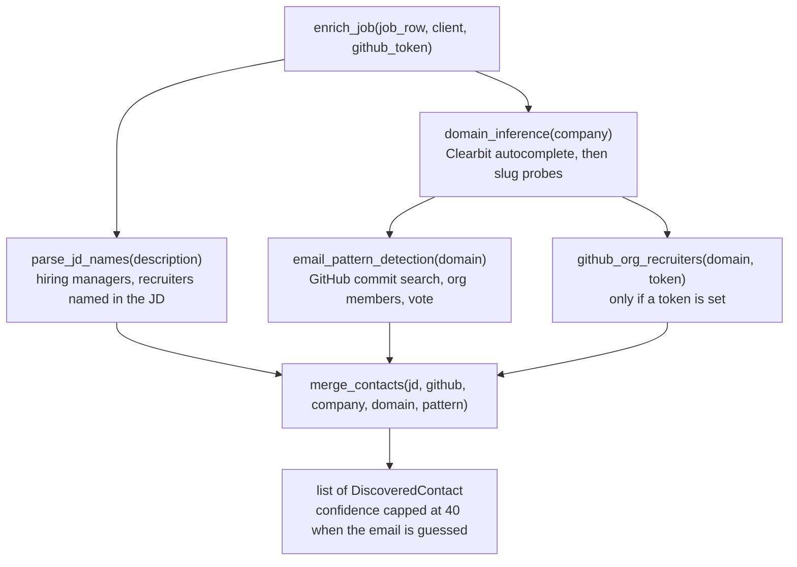

# Workflow: contact discovery and the Mail draft

Two entry points share one pipeline: the scheduled `contacts` step (pre-fills contacts for jobs just sent) and the **Mail**
button (on-demand lookup). Source: `src/jobdigest/contacts/`, `src/jobdigest/email_draft.py`, `src/jobdigest/bot.py`.

## Entry points

| Trigger | Entry function | Jobs processed |
|---|---|---|
| `pipeline.yml` step *Contacts enrich*, or `python -m jobdigest contacts` | `cli._cmd_contacts` -> `contacts.run.run` | `last_digest_job_ids(conn)` (or `--job-id`), capped by `--limit` |
| Mail button (`m:<id>`) | `bot._handle_mail` -> `bot._discover_contacts` -> `contacts.pipeline.enrich_job(row)` | the one job |

## The enrichment pipeline

Each step degrades independently: a missing GitHub token skips the GitHub lookup; a failing HTTP call logs a warning and
yields no data; the whole of `enrich_job` is wrapped so it **never raises** (a failure returns an empty list).
Details and verified examples: [contacts/pipeline-and-run](../modules/contacts/pipeline-and-run.md),
[domain-and-pattern](../modules/contacts/domain-and-pattern.md), [github-and-jd](../modules/contacts/github-and-jd.md),
[rank-and-email](../modules/contacts/rank-and-email.md).

## Scheduled path (`contacts.run.run`)

1. `connect`, `insert_run(conn, "contacts")`, read `JOBDIGEST_GITHUB_TOKEN` (skip GitHub lookups if empty).
2. Resolve ids: explicit `--job-id`s or `last_digest_job_ids(conn)` (the job ids stored in the last successful `digest` run's
   `stats_json`); apply `--limit`.
3. One shared `httpx.Client`. For each id: load the job row, `enrich_job`, and `upsert_contact` for every person found
   (unique on `(job_id, name, source)`). A per-job exception is logged and counted, not raised.
4. `finish_run(... "ok")` and exit 0. If the run itself fails (an exception outside the per-job guard) it records `error` and
   returns 1.

Caveat: the urgent slot also writes a `runs` row of kind `digest`, so `last_digest_job_ids` can return the urgent run's ids.
See [known issues](../architecture/known-issues-and-limitations.md).

## Mail button path (`bot._handle_mail`)

1. `load_models`, `load_profile`, `job_score_row(...)`; `_mail_gate` refuses (message) for a missing, filtered, inactive,
   duplicate or hidden job.
2. If the job has no stored contacts **and** was not recently found empty (in-process cache `_NO_CONTACT`, 6 hours),
   `_discover_contacts` runs the full enrichment synchronously and stores the results; if the lookup itself fails the user
   gets `Can't draft: contact lookup failed. Try again later.`
3. `best_contact_for_job` orders stored contacts: has an email first, then source (`jd`, `github`, `pattern`), then
   confidence, then recency. None -> the job key is cached as empty and the user gets `No hiring manager found for this job.`
4. `draft_email(profile, job_row, contact, chat_fn, model, api_key)` chooses `recruiter_outreach.j2` when the contact's role
   mentions "recruit", otherwise `cold_outreach.j2`. The only LLM-written part is one short "product observation" sentence;
   on any LLM problem a canned line from `fallbacks.yaml` (chosen by a stable hash of company/title/contact) is used. The first
   rendered line must be `Subject: ...`.
5. `format_telegram(draft)` produces a Telegram message with Subject / To / Body, a `mailto:` link when an address is
   available, and the footer "Send manually - no SMTP". Nothing is ever sent by the program.

See [delivery/email-drafts](../modules/delivery/email-drafts.md) and [delivery/bot](../modules/delivery/bot.md#_handle_mail).

## Failure modes

| Failure | Behaviour |
|---|---|
| No JD name and no GitHub token | no contacts; Mail replies "No hiring manager found" |
| Clearbit/domain probe fails | no domain, so no constructed email |
| Pattern detection has <2 agreeing samples | falls back to `{first}.{last}@domain` |
| Constructed email | contact confidence capped at 40 and (in memory only) marked `email_inferred` |
| Template missing | `Can't draft: email template missing.` |
