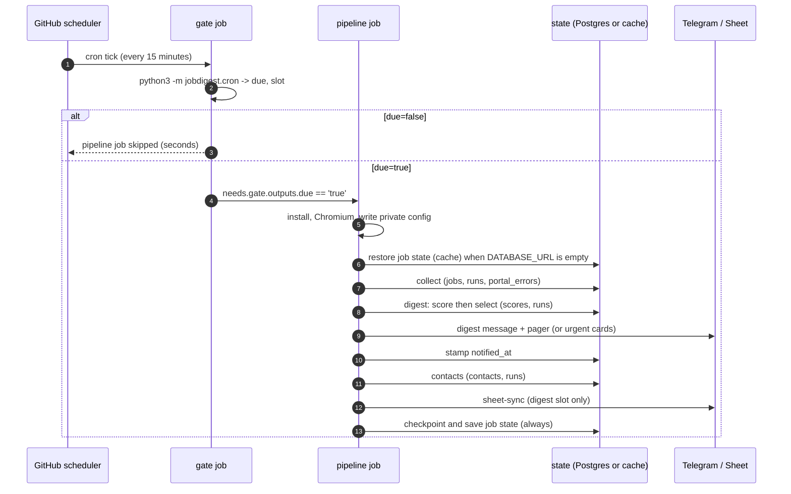

# Workflow: one scheduled pipeline run on GitHub Actions

Follows a single digest-slot run of `.github/workflows/pipeline.yml` end to end, tying the other workflow pages together
and showing what each stage reads and writes. Reference for the YAML itself: [infra/github-workflows](../infra/github-workflows.md);
the reasoning behind the layout: [deployment-and-scheduling](../architecture/deployment-and-scheduling.md).

## Timeline of a run

## Stage-by-stage inputs and outputs

| # | Stage | Reads | Writes | Detail page |
|---|---|---|---|---|
| 0 | gate (`cron.main`) | `JOBDIGEST_CRON`, `JOBDIGEST_CRON_URGENT`, `GITHUB_EVENT_NAME` | `due=`, `slot=` to `$GITHUB_OUTPUT` | [cron-gate](../modules/foundation/cron-gate.md) |
| 1 | collect | `config/*.yaml`, `data/boards_india.tsv`, the web | `companies`, `jobs`, `runs`, `portal_errors` | [collect-run](collect-run.md) |
| 2 | digest (+ score) | `jobs`, `scores`, `applications`, `runs` | `scores`, `jobs.notified_at/notify_kind`, `runs` | [scoring-and-digest](scoring-and-digest.md) |
| 3 | contacts | last digest run's `job_ids`, the web | `contacts`, `runs` | [contacts-and-mail](contacts-and-mail.md) |
| 4 | sheet-sync | `jobs`, `scores`, the sheet | sheet rows, `applications(status='saved')` | [sheet-sync](sheet-sync.md) |

## Which stages run in which slot

| Slot | collect | digest | contacts | sheet-sync |
|---|---|---|---|---|
| `digest` (also any manual run) | yes | `digest` | yes | yes |
| `urgent` (weekday mornings) | yes | `digest --urgent-only` | yes | no |

## What persists between runs

The stages only share the database, so persistence decides whether the digest can be *new*:

* With `DATABASE_URL`, everything lives in Postgres and survives.
* Without it, the job sets `DATABASE_PATH: data/pipeline_state.db`, restores that file from the Actions cache before `collect`
  and saves it again in an `if: always()` step. Without the cache every run would start empty, and the digest would
  resend the same top jobs (and the same companies) forever.

## Failure behaviour of the run

Steps are sequential with no `continue-on-error`:

* `collect` exits 1 only when every enabled source failed; the later stages are then skipped, but the alert is already on
  Telegram and the state is still saved (`always()`).
* `digest` exits 1 on a stale/failed collect, a scoring failure or a failed required Telegram send.
* `contacts` can only fail if its own run fails; `sheet-sync` fails when `JOBDIGEST_REQUIRE_SHEET` is set and credentials are
  missing.
* A missing required config secret (`PROFILE_YAML`, `COMPANIES_YAML`, `MODELS_YAML`, `PORTALS_YAML`, `FEEDS_YAML`) stops the job at
  *Write private config* before anything runs.

## Example of a real run (for orientation)

A manual `workflow_dispatch` run on 2026-11-03 (before the filter/ranking changes) logged, in order: the gate output
`slot=digest`; `collect ok fetched=5329 inserted=5214 updated=115 pass=89 reject=5240` (57 curated boards plus four portals
and one feed); `score done scored=45 relevant=11`; `digest telegram_ok=True pager_ok=True`;
`contacts done jobs=11 contacts=0 github=skip`; `sheet-sync ok appended=10 skipped_existing=1`. The whole job took about
five minutes. Numbers will differ now that more boards are fetched and the filter is stricter.
