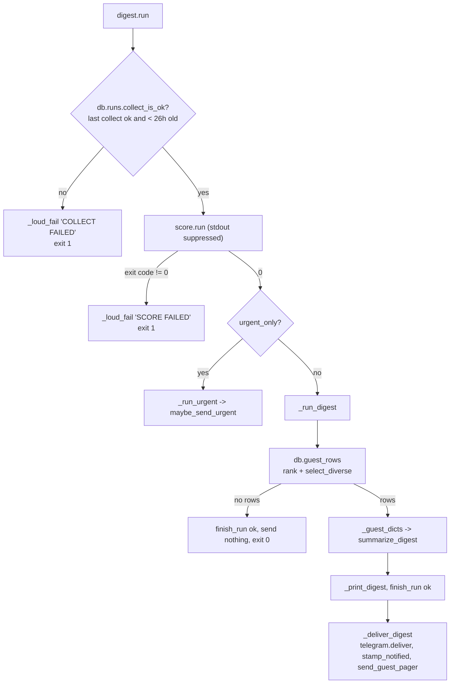

# Workflow: scoring, selection and the Telegram digest

Traces `python -m jobdigest digest` (the normal and `--urgent-only` paths) from the command line to a message in
Telegram. `digest` is the only stage that calls another stage: it runs `score` first. Previous stage:
[collect-run](collect-run.md). Next: [contacts-and-mail](contacts-and-mail.md) and [telegram-button-tap](telegram-button-tap.md).

## Trigger and entry point

* **Start:** the `Digest` step of `pipeline.yml` (digest slot) or `Urgent digest` (`--urgent-only`), or a manual run.
* **Entry chain:** `cli.main` -> `cli._cmd_digest` -> `digest.run(db_path=..., urgent_only=...)`.

## Overview

## Step by step

### 1. Preconditions (`digest.run`)

1. `load_dotenv`, `configure`. `score_fn = score_chat_fn or chat_fn`; `sum_fn = summarize_chat_fn or chat_fn`, falling back to
   `openrouter.default_chat` for the summarizer (production path).
2. `load_models()`, `load_profile()`, `connect`, `insert_run(conn, "digest")`.
3. `collect_is_ok(conn)` (default `max_age_hours=26`): the latest `collect` run must be `ok`, finished, and recent. If not,
   `_loud_fail(..., "COLLECT FAILED")` sets the run to `error`, prints to stdout and stderr and calls
   `telegram_deliver(message, required=True)`; exit 1.

### 2. Scoring (`score.run`, called inside `digest.run` with stdout redirected)

1. `unscored_pass_jobs(conn, models.score_model, models.score_prompt_version)` returns active, canonical, `hard_status='pass'`
   jobs with **no fresh score** for this `(model, prompt_version)` and **no application** (also none for the same
   `posting_key`).
2. If there is work, `OPENROUTER_API_KEY` must be set (unless a `chat_fn` was injected) else `_fail("missing OPENROUTER_API_KEY")`.
3. `system = _system_prompt(profile)` once; then rows are processed in slices of `models.batch_size` (default 12) by
   `_score_batch`.
4. `_score_batch` -> `_request_items`: builds messages (`_build_messages`: the system prompt plus one `<<<JOB id=N>>>` fence
   per job from `_fence`, description cut to 3000 chars), calls `chat_fn(messages, model=..., api_key=..., json_mode=True)`
   (`openrouter.chat` with a strict JSON schema), and parses with `_parse_jobs_payload`.
5. For each returned item `_score_item` validates `job_id` against the batch and clamps the score; `_persist_item` runs
   **`coerce_relevant`** (forces `relevant=False, score=0` for model `kill`, `stack_ok=false`, ops titles, senior titles, or a
   years-of-experience hit) and `upsert_score`. Jobs the model omitted are re-asked once in a smaller call.
6. A failed batch increments `failed_batches` and the loop continues; at the end any failure makes `score.run` return 1
   (`SCORE FAILED`), but already-stored scores are kept. `_InvalidModel` aborts immediately.

Detail: [score-llm](../modules/ranking/score-llm.md), [openrouter](../modules/ranking/openrouter.md).

### 3. Selection (`_run_digest` -> `db.guest_rows`)

`guest_rows(conn, model, prompt_version, profile.digest_max, profile=profile, now=now)`:

1. `_relevant_unapplied_select` joins `jobs` to fresh `scores` with `relevant = 1`, excluding jobs that already have an `applications` row (saved, applied, hidden, ...).
2. Rows with a `notified_at` are removed (never re-send).
3. `sort_rows(..., profile=profile)` orders by `blend_rank = quality_score + location bonus + company prior`, where
   `quality_score = 0.65 * fit_score + 0.35 * llm_score` ([fit-and-tiers](../modules/ranking/fit-and-tiers.md)).
4. `recently_notified_companies` supplies the cooldown set; `select_diverse` then applies: posting-age limit (default 21
   days), quality floor (`digest_min_quality`, default 50), one role per company (aliasing region/legal suffixes), at most 2
   per aggregator, and the 3-day company cooldown (bypassed when quality >= 85). It stops at `digest_max`.

See [rank-and-selection](../modules/ranking/rank-and-selection.md) and
[contacts-and-digest-queries](../modules/storage/contacts-and-digest-queries.md#guest_rows).

### 4. Rendering and sending

1. `_guest_dicts(rows, now=now, profile=profile)` turns each row into a dict (`id`, `company`, `title`, `location`, `url`,
   `score` = rounded **quality**, `why`, age/source chips, legitimacy chip, gap labels from `reasons_json`).
2. `summarize_digest` renders cards **in code** (`render_card`) and asks the LLM only for an optional one-sentence intro,
   which a guard drops if it contains words not present in the allowlist or the job data. See
   [summarize](../modules/ranking/summarize.md).
3. `_print_digest` writes the text to stdout (so the Actions log has a record), then `finish_run(conn, run_id, "ok",
   {"guest": n, "path": path, "job_ids": [...]})`.
4. `_deliver_digest`:
   * `telegram_deliver(text, required=True)` - splits at 3800 characters on paragraph boundaries and posts each part; returns
     False (exit 1, nothing stamped) if sending failed.
   * if credentials exist (`would_post`), `stamp_notified(conn, id, "digest")` for each job.
   * `send_guest_pager` sends numbered buttons (`o:<id>`) so the user can open any job as an action card.
   * exit 0 only if the pager also succeeded.

### Urgent path (`--urgent-only`)

`_run_urgent` -> `maybe_send_urgent`: budget = `urgent_daily_cap` minus today's urgent sends (`urgent_sent_count`, IST day);
candidates are relevant, unapplied, un-notified, first seen within 36 hours, and either watchlisted or with an LLM score >=
`urgent_score_min` **and** a deterministic fit >= `URGENT_MIN_FIT` (70). Each qualifying job is sent as a full action card
(`send_action_card`) and stamped `urgent`. See [digest](../modules/delivery/digest.md#maybe_send_urgent).

## Data that moves between the steps

| From | To | Data |
|---|---|---|
| `unscored_pass_jobs` | `_score_batch` | list of `jobs` rows |
| `chat_fn` | `_score_item` | JSON `{"jobs":[{"job_id","score","relevant","level_ok","location_ok","stack_ok","why","kill"}]}` |
| `_persist_item` | DB | `scores(job_id, model, prompt_version, relevant, score, reasons_json)` |
| `guest_rows` | `_guest_dicts` | rows with joined `score`, `reasons_json`, `display_name` |
| `_guest_dicts` | `summarize_digest` | list of dicts (`score` is the quality blend) |
| `summarize_digest` | `telegram.deliver` | final text; `path` in `runs.stats_json` |

## Success and failure summary

| Situation | Outcome |
|---|---|
| Normal | message(s) in Telegram, jobs stamped, exit 0 |
| Nothing passes the quality bar | run recorded `ok` with `guest: 0`, **no message**, exit 0 |
| Last collect failed or is stale | loud failure, exit 1 |
| One scoring batch failed | other batches stored; `SCORE FAILED`; exit 1; failed jobs retried next run |
| LLM summarizer error | falls back to cards without an intro (`path = "fallback"`) |
| Telegram send failed | `TELEGRAM FAILED`, nothing stamped, exit 1 (so the same jobs are eligible next run) |
| No Telegram credentials locally | digest printed, send skipped, jobs **not** stamped, exit 0 |
