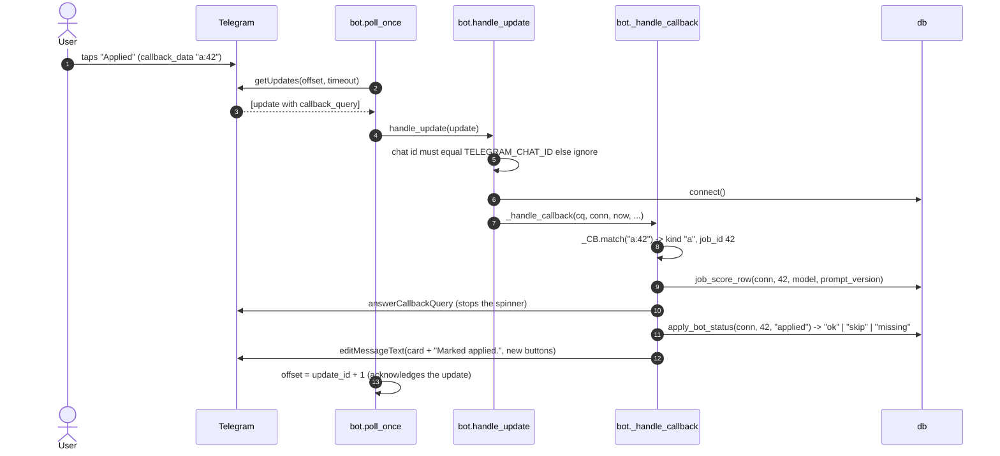

# Workflow: a Telegram button tap

Traces what happens between a user pressing **Save / Applied / Hide / Why me? / Mail** (or a numbered pager button) on a
digest message and the visible result. This is the only workflow driven by the user instead of a schedule. Source:
`src/jobdigest/bot.py`, `src/jobdigest/telegram.py`. Previous stage: [scoring-and-digest](scoring-and-digest.md).

## Why a poller is needed

A Telegram inline button does not call any URL of yours. It makes Telegram create an *update* containing a
`callback_query`, which sits in Telegram's queue until a program fetches it with `getUpdates`. If nothing fetches it the
button appears to do nothing. In this project that program is `python -m jobdigest.bot`, run by `bot.yml`
(or by hand). See [deployment](../architecture/deployment-and-scheduling.md).

## What the buttons are

`telegram.action_markup` / `pager_markup` build `callback_data` strings of the form `<kind>:<job_id>`:

| Button | `callback_data` | Result |
|---|---|---|
| numbered pager button | `o:<id>` | send that job's full action card |
| Apply | (URL button) | opens the posting; no bot involvement |
| Save / Applied / Hide | `s:<id>` / `a:<id>` / `h:<id>` | write `applications.status = saved/applied/hidden`, edit the card |
| Why me? | `w:<id>` | draft a short cover note with the LLM |
| Mail | `m:<id>` | find a contact and draft an outreach email |

Telegram limits `callback_data` to 64 bytes, so only the kind and the job id are carried; everything else is looked up in
the database. That is why the bot needs the **same database** the digest used.

## Sequence (an "Applied" tap)

## Step by step

### 1. Fetching (`poll_once`, `drain`, `run_for`, `main`)

* `poll_once(offset, ...)` calls `telegram.get_updates` and passes each dict update to `handle_update`, **catching any exception per update** so
  one bad update cannot crash the loop or be redelivered forever. It returns `last_update_id + 1`, which becomes the next
  `offset` (this is how Telegram is told the updates were received).
* `run_for(seconds)` loops `poll_once` with a 25-second long poll until a deadline; `drain()` handles everything pending with
  `timeout=0` and returns; `main` selects between `--once`, `--max-seconds N` and the endless loop. See
  [bot](../modules/delivery/bot.md#poll_once).

### 2. Authorisation (`handle_update`)

The chat id is taken from `callback_query.message.chat.id` (falling back to `from.id`) and compared with `TELEGRAM_CHAT_ID`. A
mismatch is dropped silently (a callback is still answered so the user's spinner stops). In a group chat every member of
the allowed group passes this check - there is no per-user filter.

### 3. Dispatch (`_handle_callback`)

1. `_CB = ^(o|s|a|h|w|m):(\d+)$`. No match -> toast `Unknown action.`.
2. `w` and `m` (slow actions): answer immediately, then `_handle_slow_action` runs `_handle_why_me` / `_handle_mail` inside a
   try/except that sends `Something went wrong. Try again later.` on any error.
3. Otherwise `job_score_row(...)` loads the job joined to its score; `_guest_dicts([row], now=now)` builds the card dict;
   `render_card` produces the text. No row -> toast `Job not found.` **plus** a lasting message explaining the likely
   cause (`_NOT_FOUND_TEXT`).
4. `o` -> `send_action_card` (a new message with Save/Applied/Hide, Why me?, Mail, Apply).
5. `s`/`a`/`h` -> `apply_bot_status(conn, job_id, status)`; `_status_outcome` maps the result:
   `ok` -> status line (`Saved.`, `Marked applied.`, `Hidden.`) and a reduced keyboard; `skip` -> `Already tracking.`
   (a protected status `oa`/`interview`/`offer` is never overwritten); `missing` -> `Job not found.`
6. `_edit_card` edits the original message; if editing fails (or there is no message id) it falls back to sending a new
   message, so the outcome is never lost.

### 4. The slow actions

**Why me? (`_handle_why_me`):** `_why_me_gate` refuses (with a message) if the job is missing, not `pass`, inactive, a
duplicate, hidden, the profile has no internships, or no blurb model is configured. Then `draft_blurb` (LLM, must cite one of
the profile's internships on a `CITE:` first line) and `ground()` (flags claims not found in the profile or job) produce the
text; flags are appended as `Ungrounded: ...`. See [blurb](../modules/ranking/blurb.md).

**Mail (`_handle_mail`):** see [contacts-and-mail](contacts-and-mail.md).

## The contract: every tap ends visibly

For each button and each failure mode (job exists / missing / handler crash / database unreachable) the bot answers the tap
exactly once and leaves a lasting message (an edited card or a new message). This is enforced by
`tests/test_bot_buttons.py` (parametrised over all six kinds). The toast alone is not enough because it disappears; hence
the additional `_send_plain` calls. See [bot](../modules/delivery/bot.md#why-every-tap-ends-visibly).

## Failure paths

| What goes wrong | What the user sees |
|---|---|
| Nothing is polling | Nothing (the tap waits in Telegram for up to ~24 h) |
| Bot reads a different database | `Job not found.` toast and an explanation message |
| Database unreachable | `Error.` toast and `Something went wrong handling that button...` |
| Handler raises | same generic failure message |
| Same update delivered twice (restart in the same poll window) | the action is idempotent for statuses; Why me / Mail may answer twice |

Notes and known quirks (for example the card score shown after a tap) are listed in
[known-issues-and-limitations](../architecture/known-issues-and-limitations.md).
